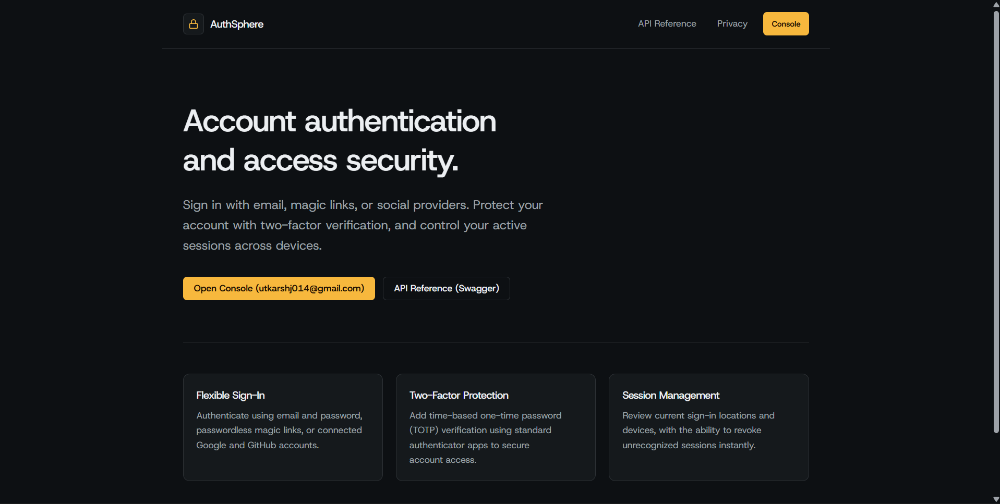
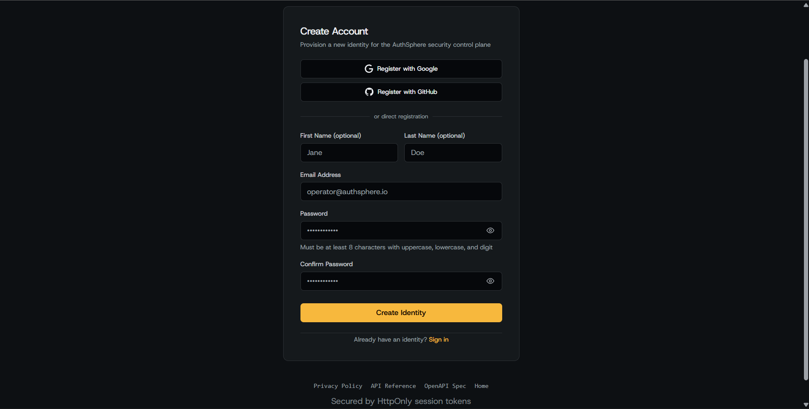
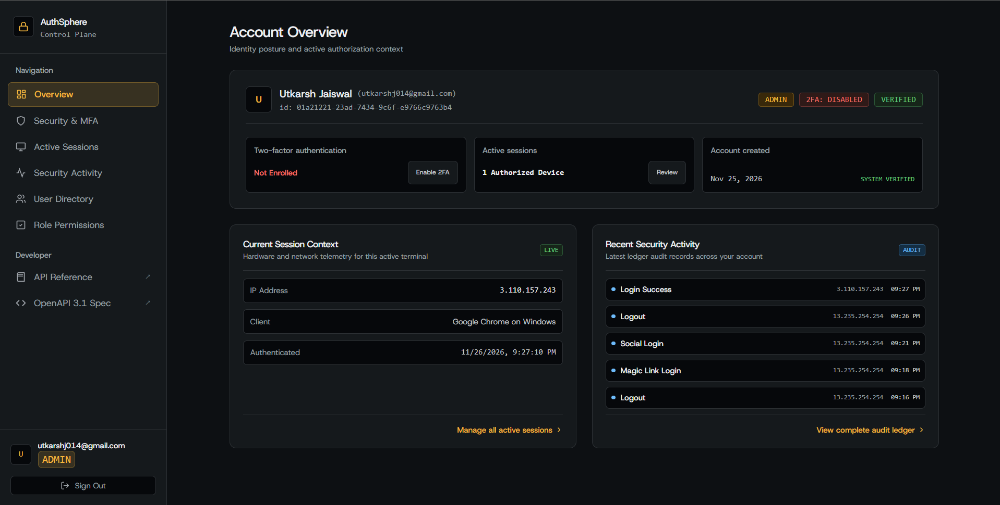
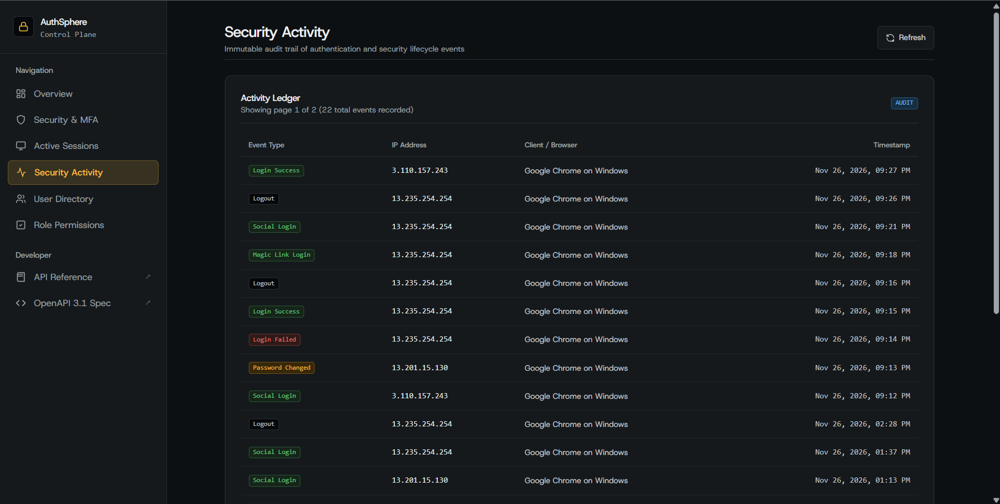
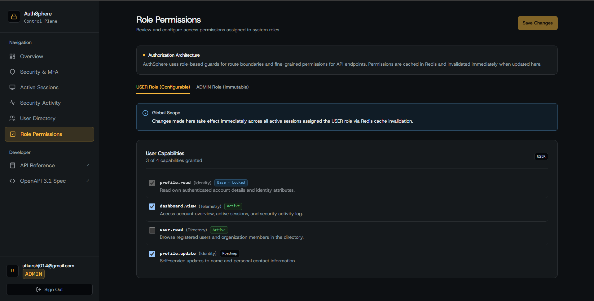
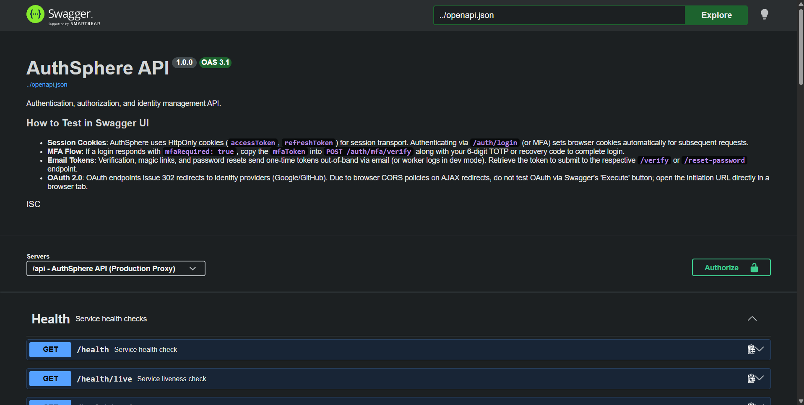

# AuthSphere

Authentication, RBAC authorization, and session-management platform built with Express 5, TypeScript, Prisma 7, PostgreSQL, Redis, and React 19.

---

## Core Capabilities

- **Authentication:** Email/password (Argon2id), passwordless magic links, Google & GitHub OAuth 2.0 (PKCE + `HttpOnly` MFA cookie handoff), and TOTP MFA with single-use recovery codes.
- **Sessions & Security:** `HttpOnly` JWT cookies, atomic refresh-token rotation with replay detection, per-browser session isolation with Redis revocation blacklisting, bounded active-session eviction, fixed-window rate limiting, and audit logs.
- **Authorization & API Contract:** Dynamic role permissions (`USER`, `ADMIN`) cached in Redis, OpenAPI 3.1 schema generation, and interactive Swagger UI (`/api/docs/`).
- **Deployment Targets:** Primary serverless deployment on AWS Lambda (Neon PostgreSQL + Upstash Redis + Vercel `/api/*` edge proxy), alongside AWS ECS Fargate container blueprints.

---

## Preview

|                            Landing Page                            |                      Account Registration & OAuth                      |
| :----------------------------------------------------------------: | :--------------------------------------------------------------------: |
|          |            |
|                        **Account Overview**                        |                      **Security Activity Ledger**                      |
|     |  |
|                  **Role & Permission Governance**                  |                      **Swagger UI (OpenAPI 3.1)**                      |
|  |   |

---

## Documentation ([`docs/`](./docs/))

- [System Architecture & Design](./docs/ARCHITECTURE.md) — Topology, data model (ERD), middleware pipeline, and auth flows.
- [Frontend Architecture & Control Plane](./docs/FRONTEND_ARCHITECTURE.md) — SPA shells, route guards, single-flight token refresh, and design tokens.
- [OAuth 2.0 Integration Guide](./docs/OAUTH.md) — PKCE flow, identity resolution matrix, linking, and security invariants.
- [Cloud Deployment & DevOps Guide](./docs/DEPLOYMENT.md) — Lambda/ECS compute topology, Neon & Upstash config, Vercel edge proxy, and CI/CD.
- [Testing & Verification Strategy](./docs/TESTING.md) — Hermetic test pyramid (unit, integration, E2E) and security invariant matrix.
- [Architecture Decision Records](./docs/Engineering-Decisions.md) — 111 documented architectural and security decisions (`ADR-001`–`ADR-111`).

---

## Repository Structure

```text
authsphere/
├── .github/workflows/  # CI and AWS dual-target deployment workflows
├── apps/
│   ├── api/            # Express 5 REST API, Lambda handler, BullMQ worker, Prisma 7 & tests
│   └── web/            # React 19 + Vite SPA & Vercel edge proxy config
├── packages/
│   └── shared/         # Shared domain constants (ROLES, PERMISSIONS) and types
├── docker/             # Local PostgreSQL 16 + Redis 8 compose configurations
├── infra/              # AWS Lambda SAM template and ECS Fargate task definitions
├── docs/               # Architecture docs, ADRs, testing/deployment guides & UI assets
└── Dockerfile          # Multi-stage production container image for ECS API & worker
```

---

## Quickstart

### Prerequisites

- **Node.js `24.x` (recommended, matches CI and Lambda `nodejs24.x`) or `25.x`** (declared in `engines`)
- **npm** (included with Node.js)
- **Docker & Docker Compose** (for local PostgreSQL and Redis)

### 1. Install Dependencies & Build Shared Package

```bash
npm install
npm run build:shared
```

### 2. Start Local Backing Services

```bash
# Local PostgreSQL 16 + Redis 8 (provisions both authsphere and authsphere_test)
docker compose -f docker/docker-compose.dev.yml up -d

# Or Redis only (when connecting to an existing local PostgreSQL instance)
# docker compose -f docker/docker-compose.infra.yml up -d
```

> **Automatic Test Database Provisioning:** `docker-compose.dev.yml` creates `authsphere` (`POSTGRES_DB`) and mounts [`docker/init-test-db.sql`](./docker/init-test-db.sql) to create `authsphere_test` on initial container volume creation. If reusing an existing Docker volume or native local PostgreSQL, ensure `authsphere_test` exists once (`psql -U postgres -c "CREATE DATABASE authsphere_test;"`).

### 3. Configure Environment Variables

```bash
cp apps/api/.env.example apps/api/.env
cp apps/web/.env.example apps/web/.env
```

### 4. Apply Database Migrations & Seed Baseline Roles

```bash
npm run db:migrate:dev -w @authsphere/api
npm run db:seed -w @authsphere/api
```

### 5. Run Development Servers

```bash
npm run dev:api      # Express API on :3000
npm run dev:web      # Vite React SPA on :5173 (proxies /api/* -> :3000)
npm run dev:worker   # Optional: BullMQ email worker when QUEUE_DRIVER=bullmq
```

### 6. Verification & Testing

```bash
npm run lint                                    # ESLint across workspaces
npm run typecheck                               # TypeScript checks across shared, api, and web
npm test -w @authsphere/api -- tests/unit/      # Pure in-memory unit tests (zero DB/Redis needed)
```

**Running the full test suite (`npm test`):**

```bash
cp apps/api/.env.test.example apps/api/.env.test   # Verify DATABASE_URL matches local PostgreSQL
npm run db:migrate:test -w @authsphere/api         # Deploys schema tables to authsphere_test
npm test                                           # Auto-seeds baseline roles & isolates DB/Redis state
```

For targeted layer commands, coverage, and troubleshooting, see [`docs/TESTING.md`](./docs/TESTING.md).
