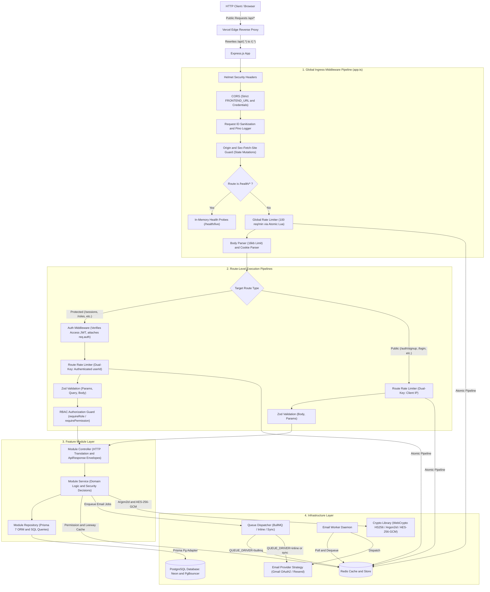
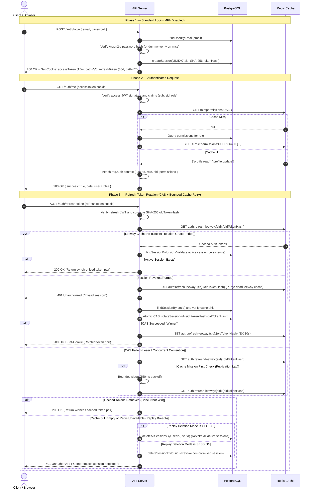
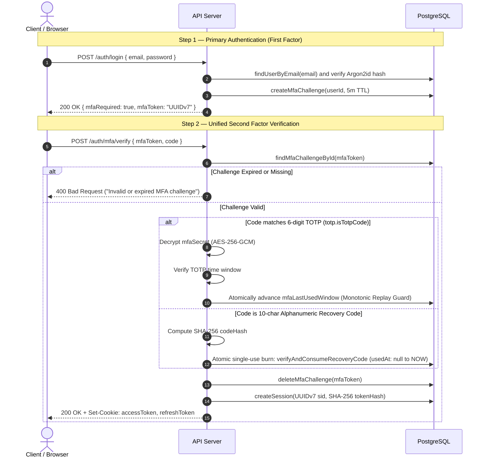
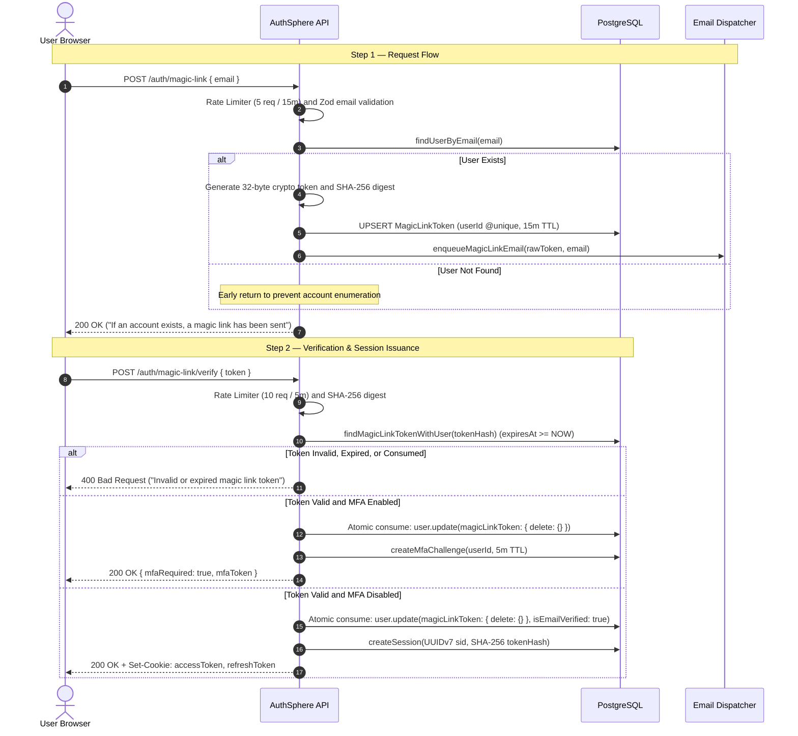
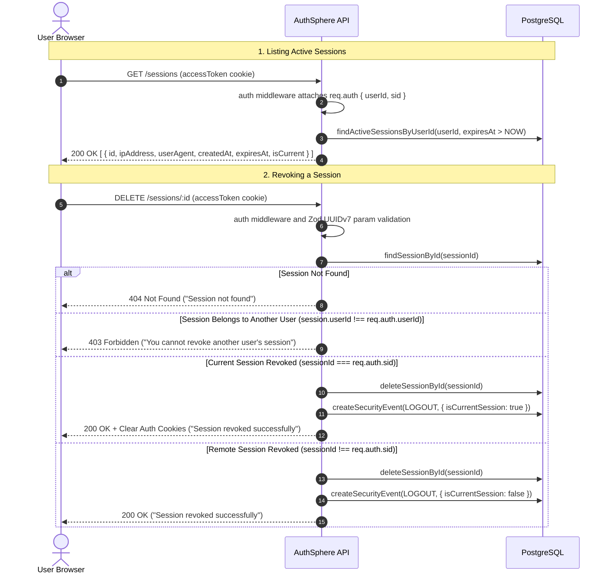
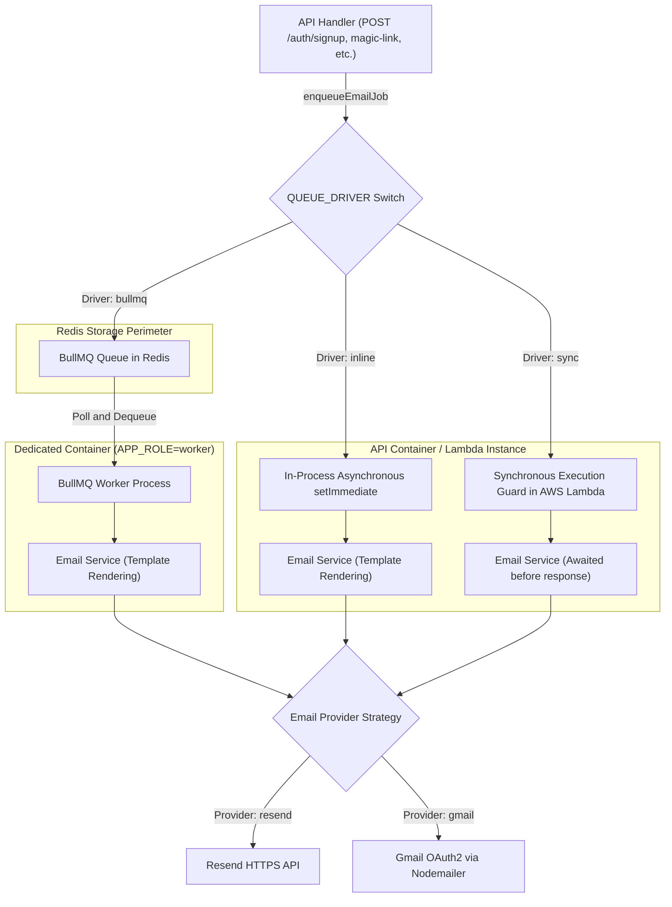
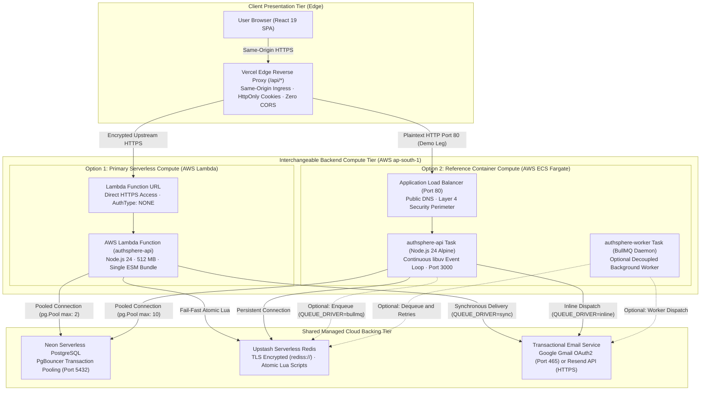
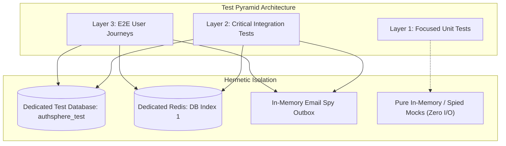

# Architecture & System Design — AuthSphere

This document provides a comprehensive overview of **AuthSphere's** system architecture, component interactions, data models, and core execution flows for an authentication and session-management platform with production-oriented security controls.

> **AuthSphere Architecture & Engineering Documentation Suite:**
>
> - [ARCHITECTURE.md](./ARCHITECTURE.md) — System Design, Component Topology & Core Data Models
> - [Engineering-Decisions.md](./Engineering-Decisions.md) — 98 Formal ADRs, Security Invariants & Technical Trade-offs
> - [OAUTH.md](./OAUTH.md) — OAuth 2.0 PKCE Social Authentication & Integration Protocols
> - [DEPLOYMENT.md](./DEPLOYMENT.md) — Cloud Infrastructure, Dual-Compute (Lambda/ECS) & Runbooks
> - [TESTING.md](./TESTING.md) — Hermetic Test Pyramid, Invariant Verification & CI Strategies

---

## 1. System Overview & Monorepo Architecture

AuthSphere is organized as a multi-package monorepo managed via npm workspaces:

```text
authsphere/ (Monorepo Root)
├── apps/
│   ├── api/                  # Express.js REST API service (Node.js >=24)
│   │   ├── prisma/           # Database schema, migrations, and seed script
│   │   └── src/
│   │       ├── common/       # Global errors, utilities, ApiResponse envelopes, OpenAPI registry
│   │       ├── config/       # Process-aware environment validation (env.ts)
│   │       ├── generated/    # Explicitly generated Prisma client
│   │       ├── lib/          # Singleton infrastructure clients (Prisma, Redis, Logger, Crypto, JWT, TOTP, Queue)
│   │       ├── middlewares/  # Security, tracing, origin guard, rate limiting, RBAC middlewares
│   │       ├── modules/      # Feature modules (auth, authorization, sessions, roles, users, health, email)
│   │       ├── types/        # Express ambient type declarations
│   │       ├── workers/      # Standalone background queue worker (email.worker.ts)
│   │       ├── app.ts        # Pure Express application setup
│   │       ├── server.ts     # HTTP server entrypoint (ECS Fargate container)
│   │       └── lambda.ts     # AWS Lambda serverless entrypoint (@codegenie/serverless-express)
│   └── web/                  # React & Vite frontend application
│       ├── vercel.ts         # Code-first edge reverse proxy configuration (@vercel/config/v1)
│       └── vite.config.ts    # Development reverse proxy configuration
├── packages/
│   └── shared/               # Shared domain constants (ROLES, PERMISSIONS, etc.) and TypeScript types
├── infra/                    # Infrastructure as Code
│   ├── ecs/                  # AWS ECS Task Definitions (API & Worker)
│   └── lambda/               # AWS SAM / CloudFormation Template & build scripts
├── docker/                   # Multi-container local orchestration (docker-compose.dev.yml, docker-compose.infra.yml)
└── Dockerfile                # Multi-stage production container build (base -> builder -> runner)
```

> **Related Architectural Decisions:** See [Architecture & Project Boundaries ADRs](./Engineering-Decisions.md#architecture--project-boundaries) for monorepo boundary principles and feature-based modular design.

---

## 2. Layered Component Architecture

HTTP requests traversing AuthSphere pass through a deterministic pipeline across distinct architectural boundaries. Global security and ingress middlewares run ahead of route matching, while protected endpoints evaluate authentication prior to user-keyed rate limiting and authorization guards:



### Layer Responsibilities

| Architectural Layer            | Primary Responsibility                                                                                                                                                                                                                        | Architectural Rule                                                                                                                                         |
| :----------------------------- | :-------------------------------------------------------------------------------------------------------------------------------------------------------------------------------------------------------------------------------------------- | :--------------------------------------------------------------------------------------------------------------------------------------------------------- |
| **Global Middleware Pipeline** | Request tracing, CORS validation, origin and `Sec-Fetch-Site` verification, health check bypass, global IP rate limiting, and deferred payload parsing (16kb limit).                                                                          | Rejects malformed, oversized, untrusted-origin, or rate-limited requests before JSON parsing or route matching.                                            |
| **Route Middleware Pipeline**  | JWT authentication, user-keyed vs IP-keyed rate limiting, multi-target Zod input validation, and RBAC authorization guards.                                                                                                                   | Enforces `auth -> rateLimiter -> validate -> requireRole/requirePermission`. Authentication runs ahead of user-keyed rate limits and authorization guards. |
| **Controller Layer**           | HTTP protocol translation, extracting pre-validated input, setting/clearing HTTP-only cookies, and returning standardized API response envelopes (`ApiResponse`: `{ success: boolean, message: string, data: T \| null, errors?: unknown }`). | Pure HTTP orchestration with zero business logic or direct database access. Delegates all state mutations to services.                                     |
| **Service Layer**              | Core authentication and session orchestration, password verification, cryptographic operations, MFA challenge resolution, session generation, and cache invalidation.                                                                         | Independent of Express `req`/`res`. Throws domain-specific `AppError` subclasses.                                                                          |
| **Repository Layer**           | Data persistence using Prisma 7 ORM with PostgreSQL adapter (`@prisma/adapter-pg` + `pg.Pool`). Translates database errors (e.g. `P2002` duplicate key) into domain errors.                                                                   | Encapsulates all database operations and transactions. No business logic.                                                                                  |
| **Infrastructure Layer**       | Singleton clients for PostgreSQL (`prisma`), Redis (`ioredis`), Logging (`pino`), and background email delivery (`emailQueue` / `emailService`).                                                                                              | Singletons instantiated in `src/lib/`. Decoupled from application framework.                                                                               |

> **Related Architectural Decisions:** See [Validation, Middleware & Authorization ADRs](./Engineering-Decisions.md#validation-middleware--authorization) for pipeline ordering, Zod validation contracts, and rate limiting policies.

---

## 3. Data Architecture & Entity-Relationship Model

AuthSphere models user identity, active sessions, multi-factor authentication, role-based permissions, OAuth federated accounts, and security audit events across 12 Prisma models:

```mermaid
erDiagram
    User ||--o{ Session : "holds active"
    User ||--o| EmailVerificationToken : "has pending"
    User ||--o| PasswordResetToken : "has pending"
    User ||--o{ MfaRecoveryCode : "owns"
    User ||--o{ MfaChallenge : "has pending"
    User ||--o{ OAuthAccount : "federated with"
    User ||--o| MagicLinkToken : "has pending"
    User ||--o{ SecurityEvent : "audited by"
    User }|--|| Role : "assigned"
    Role ||--o{ RolePermission : "contains"
    Permission ||--o{ RolePermission : "granted to"

    User {
        string id PK "UUIDv7"
        string email UK "Normalized lowercase"
        string passwordHash "Argon2id (Null for pure social)"
        boolean isEmailVerified "Default false"
        string firstName "Nullable"
        string lastName "Nullable"
        string roleId FK "onDelete: Restrict"
        datetime lastLoginAt "Nullable"
        datetime verifiedAt "Nullable"
        datetime passwordChangedAt "Nullable"
        boolean mfaEnabled "Default false"
        string mfaSecret "AES-256-GCM Encrypted"
        int mfaLastUsedWindow "Monotonic Window Index"
        datetime createdAt
        datetime updatedAt
    }

    Role {
        string id PK "UUIDv7"
        enum name UK "USER | ADMIN"
        string description "Nullable"
        datetime createdAt
        datetime updatedAt
    }

    Permission {
        string id PK "UUIDv7"
        string name UK "e.g. user.read"
        string description "Nullable"
        datetime createdAt
        datetime updatedAt
    }

    RolePermission {
        string roleId PK,FK "onDelete: Cascade"
        string permissionId PK,FK "onDelete: Cascade"
    }

    Session {
        string id PK "UUIDv7"
        string userId FK "onDelete: Cascade"
        string tokenHash UK "SHA-256 Digest"
        string ipAddress "Nullable"
        string userAgent "Nullable"
        datetime expiresAt "Indexed"
        datetime createdAt
    }

    EmailVerificationToken {
        string id PK "UUIDv7"
        string userId UK,FK "onDelete: Cascade"
        string tokenHash UK "SHA-256 Digest"
        datetime expiresAt "Indexed"
        datetime createdAt
    }

    PasswordResetToken {
        string id PK "UUIDv7"
        string userId UK,FK "onDelete: Cascade"
        string tokenHash UK "SHA-256 Digest"
        datetime expiresAt "Indexed"
        datetime createdAt
    }

    MfaRecoveryCode {
        string id PK "UUIDv7"
        string userId FK "onDelete: Cascade"
        string codeHash UK "SHA-256 Digest"
        datetime usedAt "Nullable"
        datetime createdAt
    }

    MfaChallenge {
        string id PK "UUIDv7"
        string userId FK "onDelete: Cascade"
        datetime expiresAt "Indexed (5m TTL)"
        datetime createdAt
    }

    OAuthAccount {
        string id PK "UUIDv7"
        string userId FK "onDelete: Cascade"
        enum provider "GOOGLE | GITHUB"
        string providerId "External Sub/ID"
        datetime createdAt
        datetime updatedAt
    }

    MagicLinkToken {
        string id PK "UUIDv7"
        string userId UK,FK "onDelete: Cascade"
        string tokenHash UK "SHA-256 Digest"
        datetime expiresAt "Indexed (15m TTL)"
        datetime createdAt
    }

    SecurityEvent {
        string id PK "UUIDv7"
        string userId FK "onDelete: Cascade"
        enum type "LOGIN_SUCCESS | LOGOUT | MFA_..."
        string ipAddress "Nullable"
        string userAgent "Nullable"
        json metadata "Nullable audit context"
        datetime createdAt "Indexed desc with userId"
    }
```



### Relational & Key Invariants

1. **Universal UUIDv7 Primary Keys & Composite Join Keys:** AuthSphere defines 12 Prisma models. All 11 independent database entities (`User`, `Role`, `Permission`, `Session`, `EmailVerificationToken`, `PasswordResetToken`, `MfaRecoveryCode`, `MfaChallenge`, `OAuthAccount`, `MagicLinkToken`, and `SecurityEvent`) use time-ordered UUIDv7 identifiers (`@default(uuid(7))`). UUIDv7 embeds a 48-bit Unix millisecond timestamp in the high bits, ensuring sequential B-tree index insertion locality and minimizing page splits while providing cryptographically random entropy to prevent ID enumeration. The 12th model, `RolePermission`, is a relational join entity utilizing a composite primary key (`@@id([roleId, permissionId])`).
2. **Explicit Deletion Cascade Policy:** Deleting a `User` cascades to all user-owned dependent entities (`Session`, `EmailVerificationToken`, `PasswordResetToken`, `MfaRecoveryCode`, `MfaChallenge`, `OAuthAccount`, `MagicLinkToken`, and `SecurityEvent`). Conversely, `User.roleId` enforces `onDelete: Restrict` to prevent accidental deletion of assigned roles. Deleting `SecurityEvent` records on account purge represents a deliberate operational audit-retention trade-off.
3. **PostgreSQL Token Persistence:** Relational persistence in PostgreSQL stores exclusively one-way cryptographic SHA-256 digests (`tokenHash`, `codeHash`). Raw verification and magic link tokens are never written in plaintext to the PostgreSQL database. Note that raw tokens transit Redis in job payloads during BullMQ email queue delivery; whether these payloads touch disk depends on the underlying Redis snapshotting/append-only file configuration (RDB/AOF), so disk-level persistence guarantees apply strictly to the PostgreSQL database.

> **Related Architectural Decisions:** See [Data Access, ORM & Transactions ADRs](./Engineering-Decisions.md#data-access-orm--transactions) for UUIDv7 selection rationale, foreign key cascade policies, and unique constraint error handling.

---

## 4. End-to-End Core System Flows

### 4.1 Primary Authentication & Token Refresh Flow

The standard authentication lifecycle pairs short-lived access JWTs with database-backed refresh tokens governed by atomic Compare-And-Swap (CAS) rotation and an ephemeral Redis leeway cache:



> **Related Architectural Decisions:** See [Authentication & Session Management ADRs](./Engineering-Decisions.md#authentication--session-management) for token rotation invariants, CAS concurrency semantics, and replay scope policies.

---

### 4.2 Multi-Factor Authentication (MFA) & Ephemeral Challenge Flow

When MFA is enabled on an account, primary credential verification yields an ephemeral 5-minute challenge token (`mfaToken`) instead of active session cookies, withholding session issuance until the second factor succeeds:



> **Related Architectural Decisions:** See [Multi-Factor Authentication ADRs](./Engineering-Decisions.md#multi-factor-authentication-mfa) for symmetric secret encryption, monotonic replay windows, and polymorphic TOTP vs recovery code resolution.

---

### 4.3 OAuth 2.0 PKCE & Identity Resolution Architecture

AuthSphere acts strictly as an **OAuth 2.0 Client** using the **Authorization Code Flow with PKCE (RFC 7636 / RFC 9700)**, enabling federated social authentication and account linking across external identity providers (Google and GitHub):

- **Protocol Standard:** Implements the OAuth 2.0 Authorization Code Grant with Proof Key for Code Exchange (RFC 7636 / RFC 9700 PKCE using `S256`).
- **Cryptographic Binding:** The 32-byte code verifier is stored in a browser-bound, per-transaction HttpOnly cookie (`oauth_verifier_<state>`) scoped to `/api/auth/oauth` with a 10-minute TTL, isolating multi-tab authentication flows.
- **Atomic Single-Use State:** Random 32-byte CSRF state tokens are cached in Redis (`oauth:state:<state>`, 600s TTL) and consumed atomically via `GETDEL` upon callback processing to prevent replay attacks.
- **Pre-Resolution Session Gate:** If initiating linking from an authenticated state, AuthSphere validates the active session in PostgreSQL before token exchange; revoked or invalid sessions fail immediately with `401 Unauthorized`.
- **Anti-Account Takeover Guard:** Unauthenticated OAuth logins attempting to claim an existing local password-registered email are rejected with `409 Conflict`, requiring password verification before linking.
- **Provider Normalization & Trust Boundary:** User profiles are retrieved over authenticated TLS (Google via authenticated UserInfo endpoint over TLS without local ID-token signature validation against JWKS; GitHub via user emails API) and normalized into unified identity records.

For complete end-to-end sequence flows, provider attribute matrices, security invariants, and curl test scripts, refer to the authoritative specification in [OAUTH.md](./OAUTH.md).

> **Related Architectural Decisions:** See [Security, Cryptography & Credentials ADRs](./Engineering-Decisions.md#security-cryptography--credentials) for OAuth strategy patterns, atomic state invalidation, and conflict-guarded identity workflows.

---

### 4.4 Passwordless Magic Link Authentication Flow

Magic link authentication provides enumeration-safe token generation with single-use atomic consumption:



> **Related Architectural Decisions:** See [Security, Cryptography & Credentials ADRs](./Engineering-Decisions.md#security-cryptography--credentials) for silent enumeration-safe returns and 1-to-1 token lifecycle guarantees.

---

### 4.5 Active Session Management & Revocation Flow

Users can inspect active login sessions across devices and revoke individual remote sessions or perform global revocation:



> **Related Architectural Decisions:** See [Authentication & Session Management ADRs](./Engineering-Decisions.md#authentication--session-management) for hard-deletion strategies and ownership-enforced revocation.

---

### 4.6 Outbound Email Dispatch Architecture (Tri-Driver Queue)

Outbound email delivery is decoupled from the synchronous HTTP request-response cycle via a configurable tri-driver queue architecture:



| Queue Driver | Runtime Environment                    | Delivery Characteristics                                                                                      | Failure & Retry Semantics                                                                                                     |
| :----------- | :------------------------------------- | :------------------------------------------------------------------------------------------------------------ | :---------------------------------------------------------------------------------------------------------------------------- |
| **`bullmq`** | AWS ECS Fargate / Clustered Containers | Asynchronous background offload. Completely isolates HTTP response latency from email transit.                | Up to 4 exponential retries across 5 total attempts. Failed jobs retained in dead-letter storage. Requires `APP_ROLE=worker`. |
| **`inline`** | Single-Container / Development / Demos | Asynchronous event-loop offload via `setImmediate()`. Eliminates Redis command overhead on serverless tiers.  | Ephemeral in-process execution. Jobs may be lost on unexpected container termination.                                         |
| **`sync`**   | AWS Lambda (`isLambdaRuntime`)         | Awaits email dispatch in-band before completing the Lambda handler invocation to prevent mid-flight freezing. | Bounded by Lambda invocation timeout. Delivery remains subject to network timeouts and provider errors.                       |

> **Related Architectural Decisions:** See [Observability, Reliability & Operations ADRs](./Engineering-Decisions.md#observability-reliability--operations) for queue driver migration, Lambda runtime guards, and failed-job retention policies.

---

## 5. Security & Ingress Architecture

### 5.1 Cryptographic & Credential Security Profile

| Security Domain           | Architectural Mechanism                                              | Implementation Details                                                                                                                                                                                        |
| :------------------------ | :------------------------------------------------------------------- | :------------------------------------------------------------------------------------------------------------------------------------------------------------------------------------------------------------ |
| **Password Hashing**      | Argon2id with chosen benchmarked parameters                          | Parameters: 64MB memory, 3 iterations, degree of parallelism 4. Mitigates login timing differences via pre-computed dummy verification on non-existent accounts.                                              |
| **Secret Isolation**      | Dual-secret separation (`JWT_ACCESS_SECRET` vs `JWT_REFRESH_SECRET`) | Completely partitions cryptographic keys. Access tokens use short 15-minute TTLs with dynamic permission evaluation. Access secret compromise cannot forge 30-day refresh tokens or hijack database sessions. |
| **MFA Secret Encryption** | AES-256-GCM authenticated encryption at rest                         | Secrets encrypted before storage (`ivHex:authTagHex:ciphertextHex`). 32-byte key derived from `env.MFA_ENCRYPTION_KEY` using SHA-256.                                                                         |
| **Replay Protection**     | Monotonic integer window indexing                                    | Tracks `mfaLastUsedWindow` in PostgreSQL to reject TOTP re-submissions within the active 30s window and locks out preceding time steps. Single-use hashed backup recovery codes (`XXXXX-XXXXX`).              |
| **Token Cryptography**    | Native WebCrypto JOSE (HS256)                                        | Pinned to HMAC-SHA256 (`HS256`) via WebCrypto JOSE, avoiding native C++ bindings for portability across Node.js and AWS Lambda.                                                                               |

### 5.2 Ingress, Proxy & Anti-Abuse Controls

1. **Reverse Proxy Parity & Root Cookie Scoping:**
   - **Production Edge Proxy:** Configured via code-first TypeScript specification (`apps/web/vercel.ts` using `@vercel/config/v1`), rewriting `/api/:path*` to the backend. Browsers communicate strictly same-origin (`/api/*`), preserving `SameSite=Lax` cookies and eliminating CORS preflights.
   - **Development Proxy Parity:** Vite dev server mirrors the `/api` reverse proxy route identically.
   - **Root Cookie Scoping:** Authentication cookies are scoped to root `path: "/"` to ensure uniform delivery across proxy rewrites.
2. **Proxy Trust & Client IP Resolution:**
   - `TRUST_PROXY` environment variable validated and type-coerced at startup via Zod.
   - Client IP resolution relies on Express `req.ip` (`proxy-addr`), treating client attribution and IP rate limiting as proxy-derived under the ingress topology.
3. **Resource Isolation & Origin Validation:**
   - Evaluates all state-changing HTTP requests (`POST`, `PUT`, `PATCH`, `DELETE`) using browser `Sec-Fetch-Site` metadata paired with normalized `Origin`/`Referer` header checking against `env.FRONTEND_URL`.
   - Fast-paths `same-origin`/`same-site` requests, blocks explicit `cross-site` mutations from untrusted origins, and rejects opaque `Origin: "null"` sandboxed iframe requests.
4. **Multi-Tiered Atomic Lua Rate Limiting:**
   - Redis-backed rate limiting using an atomic Lua script (`INCR` + conditional `EXPIRE` in 1 command via `redis.eval`), reducing Redis roundtrips by 75%.
   - Centralized `RATE_LIMIT_POLICIES` dictionary defines per-endpoint quotas. Dual-key strategy uses IP for unauthenticated routes and `userId` for authenticated routes.
   - Fail-open resilience: Redis connectivity blips bypass rate limiting transparently rather than blocking legitimate traffic.
5. **Process-Aware Environment Partitioning:**
   - Configuration schemas partition validation into `sharedConfig`, `apiConfig`, and `workerConfig` based on `APP_ROLE: api | worker`, preventing code from referencing unvalidated cross-role variables, while deployment pipelines inject only required secrets per task definition.

> **Related Architectural Decisions:** See [Security, Cryptography & Credentials ADRs](./Engineering-Decisions.md#security-cryptography--credentials) and [Validation, Middleware & Authorization ADRs](./Engineering-Decisions.md#validation-middleware--authorization) for complete cryptographic profiles, origin guards, and rate limiting specifications.

---

## 6. Infrastructure & Deployment Architecture

AuthSphere implements a **Shared Backing State, Interchangeable Compute** model. Both serverless (AWS Lambda) and containerized (AWS ECS Fargate) compute targets compile from a single TypeScript codebase and run against the exact same managed cloud backing tier:



### Key Infrastructure Invariants

1. **Dual Database Connections:** Migrations require session-scoped advisory locks (`pg_advisory_lock`) that transaction poolers do not support. CI/CD pipelines connect directly (`DATABASE_URL_DIRECT`). Runtime compute (API, Worker, Lambda) connects exclusively through the PgBouncer transaction pooler (`DATABASE_URL_POOLED` mapped to `DATABASE_URL`) with bounded socket limits (Lambda max 2, ECS max 10).
2. **Deterministic Release Sequencing:** The CI/CD release pipeline executes strictly in order: **validate -> build/package artifact -> direct database migrations -> deploy -> automated smoke test** (`/health/live`, `/health/ready`). Artifacts are built and validated before migrations touch the database schema.
3. **Container & Serverless Deployment Mechanisms:**
   - **AWS Lambda Deployments:** Compiled via `tsup` into a single tree-shaken ESM bundle (`lambda.mjs`) externalizing native C++ bindings (`argon2`), packaged with `@codegenie/serverless-express`, and deployed via AWS SAM (`sam deploy` using `template.yaml`).
   - **AWS ECS Deployments:** Multi-stage Docker image built and pushed to GitHub Container Registry (GHCR), dynamically rendered via `aws-actions/amazon-ecs-render-task-definition@v1`, and deployed via `aws-actions/amazon-ecs-deploy-task-definition@v2`.
4. **Hardened Container Runtime:** Containers run as non-root `USER node` with `dumb-init` as PID 1 to proxy signals and reap zombie child processes, bounding request draining to a 10-second graceful window.
5. **Decoupled Health Probes:** Decouples process liveness (`/health/live`, zero-I/O in-memory probe for load balancers) from dependency readiness (`/health/ready`, concurrent evaluation of PostgreSQL and Redis), preventing cascading service deregulation during temporary dependency blips.

For complete cloud configurations, SAM templates, task definitions, migration commands, and operational runbooks, refer to [DEPLOYMENT.md](./DEPLOYMENT.md).

> **Related Architectural Decisions:** See [Observability, Reliability & Operations ADRs](./Engineering-Decisions.md#observability-reliability--operations) for dual-database pooling strategy, container signal handling, and release pipeline sequencing.

---

## 7. Testing Architecture & Invariant Verification

AuthSphere enforces a hermetic, 3-layer test pyramid combining **Vitest** and **Supertest** to verify all system boundaries and security invariants without external network dependencies:



### Verification Philosophy

- **Layer 1: Focused Unit Tests (Zero I/O):** Pure in-memory verification of cryptographic primitives (Argon2id, AES-256-GCM, HMAC), TOTP RFC 6238 window stepping, Zod input sanitization, OpenAPI 3.1 router parity, email template rendering, BullMQ enqueue semantics, and the deterministic ADR-076 CAS vs. Redis race condition state machine (verified hermetically via method spies in `refresh-token-race.test.ts`).
- **Layer 2: Critical Integration Tests (Database & Redis DB 1):** Full-stack HTTP request lifecycles across registration, login, MFA challenge/verify/disable, OAuth strategies, active sessions, RBAC guards, rate limits, error envelopes, the live ADR-076 rotation race window, and Redis fail-open degradation (in `auth.test.ts`).
- **Layer 3: Stateful E2E User Journeys:** Multi-step workflows verifying the complete auth lifecycle (signup -> verify -> login -> refresh -> logout), multi-device session revocation, and administrative privilege elevation and demotion.
- **Deterministic Controls:** Test suites run with `fileParallelism: false` to eliminate database contention. `cleanTestState()` performs cascade truncations on user tables and flushes Redis DB 1 between tests while preserving baseline roles and permissions. Outbound emails are captured via in-memory spies with zero network calls.

For complete test execution commands, coverage thresholds, and hermetic setup patterns, refer to [TESTING.md](./TESTING.md).

> **Related Architectural Decisions:** See [Testing, Quality & Security Invariants ADRs](./Engineering-Decisions.md#testing-quality--security-invariants) for test pyramid specifications and deterministic test environment isolation.
