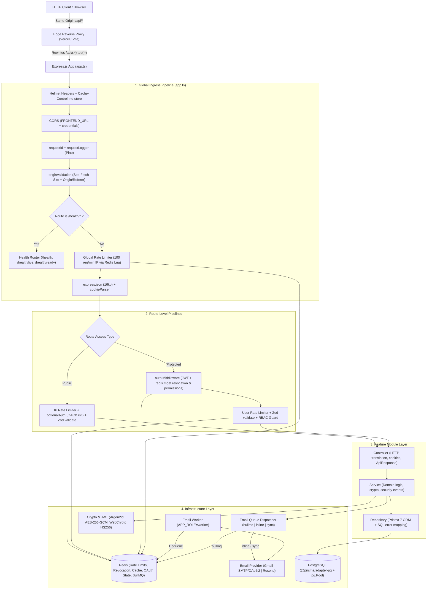
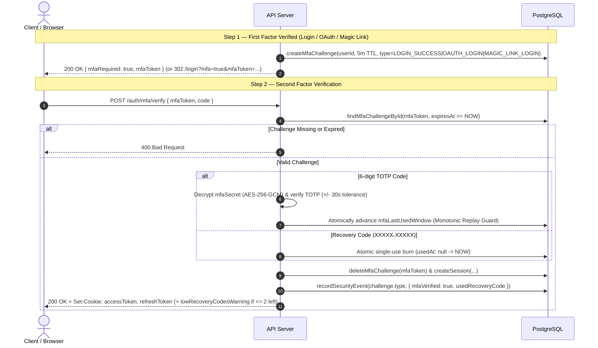
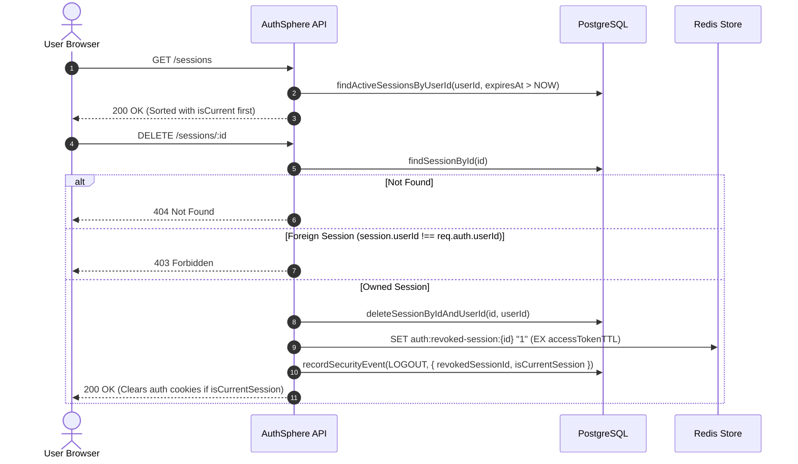

# Architecture & System Design — AuthSphere

This document is the Single Source of Truth (SSOT) for **AuthSphere's** monorepo/backend layered architecture, Canonical Route Inventory & OpenAPI 3.1 Registry, rate limit tiers, Prisma ER data model, and core backend execution lifecycles.

> **AuthSphere Architecture & Engineering Documentation Suite:**
>
> - [ARCHITECTURE.md](./ARCHITECTURE.md) — System Design, Component Topology & Core Data Models
> - [FRONTEND_ARCHITECTURE.md](./FRONTEND_ARCHITECTURE.md) — Frontend Architecture, Component Topology & Control Plane
> - [Engineering-Decisions.md](./Engineering-Decisions.md) — 107 Formal ADRs, Security Invariants & Technical Trade-offs
> - [OAUTH.md](./OAUTH.md) — OAuth 2.0 PKCE Social Authentication & Integration Protocols
> - [DEPLOYMENT.md](./DEPLOYMENT.md) — Cloud Infrastructure, Dual-Compute (Lambda/ECS) & Runbooks
> - [TESTING.md](./TESTING.md) — Hermetic Test Pyramid, Invariant Verification & CI Strategies

---

## 1. System Overview & Monorepo Architecture

AuthSphere is organized as an npm workspaces monorepo separating the backend API/worker runtime, frontend SPA, shared domain contracts, and infrastructure definitions:

```text
authsphere/ (Monorepo Root)
├── apps/
│   ├── api/                  # Express.js REST API & background worker (Node.js >=24)
│   │   ├── prisma/           # Prisma schema, SQL migrations, and seed script
│   │   └── src/
│   │       ├── common/       # Global errors, utilities, ApiResponse envelopes, OpenAPI registry
│   │       ├── config/       # Process-aware environment validation (env.ts)
│   │       ├── generated/    # Explicitly generated Prisma client
│   │       ├── lib/          # Singleton infrastructure clients (Prisma, Redis, Logger, Crypto, JWT, TOTP, Queue)
│   │       ├── middlewares/  # Security, tracing, origin guard, rate limiting, auth, validation middlewares
│   │       ├── modules/      # Feature modules (auth, authorization, sessions, roles, users, health, email)
│   │       ├── types/        # Express ambient type declarations
│   │       ├── workers/      # Standalone BullMQ email worker entrypoint (email.worker.ts)
│   │       ├── app.ts        # Pure Express application setup
│   │       ├── server.ts     # HTTP server entrypoint (containerized runtime)
│   │       └── lambda.ts     # AWS Lambda serverless entrypoint (@codegenie/serverless-express)
│   └── web/                  # React & Vite SPA (see FRONTEND_ARCHITECTURE.md)
│       ├── vercel.ts         # Code-first edge reverse proxy configuration (@vercel/config/v1)
│       └── vite.config.ts    # Development reverse proxy configuration
├── packages/
│   └── shared/               # Shared domain constants (ROLES, PERMISSIONS, OAUTH_PROVIDERS, SECURITY_EVENT_TYPES) & TS types
├── infra/                    # Infrastructure as Code (ecs/ task definitions, lambda/ SAM template)
├── docker/                   # Local orchestration (docker-compose.dev.yml, docker-compose.infra.yml)
└── Dockerfile                # Multi-stage production container build (base -> builder -> runner)
```

> **Related ADRs:** See [Architecture & Project Boundaries](./Engineering-Decisions.md#architecture--project-boundaries) for monorepo boundary principles and feature-based modular design.

---

## 2. Layered Component Architecture

HTTP requests pass through a deterministic ingress pipeline in `apps/api/src/app.ts`, followed by route-specific authentication, rate-limiting, validation, and authorization guards:



### Layer Responsibilities

| Architectural Layer            | Primary Responsibility                                                                                                                                                                                          | Architectural Rule                                                                                                                                                                                                                                                        |
| :----------------------------- | :-------------------------------------------------------------------------------------------------------------------------------------------------------------------------------------------------------------- | :------------------------------------------------------------------------------------------------------------------------------------------------------------------------------------------------------------------------------------------------------------------------ |
| **Global Middleware Pipeline** | Proxy trust (`TRUST_PROXY`), Helmet headers, `Cache-Control: no-store`, CORS, sanitized `X-Request-Id`, Pino logging, origin validation, `/health` bypass, global IP limit, body parsing.                       | Rejects untrusted-origin or flooded requests before JSON parsing (`16kb` limit) or feature routing. `openApiRouter` (`/openapi.json`, `/docs`) uses `no-cache`.                                                                                                           |
| **Route Middleware Pipeline**  | JWT authentication (`auth` / `optionalAuth`), dual-key rate limiting, multi-target Zod validation (`body`, `params`, `query`), and RBAC guards (`requireRole`, `requirePermission`, `requireSelfOrPermission`). | On protected routes, `auth` always precedes `rateLimiter` so `userId` keys are populated. Permission guards precede `rateLimiter` on `GET /auth/security-events` and `GET /users`; role/self guards follow `validate` on `/users/:id`, `/users/:id/role`, and `/roles/*`. |
| **Controller Layer**           | Extracts validated inputs, manages `HttpOnly` cookies, and serializes envelopes (`ApiResponse.success`: `{ success: true, message, data }`; `errorHandler`: `{ success: false, message, errors? }`).            | Pure HTTP translation with zero business logic or direct database access. `UnauthorizedError` automatically clears the `accessToken` cookie in `errorHandler`.                                                                                                            |
| **Service Layer**              | Authentication orchestration, password/MFA verification, session rotation, permission caching, and audit event recording.                                                                                       | Framework-independent; throws `AppError` subclasses.                                                                                                                                                                                                                      |
| **Repository Layer**           | Data persistence via Prisma 7 ORM (`@prisma/adapter-pg` + `pg.Pool`) and translation of Prisma error codes (`P2002`, `P2025`) to domain errors.                                                                 | Encapsulates all queries and interactive transactions (`$transaction`).                                                                                                                                                                                                   |
| **Infrastructure Layer**       | Singleton clients (`prisma`, `redis`, `logger`, `emailQueue`) and cryptographic/JWT utilities in `apps/api/src/lib/`.                                                                                           | Decoupled from Express handlers; bounded timeouts for serverless safety.                                                                                                                                                                                                  |

> **Related ADRs:** See [Validation, Middleware & Authorization](./Engineering-Decisions.md#validation-middleware--authorization) for pipeline ordering, Zod contracts, and OpenAPI parity.

### 2.1 Canonical Route Inventory & OpenAPI 3.1 Operation Registry (34 Operations)

AuthSphere enforces strict 1:1 bidirectional parity (`apps/api/tests/unit/openapi.test.ts`) between mounted Express routers and the code-first OpenAPI 3.1 document (`[ADR-071]`), exposing **34 operations** across 5 feature modules (plus `/openapi.json` and `/docs` mounted via `openApiRouter`):

| Module       | Method   | Route Path                            | Access / Authorization Guards                             | Rate Limit Policy                             | Operation Summary & Egress Contract                                                                                                           |
| :----------- | :------- | :------------------------------------ | :-------------------------------------------------------- | :-------------------------------------------- | :-------------------------------------------------------------------------------------------------------------------------------------------- |
| **Health**   | `GET`    | `/health`                             | Public                                                    | None                                          | Root alias liveness probe; returns `LivenessData` (`status: "UP"`).                                                                           |
| **Health**   | `GET`    | `/health/live`                        | Public                                                    | None                                          | Zero-I/O in-memory liveness probe; returns `LivenessData`.                                                                                    |
| **Health**   | `GET`    | `/health/ready`                       | Public                                                    | `HEALTH` (60/1m, IP)                          | Concurrent PostgreSQL + Redis readiness probe; returns `ReadinessData` (`200` or `503`).                                                      |
| **Auth**     | `POST`   | `/auth/signup`                        | Public                                                    | `SIGNUP` (5/15m, IP)                          | Creates unverified user (Argon2id), stores SHA-256 verification token (24h), enqueues verification email (`201`).                             |
| **Auth**     | `POST`   | `/auth/verify-email`                  | Public                                                    | `VERIFY_EMAIL` (10/5m, IP)                    | Consumes verification token; sets `isEmailVerified` and `verifiedAt` (idempotent if already verified).                                        |
| **Auth**     | `POST`   | `/auth/resend-verification`           | Public                                                    | `RESEND_VERIFICATION` (5/15m, IP)             | Upserts verification token and enqueues email; enumeration-safe silent `200` on missing/verified email.                                       |
| **Auth**     | `POST`   | `/auth/login`                         | Public                                                    | `LOGIN` (10/1m, IP)                           | Verifies password (dummy hash on miss); issues `accessToken` + `refreshToken` cookies, or `mfaRequired` 5m `mfaToken`.                        |
| **Auth**     | `POST`   | `/auth/refresh-token`                 | Public _(Refresh Cookie)_                                 | `REFRESH_TOKEN` (30/1m, IP)                   | Atomic CAS refresh rotation with Redis leeway grace cache (`AUTH_REFRESH_TOKEN_LEEWAY_SECONDS`); revokes on reuse.                            |
| **Auth**     | `POST`   | `/auth/logout`                        | Public _(Refresh Cookie)_                                 | None                                          | Deletes session, writes `auth:revoked-session:{sid}` to Redis, clears auth cookies, records `LOGOUT`.                                         |
| **Auth**     | `POST`   | `/auth/logout-all`                    | Protected (`auth`)                                        | None                                          | Deletes all user sessions, writes `auth:user-revoked-at:{userId}`, clears auth cookies, records `LOGOUT`.                                     |
| **Auth**     | `GET`    | `/auth/me`                            | Protected (`auth`)                                        | None                                          | Returns sanitized `CurrentUserProfile` (`permissions`, `mfaEnabled`, `hasPassword`, `oauthProviders`, `remainingRecoveryCodes?`) `[ADR-101]`. |
| **Auth**     | `POST`   | `/auth/forgot-password`               | Public                                                    | `FORGOT_PASSWORD` (5/15m, IP)                 | Enqueues 24h reset token email (or social-login reminder if `!passwordHash`); enumeration-safe silent `200`.                                  |
| **Auth**     | `POST`   | `/auth/reset-password`                | Public                                                    | `RESET_PASSWORD` (10/5m, IP)                  | Resets password via token; requires TOTP/recovery `code` if MFA enabled; revokes sessions + sets `auth:user-revoked-at`.                      |
| **Auth**     | `POST`   | `/auth/change-password`               | Protected (`auth`)                                        | `CHANGE_PASSWORD` (5/15m, User)               | Updates password (or sets initial password if `!passwordHash`); requires MFA `code` if enabled; revokes sessions and clears auth cookies.     |
| **Auth**     | `POST`   | `/auth/mfa/setup`                     | Protected (`auth`)                                        | `MFA_VERIFY_SETUP` (5/5m, User)               | Generates Base32 TOTP secret, encrypts via AES-256-GCM, returns `secret` and `otpauthUri`.                                                    |
| **Auth**     | `POST`   | `/auth/mfa/verify-setup`              | Protected (`auth`)                                        | `MFA_VERIFY_SETUP` (5/5m, User)               | Verifies 6-digit TOTP code, enables MFA, stores hashed recovery codes, returns 10 single-use `XXXXX-XXXXX` recovery codes.                    |
| **Auth**     | `POST`   | `/auth/mfa/verify`                    | Public                                                    | `MFA_VERIFY` (10/1m, IP)                      | Completes `mfaToken` challenge with TOTP or recovery code; issues session cookies; warns when `remainingRecoveryCodes <= 2`.                  |
| **Auth**     | `POST`   | `/auth/mfa/disable`                   | Protected (`auth`)                                        | `MFA_DISABLE` (5/15m, User)                   | Verifies TOTP or recovery `code`; clears `mfaSecret`, deletes recovery codes/challenges, revokes all sessions, clears cookies.                |
| **Auth**     | `POST`   | `/auth/mfa/regenerate-recovery-codes` | Protected (`auth`)                                        | `MFA_REGENERATE_RECOVERY_CODES` (5/15m, User) | Verifies TOTP or recovery `code`; replaces existing recovery codes with a fresh set of 10 hashed codes.                                       |
| **Auth**     | `POST`   | `/auth/magic-link`                    | Public                                                    | `MAGIC_LINK_REQUEST` (5/15m, IP)              | Upserts 15m SHA-256 magic link token and enqueues email; enumeration-safe silent `200`.                                                       |
| **Auth**     | `POST`   | `/auth/magic-link/verify`             | Public                                                    | `MAGIC_LINK_VERIFY` (10/5m, IP)               | Consumes magic link token, auto-verifies email if unverified, and issues session cookies or 5m `mfaToken` challenge.                          |
| **Auth**     | `GET`    | `/auth/security-events`               | Protected (`auth` + `requirePermission(DASHBOARD_VIEW)`)  | `SECURITY_EVENTS_READ` (60/1m, User)          | Returns paginated chronological (`createdAt DESC`) security audit trail for caller.                                                           |
| **Auth**     | `GET`    | `/auth/oauth/google`                  | Public (`optionalAuth`)                                   | `OAUTH_INITIATE` (20/1m, IP)                  | Initiates Google PKCE flow; sets `oauth_verifier_<state>` cookie and `302` redirects to Google. See [OAUTH.md](./OAUTH.md).                   |
| **Auth**     | `GET`    | `/auth/oauth/google/callback`         | Public                                                    | `OAUTH_CALLBACK` (20/1m, IP)                  | Completes Google PKCE exchange, resolves identity, sets cookies or MFA redirect. See [OAUTH.md](./OAUTH.md).                                  |
| **Auth**     | `GET`    | `/auth/oauth/github`                  | Public (`optionalAuth`)                                   | `OAUTH_INITIATE` (20/1m, IP)                  | Initiates GitHub PKCE flow; sets `oauth_verifier_<state>` cookie and `302` redirects to GitHub. See [OAUTH.md](./OAUTH.md).                   |
| **Auth**     | `GET`    | `/auth/oauth/github/callback`         | Public                                                    | `OAUTH_CALLBACK` (20/1m, IP)                  | Completes GitHub PKCE exchange, resolves identity, sets cookies or MFA redirect. See [OAUTH.md](./OAUTH.md).                                  |
| **Auth**     | `DELETE` | `/auth/oauth/:provider`               | Protected (`auth`)                                        | `OAUTH_UNLINK` (10/15m, User)                 | Disconnects `google` or `github`; enforces Zero-Orphan invariant (`400` if sole sign-in method). See [OAUTH.md](./OAUTH.md).                  |
| **Sessions** | `GET`    | `/sessions`                           | Protected (`auth`)                                        | `SESSIONS_READ` (60/1m, User)                 | Lists active (`expiresAt > NOW`) sessions for caller with `isCurrent` sorted first.                                                           |
| **Sessions** | `DELETE` | `/sessions/:id`                       | Protected (`auth`)                                        | `SESSION_REVOKE` (20/1m, User)                | Ownership-enforced (`403` on foreign ID) session deletion + Redis `auth:revoked-session:{id}`; clears cookies if `isCurrent`.                 |
| **Users**    | `GET`    | `/users`                              | Protected (`auth` + `requirePermission(USER_READ)`)       | `USERS_LIST` (30/1m, User)                    | Paginated user directory (`page`, `limit <= 100`) sanitized via `usersResponseSchema.paginatedUsers` `[ADR-099]`.                             |
| **Users**    | `GET`    | `/users/:id`                          | Protected (`auth` + `requireSelfOrPermission(USER_READ)`) | `USER_READ` (60/1m, User)                     | Retrieves sanitized `UserProfile` by UUIDv7 ID (`mfaEnabled`, `isEmailVerified`, `role`).                                                     |
| **Users**    | `PATCH`  | `/users/:id/role`                     | Protected (`auth` + `requireRole(ADMIN)`)                 | `USER_CHANGE_ROLE` (10/1m, User)              | Blocks self-modification (`403`); locks `ADMIN` role row to prevent last-admin demotion `[ADR-067]`; revokes target sessions in DB + Redis.   |
| **Roles**    | `GET`    | `/roles/:roleName/permissions`        | Protected (`auth` + `requireRole(ADMIN)`)                 | `ROLE_READ_PERMISSIONS` (60/1m, User)         | Returns role permissions from Redis (`role:permissions:<role>`, 24h TTL) with DB fallback `[ADR-100]`.                                        |
| **Roles**    | `PUT`    | `/roles/:roleName/permissions`        | Protected (`auth` + `requireRole(ADMIN)`)                 | `ROLE_UPDATE_PERMISSIONS` (10/1m, User)       | Updates non-`ADMIN` role permissions (`403` on `ADMIN`); deduplicates via Zod; invalidates `role:permissions:<role>` `[ADR-037]`.             |

### 2.2 Rate Limit Tiers & Canonical Redis Keyspace

`apps/api/src/middlewares/rate-limit.ts` enforces fixed-window rate limits using a single atomic Redis `EVAL` script (`INCR` + conditional `EXPIRE` on count `1`):

- **Key Format:** `rl:<policy.name>:<identifier>:<bucket>`, where `<bucket> = Math.floor(Date.now() / policy.windowMs)` and `<identifier>` is `req.auth?.userId` for `"user"` policies (falling back to client IP) or `getClientIp(req)` for `"ip"` policies.
- **Response Headers & Fail-Open:** Sets IETF `RateLimit-Limit`, `RateLimit-Remaining`, and `RateLimit-Reset` on all evaluated responses, plus `Retry-After` on `429`. Bypasses transparently when `redis.status !== "ready"` or on Redis errors.

| Tier Category                  | Policies (`RATE_LIMIT_POLICIES`)                                                                                                      | Quota / Window   | Key Type |
| :----------------------------- | :------------------------------------------------------------------------------------------------------------------------------------ | :--------------- | :------- |
| **Global Ingress**             | `GLOBAL`                                                                                                                              | 100 req / 1m     | IP       |
| **Readiness Probe**            | `HEALTH`                                                                                                                              | 60 req / 1m      | IP       |
| **High-Risk Public Auth**      | `SIGNUP`, `FORGOT_PASSWORD`, `RESEND_VERIFICATION`, `MAGIC_LINK_REQUEST`                                                              | 5 req / 15m      | IP       |
| **Public Token / Code Verify** | `VERIFY_EMAIL`, `RESET_PASSWORD`, `MAGIC_LINK_VERIFY`                                                                                 | 10 req / 5m      | IP       |
| **Public Credential / MFA**    | `LOGIN`, `MFA_VERIFY` (10/1m); `OAUTH_INITIATE`, `OAUTH_CALLBACK` (20/1m); `REFRESH_TOKEN` (30/1m)                                    | 10–30 req / 1m   | IP       |
| **Sensitive User Mutations**   | `MFA_VERIFY_SETUP` (5/5m); `CHANGE_PASSWORD`, `MFA_DISABLE`, `MFA_REGENERATE_RECOVERY_CODES` (5/15m); `OAUTH_UNLINK` (10/15m)         | 5–10 req / 5–15m | User     |
| **Admin Mutations**            | `USER_CHANGE_ROLE`, `ROLE_UPDATE_PERMISSIONS`                                                                                         | 10 req / 1m      | User     |
| **Authenticated Reads/Revoke** | `SESSION_REVOKE` (20/1m); `USERS_LIST` (30/1m); `USER_READ`, `ROLE_READ_PERMISSIONS`, `SESSIONS_READ`, `SECURITY_EVENTS_READ` (60/1m) | 20–60 req / 1m   | User     |

#### Canonical Redis Keyspace

| Key Pattern                                | TTL                                       | Purpose                                                                                                        |
| :----------------------------------------- | :---------------------------------------- | :------------------------------------------------------------------------------------------------------------- |
| `rl:<policy>:<identifier>:<bucket>`        | Remainder of fixed window                 | Atomic fixed-window rate-limit counter                                                                         |
| `role:permissions:<role>`                  | `86400s` (24h)                            | Cached permission array for `USER` / `ADMIN` (`authorizationService`)                                          |
| `auth:refresh-leeway:<sid>:<oldTokenHash>` | `AUTH_REFRESH_TOKEN_LEEWAY_SECONDS` (30s) | Concurrent CAS refresh-token grace cache (`AuthTokens` JSON)                                                   |
| `auth:revoked-session:<sid>`               | `JWT_ACCESS_EXPIRES_IN_MS`                | Immediate single-session access-JWT revocation marker (`logout`, `DELETE /sessions/:id`)                       |
| `auth:user-revoked-at:<userId>`            | `JWT_ACCESS_EXPIRES_IN_MS`                | Epoch-second floor rejecting older access JWTs (`logoutAll`, password reset/change, `mfaDisable`, role change) |
| `oauth:state:<state>`                      | `600s` (10m)                              | Single-use OAuth PKCE state (`GETDEL`); see [OAUTH.md](./OAUTH.md)                                             |
| `bull:authsphere-email:*`                  | Managed by BullMQ                         | Email job queue & dead-letter retention (last 500 failed jobs) when `QUEUE_DRIVER=bullmq`                      |

---

## 3. Data Architecture & Entity-Relationship Model

`apps/api/prisma/schema.prisma` defines 12 PostgreSQL models backing identity, sessions, MFA, RBAC, OAuth federation, and security auditing:

```mermaid
erDiagram
    User ||--o{ Session : "holds active"
    User ||--o| EmailVerificationToken : "has pending"
    User ||--o| PasswordResetToken : "has pending"
    User ||--o{ MfaRecoveryCode : "owns"
    User ||--o{ MfaChallenge : "has pending"
    User ||--o{ OAuthAccount : "federated with"
    User ||--o| MagicLinkToken : "has pending"
    User ||--o{ SecurityEvent : "audited by"
    User }|--|| Role : "assigned"
    Role ||--o{ RolePermission : "contains"
    Permission ||--o{ RolePermission : "granted to"

    User {
        string id PK "UUIDv7"
        string email UK "Normalized lowercase"
        string passwordHash "Argon2id (Null for pure social)"
        boolean isEmailVerified "Default false"
        string firstName "Nullable"
        string lastName "Nullable"
        string roleId FK "onDelete: Restrict"
        datetime lastLoginAt "Nullable"
        datetime verifiedAt "Nullable"
        datetime passwordChangedAt "Nullable"
        boolean mfaEnabled "Default false"
        string mfaSecret "AES-256-GCM Encrypted"
        int mfaLastUsedWindow "Monotonic Window Index"
        datetime createdAt
        datetime updatedAt
    }

    Role {
        string id PK "UUIDv7"
        enum name UK "USER | ADMIN"
        string description "Nullable"
        datetime createdAt
        datetime updatedAt
    }

    Permission {
        string id PK "UUIDv7"
        string name UK "e.g. user.read"
        string description "Nullable"
        datetime createdAt
        datetime updatedAt
    }

    RolePermission {
        string roleId PK,FK "onDelete: Cascade"
        string permissionId PK,FK "onDelete: Cascade"
    }

    Session {
        string id PK "UUIDv7"
        string userId FK "onDelete: Cascade"
        string tokenHash UK "SHA-256 Digest"
        string ipAddress "Nullable"
        string userAgent "Nullable"
        datetime expiresAt "Indexed"
        datetime createdAt
    }

    EmailVerificationToken {
        string id PK "UUIDv7"
        string userId UK,FK "onDelete: Cascade"
        string tokenHash UK "SHA-256 Digest"
        datetime expiresAt "Indexed"
        datetime createdAt
    }

    PasswordResetToken {
        string id PK "UUIDv7"
        string userId UK,FK "onDelete: Cascade"
        string tokenHash UK "SHA-256 Digest"
        datetime expiresAt "Indexed"
        datetime createdAt
    }

    MfaRecoveryCode {
        string id PK "UUIDv7"
        string userId FK "onDelete: Cascade"
        string codeHash UK "SHA-256 Digest"
        datetime usedAt "Nullable"
        datetime createdAt
    }

    MfaChallenge {
        string id PK "UUIDv7"
        string userId FK "onDelete: Cascade"
        enum type "LOGIN_SUCCESS | OAUTH_LOGIN | MAGIC_LINK_LOGIN"
        datetime expiresAt "Indexed (5m TTL)"
        datetime createdAt
    }

    OAuthAccount {
        string id PK "UUIDv7"
        string userId FK "onDelete: Cascade"
        enum provider "GOOGLE | GITHUB"
        string providerId "External Sub/ID"
        datetime createdAt
        datetime updatedAt
    }

    MagicLinkToken {
        string id PK "UUIDv7"
        string userId UK,FK "onDelete: Cascade"
        string tokenHash UK "SHA-256 Digest"
        datetime expiresAt "Indexed (15m TTL)"
        datetime createdAt
    }

    SecurityEvent {
        string id PK "UUIDv7"
        string userId FK "onDelete: Cascade"
        enum type "SecurityEventType enum"
        string ipAddress "Nullable"
        string userAgent "Nullable"
        json metadata "Nullable audit context"
        datetime createdAt "Indexed desc with userId"
    }
```



### Relational & Key Invariants

1. **UUIDv7 Primary Keys & Composite Join Key:** The 11 independent entities use `@default(uuid(7))` for time-ordered B-tree locality without sequential ID enumeration. `RolePermission` uses a composite primary key (`@@id([roleId, permissionId])`).
2. **Cascade & Constraint Rules:** Deleting a `User` cascades to all user-owned records (`Session`, tokens, MFA records, `OAuthAccount`, `SecurityEvent`), whereas `User.roleId` uses `onDelete: Restrict`. `OAuthAccount` enforces `@@unique([provider, providerId])` and `@@unique([userId, provider])`.
3. **Hashed PostgreSQL Token Storage:** PostgreSQL persists only one-way SHA-256 digests (`tokenHash`, `codeHash`) for sessions, verification/reset/magic-link tokens, and recovery codes. Raw outbound tokens transit Redis only if `QUEUE_DRIVER=bullmq`.

> **Related ADRs:** See [Data Access, ORM & Transactions](./Engineering-Decisions.md#data-access-orm--transactions) for UUIDv7 selection, cascade policies, and Prisma error translation.

---

## 4. End-to-End Core System Flows

### 4.1 Primary Authentication, Introspection & Token Refresh

Authentication pairs short-lived access JWTs (`15m` default) with database-backed refresh JWTs (`30d` default) governed by atomic Compare-And-Swap (CAS) rotation and a Redis leeway grace window:

```mermaid
sequenceDiagram
    autonumber
    actor Client as Client / Browser
    participant API as API Server
    participant DB as PostgreSQL
    participant Redis as Redis Store

    Note over Client, Redis: Phase 1 — Standard Login (MFA Disabled)
    Client->>API: POST /auth/login { email, password }
    API->>DB: findUserByEmailWithRole(email)
    API->>API: Verify Argon2id hash (or DUMMY_PASSWORD_HASH on miss)
    API->>DB: createSession(UUIDv7 sid, SHA-256 tokenHash; prunes same IP+UA)
    API-->>Client: 200 OK + Set-Cookie: accessToken, refreshToken (HttpOnly, Path="/")

    Note over Client, Redis: Phase 2 — Authenticated Request (auth middleware)
    Client->>API: GET /auth/me (accessToken cookie)
    API->>API: Verify access JWT (HS256: sub, sid, role, iat)
    API->>Redis: MGET auth:revoked-session:{sid}, auth:user-revoked-at:{sub}, role:permissions:{role}
    alt Revoked in Redis
        API-->>Client: 401 Unauthorized + Clear Auth Cookies
    else Active
        opt Permissions Cache Miss
            API->>DB: Query role permissions
            API->>Redis: SETEX role:permissions:{role} 86400 [...]
        end
        API->>API: Attach req.auth { userId, role, sessionId, permissions }
        API-->>Client: 200 OK (Sanitized CurrentUserProfile)
    end

    Note over Client, Redis: Phase 3 — Refresh Token Rotation (CAS + Bounded Leeway)
    Client->>API: POST /auth/refresh-token (refreshToken cookie)
    API->>API: Verify refresh JWT & compute SHA-256 oldTokenHash
    API->>Redis: GET auth:refresh-leeway:{sid}:{oldTokenHash}
    opt Leeway Cache Hit
        API->>DB: findSessionById(sid)
        alt Active Session Exists
            API-->>Client: 200 OK + Set-Cookie (Synchronized token pair)
        else Session Missing / Revoked
            API->>Redis: DEL auth:refresh-leeway:{sid}:{oldTokenHash}
            API-->>Client: 401 Unauthorized + Clear Auth Cookies
        end
    end
    API->>DB: findSessionById(sid) & atomic CAS rotateSession(id=sid, tokenHash=oldTokenHash)
    alt CAS Succeeded (Winner)
        API->>Redis: SET auth:refresh-leeway:{sid}:{oldTokenHash} (EX 30s)
        API-->>Client: 200 OK + Set-Cookie (Rotated token pair)
    else CAS Failed (Concurrent Contention or Replay)
        API->>Redis: GET auth:refresh-leeway:{sid}:{oldTokenHash} (retry once after 150ms if empty)
        alt Leeway Cache Populated
            API-->>Client: 200 OK + Set-Cookie (Winner's token pair)
        else Cache Empty (Replay Breach)
            API->>DB: Revoke session (SESSION mode) or all user sessions (GLOBAL mode)
            API-->>Client: 401 Unauthorized + Clear Auth Cookies
        end
    end
```

- **Client-Device Session Supersession (`[ADR-102]`):** `createSession()` atomically deletes prior sessions sharing the exact `(userId, userAgent, ipAddress)` tuple before inserting the new session.
- **Profile Introspection (`GET /auth/me`):** `authResponseSchema.currentUserProfile` acts as a runtime egress firewall (`[ADR-088]`, `[ADR-101]`), returning `{ id, email, firstName, lastName, role, permissions, mfaEnabled, verifiedAt, createdAt, oauthProviders, hasPassword, remainingRecoveryCodes? }` while stripping secrets and password hashes.

> **Related ADRs:** See [Authentication & Session Management](./Engineering-Decisions.md#authentication--session-management).

### 4.2 Multi-Factor Authentication (MFA) & Ephemeral Challenge Flow

When `mfaEnabled` is true during password login, OAuth social login, or magic link verification, session issuance is withheld behind an ephemeral 5-minute `MfaChallenge` (`mfaToken` UUIDv7):



> **Related ADRs:** See [Multi-Factor Authentication (MFA)](./Engineering-Decisions.md#multi-factor-authentication-mfa) and [ADR-107](./Engineering-Decisions.md#adr-107--deferred-mfa-security-event-attribution-via-polymorphic-challenge-state).

### 4.3 OAuth 2.0 PKCE Integration

AuthSphere acts strictly as an **OAuth 2.0 Client** (Google and GitHub) using Authorization Code Flow with `S256` PKCE, Redis single-use `GETDEL` state (`oauth:state:<state>`), browser-bound `oauth_verifier_<state>` cookies scoped via `getOAuthVerifierCookiePath()`, pre-resolution session revalidation for in-session linking, `409 Conflict` anti-takeover guards, and Zero-Orphan disconnection governance (`DELETE /auth/oauth/:provider`).

For the full protocol specification, sequence diagrams, provider strategies, identity resolution matrix, and threat model, see the SSOT in **[OAUTH.md](./OAUTH.md)**.

### 4.4 Passwordless Magic Link Flow

```mermaid
sequenceDiagram
    autonumber
    actor Client as User Browser
    participant API as AuthSphere API
    participant DB as PostgreSQL
    participant Queue as Email Dispatcher

    Client->>API: POST /auth/magic-link { email }
    API->>DB: findUserByEmail(email)
    opt User Exists
        API->>DB: UPSERT MagicLinkToken (SHA-256 tokenHash, 15m TTL)
        API->>Queue: enqueueMagicLinkEmail(email, rawToken)
    end
    API-->>Client: 200 OK (Enumeration-safe silent response)

    Client->>API: POST /auth/magic-link/verify { token }
    API->>DB: findMagicLinkTokenWithUser(SHA-256(token), expiresAt >= NOW)
    alt Invalid / Expired
        API-->>Client: 400 Bad Request
    else Valid Token
        API->>DB: consumeMagicLinkToken (delete token; set isEmailVerified=true if false)
        alt mfaEnabled === true
            API->>DB: createMfaChallenge(userId, 5m TTL, MAGIC_LINK_LOGIN)
            API-->>Client: 200 OK { mfaRequired: true, mfaToken }
        else mfaEnabled === false
            API->>DB: createSession & recordSecurityEvent(MAGIC_LINK_LOGIN)
            API-->>Client: 200 OK + Set-Cookie: accessToken, refreshToken
        end
    end
```

### 4.5 Active Session Management & Dual-Tier Revocation

Users inspect active sessions via `GET /sessions` and terminate individual sessions via `DELETE /sessions/:id` or all sessions via `POST /auth/logout-all`:



For user-wide invalidation (`POST /auth/logout-all`, password change/reset, `mfaDisable`, and admin `PATCH /users/:id/role`), AuthSphere writes `auth:user-revoked-at:{userId}` in Redis (TTL equal to access token lifetime) so any in-flight access JWT issued at or before that timestamp is immediately rejected on the next request (`[ADR-105]`).

### 4.6 Outbound Email Dispatch Architecture (Tri-Driver Queue)

`apps/api/src/modules/email/email.queue.ts` switches delivery mechanics via `QUEUE_DRIVER`, using `email.factory.ts` to select `gmailProvider` (App Password or OAuth2 via Nodemailer) or `resendProvider` (HTTPS API):

| `QUEUE_DRIVER` | Execution Context              | Delivery & Retry Semantics                                                                                                                                                                            |
| :------------- | :----------------------------- | :---------------------------------------------------------------------------------------------------------------------------------------------------------------------------------------------------- |
| **`bullmq`**   | Containerized / Worker mode    | Enqueues to Redis queue `authsphere-email`; 5 total attempts (4 exponential backoff retries from `2s`); retains last 500 failed jobs; processed by `src/workers/email.worker.ts` (`APP_ROLE=worker`). |
| **`inline`**   | Single-node / Local dev        | Fires asynchronously via `setImmediate()` without Redis queue overhead; errors logged without failing HTTP response.                                                                                  |
| **`sync`**     | AWS Lambda (`isLambdaRuntime`) | Awaits provider delivery in-band before returning the HTTP response so Lambda does not freeze mid-flight.                                                                                             |

---

## 5. Security & Ingress Architecture

### 5.1 Cryptographic & Credential Security Profile

| Security Domain             | Mechanism                                     | Implementation (`apps/api/src/lib/`)                                                                                        |
| :-------------------------- | :-------------------------------------------- | :-------------------------------------------------------------------------------------------------------------------------- |
| **Password Hashing**        | Argon2id + pre-computed `DUMMY_PASSWORD_HASH` | `memoryCost: 65536` (64 MiB), `timeCost: 3`, `parallelism: 4`, `hashLength: 32`; dummy verify mitigates login timing leaks. |
| **JWT Signing & Isolation** | WebCrypto JOSE (`HS256`) with dual secrets    | Separate `JWT_ACCESS_SECRET` (`15m`) and `JWT_REFRESH_SECRET` (`30d`) with unique `jti` claims; no native C++ JWT bindings. |
| **MFA Secret Encryption**   | AES-256-GCM authenticated encryption at rest  | 12-byte random IV, `ivHex:authTagHex:ciphertextHex`, 32-byte key derived via `SHA-256(MFA_ENCRYPTION_KEY)`.                 |
| **MFA Replay Protection**   | Monotonic TOTP window + hashed backup codes   | `mfaLastUsedWindow` rejects reused/older 30s steps (`+/- 30s` clock tolerance); 10 single-use `XXXXX-XXXXX` recovery codes. |
| **Token Digests**           | SHA-256 opaque digests                        | Used for refresh tokens, verification/reset/magic-link tokens, and recovery codes before PostgreSQL persistence.            |

### 5.2 Ingress, Proxy Parity & Origin Controls

1. **Same-Origin Reverse Proxy & Cookies:** Production (`apps/web/vercel.ts` via `@vercel/config/v1`) and local dev (`apps/web/vite.config.ts`) rewrite `/api/(.*)` upstream to `/(.*)` and redirect `/docs` and `/openapi.json` to `/api/*`. Auth cookies (`accessToken`, `refreshToken`) use `httpOnly: true`, `sameSite: "lax"`, `priority: "high"`, `secure: NODE_ENV === "production"`, and `path: "/"`.
2. **Proxy Trust & Client IP:** `app.set("trust proxy", env.TRUST_PROXY)` parses boolean, hop count, or subnet config at startup so Express `req.ip` resolves client attribution behind edge/load-balancer hops.
3. **Origin & Fetch-Metadata Guard (`originValidation`):** Guards `POST`, `PUT`, `PATCH`, and `DELETE` requests by fast-pathing `sec-fetch-site: same-origin | same-site`, blocking `cross-site` mutations unless matching `env.FRONTEND_URL`, rejecting `Origin: "null"`, and permitting non-browser clients lacking `Origin`/`Referer`.
4. **Process-Aware Env Partitioning (`config/env.ts`):** Validates `sharedConfig` plus either `apiConfig` or `workerConfig` depending on `APP_ROLE`, enforcing inline/sync email credentials when `QUEUE_DRIVER` is `inline` or `sync`.

---

## 6. Compute & Infrastructure Boundaries

AuthSphere runs a **Shared Backing State, Interchangeable Compute** design compiled from one codebase:

- **Dual Entrypoints:** `apps/api/src/server.ts` serves containerized/long-lived HTTP deployments, while `apps/api/src/lambda.ts` wraps `app.ts` with `@codegenie/serverless-express` for AWS Lambda. `apps/api/src/workers/email.worker.ts` runs standalone when `APP_ROLE=worker`.
- **PostgreSQL Pool Bounds (`lib/prisma.ts`):** Runtime compute uses `@prisma/adapter-pg` with `pg.Pool` bounded via `DATABASE_POOL_MAX ?? (isLambdaRuntime ? 2 : 10)` (`5s` connect timeout, `10s` query timeout) for PgBouncer transaction pooling, while schema migrations require a direct session-mode URL (`pg_advisory_lock`).
- **Fail-Fast Redis (`lib/redis.ts`):** Configured with `lazyConnect: true`, `enableOfflineQueue: false`, `maxRetriesPerRequest: 1`, `connectTimeout: 2000`, and `commandTimeout: 1000` so Redis outages fail open on rate limits and caching instead of stalling requests.
- **Decoupled Health Probes:** `/health` and `/health/live` perform zero external I/O; `/health/ready` concurrently probes PostgreSQL and Redis (`200` vs `503`).

For cloud topology diagrams, AWS Lambda SAM / ECS Fargate configurations, environment variable catalogs, CI/CD release pipelines, and runbooks, see **[DEPLOYMENT.md](./DEPLOYMENT.md)**.

---

## 7. Verification & Testing Boundaries

AuthSphere enforces a hermetic 3-tier **Vitest + Supertest** pyramid (`fileParallelism: false`) covering pure in-memory unit invariants (cryptography, TOTP, Zod validation, email templates/drivers, and 34-route OpenAPI 3.1 parity), isolated integration suites against a dedicated test PostgreSQL database and Redis DB index 1 with an in-memory email spy, and end-to-end user journeys.

For suite structure, test counts, coverage thresholds, and CLI execution commands, see **[TESTING.md](./TESTING.md)**.
