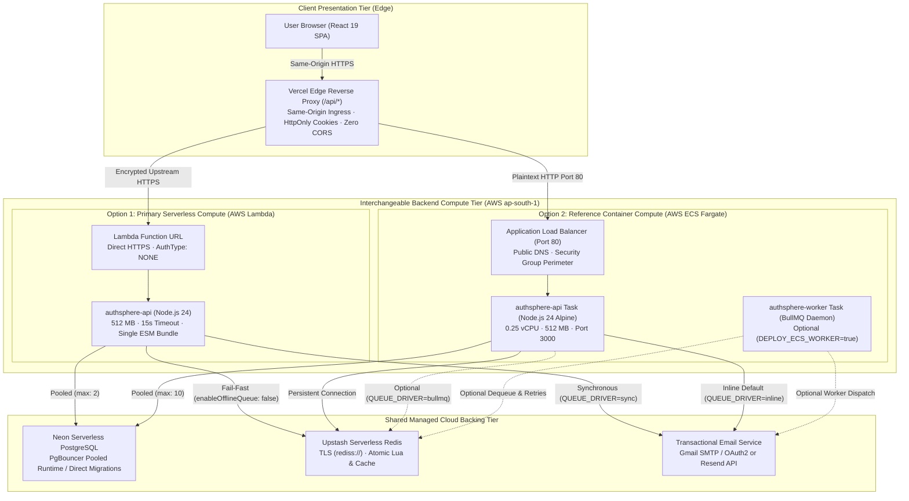
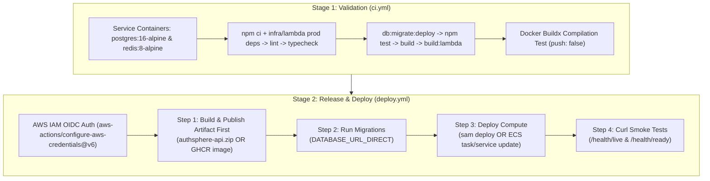

# Cloud Deployment & DevOps Guide — AuthSphere

> **Single Source of Truth (SSOT)** for AuthSphere's cloud deployment architecture, compute packaging (AWS Lambda & ECS Fargate), backing infrastructure (Neon PostgreSQL, Upstash Redis, Email), Vercel edge proxy & Vite dev parity, CI/CD pipelines, and production environment configuration.
>
> **Companion Documentation Suite:**
>
> - System Design & Component Architecture: [`docs/ARCHITECTURE.md`](./ARCHITECTURE.md)
> - Frontend Architecture & Control Plane: [`docs/FRONTEND_ARCHITECTURE.md`](./FRONTEND_ARCHITECTURE.md)
> - Formal Decisions (109 Formal ADRs): [`docs/Engineering-Decisions.md`](./Engineering-Decisions.md)
> - OAuth 2.0 PKCE & Integration Guide: [`docs/OAUTH.md`](./OAUTH.md)
> - Testing Architecture & Verification Matrix: [`docs/TESTING.md`](./TESTING.md)

---

## 1. Deployment Topology

AuthSphere implements a **Shared Backing State, Interchangeable Compute** model. Both Serverless (AWS Lambda) and Container (AWS ECS Fargate) targets compile from the same TypeScript monorepo and connect to the same managed backing tier:



### Deployed Services Summary

| Component                 | Provider / Service           | Sizing / Runtime                              | Role in AuthSphere                                                           |
| :------------------------ | :--------------------------- | :-------------------------------------------- | :--------------------------------------------------------------------------- |
| **Frontend Presentation** | Vercel Edge Network          | Static SPA + Edge Rewrites (`vercel.ts`)      | Hosts React 19 SPA; proxies `/api/*` upstream for same-origin cookies.       |
| **Primary Compute**       | AWS Lambda                   | `nodejs24.x`, `x86_64`, 512 MB, 15s timeout   | Primary serverless REST API behind a Function URL; scales to zero idle cost. |
| **Reference Compute**     | AWS ECS Fargate + ALB        | `256` CPU (0.25 vCPU), `512` MB, Alpine Linux | Reference container runtime for persistent event loops and optional workers. |
| **Database Tier**         | Neon PostgreSQL              | PostgreSQL 16 with PgBouncer                  | Dual-endpoint topology: direct for migrations, `-pooler` for runtime.        |
| **Cache & State Tier**    | Upstash Redis                | Serverless Redis (`rediss://`)                | Rate limiting, OAuth PKCE state, RBAC permission cache, refresh leeway.      |
| **Transactional Email**   | Gmail SMTP / OAuth2 / Resend | Nodemailer SMTP or Resend HTTPS               | Strategy-selected (`EMAIL_PROVIDER`) transactional email delivery.           |

---

## 2. Compute Packaging: Lambda vs. ECS Fargate

### 2.1. Primary Serverless Compute (AWS Lambda)

Defined in [`infra/lambda/template.yaml`](../infra/lambda/template.yaml), [`apps/api/tsup.config.ts`](../apps/api/tsup.config.ts), and [`package.json`](../package.json):

1. **Two-Layer Bundle & Native Addon Isolation:**
   - **ESM Application Bundle:** `tsup` compiles `apps/api/src/lambda.ts` (`@codegenie/serverless-express`) into a single minified ESM bundle (`infra/lambda/lambda.mjs`, `target: "node24"`, `splitting: false`, `sourcemap: true`). Every dependency except `argon2` is bundled (`noExternal: [/^(?!argon2).*$/]`), with an injected `createRequire(import.meta.url)` banner for bundled CommonJS packages.
   - **External Native C++ Addon:** `argon2` is kept `external` so its precompiled `.node` binary resolves via `infra/lambda/node_modules` (declared in [`infra/lambda/package.json`](../infra/lambda/package.json) and installed via `npm --prefix infra/lambda ci --omit=dev`).
   - **Sourcemap Exclusion (`zip:lambda`):** Root `npm run build:lambda` runs `build:shared` -> `prisma:generate` -> `tsup` -> `zip:lambda`. The `zip:lambda` script (`cd infra/lambda && bestzip authsphere-api.zip lambda.mjs node_modules/`) explicitly excludes `lambda.mjs.map` (~14.7 MB), keeping `authsphere-api.zip` lean (~3.55 MB) for faster Lambda cold-start extraction.
   - **Architecture Parity:** CI builds on `ubuntu-latest`, producing Linux glibc `x86_64` binaries for `argon2`. Building locally on macOS or Windows produces host-OS binaries that fail on Amazon Linux 2023; run local packaging inside a Linux `amd64` container or WSL2.
2. **Zero-Binary Database Engine:** Prisma (`@prisma/client`, `@prisma/adapter-pg`, and `prisma` pinned to `7.8.0`) connects via pure JS `@prisma/adapter-pg` + `pg`, eliminating Prisma native query-engine binaries.
3. **Runtime Sizing & Guardrails (`infra/lambda/template.yaml`):**
   - **512 MB Memory / 15s Timeout:** Prevents cold-start OOM seen at 128 MB and provides proportional vCPU for CPU-bound Argon2id hashing.
   - **Logging & Aliasing:** `AutoPublishAlias: live`, CloudWatch Log Group `/aws/lambda/authsphere-api` with `RetentionInDays: 7`, and Function URL with `AuthType: NONE` (intentional evaluator trade-off for direct probing without SigV4).

### 2.2. Reference Container Compute (AWS ECS Fargate)

Defined in [`Dockerfile`](../Dockerfile), [`.dockerignore`](../.dockerignore), [`infra/ecs/api-task-definition.json`](../infra/ecs/api-task-definition.json), and [`infra/ecs/worker-task-definition.json`](../infra/ecs/worker-task-definition.json):

1. **Multi-Stage Production Container (`Dockerfile`):**
   - **`base` (`node:24-alpine`):** Installs `openssl` and `libc6-compat`, copies root, `packages/shared`, and `apps/api` manifests only, and runs `npm ci`.
   - **`builder`:** Uses a build-time fallback `ARG DATABASE_URL` for `prisma generate`, builds `@authsphere/shared`, compiles `@authsphere/api` (`tsc` with `sourceMap: true` per [`apps/api/tsconfig.json`](../apps/api/tsconfig.json)), and runs `npm prune --omit=dev`.
   - **`runner` (`node:24-alpine`):** Installs `dumb-init` for PID 1 signal forwarding (supporting the 10s graceful shutdown in [`apps/api/src/server.ts`](../apps/api/src/server.ts)), copies only pruned `node_modules` and compiled `dist/` + `schema.prisma`, runs as non-root `USER node`, exposes port `3000`, and starts via `ENTRYPOINT ["dumb-init", "--"]` + `CMD ["node", "--enable-source-maps", "dist/server.js"]`.
2. **Lean Build Context (`.dockerignore`):** Excludes `apps/web`, `apps/api/tests`, `apps/api/src/generated`, `docs/`, `docker/`, `infra/`, `*.zip`, `.env*`, `.git`, and `.github` so frontend code, tests, and local artifacts never enter the Docker build context.
3. **ECS Task Safeguards & Networking:**
   - **API Task (`authsphere-api`):** `256` CPU / `512` MB, `awsvpc`, CloudWatch log group `/ecs/authsphere-api` (`ap-south-1`). Deploys with `desired-count: 1`, `wait-for-service-stability: true`, ECS deployment circuit breaker (`rollback: true`), and ALB health checks targeting `/health/live` on port `3000` (with 30s grace period).
   - **Public Subnet Placement:** Tasks run in public subnets with public IPs to pull GHCR images without an AWS NAT Gateway; `ECS-SG` restricts ingress on port `3000` to `ALB-SG`.
   - **Optional Worker Task (`authsphere-worker`):** Runs `node --enable-source-maps dist/workers/email.worker.js` with `APP_ROLE=worker` and `QUEUE_DRIVER=bullmq`. Dormant in the baseline setup (`QUEUE_DRIVER=inline` on the API container) and deployed only when `DEPLOY_ECS_WORKER=true` in repository variables.
4. **Local Container Profiles (`docker/`):**
   - [`docker/docker-compose.dev.yml`](../docker/docker-compose.dev.yml): PostgreSQL 16 Alpine + Redis 8 Alpine for full local development.
   - [`docker/docker-compose.infra.yml`](../docker/docker-compose.infra.yml): Redis 8 Alpine only, for local API runs targeting a remote Neon database.

---

## 3. Backing Infrastructure & Operational Policies

### 3.1. Neon PostgreSQL: Dual-Endpoint Topology

Configured in [`apps/api/src/lib/prisma.ts`](../apps/api/src/lib/prisma.ts) and CI/CD workflows:

- **Direct Unpooled (`DATABASE_URL_DIRECT`):** Used strictly for Prisma migrations (`npm run db:migrate:deploy --workspace=@authsphere/api`) in CI/CD so PostgreSQL session-level advisory locks (`pg_advisory_lock`) and DDL transactions execute reliably.
- **Pooled Runtime (`DATABASE_URL` -> `-pooler`):** Used by Lambda and ECS runtime tasks through Neon's PgBouncer transaction pooler.
- **Pool Sizing & Socket Resilience:**
  - `max`: `env.DATABASE_POOL_MAX ?? (isLambdaRuntime ? 2 : 10)` (`isLambdaRuntime` checks `AWS_LAMBDA_FUNCTION_NAME || LAMBDA_TASK_ROOT`).
  - `connectionTimeoutMillis: 5000` (accommodates Neon cold-wake resumes), `query_timeout: 10000`, `idleTimeoutMillis: 0` (favors warm socket reuse), `allowExitOnIdle: true` (lets CLI scripts and tests exit cleanly), and `pool.on("error")` (prevents crashes when idle sockets close remotely).

### 3.2. Upstash Redis & Queue Drivers

Configured in [`apps/api/src/lib/redis.ts`](../apps/api/src/lib/redis.ts), [`apps/api/src/lambda.ts`](../apps/api/src/lambda.ts), [`apps/api/src/lib/queue.ts`](../apps/api/src/lib/queue.ts), and [`apps/api/src/workers/email.worker.ts`](../apps/api/src/workers/email.worker.ts):

- **API Singleton (`redis.ts`):** `lazyConnect: true`, `enableOfflineQueue: false` (fail fast instead of buffering commands across frozen Lambda invocations), `maxRetriesPerRequest: 1`, `connectTimeout: 2000`, `commandTimeout: 1000`, `retryStrategy` (0ms, 50ms, 100ms; stops after 3 failures), and `redis.on("error")` (prevents unhandled EventEmitter crashes on idle socket drops).
- **Lambda Lifecycle (`lambda.ts`):** Pre-constructs `lambdaApp` and `@codegenie/serverless-express` once during Lambda INIT, shares `JSON_BODY_LIMIT_BYTES` from `app.ts` for Buffer JSON parsing, and runs `ensureRedisReady()` (`500ms` bounded settlement wait via `"ready"`/`"end"` listeners and `5000ms` failure cooldown) before each invocation, degrading gracefully if Redis is unavailable.
- **Queue Driver Strategy (`QUEUE_DRIVER`):**
  - `sync` (Lambda default): Awaits email delivery before returning the handler response so AWS does not freeze the microVM mid-flight.
  - `inline` (ECS API default): Offloads delivery via `setImmediate()` on the continuous event loop with zero Redis polling.
  - `bullmq` (Optional Worker): Enqueues jobs to `authsphere-email` with 5 attempts and 2s exponential backoff (`removeOnComplete: true`, `removeOnFail: { count: 500 }`). The worker (`concurrency: 5`) uses `createBullMQConnection()` (`maxRetriesPerRequest: null`) and maps permanent `EmailDeliveryError` failures to BullMQ `UnrecoverableError`.

### 3.3. Transactional Email Providers

Configured via `EMAIL_PROVIDER` (`gmail` or `resend`; defaults to `gmail` if `GMAIL_APP_PASSWORD` or `GMAIL_REFRESH_TOKEN` is set, otherwise `resend`):

- **Gmail SMTP with App Password (Recommended for Demos):** Uses `GMAIL_USER` + 16-character `GMAIL_APP_PASSWORD` over Nodemailer (`5000ms` connection/greeting/socket timeouts). Delivers to arbitrary recipients without custom domain DNS or Google OAuth app verification.
- **Gmail OAuth2 (Alternative):** Uses `GMAIL_USER`, `GMAIL_REFRESH_TOKEN`, `GOOGLE_CLIENT_ID`, and `GOOGLE_CLIENT_SECRET`.
- **Resend API:** Uses `RESEND_API_KEY` and `EMAIL_FROM` (requires a verified sending domain for arbitrary recipients).

### 3.4. Secret Stores & Key Rotation Rules

- **Unsynchronized Secret Stores:** Lambda receives deploy-time parameter overrides from GitHub Secrets/Variables; ECS Fargate resolves secrets at boot from AWS SSM Parameter Store (`/authsphere/prod/*`). Rotating any credential requires updating **both** stores and redeploying the active target.
- **JWT Secrets (`JWT_ACCESS_SECRET`, `JWT_REFRESH_SECRET`):** Replacing a secret immediately invalidates tokens signed with the previous key; users must re-authenticate after cutover unless multi-key verification is implemented.
- **MFA Encryption Key (`MFA_ENCRYPTION_KEY`):** Existing encrypted TOTP secrets in PostgreSQL must be decrypted with the old key and re-encrypted with the new key before retiring the old key, or affected users must re-enrol MFA.

---

## 4. Vercel Edge Proxy, Vite Dev Parity & Ingress

For the internal Express middleware pipeline, route inventory (34 operations), and Redis rate-limit policy dictionary, see [`docs/ARCHITECTURE.md`](./ARCHITECTURE.md#2-layered-component-architecture) and [`docs/ARCHITECTURE.md#22-rate-limit-tiers--canonical-redis-keyspace`](./ARCHITECTURE.md#22-rate-limit-tiers--canonical-redis-keyspace).

### 4.1. Edge Reverse Proxy (`apps/web/vercel.ts`) & Vite Dev Parity (`apps/web/vite.config.ts`)

Both production Vercel Edge and local Vite Dev route browser requests same-origin under `/api/*`, keeping `accessToken` and `refreshToken` cookies (`Path=/; HttpOnly; SameSite=Lax; Secure` in prod) first-party and eliminating CORS preflights:

| Surface                      | Configuration File                                      | Routing & Proxy Behavior                                                                                                                                                                          |
| :--------------------------- | :------------------------------------------------------ | :------------------------------------------------------------------------------------------------------------------------------------------------------------------------------------------------ |
| **Production (Vercel Edge)** | [`apps/web/vercel.ts`](../apps/web/vercel.ts)           | Permanent redirects: `/api/docs`, `/docs`, `/docs/` -> `/api/docs/`; `/openapi.json` -> `/api/openapi.json`. Rewrites: `/api/(.*)` -> `${BACKEND_URL}/$1`; SPA fallback `/(.*)` -> `/index.html`. |
| **Local Dev (Vite)**         | [`apps/web/vite.config.ts`](../apps/web/vite.config.ts) | Proxies `/api` -> `VITE_API_URL \|\| http://localhost:3000` (stripping `/api`) and `/openapi.json` -> target; 301-redirects `^/api/docs$` and `^/docs/?$` -> `/api/docs/`.                        |

> [!IMPORTANT]
> **Lambda Function URL Trailing Slash & Cookie Path Invariants:**
>
> 1. CloudFormation outputs `FunctionUrl` with a trailing slash (`https://<id>.lambda-url.<region>.on.aws/`). Strip the trailing slash when setting `BACKEND_URL` in Vercel so `${BACKEND_URL}/$1` does not produce `//$1`.
> 2. Leave `VITE_API_URL` empty in production (`apps/web/.env` / Vercel) so browser calls stay relative to `/api/*`.
> 3. OAuth PKCE verifier cookies (`oauth_verifier_<state>`) dynamically resolve their `Path` from `OAUTH_CALLBACK_BASE_URL` (or `${FRONTEND_URL}/api/auth/oauth`) to `/api/auth/oauth` in production (`apps/api/src/common/utils/cookie.ts`). See [`docs/OAUTH.md`](./OAUTH.md#edge-reverse-proxy--cookie-path-alignment).

### 4.2. Vercel Project Settings & Monorepo Build Orchestration

Because AuthSphere is an npm monorepo with cross-workspace dependencies, the frontend build is orchestrated from the monorepo root:

| Setting              | Configured Value                | Behavior / Rationale                                                                                       |
| :------------------- | :------------------------------ | :--------------------------------------------------------------------------------------------------------- |
| **Root Directory**   | `apps/web`                      | Scopes deployment to frontend, auto-detects Vite, and loads [`apps/web/vercel.ts`](../apps/web/vercel.ts). |
| **Build Command**    | `cd ../.. && npm run build:web` | **Override ON**. Triggers root orchestration (`npm run build:shared && npm run build -w @authsphere/web`). |
| **Output Directory** | `dist`                          | Default (Not Overridden). Resolves to `apps/web/dist` where Vite emits the SPA bundle.                     |
| **Install Command**  | _(Default / Auto)_              | Default (Not Overridden). Automatically runs `npm install` across all monorepo workspaces.                 |

### 4.3. Transport Legs & `TRUST_PROXY` Calibration

- **Upstream Transport:** Vercel terminates browser TLS. Upstream is encrypted HTTPS to Lambda Function URL, or plaintext HTTP port `80` to the reference ECS ALB (intentional portfolio trade-off).
- **`TRUST_PROXY` Depth:** Set to `1` on Lambda (`Browser -> Vercel -> Lambda`) and `2` on ECS (`Browser -> Vercel -> ALB -> Container`) so Express `req.ip` extracts the client IP from `X-Forwarded-For` (`RATE_LIMIT_POLICIES` keys public routes by IP and protected routes by `userId`). Because direct backend endpoints are publicly reachable for evaluator testing, IP attribution is best-effort.
- **Rate-Limit Headers:** Standardized `RateLimit-Limit`, `RateLimit-Remaining`, `RateLimit-Reset`, and `Retry-After` (on HTTP 429) pass through the Vercel edge proxy unchanged.

---

## 5. CI/CD & Automated Release Pipeline

Declared in [`.github/workflows/ci.yml`](../.github/workflows/ci.yml) and [`.github/workflows/deploy.yml`](../.github/workflows/deploy.yml):



### 5.1. Pipeline Execution Order

1. **Stage 1 (`ci.yml`):** Triggered on PRs to `main`, pushes to `dev`, or `workflow_call` from `deploy.yml`. Spins up ephemeral `postgres:16-alpine` (`authsphere_test`) and `redis:8-alpine` containers, installs root + `infra/lambda` production dependencies on Node 24, and executes `npm run lint`, `npm run typecheck`, `npm run db:migrate:deploy --workspace=@authsphere/api`, `npm test`, `npm run build`, `npm run build:lambda`, and a non-pushed Docker Buildx build.
2. **Stage 2 (`deploy.yml`):** Triggered on push to `main` or `workflow_dispatch` after `validate` succeeds.
   - **OIDC Federation:** Assumes `secrets.AWS_DEPLOY_ROLE_ARN` via `id-token: write` without static AWS access keys.
   - **Artifact First Invariant:** Builds `authsphere-api.zip` (when `DEPLOY_TARGET != 'ecs'`) or builds/pushes `ghcr.io/<repo>/backend:<sha|latest>` (when `DEPLOY_TARGET == 'ecs'`) _before_ mutating the database.
   - **Direct Database Migrations:** Executes `npm run db:migrate:deploy --workspace=@authsphere/api` against `secrets.DATABASE_URL_DIRECT`.
   - **Compute Dispatch & Smoke Test:**
     - `DEPLOY_TARGET=serverless` (default): Runs `sam deploy --no-confirm-changeset --no-fail-on-empty-changeset` in `infra/lambda/`, resolves `FunctionUrl` from stack `authsphere-serverless`, and probes `health/live` & `health/ready` (`--retry 3`).
     - `DEPLOY_TARGET=ecs`: Resolves `authsphere-alb` DNS, injects `<ACCOUNT_ID>` into `infra/ecs/*-task-definition.json`, deploys `authsphere-api` (`desired-count: 1`, `wait-for-service-stability: true`) and optionally `authsphere-worker` (if `vars.DEPLOY_ECS_WORKER == 'true'`), and probes `health/live` & `health/ready` (`--retry 10`).

### 5.2. Manual SAM Recovery Note

For emergency local SAM deployment from `infra/lambda/`, package inside a Linux `amd64` container or WSL2 (`npm --prefix infra/lambda ci --omit=dev && npm run build:lambda`) before running `sam deploy`. Never commit secret parameter overrides into `infra/lambda/samconfig.toml`.

---

## 6. Compute Switching, Rollback & Cost Hygiene

Switching between Lambda and ECS requires zero database migrations and zero application code changes:

| Operational Step               | Switching to ECS Fargate                       | Switching to AWS Lambda                        |
| :----------------------------- | :--------------------------------------------- | :--------------------------------------------- |
| **1. Set Repo Variable**       | `DEPLOY_TARGET = ecs`                          | `DEPLOY_TARGET = serverless`                   |
| **2. Run Release Workflow**    | Trigger `deploy.yml` (builds & deploys ECS)    | Trigger `deploy.yml` (builds & deploys Lambda) |
| **3. Update Vercel Ingress**   | `BACKEND_URL = http://<ALB_DNS>`               | `BACKEND_URL = <LAMBDA_URL_NO_TRAILING_SLASH>` |
| **4. Redeploy Vercel App**     | Redeploy frontend so edge rewrites pick up URL | Redeploy frontend so edge rewrites pick up URL |
| **5. Rollback / Cost Hygiene** | Keep Lambda ready; scale ECS down when idle    | Scale ECS desired count to `0` after proof     |

### ECS Idle Cost Hygiene Commands

```bash
# Scale Fargate services to 0 when Lambda is active
aws ecs update-service --cluster authsphere-cluster --service authsphere-api --desired-count 0 --region ap-south-1
aws ecs update-service --cluster authsphere-cluster --service authsphere-worker --desired-count 0 --region ap-south-1
```

For extended pauses, deleting only the ALB (`authsphere-alb`) while retaining the Target Group (`authsphere-api-tg`) avoids idle ALB/IPv4 hourly charges while preserving the target-group ARN referenced by the ECS service.

---

## 7. Verification Probes & Environment Reference

### 7.1. Smoke Probes & Curl Verification

| Probe                   | Endpoint                                 | Dependencies Verified           | Expected Behavior                                                                                    |
| :---------------------- | :--------------------------------------- | :------------------------------ | :--------------------------------------------------------------------------------------------------- |
| **Liveness**            | `GET /health/live`                       | None (in-memory)                | Returns `200 UP` with zero DB/Redis I/O.                                                             |
| **Readiness**           | `GET /health/ready`                      | Neon PostgreSQL + Upstash Redis | Returns `200 UP` when healthy, `503 DOWN` if DB or Redis fails (`HEALTH`: 60/min IP).                |
| **Argon2id Native C++** | `POST /auth/signup` / `POST /auth/login` | Native `argon2` `.node` + DB    | `signup` returns `201`; `login` executes `argon2.verify()` (`200` if verified, `403` if unverified). |

```bash
# 1. Process liveness & dependency readiness
curl -i https://<ACTIVE_ENDPOINT>/health/live
curl -i https://<ACTIVE_ENDPOINT>/health/ready

# 2. Verify native Argon2id addon via signup (201 Created) & login
curl -i -X POST https://<ACTIVE_ENDPOINT>/auth/signup \
  -H "Content-Type: application/json" \
  -d '{"firstName":"Probe","lastName":"User","email":"probe-1@example.com","password":"TestPassword123!"}'

curl -i -X POST https://<ACTIVE_ENDPOINT>/auth/login \
  -H "Content-Type: application/json" \
  -c cookies.txt \
  -d '{"email":"probe-1@example.com","password":"TestPassword123!"}'

# 3. Verify authenticated RBAC endpoint via Vercel edge proxy (uses HttpOnly cookie)
curl -i "https://<PUBLIC_DOMAIN>/api/users?page=1&limit=10" -b cookies.txt

# 4. Verify Redis fixed-window rate-limit headers (case-insensitive grep for HTTP/2)
for i in {1..105}; do
  curl -s -D - -o /dev/null https://<ACTIVE_ENDPOINT>/openapi.json | grep -iE "(HTTP/|ratelimit-remaining)"
done
```

### 7.2. Production Environment Variables

#### Plaintext Runtime Configuration (`template.yaml` Globals / `api-task-definition.json` / `worker-task-definition.json`)

| Variable                            | Lambda Value                     | ECS API / Worker Value                | Description                                                           |
| :---------------------------------- | :------------------------------- | :------------------------------------ | :-------------------------------------------------------------------- |
| `NODE_ENV`                          | `production`                     | `production`                          | Express & cookie security mode (`development \| production \| test`). |
| `APP_ROLE`                          | `api`                            | `api` / `worker`                      | Partitions env validation in `apps/api/src/config/env.ts`.            |
| `QUEUE_DRIVER`                      | `sync`                           | `inline` / `bullmq`                   | Email dispatch mode (`sync \| inline \| bullmq`).                     |
| `PORT` / `HOST`                     | `HOST=0.0.0.0`                   | `3000` / `0.0.0.0`                    | HTTP server bind host and port (unused port on Lambda).               |
| `TRUST_PROXY`                       | `1`                              | `2` (API only)                        | Hop count for `req.ip`: 1 (Vercel->Lambda), 2 (Vercel->ALB->ECS).     |
| `DATABASE_POOL_MAX`                 | `2`                              | `10` (API only)                       | `pg.Pool` max connections per instance.                               |
| `JWT_ACCESS_EXPIRES_IN`             | `15m`                            | `15m` (API only)                      | Access JWT lifetime.                                                  |
| `JWT_REFRESH_EXPIRES_IN`            | `30d`                            | `30d` (API only)                      | Refresh JWT & session lifetime.                                       |
| `AUTH_REUSE_DELETION_MODE`          | `SESSION`                        | `SESSION` (API only)                  | Replay compromise revocation scope (`SESSION \| GLOBAL`).             |
| `AUTH_REFRESH_TOKEN_LEEWAY_SECONDS` | `30`                             | `30` (API only)                       | Concurrent refresh grace window (seconds).                            |
| `EMAIL_PROVIDER`                    | `vars.EMAIL_PROVIDER \|\| gmail` | SSM `/authsphere/prod/EMAIL_PROVIDER` | Active email adapter (`gmail \| resend`).                             |

#### Secrets & Service Endpoints

| Variable                  | Lambda (`deploy.yml` -> SAM)                               | ECS (`api` / `worker` SSM `/authsphere/prod/*`) | Purpose                                                          |
| :------------------------ | :--------------------------------------------------------- | :---------------------------------------------- | :--------------------------------------------------------------- |
| `DATABASE_URL_DIRECT`     | GitHub Secret `DATABASE_URL_DIRECT` (CI only)              | GitHub Secret `DATABASE_URL_DIRECT` (CI only)   | Direct Neon URL for `prisma migrate deploy`.                     |
| `DATABASE_URL`            | Secret `DATABASE_URL_POOLED` -> `DatabaseUrl`              | API SSM `DATABASE_URL`                          | Pooled Neon URL (`-pooler`) for runtime queries.                 |
| `REDIS_URL`               | Secret `REDIS_URL` -> `RedisUrl`                           | API & Worker SSM `REDIS_URL`                    | Upstash Redis TLS URL (`rediss://...`).                          |
| `FRONTEND_URL`            | Var `FRONTEND_URL` -> `FrontendUrl`                        | API & Worker SSM `FRONTEND_URL`                 | Hosted frontend origin (CORS, origin guard, email links).        |
| `JWT_ACCESS_SECRET`       | Secret `JWT_ACCESS_SECRET`                                 | API SSM `JWT_ACCESS_SECRET`                     | HS256 access token signing secret.                               |
| `JWT_REFRESH_SECRET`      | Secret `JWT_REFRESH_SECRET`                                | API SSM `JWT_REFRESH_SECRET`                    | HS256 refresh token signing secret.                              |
| `MFA_ENCRYPTION_KEY`      | Secret `MFA_ENCRYPTION_KEY`                                | API SSM `MFA_ENCRYPTION_KEY`                    | Secret (>=16 chars) deriving AES-256-GCM MFA key.                |
| `GMAIL_USER`              | Var `GMAIL_USER`                                           | API & Worker SSM `GMAIL_USER`                   | Gmail sender address (SMTP / OAuth2).                            |
| `GMAIL_APP_PASSWORD`      | Secret `GMAIL_APP_PASSWORD`                                | API & Worker SSM `GMAIL_APP_PASSWORD`           | Gmail 16-char App Password.                                      |
| `GMAIL_REFRESH_TOKEN`     | Secret `GMAIL_REFRESH_TOKEN`                               | API & Worker SSM `GMAIL_REFRESH_TOKEN`          | Gmail OAuth2 refresh token (alternative to App Password).        |
| `RESEND_API_KEY`          | Secret `RESEND_API_KEY`                                    | API & Worker SSM `RESEND_API_KEY`               | Resend API key.                                                  |
| `EMAIL_FROM`              | Secret `EMAIL_FROM`                                        | API & Worker SSM `EMAIL_FROM`                   | Sender header (`AuthSphere <noreply@...>`).                      |
| `GOOGLE_CLIENT_ID/SECRET` | Var `GOOGLE_CLIENT_ID` / Secret `GOOGLE_CLIENT_SECRET`     | API & Worker SSM `GOOGLE_CLIENT_ID/SECRET`      | Google OAuth & Gmail OAuth2 credentials.                         |
| `GITHUB_CLIENT_ID/SECRET` | Var `GH_OAUTH_CLIENT_ID` / Secret `GH_OAUTH_CLIENT_SECRET` | API SSM `GITHUB_CLIENT_ID/SECRET`               | GitHub OAuth credentials (prefixed `GH_OAUTH_*` in GitHub).      |
| `OAUTH_CALLBACK_BASE_URL` | Var `OAUTH_CALLBACK_BASE_URL`                              | API SSM `OAUTH_CALLBACK_BASE_URL`               | Public callback base (`https://<VERCEL_DOMAIN>/api/auth/oauth`). |

#### Frontend & Vercel Settings

| Variable       | Location                         | Value / Notes                                                                                                               |
| :------------- | :------------------------------- | :-------------------------------------------------------------------------------------------------------------------------- |
| `BACKEND_URL`  | Vercel Project Env (Server-Side) | Active backend URL **without trailing slash** (`https://<LAMBDA_URL>` or `http://<ALB_DNS>`). Read by `apps/web/vercel.ts`. |
| `VITE_API_URL` | `apps/web/.env` / Vercel Env     | **Empty** in production (routes via `/api/*` proxy); defaults to `http://localhost:3000` in Vite dev.                       |

---

## 8. Local Development Quickstart

```bash
# 1. Start local backing services (PostgreSQL 16 + Redis 8, OR Redis-only for remote Neon)
docker compose -f docker/docker-compose.dev.yml up -d
# docker compose -f docker/docker-compose.infra.yml up -d

# 2. Configure local environment files
cp apps/api/.env.example apps/api/.env
cp apps/web/.env.example apps/web/.env

# 3. Apply migrations and seed baseline roles (USER, ADMIN), permissions, and optional bootstrap admin (SEED_ADMIN_EMAIL)
npm run db:migrate:deploy --workspace=@authsphere/api
npm run db:seed --workspace=@authsphere/api

# 4. Run development servers
npm run dev:api      # Express API on :3000
npm run dev:web      # Vite React SPA on :5173 (proxies /api/* -> :3000)
npm run dev:worker   # Optional: BullMQ email worker when QUEUE_DRIVER=bullmq
```

---

## 9. Related Architectural Decision Records (ADRs)

- [ADR-010: Multi-Resource Graceful Shutdown](Engineering-Decisions.md#adr-010--multi-resource-graceful-shutdown)
- [ADR-011: Operational Health Monitoring Pattern](Engineering-Decisions.md#adr-011--operational-health-monitoring-pattern)
- [ADR-050: Redis-Backed Fixed-Window Rate Limiting via Atomic Lua Scripting](Engineering-Decisions.md#adr-050--redis-backed-fixed-window-rate-limiting-via-atomic-lua-scripting)
- [ADR-053: Zod-Validated Proxy Trust Configuration](Engineering-Decisions.md#adr-053--zod-validated-proxy-trust-configuration)
- [ADR-054: Proxy-Derived Client IP Resolution via Express `req.ip`](Engineering-Decisions.md#adr-054--proxy-derived-client-ip-resolution-via-express-reqip)
- [ADR-073: Provider-Agnostic Email Abstraction with Resend Implementation](Engineering-Decisions.md#adr-073--provider-agnostic-email-abstraction-with-resend-implementation)
- [ADR-074: Unified Redis Architecture (ioredis Migration)](Engineering-Decisions.md#adr-074--unified-redis-architecture-ioredis-migration)
- [ADR-077: Process-Aware Environment Partitioning and Least Privilege Secret Isolation](Engineering-Decisions.md#adr-077--process-aware-environment-partitioning-and-least-privilege-secret-isolation)
- [ADR-078: Dual-Driver Background Job Architecture and Cloud Migration Path](Engineering-Decisions.md#adr-078--dual-driver-background-job-architecture-and-cloud-migration-path)
- [ADR-079: Serverless Lambda Runtime, Synchronous Execution Guard, and Reverse-Proxy Cookie Bridge](Engineering-Decisions.md#adr-079--serverless-lambda-runtime-synchronous-execution-guard-and-reverse-proxy-cookie-bridge)
- [ADR-085: Code-First Edge Reverse Proxy Configuration via `@vercel/config/v1`](Engineering-Decisions.md#adr-085--code-first-edge-reverse-proxy-configuration-via-vercelconfigv1)
- [ADR-086: Development-to-Production Reverse Proxy Parity via Vite Local Server](Engineering-Decisions.md#adr-086--development-to-production-reverse-proxy-parity-via-vite-local-server)
- [ADR-090: Keyless Cloud Deployment via AWS IAM OpenID Connect (OIDC) Federation](Engineering-Decisions.md#adr-090--keyless-cloud-deployment-via-aws-iam-openid-connect-oidc-federation)
- [ADR-095: Dual Database Connection Strategy (Neon Direct Migrations vs Pooled Runtime)](Engineering-Decisions.md#adr-095--dual-database-connection-strategy-neon-direct-migrations-vs-pooled-runtime)
- [ADR-096: Multi-Stage Container Architecture with Non-Root Execution and PID 1 Signal Reaping (`dumb-init`)](Engineering-Decisions.md#adr-096--multi-stage-container-architecture-with-non-root-execution-and-pid-1-signal-reaping-dumb-init)
- [ADR-097: Single-File Tree-Shaken ESM Lambda Bundling with Native C++ Addon Externalization (`tsup`)](Engineering-Decisions.md#adr-097--single-file-tree-shaken-esm-lambda-bundling-with-native-c-addon-externalization-tsup)
- [ADR-098: Unified Dual-Target Deployment Pipeline (Serverless Lambda vs Containerized ECS Fargate)](Engineering-Decisions.md#adr-098--unified-dual-target-deployment-pipeline-serverless-lambda-vs-containerized-ecs-fargate)
- [ADR-103: Decoupled Transactional Email via Dedicated Gmail App Password with Preserved OAuth2 Fallback](Engineering-Decisions.md#adr-103--decoupled-transactional-email-via-dedicated-gmail-app-password-with-preserved-oauth2-fallback)
- [ADR-109: Least-Privilege Bootstrap Administrator Seeding](Engineering-Decisions.md#adr-109--least-privilege-bootstrap-administrator-seeding)
