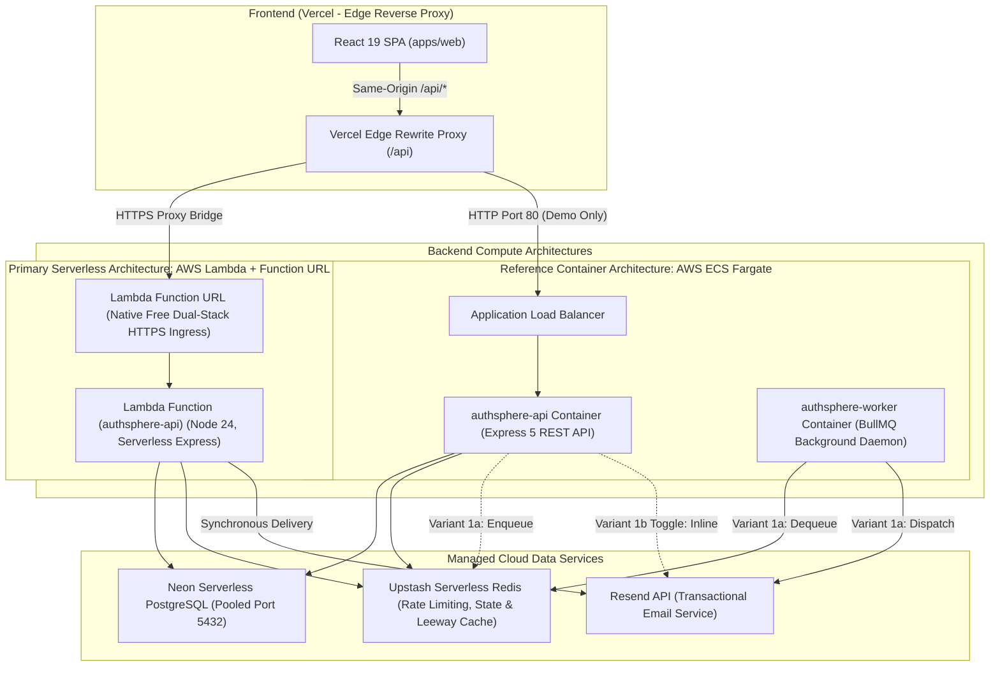
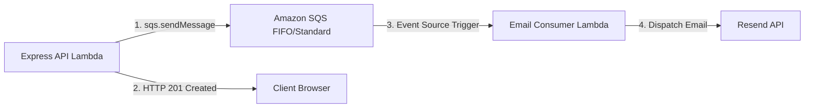
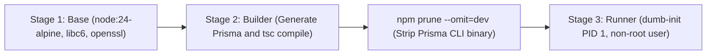
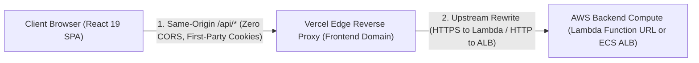

# Cloud Deployment & DevOps Guide — AuthSphere

This document specifies the deployment architectures, infrastructure strategies, configuration standards, and operational workflows for AuthSphere across serverless (AWS Lambda), containerized (AWS ECS Fargate), and edge (Vercel) environments.

---

## 1. High-Level Architecture Overview

AuthSphere implements a decoupled architecture: an edge-hosted Single-Page Application (SPA) frontend, two distinct backend compute deployment models, and managed serverless cloud data services.



### Compute Model Comparison

| Dimension                     | Serverless (AWS Lambda + Function URL)                                                 | Containers (AWS ECS Fargate)                                                                       |
| :---------------------------- | :------------------------------------------------------------------------------------- | :------------------------------------------------------------------------------------------------- |
| **Operational Model**         | Automated scale-to-zero serverless                                                     | Minimum-footprint reference container deployment                                                   |
| **Idle Infrastructure Cost**  | **$0.00 baseline idle compute** (scale-to-zero; request volume/duration billed on use) | Continuous compute allocation + ALB hourly charges + public IPv4 address fees                      |
| **Email Processing Strategy** | Synchronous API submission within request lifecycle (`QUEUE_DRIVER=sync`)              | Decoupled queue worker (`QUEUE_DRIVER=bullmq`) or inline (`QUEUE_DRIVER=inline`)                   |
| **HTTPS Endpoint**            | Native HTTPS via Lambda Function URL (`.lambda-url.<region>.on.aws`)                   | ALB provides HTTP on port 80 (demo-only reference setup; production requires custom domain + ACM)  |
| **Request Timeout**           | Handled directly by Lambda function without an intermediate API Gateway proxy timeout  | Subject to ALB idle timeout configuration                                                          |
| **Infrastructure as Code**    | AWS SAM template ([infra/lambda/template.yaml](../infra/lambda/template.yaml))         | ECS Task Definitions ([infra/ecs/api-task-definition.json](../infra/ecs/api-task-definition.json)) |
| **Portability & Coupling**    | Portable application core (Express 5) with AWS SAM infrastructure coupling             | Portable container image (Alpine Node 24) with ECS task definition coupling                        |
| **Engineering Value**         | Serverless Express adapter, socket management, cold-start connection reuse             | Container lifecycle, signal forwarding, decoupled worker architecture                              |

---

## 2. Serverless Architecture: AWS Lambda + Function URL

### 2.1. Runtime Mechanics

AuthSphere separates the Express application definition ([apps/api/src/app.ts](../apps/api/src/app.ts)) from HTTP server binding ([apps/api/src/server.ts](../apps/api/src/server.ts)). On AWS Lambda, the application is invoked via `@codegenie/serverless-express` in [apps/api/src/lambda.ts](../apps/api/src/lambda.ts).

#### Core Technical Mechanics:

1. **Direct Function URL Ingress (Scale-to-Zero HTTPS):**
   Operates with `AuthType: NONE` for native HTTPS without intermediate API Gateway fees. Application middlewares enforce all security boundaries directly (origin validation, 16kb payload bounds, fixed-window rate limits, signed JWTs; see [Section 4](#4-frontend-deployment-vercel-edge-reverse-proxy)).
2. **Immutable Versioning & Aliasing:**
   `AutoPublishAlias: live` snapshots an immutable Lambda version on each deploy and maps the Function URL directly to the `live` alias, enabling instant rollbacks.
3. **Standardized Runtime:** Operates on `nodejs24.x` across serverless, container builds, and CI workflows.
4. **Serverless Database Connection Pooling (`pg.Pool max: 2`):**
   In [prisma.ts](../apps/api/src/lib/prisma.ts), PostgreSQL connection pool sizing adapts dynamically. Bounding `pg.Pool` to `max: 2` per Lambda microVM prevents connection multiplication across concurrent instances from exhausting Neon's connection pooler. (Long-running ECS containers allocate `max: 10`; see [Section 3](#3-reference-container-architecture-aws-ecs-fargate)).
5. **Event Loop Non-Blocking Teardown:**
   ```ts
   // apps/api/src/lambda.ts
   context.callbackWaitsForEmptyEventLoop = false;
   ```
   PostgreSQL and Redis maintain persistent TCP keepalives. Disabling `callbackWaitsForEmptyEventLoop` allows Lambda to freeze the container immediately upon HTTP response completion rather than hanging until timeout.
6. **Graceful Startup Degradation:**
   Prisma and Redis clients initialize outside the request handler and persist across warm invocations. If Redis is unreachable, rate limiting fails open to preserve authentication; if PostgreSQL is temporarily down, non-database endpoints (`/health/live`) continue operating.
7. **Synchronous Email Submission (`QUEUE_DRIVER=sync`):**
   Because Lambda freezes immediately after response dispatch, background in-memory tasks (`setImmediate`) cannot run reliably. `QUEUE_DRIVER=sync` awaits API acceptance by Resend's edge relay during the request lifecycle before freezing (downstream mailbox delivery occurs asynchronously over SMTP).
8. **Proxy Trust Calibration (`TRUST_PROXY=1`):**
   In [`template.yaml`](../infra/lambda/template.yaml), `TRUST_PROXY: "1"` is configured for the 1-hop topology (`Browser -> Vercel Edge Proxy -> Lambda Function URL`). Express strips 1 proxy hop from `X-Forwarded-For` to resolve the genuine client IP for rate limiting and audit logs. (See [Section 4.2](#42-traffic-journey--core-architectural-concepts) for complete proxy hop calibration, origin shielding, direct access risks, and mitigation trade-offs).
9. **Resource Sizing (512 MB & 15s Timeout):**
   - **Memory (`MemorySize: 512`):** Proportional vCPU allocation enables Argon2id password hashing to complete in ~180ms (measured benchmark under standard test parameters) versus 1.5–2.0s at default 128 MB.
   - **Timeout (`Timeout: 15`):** Absorbs cold-start TLS handshakes to Neon PostgreSQL and Upstash Redis while guaranteeing runaway requests terminate.
10. **Cost, Versioning & Concurrency Guardrails:**
    - `AutoPublishAliasAllProperties: true` & `AWS::LanguageExtensions`: To ensure credential and parameter rotations publish a new immutable Lambda version, [`infra/lambda/template.yaml`](../infra/lambda/template.yaml) includes both `AWS::LanguageExtensions` and `AWS::Serverless-2016-10-31` transforms. Without language extensions, intrinsic parameter references (`!Ref`) are evaluated as static AST nodes by the SAM macro, causing parameter-only updates to leave the `live` alias pointing to the prior version. With language extensions, parameter values resolve before version hash generation.
    - `ReservedConcurrentExecutions: 10`: Binds concurrent microVM instances to 10, shielding Neon pool and Upstash command budgets.
      - **Function URL Quota & Throttling:** AWS Function URLs cap request rate at $10 \times \text{Reserved Concurrency} = 100\text{ req/s}$. Saturated requests receive an immediate edge `HTTP 429 Too Many Requests` (no queuing). This caps downstream connection exhaustion rather than guaranteeing throughput or DoS immunity.
    - `RetentionInDays: 7`: CloudWatch Log Group retention caps log storage accumulation.
    - `NoEcho: true`: Masks sensitive database and JWT credentials in CloudFormation console displays and CLI outputs.

### 2.2. Scale-Out Roadmap: Amazon SQS + Worker Lambda

For high-volume serverless environments requiring decoupled queuing, the cloud-native serverless equivalent of the BullMQ worker daemon is **Amazon SQS + Event-Driven Consumer Lambda**:



- **Scale-to-Zero:** SQS costs $0 when empty; the consumer Lambda executes only for the duration of the email dispatch call.
- **Native Retries:** Utilizes AWS Dead-Letter Queues (DLQ) and native exponential backoff without requiring running daemon infrastructure.

### 2.3. Deployment & Infrastructure Setup (AWS Lambda)

Deployments are executed via GitHub Actions CI/CD or the AWS SAM CLI.

> [!NOTE]
> **Prerequisite:** Ensure Neon PostgreSQL is provisioned and baseline migrations are applied (see [5.1. Database Provisioning & Schema Migrations](#51-neon-postgresql-connection-pooling-architecture--provisioning)). When using the CI/CD pipeline, migrations run automatically on every release.

#### Step 1: Configure GitHub Repository Secrets & Variables

Lambda runtime secrets are defined in [`infra/lambda/template.yaml`](../infra/lambda/template.yaml) with `NoEcho: true` (masking credentials in CloudFormation console displays and CLI outputs) and supplied at deploy-time via GitHub Secrets.

1. **GitHub Repository Secrets (`production` environment):**
   - `DATABASE_URL_DIRECT`: Direct unpooled database connection string (used by CI to run schema migrations)
   - `DATABASE_URL_POOLED`: Pooled database connection string (supplied to Lambda runtime compute)
   - `REDIS_URL`: Serverless Redis connection string
   - `JWT_ACCESS_SECRET`: Signing secret for access JWTs (min 16 characters)
   - `JWT_REFRESH_SECRET`: Signing secret for refresh JWTs (min 16 characters)
   - `MFA_ENCRYPTION_KEY`: AES-256-GCM encryption key for TOTP secrets (min 16 characters)
   - `RESEND_API_KEY`: Transactional email service API key
   - `AWS_DEPLOY_ROLE_ARN`: AWS IAM OIDC Role ARN for GitHub Actions deployment

2. **GitHub Repository Variables (Optional / Defaults):**
   - `DEPLOY_TARGET`: `serverless` (default) or `ecs`
   - `AWS_REGION`: Target AWS deployment region (e.g. `ap-south-1`)
   - `FRONTEND_URL`: Hosted frontend origin URL (e.g. `https://<YOUR_PROJECT>.vercel.app`)
   - `EMAIL_FROM`: Transactional sender identity (e.g. `AuthSphere <noreply@<YOUR_DOMAIN>>`)

#### Step 2: Deploy via AWS SAM CLI or GitHub Actions

Non-sensitive deployment defaults (stack name, region, IAM capabilities, S3 resolution) are saved in [`infra/lambda/samconfig.toml`](../infra/lambda/samconfig.toml).

- **Automated Deploy (GitHub Actions):** Push code to `main`. The `deploy.yml` workflow automatically runs Prisma migrations, compiles TypeScript, runs `sam build`, and executes `sam deploy` with parameter overrides.
- **Manual CLI Deploy:**
  ```bash
  npm run build:shared
  npm run build -w @authsphere/api
  cd infra/lambda
  # Note: Use --use-container when building locally from Windows or macOS
  # to compile native C++ bindings (argon2) for Amazon Linux 2023
  sam build --use-container
  sam deploy --parameter-overrides \
    DatabaseUrl="<POOLED_DB_URL>" \
    RedisUrl="<REDIS_URL>" \
    FrontendUrl="<FRONTEND_URL>" \
    JwtAccessSecret="<JWT_ACCESS_SECRET>" \
    JwtRefreshSecret="<JWT_REFRESH_SECRET>" \
    MfaEncryptionKey="<MFA_KEY>" \
    ResendApiKey="<RESEND_KEY>" \
    EmailFrom="<EMAIL_FROM>"
  ```

#### Step 3: Verify Deployment

Capture the output `FunctionUrl` from the deployment output.
Test the health probe:

```bash
curl -I <FUNCTION_URL>/health/live
# Expected: HTTP/1.1 200 OK
```

---

## 3. Reference Container Architecture: AWS ECS Fargate

### 3.1. Architectural Variants

#### Variant 1a: Clustered Enterprise Standard (API + Standalone BullMQ Worker)

- **Producer–Consumer Separation:** The API container handles incoming HTTP requests and enqueues email tasks to Redis. Responses return without waiting for third-party email API roundtrips.
- **Failure Isolation:** Outbound email delivery interruptions or provider rate limits do not block HTTP connections or exhaust database connection pools.
- **Retry Resilience:** BullMQ executes with up to 4 exponential backoff retries across 5 total delivery attempts (delays: 2s, 4s, 8s, 16s via `delay: 2000`) and stores failed jobs in retention storage for operational diagnosis.
- **Production Scaling Pattern:** In high-volume production, API tasks scale horizontally based on ALB target group request count/CPU, and worker tasks scale based on Redis queue depth (`authsphere-email`). The baseline reference deployment runs static single tasks (`desired tasks: 1`) to represent a minimum-footprint container showcase (continuous compute allocation and ALB baseline fees apply; see Section 1).

#### Variant 1b: Pragmatic Cost-Saving Toggle (Single-Container Inline)

- Set `QUEUE_DRIVER=inline` in the API container environment.
- Set the worker ECS service task count to `0`.
- The API dispatches jobs asynchronously in-process via `setImmediate()` directly to Resend.
- **Durability Trade-off:** While this eliminates dedicated worker compute and stops continuous BullMQ polling, in-memory jobs are best-effort: an unexpected container crash or redeployment can drop in-flight unexecuted emails. Variant 1a with BullMQ remains the durable, enterprise-grade architecture.

### 3.2. Docker Image & Lean Container Design

The production container build ([Dockerfile](../Dockerfile)) uses a multi-stage Alpine pipeline:



#### Container Engineering Highlights:

1. **Build-Time Prisma Compilation:** Prisma Client is generated and compiled into JavaScript during Stage 2 (`npm run build -w @authsphere/api`). The final runner stage receives pre-compiled native JavaScript, meaning **zero client generation overhead on container startup** and zero runtime dependency on the heavy `prisma` CLI development package.
2. **Persistent Connection Pooling (`pg.Pool max: 10`):** Unlike serverless microVMs, long-running ECS container instances multiplex concurrent HTTP requests across their event loop, sizing `pg.Pool` to `max: 10` to maximize query throughput.
3. **Proxy Trust Calibration for ECS (`TRUST_PROXY=2`):** In [`infra/ecs/api-task-definition.json`](../infra/ecs/api-task-definition.json), `TRUST_PROXY: "2"` is configured to account for the 2-hop topology (`Browser -> Vercel Edge Proxy -> AWS ALB -> Container`). Express peels 2 hops from `X-Forwarded-For` to resolve the real client IP.
4. **Frontend Isolation:** `apps/web` is excluded via [.dockerignore](../.dockerignore), ensuring frontend dependencies (`framer-motion`, `tailwindcss`, Vite) never enter the backend image.
5. **Signal Forwarding & PID 1 Reaping:** Utilizes `dumb-init` as the container entrypoint to correctly propagate `SIGTERM` and `SIGINT` signals for graceful Express and Redis termination.
6. **External Health Checks:** ALB Target Groups evaluate container health over HTTP at `/health/live`. In-container Docker `HEALTHCHECK` polling is omitted to conserve vCPU cycles on minimal 0.25 vCPU Fargate tasks.

### 3.3. Networking Topology (Lean Public Subnet with Layer 4 Security Group Perimeter)

To eliminate AWS NAT Gateway hourly baseline charges and data processing fees while maintaining robust perimeter defense, AuthSphere implements a **Public Subnet with Layer 4 Security Group Perimeter** topology:

> [!NOTE]
> **Understanding Layer 4 vs. Layer 7:**  
> In the OSI networking model, **Layer 4** is the **Transport Layer (TCP / UDP ports)**, whereas Layer 7 is the Application Layer (HTTP / HTTPS paths, headers, and payloads). AWS Security Groups operate strictly at Layer 4: they filter traffic by IP address and TCP port number, dropping unauthorized packets at the virtual network interface level before they can reach the container operating system or application runtime.

- **VPC:** 1 VPC spanning at least 2 Availability Zones (`ap-south-1a`, `ap-south-1b`).
- **Subnets:** Public Subnets (2x) attached to an Internet Gateway (`igw-xxx`). Both ALB and ECS Fargate tasks reside in these subnets with `assign_public_ip: ENABLED`.
- **Security Group Isolation Perimeter:**
  - `ALB-SG`: Ingress HTTP (80) from `0.0.0.0/0`. AWS Security Groups are stateful; return traffic to browsers is automatically allowed.
  - `ECS-API-SG`: Ingress TCP 3000 **strictly restricted to `ALB-SG`**. AWS Security Groups reject all direct internet connections at Layer 4 (TCP port level) before reaching the container. Egress `0.0.0.0/0` routes directly via the Internet Gateway to Neon, Upstash, and Resend without intermediate gateway fees.
  - `ECS-Worker-SG`: **Zero inbound ingress rules** (completely unreachable from the internet). Egress `0.0.0.0/0` allows outbound HTTPS calls to Upstash and Resend.

> [!WARNING]
> **Production TLS Boundary vs. Demo Reference:**  
> The baseline ECS ALB ingress uses plain HTTP on port 80 over default AWS DNS (`*.elb.amazonaws.com`). While sufficient for architectural demonstration and portfolio benchmarking without custom domain costs, **plain HTTP is strictly non-production**. Authentication credentials, session cookies, and reset tokens must never traverse the public internet unencrypted. For production deployments, an AWS ACM certificate and custom domain must be attached to an HTTPS (port 443) ALB listener.

### 3.4. Deployment & Infrastructure Setup (AWS ECS Fargate)

To deploy the reference container architecture, initialize the foundational AWS resources:

> [!NOTE]
> **Prerequisites:**
>
> 1. Ensure Neon PostgreSQL is provisioned and baseline migrations are applied (see [5.1. Database Provisioning & Schema Migrations](#51-neon-postgresql-connection-pooling-architecture--provisioning)).
> 2. Ensure your container image repository (e.g., GitHub Container Registry `ghcr.io/<OWNER>/<REPO>` or Amazon ECR) has public read access enabled. This allows ECS Fargate tasks in public subnets to pull images anonymously over the internet without configuring AWS Secrets Manager credentials or registry authentication tokens.

#### Step 1: Configure AWS SSM Parameter Store (`/authsphere/*` Namespace)

ECS containers resolve secrets natively from **AWS SSM Parameter Store** via the ECS Task Execution Role (`ecsTaskExecutionRole`). Create the following parameters in SSM Parameter Store in your chosen AWS Region (`<AWS_REGION>`):

- **SecureString Parameters:**
  - `/authsphere/DATABASE_URL`: Pooled database connection string (`postgresql://<USER>:<PASS>@<POOLED_HOST>/<DB>?sslmode=require`)
  - `/authsphere/REDIS_URL`: Serverless Redis connection string (`rediss://default:<PASS>@<REDIS_HOST>:<PORT>`)
  - `/authsphere/JWT_ACCESS_SECRET`: Signing secret for access JWTs (min 16 chars)
  - `/authsphere/JWT_REFRESH_SECRET`: Signing secret for refresh JWTs (min 16 chars)
  - `/authsphere/MFA_ENCRYPTION_KEY`: AES-256-GCM encryption key for TOTP secrets (min 16 chars)
  - `/authsphere/RESEND_API_KEY`: Email delivery service API key (Option B)
  - `/authsphere/GMAIL_REFRESH_TOKEN`: Gmail OAuth2 Refresh Token (Option A)
  - `/authsphere/GOOGLE_CLIENT_SECRET`: Google OAuth client secret (shared for Sign-In & Gmail sending)
  - `/authsphere/GITHUB_CLIENT_SECRET`: GitHub OAuth client secret (optional)

- **String Parameters:**
  - `/authsphere/FRONTEND_URL`: Hosted frontend origin (e.g. `https://<YOUR_PROJECT>.vercel.app`)
  - `/authsphere/EMAIL_PROVIDER`: Email strategy selection (`gmail` or `resend`)
  - `/authsphere/EMAIL_FROM`: Transactional sender identity (Option B, e.g. `AuthSphere <noreply@<YOUR_DOMAIN>>`)
  - `/authsphere/GMAIL_USER`: Gmail account address for OAuth2 sending (Option A)
  - `/authsphere/GOOGLE_CLIENT_ID`: Google OAuth client ID (shared for Sign-In & Gmail sending)
  - `/authsphere/GITHUB_CLIENT_ID`: GitHub OAuth client ID (optional)
  - `/authsphere/OAUTH_CALLBACK_BASE_URL`: OAuth callback base URL (optional)

The ECS container definitions ([infra/ecs/api-task-definition.json](../infra/ecs/api-task-definition.json) and [infra/ecs/worker-task-definition.json](../infra/ecs/worker-task-definition.json)) reference these parameters directly via `"secrets": [{ "name": "...", "valueFrom": "/authsphere/..." }]`. When OAuth is not configured, optional parameters can be left empty (`""`).

#### Step 2: Configure GitHub Repository Secrets & Variables

Unlike Lambda, ECS container credentials do not need to be passed as environment variables in GitHub Secrets because ECS pulls them directly from SSM. Only CI/CD pipeline access credentials are required in GitHub:

1. **GitHub Repository Secrets (`production` environment):**
   - `DATABASE_URL_DIRECT`: Direct unpooled Neon connection URL (used by CI to run migrations)
   - `AWS_DEPLOY_ROLE_ARN`: AWS IAM OIDC Role ARN with permissions to register task definitions and update ECS services (container image push to GHCR is authenticated natively via `GITHUB_TOKEN`)

2. **GitHub Repository Variables:**
   - `DEPLOY_TARGET`: `ecs`
   - `AWS_REGION`: `ap-south-1` (default)

#### Step 3: Create ECS Cluster & IAM Roles

- Create an ECS cluster named `authsphere-cluster`.
- Create an ECS task execution role (`ecsTaskExecutionRole`) granting permissions to read SSM parameters (`arn:aws:ssm:*:*:parameter/authsphere/*`) and decrypt via KMS.

#### Step 4: Configure ALB & Target Group

- Create an Application Load Balancer in public subnets with `ALB-SG`.
- Create a Target Group (target type: IP, protocol: HTTP, port: 3000, health check path: `/health/live`).
- Add a listener forwarding port 80 to the target group.

#### Step 5: Register Task Definitions & Launch Services

- Register task definitions from [infra/ecs/api-task-definition.json](../infra/ecs/api-task-definition.json) and [infra/ecs/worker-task-definition.json](../infra/ecs/worker-task-definition.json).
- Create the `authsphere-api` service in the **public subnets** with `assign_public_ip: ENABLED` and `security_groups: [ECS-API-SG]`, attaching it to the ALB target group (desired tasks: 1).
- (Optional for Variant 1a) Create the `authsphere-worker` service in the **public subnets** with `assign_public_ip: ENABLED` and `security_groups: [ECS-Worker-SG]` without load balancer attachment (desired tasks: 1).

Subsequent deployments trigger automatically when code is pushed to `main` with `DEPLOY_TARGET=ecs`.

---

## 4. Frontend Deployment: Vercel Edge Reverse Proxy

When deploying the frontend on Vercel and backend compute on AWS without an expensive shared custom domain, standard cross-origin setups encounter strict browser security boundaries (mixed content, third-party cookie restrictions, and CORS preflight roundtrip delays). AuthSphere resolves these through Vercel's Edge Reverse Proxy:



### 4.1. Browser Security Resolution Matrix

| Security Dimension             | Cross-Origin Direct Challenge                                                                                           | Vercel Edge Reverse Proxy Solution                                                                                                                                                                        |
| :----------------------------- | :---------------------------------------------------------------------------------------------------------------------- | :-------------------------------------------------------------------------------------------------------------------------------------------------------------------------------------------------------- |
| **HTTPS Mixed Content**        | Default AWS ALB DNS provides plain HTTP. Modern browsers block insecure HTTP requests initiated from an HTTPS frontend. | Vercel terminates SSL on the frontend origin. The edge proxy rewrites `/api/*` upstream (native HTTPS to Lambda Function URL; HTTP port 80 to default ALB DNS), eliminating browser mixed-content blocks. |
| **Cookie Privacy & Isolation** | Browsers treat disparate origins as third-party contexts, partitioning or blocking ambient cookie access.               | Requests route to `https://<FRONTEND_URL>/api/*`. Cookies remain strictly **first-party same-origin**, operating reliably under `SameSite=Lax; HttpOnly; Secure`.                                         |
| **CORS & Preflight Latency**   | Cross-origin requests trigger browser `OPTIONS` preflight roundtrips, adding 50–200ms latency to mutating API calls.    | Because requests are same-origin from the browser's perspective, browser preflight `OPTIONS` requests are completely eliminated.                                                                          |
| **CSRF Defense**               | Relying on `SameSite=None; Secure` increases exposure across ambient cross-site contexts.                               | Preserves `SameSite=Lax` protection. AuthSphere's [originValidation](../apps/api/src/middlewares/origin-validation.ts) middleware verifies `Sec-Fetch-Site` and `Origin` headers.                         |

### 4.2. Traffic Journey & Core Architectural Concepts

#### 1. The Browser Journey (Client to Edge):

- **Same-Origin Requests:** The SPA makes all API requests to relative paths (`/api/*`). The browser connects strictly to `https://<FRONTEND_URL>/api/*`.
- **Zero CORS Preflight:** Because the browser is communicating with its own origin, it never triggers a CORS `OPTIONS` preflight. Mutations (`POST`, `PUT`, `DELETE`) execute in a single HTTP roundtrip.
- **First-Party Cookie Isolation:** Auth tokens operate as first-party cookies with `SameSite=Lax; HttpOnly; Secure`. Modern browser privacy engines (Safari ITP, Chrome Privacy Sandbox) never block or partition them.

#### 2. The Edge to Backend Journey (Vercel to AWS Compute):

- **Server-to-Server Proxy Hop:** Vercel Edge nodes rewrite `/api/:path*` directly to the backend compute target:
  - **AWS Lambda:** Uses native HTTPS (`https://<LAMBDA_FUNCTION_URL_HOST>/:path*`), secured by AWS-managed TLS certificates on Function URLs at $0 cost.
  - **AWS ECS Fargate:** In the reference setup without a custom domain, rewrites over HTTP (`http://<ALB_DNS>/:path*`). AWS default `*.elb.amazonaws.com` DNS cannot obtain public ACM certificates. For production TLS on ALB, configure a custom domain with an ACM certificate.
- **CORS Demystified:** CORS is an ambient browser security policy, not a server-to-server protocol. Upstream proxy traffic between Vercel and AWS does not trigger or require CORS headers.
- **Why Express CORS is Retained:** The Express backend maintains `cors({ origin: env.FRONTEND_URL, credentials: true })` for two reasons:
  1. **Local Development:** Allows the local Vite dev server (`http://localhost:5173`) to communicate directly with the Express API (`http://localhost:3000`).
  2. **Direct Browser Defense:** If an external browser or third-party web app attempts to query the backend endpoint directly, Express CORS rejects ambient cross-origin reads.

#### 3. Proxy Hop Calibration, Reverse Proxying & Direct Ingress Realities:

Vercel overwrites incoming `X-Forwarded-For` headers with the caller's verified IP to prevent client-supplied spoofing. Express's `trust proxy` setting scans forwarded addresses from right to left starting from the socket peer:

- **AWS Lambda (1 Hop):** `Browser -> Vercel Edge Proxy -> Lambda Function URL`. With `TRUST_PROXY=1`, Express trusts 1 hop from the right, ensuring `req.ip` reflects the verified client IP.
- **AWS ECS Fargate (2 Hops):** `Browser -> Vercel Edge Proxy -> AWS ALB -> Container`. With `TRUST_PROXY=2`, Express trusts 2 hops from the right (stepping past both the ALB and Vercel edge node).
- **Cookie Path Alignment:** Auth cookies use root path scoping (`path: "/"`) so browsers reliably include them on all `/api/*` requests across reverse-proxy rewrites.
- **Direct Access Realities & Architectural Trade-offs:**
  - _Reverse Proxy Routing with Accepted Direct Exposure:_ The backend URL is omitted from client bundles and documentation to steer legitimate browser users through Vercel. However, because the Function URL uses `AuthType: NONE`, it remains publicly invokable. Hiding the URL is obscurity rather than an access boundary; direct-origin exposure is an **accepted architectural trade-off** of a lean $0 baseline compute setup.
  - _Direct Caller Spoofing Risk:_ Direct callers knowing the endpoint URL can bypass Vercel and supply forged `X-Forwarded-For` headers. Under numeric proxy trust, Express trusts the immediate hop, which direct callers can exploit.
  - _Ingress Enforcement Patterns & Trade-offs:_
    1. **AWS CloudFront Origin Access Control (OAC):** Lambda Function URLs support OAC via `AuthType: AWS_IAM` and a resource policy. While a default `*.cloudfront.net` distribution provides free AWS TLS without a custom domain, OAC isolates the Lambda to CloudFront—it does not automatically prevent direct calls to the CloudFront viewer URL unless additional edge viewer-side access controls are added.
    2. **Pre-Shared Secret Header (`X-Edge-Secret`):** Edge middleware injects a secret validated by backend Express middleware. _Trade-off:_ Completely blocks direct unproxied callers, but couples backend to edge runtime APIs and requires serverless compute on static SPAs.
    3. **Application Origin Validation & Socket IP Fallback:** Validating `Origin` defends against browser-based CSRF and cross-origin reads; falling back to socket IP prevents forged forwarded headers. _Trade-off:_ Non-browser HTTP clients (curl/scripts) can forge arbitrary `Origin` headers, and Lambda socket semantics reflect internal adapter virtual sockets.

#### 4. Shared Application Security Perimeter & Compute Trade-offs:

Regardless of the compute model or ingress path, Express enforces multi-layered defense controls. Each control provides distinct protections with explicit trade-offs:

- **CSRF & Origin Validation:** The [`originValidation`](../apps/api/src/middlewares/origin-validation.ts) middleware intercepts mutations (`POST`, `PUT`, `PATCH`, `DELETE`), verifying W3C Fetch Metadata (`Sec-Fetch-Site: same-origin | same-site`) and matching `Origin`/`Referer` against `FRONTEND_URL` to block unauthorized cross-site requests before body parsing.
- **Distributed Fixed-Window Rate Limiting:** Enforced via atomic Upstash Redis transactions (`INCR` + `EXPIRE NX`). Mitigates credential stuffing and brute-force attempts.
  - _Fail-Open Trade-off:_ If Redis is unreachable, rate limiting fails open to maintain login availability for legitimate users, accepting that endpoints are temporarily unthrottled during cache outages.
- **Resource Sizing & Concurrency Ceilings:**
  - _Argon2id Password Hashing:_ Protects stored passwords against offline dictionary and GPU cracking. Because it deliberately consumes CPU (~180ms) and memory (64MB), it increases compute load under high-volume online request floods.
  - _Reserved Concurrency (10):_ Shields downstream Neon PostgreSQL connection pools from exhaustion, enforcing a hard Function URL ceiling of $10 \times \text{concurrency} = 100\text{ req/s}$. Excess requests receive an edge `HTTP 429 Too Many Requests`. This protects persistent data storage at the expense of throttling callers during surges.
- **Payload & Memory Protections:** Strict 16kb body limits (`express.json({ limit: "16kb" })`) defend against JSON nested payload attacks and memory exhaustion.
- **Cryptographic Access Control:** Authenticated routes require signed, tamper-proof RS256/HS256 JWTs with database-backed session revocation, constant-time timing-attack defenses, and RBAC permission checks.

### 4.3. Vercel Configuration & Reverse Proxy ([apps/web/vercel.ts](../apps/web/vercel.ts))

The reverse proxy rewrite in [`apps/web/vercel.ts`](../apps/web/vercel.ts) dynamically routes `/api/*` requests from your frontend domain directly to your backend compute using the programmatic `@vercel/config` configuration:

```typescript
import { deploymentEnv, routes, type VercelConfig } from "@vercel/config/v1";

const backendUrl = deploymentEnv("BACKEND_URL");

export const config: VercelConfig = {
  rewrites: [
    routes.rewrite("/api/:path*", `${backendUrl}/:path*`),
    routes.rewrite("/(.*)", "/index.html"),
  ],
};
```

1. In the Vercel dashboard, connect your GitHub repository and set the **Root Directory** to `apps/web`.
2. In Vercel Project Settings → **Environment Variables**, add `BACKEND_URL` set to your live backend endpoint base URL without a trailing slash (`https://<LAMBDA_FUNCTION_URL_HOST>` for Lambda, or `http://<ALB_DNS>` for ECS). Do not prefix it with `VITE_` so it is not exposed in the client bundle.
3. Leave `VITE_API_URL` empty in `apps/web` environment variables! This ensures the client browser sends API requests to same-origin `/api/*`, giving you first-party HttpOnly cookies and zero cross-origin CORS preflights.
4. Every push to `main` automatically triggers an optimized production build and deployment on Vercel.

---

## 5. Managed Cloud Data Strategy

### 5.1. Neon PostgreSQL: Connection Pooling Architecture & Provisioning

Neon serverless PostgreSQL enforces distinct connection modes depending on the execution context:

- **Runtime Compute (AWS Lambda / ECS Fargate):**
  - **Connection String:** Configured with the **Pooled Connection Host** (contains `-pooler`, e.g. `postgresql://<USER>:<PASS>@<POOLED_HOST>/<DB>?sslmode=require`).
  - **Purpose:** Neon's PgBouncer proxy pools transactional connections across concurrent Lambda invocations and container instances, preventing connection exhaustion. With Prisma 7 and `@prisma/adapter-pg`, legacy `?pgbouncer=true` flags are not required.
- **Database Migrations (CI/CD / CLI):**
  - **Connection String:** Configured with the **Direct Connection Host** (without `-pooler`, e.g. `postgresql://<USER>:<PASS>@<DIRECT_HOST>/<DB>?sslmode=require`).
  - **Purpose:** Prisma migration operations (`prisma migrate deploy`) require session-level advisory locks and transactional DDL that PgBouncer transaction pooling does not support.

#### Database Provisioning, Schema Migrations & RBAC Seeding

Run once against production Neon before launching compute (or allow GitHub Actions to run migrations automatically via `DATABASE_URL_DIRECT`):

```bash
# 1. Apply schema migrations via direct (unpooled) Neon connection
DATABASE_URL="<DIRECT_DATABASE_URL>" npm run db:migrate:deploy --workspace=@authsphere/api

# 2. Seed baseline system roles (USER, ADMIN) and permissions
DATABASE_URL="<DIRECT_DATABASE_URL>" npm run db:seed --workspace=@authsphere/api
```

### 5.2. Upstash Redis: Operational Profile & Command Budget

- **Responsibilities:** Powers fixed-window rate limiting, OAuth 2.0 PKCE state verification, token leeway grace periods, and BullMQ queue transport.
- **Background Bleed Elimination (Lambda & Inline):** Under the Primary Serverless Architecture (Lambda) or Variant 1b (Inline), BullMQ polling loops are inactive, completely eliminating background command consumption from idle queue polling.
- **Decoupled Worker Calibration (Variant 1a):** When running a standalone BullMQ worker daemon ([apps/api/src/workers/email.worker.ts](../apps/api/src/workers/email.worker.ts)), connection settings are tuned to prevent idle command exhaustion on serverless Redis:
  - `drainDelay: 30`: Establishes a 30-second long-poll timeout when the queue is empty, remaining safely below cloud TCP socket drop timeouts while eliminating tight polling loops. Enqueued jobs and scheduled backoff retries unblock and execute dynamically without waiting for this delay.
  - `stalledInterval: 300000`: Sets the stalled job recovery sweep to every 5 minutes, ensuring orphaned in-flight tasks are rescued following abrupt container terminations while minimizing background inspection overhead.
- **Active Traffic Command Scaling:** Active API requests consume atomic Redis commands for fixed-window rate limiting, RBAC permission lookup caching, and refresh token leeway verification, scaling strictly with incoming request volume rather than elapsed time.

### 5.3. Transactional Email: Multi-Provider Strategy & Arbitrary Recipient Delivery

AuthSphere implements a provider-agnostic Strategy Pattern (`EmailProvider`) supporting two delivery models:

- **Option A: Google Gmail OAuth2 (Recommended for Portfolio & Live Demonstrations):**
  - **No Custom Domain Required:** Sends authenticated emails from a personal Gmail address (`@gmail.com`) to **any arbitrary recipient** across the web.
  - **Mechanics:** Uses `nodemailer` with Google OAuth 2.0 (`clientId`, `clientSecret`, `refreshToken`), dynamically imported to preserve lean cold starts.
  - **Sender Display:** Fixed as `"AuthSphere" <${GMAIL_USER}>`.
  - **Ideal For:** Recruiters, reviewers, and live portfolio testing where arbitrary test emails must receive real verification links without paying for or configuring custom domain DNS.

- **Option B: Resend (Enterprise SaaS with Custom Domain):**
  - **Production Mode:** Requires adding and verifying custom domain DNS records (SPF, DKIM, DMARC) in Resend. Delivers high-volume transactional emails to arbitrary recipients with dedicated reputation.
  - **Sandbox Mode (`onboarding@resend.dev`):** Without a custom domain, Resend restricts delivery exclusively to the single email address registered with your Resend account. Attempting to send to arbitrary third-party recipients throws `403 validation_error: You can only send testing emails to your own email address`.

- **Strategy Selection (`EMAIL_PROVIDER`):**
  - Configurable as `"gmail"` or `"resend"`. If unset, automatically defaults to `"gmail"` if `GMAIL_REFRESH_TOKEN` is present, otherwise falls back to `"resend"`.

---

## 6. Unified Environment Variable & Secrets Reference

All environment variables follow a unified schema validated at startup via Zod in [apps/api/src/config/env.ts](../apps/api/src/config/env.ts):

### 6.1. Runtime Infrastructure Configuration (Plain Text)

| Variable                            | Target Location                              | Default / Value                                              | Description                                                                                               |
| :---------------------------------- | :------------------------------------------- | :----------------------------------------------------------- | :-------------------------------------------------------------------------------------------------------- |
| `NODE_ENV`                          | Task Definition / SAM Globals                | `production`                                                 | Application environment mode (`development`, `production`, `test`)                                        |
| `APP_ROLE`                          | Task Definition / SAM Globals                | `api`                                                        | Process execution role (`api` or `worker`)                                                                |
| `QUEUE_DRIVER`                      | Task Definition / SAM Globals                | `sync` (Lambda) / `inline` (ECS API) / `bullmq` (ECS Worker) | Delivery mode (`sync` for serverless Lambda, `inline` for single-container ECS, `bullmq` for worker)      |
| `PORT`                              | Task Definition / Not needed on Lambda       | `3000`                                                       | API listening port (Lambda executes in-process via `@vendia/serverless-express`; defaults to 3000 in env) |
| `HOST`                              | Task Definition / SAM Globals                | `0.0.0.0`                                                    | API listening host binding                                                                                |
| `TRUST_PROXY`                       | Task Definition / SAM Globals                | `1` (Lambda) / `2` (ECS)                                     | Proxy hops: 1 for Vercel $\rightarrow$ Lambda, 2 for Vercel $\rightarrow$ ALB $\rightarrow$ Container     |
| `DATABASE_POOL_MAX`                 | Task Definition / SAM Globals (Optional)     | `2` (Lambda) / `10` (ECS)                                    | Maximum Prisma PostgreSQL connection pool size per compute instance                                       |
| `JWT_ACCESS_EXPIRES_IN`             | Task Definition / SAM Globals                | `15m`                                                        | Access token expiration duration                                                                          |
| `JWT_REFRESH_EXPIRES_IN`            | Task Definition / SAM Globals                | `30d`                                                        | Refresh token expiration duration                                                                         |
| `AUTH_REUSE_DELETION_MODE`          | Task Definition / SAM Globals                | `SESSION`                                                    | Refresh token compromise policy (`SESSION` or `GLOBAL`)                                                   |
| `AUTH_REFRESH_TOKEN_LEEWAY_SECONDS` | Task Definition / SAM Globals                | `30`                                                         | Multi-tab concurrent token rotation grace period (seconds)                                                |
| `EMAIL_PROVIDER`                    | SAM Parameter (`vars`) / SSM Parameter Store | `gmail` / `resend`                                           | Delivery strategy (defaults to `gmail` if `GMAIL_REFRESH_TOKEN` present, else `resend`)                   |

### 6.2. Sensitive Secrets & Service Credentials

| Variable                  | Primary Serverless (Lambda)                         | Reference Containers (ECS)                   | Sensitivity        | Description                                                         |
| :------------------------ | :-------------------------------------------------- | :------------------------------------------- | :----------------- | :------------------------------------------------------------------ |
| `DATABASE_URL_DIRECT`     | GitHub Encrypted Secret `DATABASE_URL_DIRECT`       | GitHub Encrypted Secret                      | `Encrypted Secret` | PostgreSQL direct unpooled URL (strictly for CI/CD migrations)      |
| `DATABASE_URL`            | SAM Parameter (`NoEcho`) from `DATABASE_URL_POOLED` | SSM `/authsphere/DATABASE_URL` (KMS)         | `Encrypted Secret` | PostgreSQL pooled connection URL (for runtime API compute)          |
| `REDIS_URL`               | SAM Parameter (`NoEcho`) from `REDIS_URL`           | SSM `/authsphere/REDIS_URL` (KMS)            | `Encrypted Secret` | Upstash Redis connection URL                                        |
| `FRONTEND_URL`            | SAM Parameter from Variable / Default               | SSM `/authsphere/FRONTEND_URL`               | `Plaintext Config` | Hosted frontend origin (e.g. `https://<YOUR_PROJECT>.vercel.app`)   |
| `JWT_ACCESS_SECRET`       | SAM Parameter (`NoEcho`) from `JWT_ACCESS_SECRET`   | SSM `/authsphere/JWT_ACCESS_SECRET` (KMS)    | `Encrypted Secret` | Signing secret for access JWTs (256-bit entropy recommended)        |
| `JWT_REFRESH_SECRET`      | SAM Parameter (`NoEcho`) from `JWT_REFRESH_SECRET`  | SSM `/authsphere/JWT_REFRESH_SECRET` (KMS)   | `Encrypted Secret` | Signing secret for refresh JWTs (256-bit entropy recommended)       |
| `MFA_ENCRYPTION_KEY`      | SAM Parameter (`NoEcho`) from `MFA_ENCRYPTION_KEY`  | SSM `/authsphere/MFA_ENCRYPTION_KEY` (KMS)   | `Encrypted Secret` | Passphrase used to derive 32-byte AES-256 key via SHA-256           |
| `GMAIL_USER`              | SAM Parameter / Optional                            | SSM `/authsphere/GMAIL_USER`                 | `Plaintext Config` | Gmail account address for OAuth2 sending (Option A)                 |
| `GMAIL_REFRESH_TOKEN`     | SAM Parameter (`NoEcho`) / Optional                 | SSM `/authsphere/GMAIL_REFRESH_TOKEN` (KMS)  | `Encrypted Secret` | Gmail OAuth2 Refresh Token (Option A)                               |
| `RESEND_API_KEY`          | SAM Parameter (`NoEcho`) / Optional                 | SSM `/authsphere/RESEND_API_KEY` (KMS)       | `Encrypted Secret` | Resend email API key (Option B)                                     |
| `EMAIL_FROM`              | SAM Parameter / Optional                            | SSM `/authsphere/EMAIL_FROM`                 | `Plaintext Config` | Resend sender identity (e.g. `AuthSphere <noreply@<DOMAIN>>`)       |
| `GOOGLE_CLIENT_ID`        | SAM Parameter / Optional                            | SSM `/authsphere/GOOGLE_CLIENT_ID`           | `Plaintext Config` | Google OAuth 2.0 Client ID (shared for Sign-In & Gmail sending)     |
| `GOOGLE_CLIENT_SECRET`    | SAM Parameter (`NoEcho`) / Optional                 | SSM `/authsphere/GOOGLE_CLIENT_SECRET` (KMS) | `Encrypted Secret` | Google OAuth 2.0 Client Secret (shared for Sign-In & Gmail sending) |
| `GITHUB_CLIENT_ID`        | SAM Parameter / Optional                            | SSM `/authsphere/GITHUB_CLIENT_ID`           | `Plaintext Config` | GitHub OAuth 2.0 Sign-In Client ID (optional)                       |
| `GITHUB_CLIENT_SECRET`    | SAM Parameter (`NoEcho`) / Optional                 | SSM `/authsphere/GITHUB_CLIENT_SECRET` (KMS) | `Encrypted Secret` | GitHub OAuth 2.0 Sign-In Client Secret (optional)                   |
| `OAUTH_CALLBACK_BASE_URL` | SAM Parameter / Optional                            | SSM `/authsphere/OAUTH_CALLBACK_BASE_URL`    | `Plaintext Config` | Base URL for OAuth callbacks routed via Vercel reverse proxy        |

### 6.3. Frontend & Edge Reverse Proxy Configuration (Vercel & Web Client)

| Variable       | Target Location                                 | Sensitivity        | Description                                                                                                                                                  |
| :------------- | :---------------------------------------------- | :----------------- | :----------------------------------------------------------------------------------------------------------------------------------------------------------- |
| `BACKEND_URL`  | Vercel Project Settings → Environment Variables | `Plaintext Config` | Live backend base URL without trailing slash (`https://<LAMBDA_URL>` or `http://<ALB_DNS>`). Used server-side by `apps/web/vercel.ts` for Edge rewrites.     |
| `VITE_API_URL` | `apps/web/.env` / Vercel Environment Variables  | `Client-Public`    | Web client API base URL. **Leave empty** in production to route through Vercel's same-origin proxy (`/api/*`), preserving HttpOnly cookies and zeroing CORS. |

---

## 7. Continuous Integration & Deployment (GitHub Actions)

AuthSphere includes two automated workflows in `.github/workflows/`:

### 7.1. Quality CI Workflow ([.github/workflows/ci.yml](../.github/workflows/ci.yml))

Triggered on push to `dev` and pull requests to `main`:

1. Spawns isolated service containers: PostgreSQL 16 Alpine and Redis 8 Alpine.
2. Installs dependencies via `npm ci` on Node 24.
3. Executes monorepo typecheck across all workspaces (`npm run typecheck`).
4. Applies Prisma migrations against the test database (`npm run db:migrate:deploy --workspace=@authsphere/api`). Baseline RBAC roles and permissions are seeded automatically by the test setup lifecycle (`ensureBaselineSeed()`).
5. Executes the comprehensive test suite across all modules (`npm test`).
6. Compiles production build artifacts across all workspaces (`npm run build`).
7. Tests Docker container buildability using Docker Buildx.

### 7.2. Release & Deploy Workflow ([.github/workflows/deploy.yml](../.github/workflows/deploy.yml))

Triggered on push to `main` using a two-stage Directed Acyclic Graph (DAG) with zero test redundancy:

1. **Stage 1 (`validate`):** Executes full monorepo typechecks, Prisma migrations, and test suite verification (`npm test`) on ephemeral test containers.
2. **Stage 2 (`deploy`, depends on `validate`):**
   - Assumes AWS IAM deployment role via OpenID Connect (OIDC) (`aws-actions/configure-aws-credentials`).
   - Applies production database migrations against Neon using direct connection secret (`DATABASE_URL_DIRECT`).
   - **Deployment Target Dispatch (`DEPLOY_TARGET` Toggle):**
     - **Default / Serverless (`DEPLOY_TARGET != 'ecs'`):** Builds the Lambda artifact via container (`sam build --use-container`) to guarantee native module (`argon2`) ABI compatibility with Amazon Linux 2023, and deploys via AWS SAM (`sam deploy`) using preconfigured defaults in [`samconfig.toml`](../infra/lambda/samconfig.toml) and parameter overrides from GitHub Secrets/Variables targeting AWS Lambda + Function URL (with `AutoPublishAlias: live`).
     - **Reference Containers (`DEPLOY_TARGET == 'ecs'`):** Builds & pushes container images to GitHub Container Registry (`ghcr.io/<owner>/backend:<sha>`), renders task definitions, and updates Amazon ECS Fargate services (`authsphere-api` and `authsphere-worker`).

---

## 8. Local Development Quickstart

### 8.1. Start Infrastructure

```bash
# Start local PostgreSQL 16 and Redis 8 containers
docker compose -f docker/docker-compose.dev.yml up -d
```

_(Alternatively, configure `DATABASE_URL` and `REDIS_URL` in `apps/api/.env` to point to existing local instances or cloud services)._

### 8.2. Configure Environment Files

```bash
cp apps/api/.env.example apps/api/.env
cp apps/web/.env.example apps/web/.env
```

### 8.3. Database Migrations & Initial Seeding

```bash
# Apply schema migrations to local database
npm run db:migrate:deploy --workspace=@authsphere/api

# Seed baseline system roles (USER, ADMIN) and permissions
npm run db:seed --workspace=@authsphere/api
```

### 8.4. Start Development Servers

```bash
# 1. Start Express REST API (port 3000)
npm run dev --workspace=@authsphere/api

# 2. (Optional) Start BullMQ Email Worker (when QUEUE_DRIVER=bullmq)
npm run dev:email-worker --workspace=@authsphere/api

# 3. Start Vite React Frontend (port 5173 with /api proxy to port 3000)
npm run dev --workspace=@authsphere/web
```
