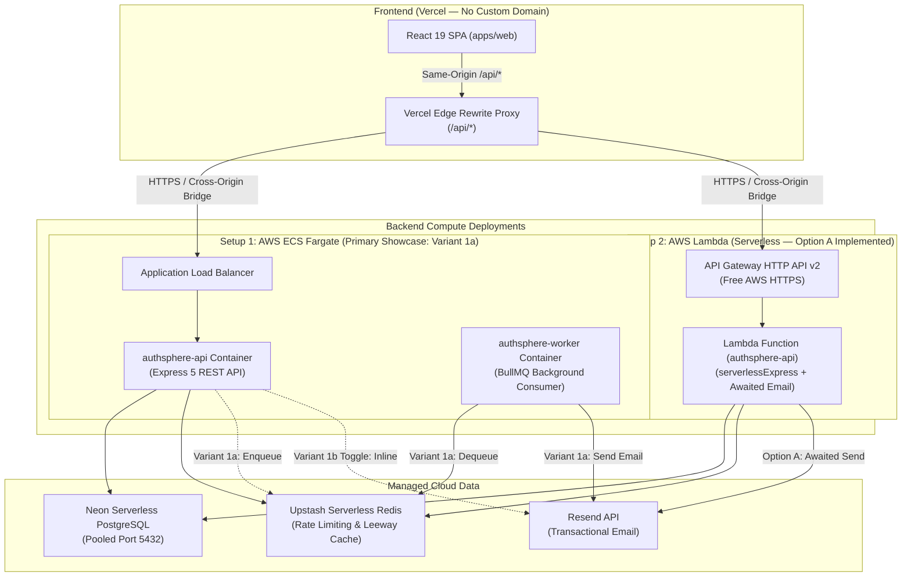
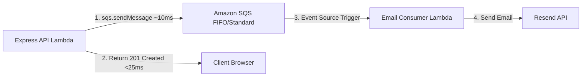

# Deployment Guide & Cloud Architecture — AuthSphere

This document specifies the deployment strategies, infrastructure architectures, and configuration guidelines for AuthSphere across containerized (AWS ECS Fargate) and serverless (AWS Lambda) environments.

---

## 1. High-Level Architecture Overview

AuthSphere decouples the frontend Single-Page Application (SPA) from the backend API, utilizing managed serverless data services to minimize operational maintenance and infrastructure costs.



---

## 2. Setup 1: AWS ECS Fargate Container Deployment

### A. Primary Showcase: Variant 1a (API + Standalone BullMQ Worker)

Variant 1a represents the **production-grade enterprise standard**:

- **Producer–Consumer Separation:** The API container handles incoming HTTP requests and enqueues jobs to Redis in <2ms. The client receives an immediate `201 Created` or `200 OK` (<20ms).
- **Failure Isolation:** Outbound email delivery issues (e.g. Resend rate limits or transient outages) never exhaust API connection pools or block HTTP worker threads.
- **Fault Tolerance:** BullMQ retries failed jobs up to 5 times with exponential backoff (2s, 4s, 8s, 16s) and retains the last 500 failed jobs for inspection.
- **Independent Autoscaling:** API tasks scale based on request latency or target group CPU; Worker tasks scale independently based on Redis queue depth (`authsphere-email`).

### B. Pragmatic Cost-Saving Toggle: Variant 1b (Inline Email Delivery)

When running cost-constrained or during maintenance:

- Set `QUEUE_DRIVER=inline` in the API service.
- Update the worker ECS service: `desiredCount: 0`.
- The API dispatches jobs asynchronously in-process via `setImmediate()` directly to the Resend SDK.
- **Cost Impact:** Drops running worker Fargate tasks to $0, eliminating continuous BullMQ Redis polling on Upstash.

### C. Task Definitions as Code

- **API Task Definition:** [infra/ecs/api-task-definition.json](../infra/ecs/api-task-definition.json)
- **Worker Task Definition:** [infra/ecs/worker-task-definition.json](../infra/ecs/worker-task-definition.json)

### D. Networking & VPC Topology

- **VPC:** 1 VPC with at least 2 Availability Zones (`ap-south-1a`, `ap-south-1b`).
- **Public Subnets (2x):** Host the Internet-Facing Application Load Balancer (ALB).
- **Private/Public Subnets (2x):** Host ECS Fargate tasks (`authsphere-api` and `authsphere-worker`).
- **Security Groups:**
  - `ALB-SG`: Ingress HTTP (80) from `0.0.0.0/0`.
  - `ECS-API-SG`: Ingress TCP 3000 restricted strictly to `ALB-SG`. Egress `0.0.0.0/0` (HTTPS 443 to Neon, Upstash, Resend).
  - `ECS-Worker-SG`: Zero inbound ingress required. Egress `0.0.0.0/0` (HTTPS 443 to Upstash, Resend).

### E. Secrets & Environment Configuration (AWS SSM Parameter Store)

| Variable                                                              | Stored In                        | Description                     |
| :-------------------------------------------------------------------- | :------------------------------- | :------------------------------ |
| `NODE_ENV`, `APP_ROLE`, `QUEUE_DRIVER`, `PORT`, `HOST`, `TRUST_PROXY` | Task Definition                  | Runtime flags                   |
| `DATABASE_URL`                                                        | SSM (`/authsphere/DATABASE_URL`) | Neon pooled connection string   |
| `REDIS_URL`                                                           | SSM (`/authsphere/REDIS_URL`)    | Upstash Redis connection string |
| `FRONTEND_URL`                                                        | SSM (`/authsphere/FRONTEND_URL`) | Vercel production URL           |
| `JWT_ACCESS_SECRET`, `JWT_REFRESH_SECRET`, `MFA_ENCRYPTION_KEY`       | SSM                              | Cryptographic keys              |
| `RESEND_API_KEY`, `EMAIL_FROM`                                        | SSM                              | Transactional email credentials |
| `GOOGLE_*`, `GITHUB_*`, `OAUTH_*`                                     | SSM                              | OAuth 2.0 PKCE credentials      |

---

## 3. Setup 2: AWS Lambda Serverless Deployment

### A. Implemented Pattern: Option A (Synchronous Awaited Delivery)

Because AuthSphere strictly separates Express application configuration ([apps/api/src/app.ts](../apps/api/src/app.ts)) from HTTP server binding ([apps/api/src/server.ts](../apps/api/src/server.ts)), the entire Express API runs inside AWS Lambda with zero route rewriting via [apps/api/src/lambda.ts](../apps/api/src/lambda.ts).

#### The Lambda "Freeze" Problem & Solution

In AWS Lambda, when the Express handler returns the HTTP response:

- The execution environment is frozen immediately.
- Any pending background tasks (`setImmediate` or un-awaited promises) are **paused mid-flight**.
- If the container is destroyed before the next request, **the email job is permanently dropped**.
- **Solution:** When running in AWS Lambda, `QUEUE_DRIVER` defaults to `sync` (or is explicitly set to `QUEUE_DRIVER=sync`). The email dispatch is `await`ed before the response is returned (~250–350ms total route latency), guaranteeing delivery without leaving uncompleted promises.

#### Cold Start & Connection Optimization

In [apps/api/src/lambda.ts](../apps/api/src/lambda.ts):

```ts
// Eagerly connect singletons outside handler invocation; reused across warm invocations
await Promise.all([prisma.$connect(), redis.connect()]);
```

- Singletons initialize once during cold start (~250ms).
- Warm invocations execute in **<15–30ms**.

### B. Documented Scale-Out Roadmap: Option B (Amazon SQS + Worker Lambda)

For high-volume serverless production environments, the cloud-native equivalent of the BullMQ worker is **Amazon SQS + Event-Driven Consumer Lambda**:



- **Scale-to-Zero:** SQS costs $0 when empty. The Worker Lambda executes only for the ~300ms required to send the email and immediately shuts down.
- **Fault Tolerance:** Native AWS SQS retry policies and Dead-Letter Queues (DLQ) without running any polling infrastructure.

### C. AWS SAM / CloudFormation Template

Committed at [infra/lambda/template.yaml](../infra/lambda/template.yaml). Declares the Lambda function (Node.js 22, 512MB RAM) and an API Gateway HTTP API v2 providing a free AWS HTTPS endpoint.

---

## 4. "No Custom Domain" Browser Security Architecture

When deploying the frontend on `https://authsphere.vercel.app` and the backend on an AWS ALB DNS (`http://...elb.amazonaws.com`) or Lambda URL (`https://...amazonaws.com`) without a custom domain, standard cross-origin setups encounter severe browser restrictions:

### The 4 Browser Security Barriers

| Challenge                       | Impact Without Proxy                                                                                                                                                                        | Vercel Edge Reverse Proxy Solution                                                                                                                                                   |
| :------------------------------ | :------------------------------------------------------------------------------------------------------------------------------------------------------------------------------------------ | :----------------------------------------------------------------------------------------------------------------------------------------------------------------------------------- |
| **1. HTTPS Mixed Content**      | AWS ALB provides plain HTTP on default `elb.amazonaws.com` domains (ACM requires custom domains). Browsers block all HTTP fetch requests from an HTTPS frontend.                            | Vercel terminates SSL on `https://authsphere.vercel.app`. Vercel edge proxies to the backend URL without browser mixed-content errors.                                               |
| **2. Cross-Site Cookies**       | AuthSphere uses `HttpOnly` cookies with `SameSite=Lax`. Browsers treat `vercel.app` and `amazonaws.com` as cross-site; modern Safari (ITP) and Chrome block third-party cookies by default. | The browser only requests `/api/*` on `authsphere.vercel.app`. Cookies are **first-party same-site**! `SameSite=Lax` works natively.                                                 |
| **3. CORS & Preflight Latency** | Every authenticated cross-origin request triggers an `OPTIONS` preflight roundtrip, adding 100–300ms latency to every API call.                                                             | Request is **same-origin**. Zero CORS headers required; zero `OPTIONS` preflight requests sent. Latency is halved.                                                                   |
| **4. CSRF Protection**          | If cookies were relaxed to `SameSite=None; Secure`, rogue sites could exploit ambient cookie transmission.                                                                                  | `SameSite=Lax` + AuthSphere's [originValidation](../apps/api/src/middlewares/origin-validation.ts) middleware verifies `sec-fetch-site` and `origin: https://authsphere.vercel.app`. |

### Vercel Edge Proxy Configuration ([apps/web/vercel.json](../apps/web/vercel.json))

```json
{
  "$schema": "https://openapi.vercel.sh/vercel.json",
  "rewrites": [
    {
      "source": "/api/:path*",
      "destination": "https://<BACKEND_URL>/:path*"
    },
    {
      "source": "/(.*)",
      "destination": "/index.html"
    }
  ]
}
```

---

## 5. Managed Cloud Data Strategy

### Neon PostgreSQL: Connection Pooling Rules

- **Runtime (ECS API / Lambda Function):** Must configure the **Pooled Connection String** (host contains `-pooler`, e.g. `ep-xyz-pooler.ap-south-1.aws.neon.tech:5432`) with `sslmode=require&pgbouncer=true`.
  - Neon's PgBouncer pooler maintains connection availability across hundreds of concurrent Lambda invocations.
- **Database Migrations (`prisma migrate deploy`):** Must use the **Direct Connection String** (without `-pooler`) in CI/CD pipelines to support migration locks and transactional DDL.

### Upstash Redis: Lean Operations

- Used for sliding-window rate limiting, OAuth PKCE state verification, and refresh token rotation leeway caching.
- When running Setup 1 Variant 1b or Setup 2 (Lambda), BullMQ is not initialized, preventing continuous command consumption on Upstash Redis free-tier limits.

---

## 6. Local Development Workflows

AuthSphere provides two streamlined Docker Compose files for local development:

```bash
# 1. Full local development stack (PostgreSQL 16 + Redis 8)
docker compose -f docker/docker-compose.dev.yml up -d

# 2. Lightweight cache-only stack (Redis 8 only, when connecting to remote Neon DB)
docker compose -f docker/docker-compose.infra.yml up -d
```

### Running Services Locally:

```bash
# Run Express REST API
npm run dev --workspace=@authsphere/api

# Run Standalone BullMQ Worker (When QUEUE_DRIVER=bullmq)
npm run dev:email-worker --workspace=@authsphere/api

# Run Vite React Frontend
npm run dev --workspace=@authsphere/web
```
