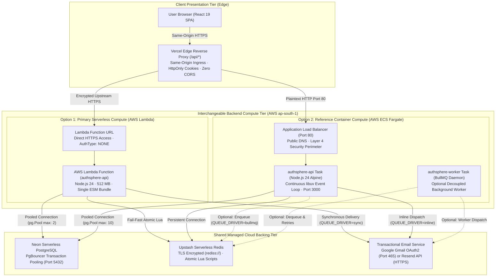
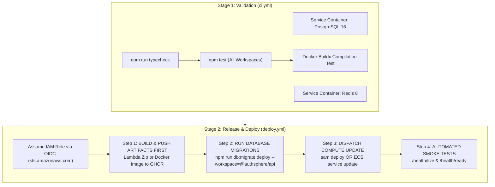

# Cloud Deployment & DevOps Guide — AuthSphere

> **Single Source of Truth (SSOT)** for AuthSphere's cloud deployment architecture, infrastructure engineering, continuous release pipelines, configuration standards, and operational workflows across serverless (AWS Lambda), containerized (AWS ECS Fargate), and edge (Vercel) environments.
>
> **Companion Guides:**
>
> - System Architecture & Component Design: [`docs/ARCHITECTURE.md`](ARCHITECTURE.md)
> - Frontend Architecture & Control Plane: [`docs/FRONTEND_ARCHITECTURE.md`](FRONTEND_ARCHITECTURE.md)
> - Architectural Decision Records (ADRs): [`docs/Engineering-Decisions.md`](Engineering-Decisions.md)
> - OAuth 2.0 & OIDC Federation Guide: [`docs/OAUTH.md`](OAUTH.md)
> - Test Architecture & Verification Matrix: [`docs/TESTING.md`](TESTING.md)

---

## 1. Architecture & Deployment Snapshot

AuthSphere implements a **Shared Backing State, Interchangeable Compute** model. Rather than treating Serverless (AWS Lambda) and Containers (AWS ECS Fargate) as separate applications, both compute targets compile from a single unified TypeScript codebase and run against the exact same managed cloud backing tier:



### Deployed Services Summary

| Component                 | Provider / Service           | Sizing / Configuration                         | Role in AuthSphere                                                               |
| :------------------------ | :--------------------------- | :--------------------------------------------- | :------------------------------------------------------------------------------- |
| **Frontend Presentation** | Vercel Edge Network          | Node.js Edge Runtime / CDN                     | Hosts React 19 SPA; provides same-origin reverse-proxy rewrites (`/api/*`).      |
| **Primary Compute**       | AWS Lambda                   | Node.js 24 (`nodejs24.x`), 512 MB, 15s timeout | Event-driven serverless REST API; scales to zero; zero idle compute cost.        |
| **Reference Compute**     | AWS ECS Fargate              | 0.25 vCPU, 512 MB, Alpine Linux (`dumb-init`)  | Continuous container execution behind an Application Load Balancer.              |
| **Database Tier**         | Neon PostgreSQL              | Serverless PostgreSQL 16 with PgBouncer        | Dual-endpoint topology (unpooled for migrations; pooled for compute).            |
| **Cache & State Tier**    | Upstash Redis                | Serverless Redis with TLS (`rediss://`)        | Atomic fixed-window rate limiting, OAuth PKCE state, session leeway.             |
| **Transactional Email**   | Gmail SMTP / OAuth2 / Resend | Nodemailer SMTP (Port 465) or Resend HTTPS     | Strategy pattern (`EmailProvider`) supporting arbitrary test recipient delivery. |

---

## 2. Compute Options: Lambda Primary & Fargate Reference

### 2.1. Option 1: Primary Serverless Compute (AWS Lambda + Function URL)

AuthSphere runs on Node.js 24 on **Amazon Linux 2023 (x86_64)** Firecracker microVMs.

#### Key Architectural Decisions:

1. **Why Lambda is Primary:** Eliminates idle compute and load-balancer costs completely while scaling automatically with request demand.
2. **Two-Layer Packaging & Native Addon Isolation:**
   - _Layer 1 (Application Bundle):_ Compiled by `tsup` into a single ESM file (`infra/lambda/lambda.mjs`). An injected banner (`import { createRequire } from "node:module"; const require = createRequire(import.meta.url);`) resolves dynamic CommonJS `require()` calls in `@codegenie/serverless-express` and `pino`.
   - _Layer 2 (Native C++ Addon):_ `argon2` is marked `external` to preserve its precompiled `.node` binary structure. Prerequisite: `npm --prefix infra/lambda ci --omit=dev`.
   - _Local Build vs. CI Isolation:_ In CI/CD, GitHub Actions runs on `ubuntu-latest`, ensuring `npm --prefix infra/lambda ci --omit=dev` installs Amazon Linux / glibc-compatible x86_64 binaries. If building locally from macOS or Windows for manual deployment or testing, raw `npm run build:lambda` packages host-architecture binaries (`win32` or `darwin`), causing Lambda runtime failures (`ELF format mismatch`). To ensure reproducible local packaging matching the Amazon Linux 2023 environment, use `sam build --use-container` or build inside a Linux container/WSL.
3. **Zero-Binary Database Engine:** Prisma 7 delegates query execution to `@prisma/adapter-pg` over pure JavaScript TCP sockets. All Prisma packages (`@prisma/client`, `@prisma/adapter-pg`, and `prisma` CLI) are locked strictly to exact version `"7.8.0"`.
4. **Function URL Pricing & Access:** Function URLs provide direct HTTP(S) access without an additional endpoint fee. Lambda request and execution charges still apply. Configured with `AuthType: NONE` as an intentional portfolio project trade-off to allow direct testing without AWS SigV4 signing.
5. **Cold-Start Performance & Sizing:**
   - _Measured Cold Start (512 MB allocation):_
     ```text
     REPORT RequestId: 7b84... Init Duration: 1045.54 ms Duration: 24.12 ms Billed Duration: 1070 ms Memory Size: 512 MB Max Memory Used: 127 MB
     ```
   - _Metric Interpretation:_ The **Init Duration (1045.54 ms)** metric reflects microVM provisioning, runtime bootstrapping, and module evaluation outside the handler. The **First Invocation Duration (24.12 ms)** covers initial handler execution, including the eager Redis TLS handshake. On subsequent warm invocations, zero-I/O routes like `/health/live` execute in **~1–3 ms**.
   - _Memory Sizing Rationale:_ A baseline 128 MB deployment was observed to fail with `Runtime.OutOfMemory` during cold-start module loading. Sizing at 512 MB provides essential memory headroom (`Max Memory Used: 127 MB` in the CloudWatch report) and proportionally allocates ~0.29 vCPU, reducing CPU-bound Argon2id verification to **~180 ms** (versus 1.8–2.2s at 128 MB).
   - _Warm Route Latencies:_ `/health/live` executes in **~1–3 ms**; `/users/me` in **~15–35 ms**; `/auth/login` in **~200–220 ms** warm end-to-end.
6. **Execution Timeout Boundary:** Configured execution timeout is **15 seconds** (application ceiling), distinct from Lambda's 900s platform maximum.

### 2.2. Option 2: Reference Container Compute (AWS ECS Fargate + ALB)

AuthSphere provides a complete containerized deployment reference running Node.js 24 Alpine on AWS Fargate behind an Application Load Balancer.

#### Key Architectural Decisions & Safeguards:

1. **Why Retain Fargate:** Serves as a reference implementation for continuous event-loop workloads, persistent connection multiplexing (`pg.Pool max: 10`), and background queue workers.
2. **Actual ECS Deployment Safeguards:**
   - _Desired Task Count:_ `1` task (baseline single-instance container reference).
   - _Deployment Circuit Breaker:_ Enabled with automatic rollback (`rollback: true`) in ECS service configuration, rolling back failed task updates automatically if new containers crash.
   - _Health-Check Grace Period:_ **30 seconds** (`--health-check-grace-period-seconds 30`), allowing Node.js container bootstrap and initial database connection checks before health checks dictate routing.
   - _Target Health Check:_ ALB routes to `/health/live` (HTTP port 3000, 30s interval, 5s timeout, healthy/unhealthy threshold: 2).
   - _Post-Deployment Smoke Tests:_ GitHub Actions executes automated retrying curl checks (`--retry 10`) on `/health/live` and `/health/ready`.
   - _Dynamic DNS Discovery & Stability Wait:_ CI/CD dynamically discovers the ALB DNS via `aws elbv2 describe-load-balancers` and waits for ECS service stability (`wait-for-service-stability: true`).
3. **Public Subnet Layer 4 Perimeter:** Containers deploy in public subnets with public IPs to pull images from GHCR without an expensive AWS NAT Gateway (~$44.53/month fixed baseline per AZ in Mumbai `ap-south-1`: $0.056/hr NAT Gateway + $0.005/hr public IPv4, excluding $0.056/GB data processing). `ECS-SG` restricts port 3000 strictly to `ALB-SG`.
4. **Worker Status Clarification:** The BullMQ worker (`authsphere-worker`) is **optional and not part of the active inline-dispatch baseline setup** (`QUEUE_DRIVER=inline`). Activating the worker daemon requires setting `DEPLOY_ECS_WORKER=true`, updating `QUEUE_DRIVER=bullmq` on the API container, and configuring separate connection factories (bounded retries for producers; `maxRetriesPerRequest: null` for workers).
5. **Local Container Environments (`docker/`):**
   - `docker/docker-compose.dev.yml`: Full local infrastructure running PostgreSQL 16 Alpine and Redis 8 Alpine for end-to-end hermetic development.
   - `docker/docker-compose.infra.yml`: Lightweight cache-only profile running Redis 8 Alpine alone, intended for developers connecting to remote Neon PostgreSQL databases.

---

## 3. Shared Infrastructure & Data Tier

Both compute targets connect to the same cloud backends without requiring modification when toggling compute targets:

### 3.1. Neon PostgreSQL: Dual-Endpoint Topology

- **Direct Unpooled Connection (`ep-xyz...`):** Configured as `DATABASE_URL_DIRECT` strictly for database migrations (`npm run db:migrate:deploy --workspace=@authsphere/api`) and initial seeding. Chosen to preserve PostgreSQL **Session-Level Advisory Lock** (`pg_advisory_lock`) semantics and DDL transactions. (Modern PgBouncer supports prepared statements, but direct connections remain the recommended practice for migration lock safety).
- **Pooled Connection (`-pooler`):** Configured as `DATABASE_URL` for runtime compute. PgBouncer multiplexes queries across concurrent microVMs and container tasks.
- **Pool Sizing & Safety:** `pg.Pool max: 2` ceiling for Lambda; `max: 10` for ECS. In `apps/api/src/lib/prisma.ts`, `pool.on("error")` intercepts background idle socket drops (e.g. Neon scale-to-zero) to prevent uncaught process crashes.

### 3.2. Upstash Redis & Background Job Architecture

- **Fail-Fast Policy (`enableOfflineQueue: false`):** Commands fail fast immediately if Redis is unreachable, rather than queuing in memory across frozen Lambda invocations.
- **Reconnection Delays:** `retryStrategy` schedules backoff delays (0ms, 50ms, 100ms; max 3 retries) and `maxRetriesPerRequest: 1` bounds command attempts.
- **Warm Ingress Readiness Gate (Lambda):** Warm microVM invocations wait up to 100ms via `once(redis, "ready")` to allow in-flight TLS handshakes to complete on fast routes.
- **BullMQ Decoupled Capability vs. Active Baseline:** BullMQ (`apps/api/src/lib/queue.ts`) with exponential backoff retries is a fully supported deployment capability for decoupled background workers (`authsphere-worker`). However, to eliminate idle Redis command consumption and polling costs across serverless tiers, default active production relies on zero-polling drivers: `QUEUE_DRIVER=sync` on AWS Lambda (synchronous in-handler execution) and `QUEUE_DRIVER=inline` on AWS ECS Fargate (event-loop dispatch via `setImmediate`), keeping the BullMQ worker task dormant until `DEPLOY_ECS_WORKER=true` is toggled.

### 3.3. Transactional Email Strategy: Gmail SMTP vs. OAuth2 vs. Resend

- **Option A1: Google Gmail SMTP with App Password (Recommended for Portfolio & Demos):** Uses Nodemailer SMTP with a dedicated Gmail account and a 16-character Google App Password (generated via Google Account -> Security -> 2-Step Verification -> App Passwords). Sends to **any arbitrary recipient** without requiring a custom domain, sensitive scope approval (`gmail.send`), or OAuth consent-screen verification. Personal account quota is **500 recipients/day**. Note: Google OAuth social sign-in remains completely independent in Testing mode requesting only basic identity scopes (`openid`, `email`, `profile`).
- **Option A2: Google Gmail OAuth2 (Preserved Alternative):** Uses Nodemailer SMTP over TLS on port 465 with OAuth2 tokens (`GMAIL_USER`, `GMAIL_REFRESH_TOKEN`). Reuses `GOOGLE_CLIENT_ID` and `GOOGLE_CLIENT_SECRET`.
- **Option B: Resend API (Enterprise SaaS):** Requires a verified sending domain with SPF and DKIM DNS records (DMARC recommended) for arbitrary recipient delivery. Free tier allows 3,000 emails/month (100/day); default API rate limit is **10 requests/second**. Sandbox mode (`onboarding@resend.dev`) delivers exclusively to the account owner.

### 3.4. Decoupled Secret Stores & Key Rotation Operational Rules

- **Decoupled Secret Stores:**
  - _Lambda_ receives secrets as deploy-time parameter overrides from GitHub Secrets.
  - _ECS Fargate_ resolves secrets natively from AWS SSM Parameter Store (`/authsphere/prod/*`) at container boot.
  - These two stores are independent, unsynchronized copies. Any credential update requires updating **both** stores and triggering deployments for both targets.
- **JWT Secrets (`JWT_ACCESS_SECRET`, `JWT_REFRESH_SECRET`):**
  - Tokens signed with an old key are rejected by instances using the new key.
  - During mixed-version deployments or rolling cutovers, authentication can fail intermittently while old and new instances temporarily coexist.
  - As cutover completes and old instances drain, users holding tokens signed with the old key must re-authenticate. Seamless rotation without disruption requires application-level multi-key verification (e.g. JWKS key sets).
- **MFA Encryption Key (`MFA_ENCRYPTION_KEY`):**
  - `MFA_ENCRYPTION_KEY` derives the 32-byte AES-256-GCM key used to encrypt TOTP secrets in the database.
  - Existing encrypted TOTP secrets must be decrypted with the old key and re-encrypted with the new key before retiring the old key. Otherwise, affected users cannot generate valid TOTP codes and must re-enrol MFA.
  - Seamless rotation requires application-level multi-key decryption fallback.

---

## 4. Frontend Ingress & Edge Security

AuthSphere routes frontend traffic through Vercel's Edge Reverse Proxy (`apps/web/vercel.ts`), eliminating cross-origin complexity while terminating SSL at edge Points of Presence (POPs). For internal Express middleware pipelines (Helmet, CORS, Request ID, Origin Validation, Rate Limiter), refer to [`docs/ARCHITECTURE.md`](ARCHITECTURE.md#2-layered-component-architecture).

### 4.1. Browser Security Resolution Matrix

| Security Dimension             | Direct Cross-Origin Direct Challenge                                                   | Vercel Edge Reverse Proxy Resolution                                                                                                      |
| :----------------------------- | :------------------------------------------------------------------------------------- | :---------------------------------------------------------------------------------------------------------------------------------------- |
| **HTTPS Mixed Content**        | Browsers block insecure HTTP requests initiated from an HTTPS frontend.                | Vercel terminates browser SSL. The edge proxy rewrites `/api/*` upstream, eliminating mixed-content blocks.                               |
| **Cookie Privacy & Isolation** | Browsers treat disparate origins as third-party contexts, partitioning cookies.        | Requests route to `https://<FRONTEND_URL>/api/*`. Cookies remain strictly **first-party same-origin** (`SameSite=Lax; HttpOnly; Secure`). |
| **CORS Preflight Overhead**    | Cross-origin mutations trigger browser `OPTIONS` preflights, adding roundtrip latency. | Browser requests are same-origin from the browser's perspective, completely eliminating `OPTIONS` preflight calls.                        |
| **CSRF Defense**               | Relying on `SameSite=None` increases cross-site attack surfaces.                       | Preserves `SameSite=Lax`. AuthSphere's `originValidation` middleware verifies `Sec-Fetch-Site` and `Origin` headers.                      |

### 4.2. Ingress Transport Security & Proxy Trust Calibration

1. **Transport Security Ingress:**
   - **Lambda:** Connects over native AWS-managed TLS via its Function URL. Vercel proxies requests over an **encrypted upstream HTTPS connection** (two distinct TLS legs: Browser --HTTPS--> Vercel Edge, then Vercel --HTTPS--> Lambda).
   - **ECS Fargate:** The ALB listener uses plaintext HTTP on port `80`. The proxy hop from Vercel to the ALB travels over public networks unencrypted.
2. **Proxy Trust Calibration & IP Attribution Limitation:**
   - Express relies on `TRUST_PROXY` to derive `req.ip` from `X-Forwarded-For`.
   - On Lambda: `TRUST_PROXY=1` (1 hop: `Browser -> Vercel -> Lambda`).
   - On ECS Fargate: `TRUST_PROXY=2` (2 hops: `Browser -> Vercel -> ALB -> Container`).
   - **Accepted Security Limitation:** Express derives `req.ip` using the configured proxy trust depth. Because direct backend ingress is intentionally permitted for evaluator testing, client IP attribution is not guaranteed to be trustworthy. IP-based rate limiting and audit logging have this accepted limitation.

### 4.3. Edge Route Mappings & Reverse Proxy Rewrites (`/api/*`)

All public browser interactions route through Vercel's Edge Reverse Proxy declared in `apps/web/vercel.ts`:

```typescript
export const config: VercelConfig = {
  redirects: [
    {
      source: "/api/docs",
      destination: "/api/docs/",
      permanent: true,
    },
  ],
  rewrites: [
    routes.rewrite("/api/(.*)", `${backendUrl}/$1`),
    routes.rewrite("/(.*)", "/index.html"),
  ],
};
```

The edge proxy strips the leading `/api` prefix on incoming browser requests and forwards the path and query string upstream:

```text
Browser Ingress:   https://<PUBLIC_DOMAIN>/api/auth/login
Edge Rewrite:      /api/(.*)  ->  ${BACKEND_URL}/$1
Upstream Target:   https://<lambda-id>.lambda-url.ap-south-1.on.aws/auth/login
```

This single-origin routing ensures authentication cookies (`accessToken`, `refreshToken` on `Path=/`) and PKCE transaction cookies (`oauth_verifier_<state>` on `Path=/api/auth/oauth`) remain strictly first-party, while eliminating browser CORS preflight overhead.

> [!NOTE]
> For the complete canonical route inventory of all 33 endpoints, RBAC access guards, and request/response contracts, see [`docs/ARCHITECTURE.md#21-complete-route-inventory--openapi-31-operation-registry-33-operations`](ARCHITECTURE.md#21-complete-route-inventory--openapi-31-operation-registry-33-operations).

> [!IMPORTANT]
> **Edge Proxy Trailing Slash & Cookie Isolation:**
>
> 1. `BACKEND_URL` in Vercel project settings must omit trailing slashes (`https://<lambda-id>.lambda-url.ap-south-1.on.aws`).
> 2. The PKCE transaction cookie is scoped to `Path=/api/auth/oauth` matching the public edge path.
> 3. Session cookies (`accessToken`, `refreshToken`) are scoped to `Path=/`, allowing all `/api/*` and client requests to transmit credentials seamlessly without cross-origin partitioning.

### 4.4. Rate Limiting Policies & Proxy Header Calibration

AuthSphere deploys a multi-tier rate limiting architecture powered by an atomic Upstash Redis Lua script (`INCR` + conditional `EXPIRE`), protecting serverless compute against denial-of-service while preserving legitimate administrative traffic.

#### Dual Rate Limit Key Resolution (`keyType: "user"` vs `keyType: "ip"`)

Behind reverse proxies, standard IP-based rate limiting can mistakenly throttle entire corporate networks or shared NAT gateways. AuthSphere decouples rate limiting through dual key resolution:

1. **User-Scoped Rate Limiting (`keyType: "user"`):**
   - Applied to authenticated administrative and user endpoints (e.g. `USERS_LIST`, `ROLE_READ_PERMISSIONS`, `USER_READ`).
   - **Key Format:** `rl:<name>:user:<userId>`.
   - **Edge Proxy Advantage:** Keyed directly to `req.auth.userId`. Operates completely independently of edge proxy IP attribution, client IP shifts, or VPN gateways. Every administrator and user receives a dedicated request quota.
2. **IP-Scoped Rate Limiting (`keyType: "ip"`):**
   - Applied to public unauthenticated endpoints (e.g. `GLOBAL`, `SIGNUP`, `LOGIN`, `OAUTH_INITIATE`, `OAUTH_CALLBACK`).
   - **Key Format:** `rl:<name>:ip:<clientIp>`.
   - **Proxy Calibration:** Resolves client IP via `req.ip` using the configured `TRUST_PROXY` depth (1 for Lambda; 2 for ECS).

> [!NOTE]
> For the canonical policy registry and per-endpoint request limits across all routes, refer to [`docs/ARCHITECTURE.md#21-complete-route-inventory--openapi-31-operation-registry-33-operations`](ARCHITECTURE.md#21-complete-route-inventory--openapi-31-operation-registry-33-operations) and [`docs/Engineering-Decisions.md#adr-051--atomic-fixed-window-rate-limiting-via-eval-lua-scripting`](Engineering-Decisions.md#adr-051--atomic-fixed-window-rate-limiting-via-eval-lua-scripting).

#### Edge Proxy Response Headers

The API emits standardized rate limiting headers that pass transparently through the Vercel edge reverse proxy:

- `RateLimit-Limit`: Maximum requests permitted within the 60-second fixed window.
- `RateLimit-Remaining`: Remaining request quota in the active window.
- `RateLimit-Reset`: Time remaining (in seconds) until the current window resets.
- `Retry-After`: Returned on HTTP `429 Too Many Requests` indicating wait seconds required before retry.

---

## 5. CI/CD & Automated Release Pipeline

The primary deployment mechanism for AuthSphere is the automated two-stage Directed Acyclic Graph (DAG) declared in `.github/workflows/`:



### 5.1. Normal Production Release Flow (GitHub Actions)

1. **Merge / Push to `main`:** Developers push or merge code to `main` (or dispatch `deploy.yml` manually).
2. **Automated Validation (Stage 1):** Validates monorepo types, executes migrations against ephemeral test containers, runs unit tests, and tests Docker build compilation.
3. **OIDC Authentication (Stage 2):** GitHub Actions authenticates to AWS via OpenID Connect (`aws-actions/configure-aws-credentials`) without static long-lived credentials.
   - _OIDC Claim Formats:_ Standard format is `repo:utkarshj014/authsphere:ref:refs/heads/main` (or wildcard pattern `repo:utkarshj014/authsphere:*` for feature branch testing). Third-party user forks have distinct logins/IDs and remain blocked in all cases.
4. **Artifact Creation First Invariant:** The compute artifact (Docker image pushed to GHCR or `authsphere-api.zip`) is built and published _before_ database migrations run. This guarantees the release code compiles before mutating persistent database schemas.
5. **Database Migrations:** Prisma migrations execute against Neon via direct unpooled connection (`DATABASE_URL_DIRECT`) using `npm run db:migrate:deploy --workspace=@authsphere/api`. Migrations follow **Expand-and-Contract** backward-compatibility rules so running instances continue serving traffic without disruption.
6. **Compute Update Dispatch:**
   - If `DEPLOY_TARGET=serverless` (default): Executes `sam deploy` targeting AWS Lambda with parameter overrides.
   - If `DEPLOY_TARGET=ecs`: Dynamically discovers ALB DNS, renders task definitions, updates ECS services with circuit breaker enabled, and waits for service stability.
7. **Automated Verification:** Executes automated retrying smoke tests against `/health/live` and `/health/ready`.

### 5.2. Optional Manual Bootstrap / Recovery (`sam deploy`)

Local CLI deployment (`sam deploy --guided`) is an optional disaster recovery or initial bootstrapping procedure, not the routine release pipeline. When packaging locally outside CI, execute `sam build --use-container` first to compile native C++ addons (`argon2`) within an Amazon Linux container environment.

> [!WARNING]
> When prompted `Save arguments to configuration file [Y/n]`, answer **`N`**. SAM CLI persists guided values in plaintext to `samconfig.toml`. Never commit secret parameter overrides to version control.

---

## 6. Compute Switching & Rollback

Because both compute options connect to identical managed cloud backing stores, switching compute targets requires zero database migration and zero secret edits:

```
                        Dual-Run Compute Cutover Procedure
┌───────────────────────────────┬───────────────────────────────────┬───────────────────────────────────┐
│ Operational Step              │ Path A: Switching to ECS Container│ Path B: Switching to Lambda       │
├───────────────────────────────┼───────────────────────────────────┼───────────────────────────────────┤
│ 1. Set GitHub Target Variable │ DEPLOY_TARGET = ecs               │ DEPLOY_TARGET = serverless        │
│ 2. Run CI/CD Workflow         │ Run deploy.yml (Builds & deploys) │ Run deploy.yml (Builds & deploys) │
│ 3. Update Vercel Ingress      │ BACKEND_URL = http://<ALB_DNS>    │ BACKEND_URL = <LAMBDA_URL>        │
│ 4. Redeploy Vercel Frontend   │ Redeploy frontend, verify ingress │ Redeploy frontend, verify ingress │
│ 5. Cost Hygiene (After Proof) │ Scale ECS desired-count: 1        │ Scale ECS tasks to 0 via AWS CLI  │
└───────────────────────────────┴───────────────────────────────────┴───────────────────────────────────┘
```

### Dual-Run Low-Downtime Principles & Rollback:

1. **Active Backend Continuity:** The existing backend remains fully active and serving traffic throughout the new backend's build and deployment window.
2. **Controlled Ingress Cutover:** Once the new compute target passes health checks, update `BACKEND_URL` in Vercel project settings and trigger a **new Vercel deployment** (required for updated environment variables to take effect on edge rewrites).
3. **Verification Before Decommissioning:** Keep the old backend active until end-to-end testing confirms the new backend is processing requests cleanly through Vercel. Only then scale down the previous compute target.
4. **Rollback:** If an issue arises after cutover, manually revert `BACKEND_URL` in Vercel and trigger a frontend redeployment.

> [!WARNING]
> **AWS Lambda Function URL Trailing Slash Invariant:**
> CloudFormation outputs `FunctionUrl` with a trailing slash (`https://<id>.lambda-url.<region>.on.aws/`). Because `apps/web/vercel.ts` rewrites routes via `${backendUrl}/$1`, **you must strip the trailing slash** when configuring `BACKEND_URL` in Vercel project settings (set `https://<id>.lambda-url.<region>.on.aws`). Leaving the trailing slash creates corrupted double-slash paths (`https://...//$1`), breaking API rewrites.

---

## 7. Cloud Cost Management & Infrastructure Hygiene

### 7.1. Cost Breakdown for `ap-south-1` (Mumbai)

Understanding the true monthly infrastructure costs across compute options:

```
                     Monthly Infrastructure Cost Breakdown (AWS ap-south-1)
┌──────────────────────────────────────┬───────────────────────────┬───────────────────────────┐
│ Cost Component                       │ Serverless (AWS Lambda)   │ Containers (ECS + ALB)    │
├──────────────────────────────────────┼───────────────────────────┼───────────────────────────┤
│ Base Compute Allocation              │ $0.00 (scales to zero)    │ ~$9.47 (0.25 vCPU / 0.5 GB)│
│ ALB Hourly Charge ($0.0239/hr)       │ $0.00 (Function URL free) │ ~$17.45 (730 hours)       │
│ Public IPv4 Addresses (3x total)     │ $0.00 (out-of-VPC)        │ ~$10.95 (2x ALB + 1x Task)│
│ Load Balancer Capacity Units (LCU)   │ $0.00 (Function URL free) │ Usage-based ($0.00 idle)  │
│ Ingress Endpoint / Gateway Charge    │ $0.00 (Function URL free) │ Included in ALB           │
├──────────────────────────────────────┼───────────────────────────┼───────────────────────────┤
│ Fixed Baseline Before LCU Usage      │ $0.00 / month idle compute│ ~$37.87 / month baseline  │
└──────────────────────────────────────┴───────────────────────────┴───────────────────────────┘
```

_(Note: Actual monthly totals scale with traffic. LCU usage, request duration, and outbound data transfer are usage-based. ALB has no mandatory minimum LCU fee; an idle load balancer incurs zero LCU charges. Lambda Function URLs eliminate endpoint fees, while standard Lambda invocation and execution duration charges apply)._

### 7.2. Shutdown & Cost Optimization Procedures

1. **Short-Term Compute Optimization: Scale Fargate Tasks to 0**

   ```bash
   # Scale down the primary API service
   aws ecs update-service --cluster authsphere-cluster --service authsphere-api --desired-count 0 --region ap-south-1

   # If the decoupled worker was activated (DEPLOY_ECS_WORKER=true), scale down the worker service:
   aws ecs update-service --cluster authsphere-cluster --service authsphere-worker --desired-count 0 --region ap-south-1
   ```

   - _Savings:_ Eliminates Fargate vCPU, memory, and task public IPv4 charges (~$13.12/month per running task). Scaling back up to 1 takes ~30 seconds.

2. **Long-Term Optimization: Deleting the ALB (Retaining Target Group)**
   - _Savings:_ Eliminates the fixed ALB hourly charge and both ALB public IPv4 addresses (~$24.75/month).
   - _Critical Invariant:_ **Delete only the ALB (`authsphere-alb`) and retain the Target Group (`authsphere-api-tg`).** The ECS service references the target group's unique, immutable ARN. Detached target groups incur **$0.00/month** and allow the recreated ALB listener on port 80 to reattach seamlessly without modifying the ECS service.

---

## 8. Verification & Operational Reference

### 8.1. 4-Tier Verification Probes Matrix

| Probe                    | Endpoint            | Target Dependencies                  | Normal Latency                                | Operational Role & Verification Function                                                                                                                                                                                                                   |
| :----------------------- | :------------------ | :----------------------------------- | :-------------------------------------------- | :--------------------------------------------------------------------------------------------------------------------------------------------------------------------------------------------------------------------------------------------------------- |
| **Liveness**             | `GET /health/live`  | None (In-memory)                     | **~1–3 ms**                                   | Validates HTTP router and serverless proxy. Zero database or native C++ execution.                                                                                                                                                                         |
| **Readiness**            | `GET /health/ready` | Neon PostgreSQL + Upstash Redis      | **~10–30 ms** (warm; ~2–3s on Neon cold wake) | Validates external network connections and database sockets. Zero native C++ execution.                                                                                                                                                                    |
| **Native Addon Hashing** | `POST /auth/signup` | Native C++ binary + Linux glibc + DB | **~220–250 ms** (warm)                        | **Empirical Hashing Proof:** Executes `argon2.hash()` to register a new user. Proves native C++ binding on AL2023 and returns HTTP 201 Created.                                                                                                            |
| **Native Addon Verify**  | `POST /auth/login`  | Native C++ binary + Linux glibc + DB | **~200–220 ms** (warm)                        | **Empirical Verify Proof:** Executes `argon2.verify()`. Requires an email-verified test account (otherwise responds with HTTP 403 "Email not verified"). Proves native C++ execution on AL2023 and returns HTTP 200 with session tokens upon verification. |

### 8.2. Verification Commands

```bash
# 1. In-memory router and serverless proxy verification
curl -i https://<ACTIVE_ENDPOINT>/health/live

# 2. External PostgreSQL and Redis connection verification
curl -i https://<ACTIVE_ENDPOINT>/health/ready

# 3. Empirically verify native Argon2 password hashing (argon2.hash()) via registration
# Use a dedicated disposable email address. Dispatches verification email and returns HTTP 201 Created:
curl -i -X POST https://<ACTIVE_ENDPOINT>/auth/signup \
  -H "Content-Type: application/json" \
  -d '{"firstName":"Probe","lastName":"User","email":"probe-verification-1@example.com","password":"TestPassword123!"}'

# 4. Empirically verify native Argon2 password verification (argon2.verify()) via login
# NOTE: AuthSphere enforces email verification before granting session access (apps/api/src/modules/auth/auth.service.ts).
# - If invoked with an unverified account: executes argon2.verify() successfully, but returns HTTP 403 "Email not verified".
# - If invoked with an already-verified test account (or after completing verification): returns HTTP 200 OK with session tokens.
curl -i -X POST https://<ACTIVE_ENDPOINT>/auth/login \
  -H "Content-Type: application/json" \
  -d '{"email":"probe-verification-1@example.com","password":"TestPassword123!"}'

# 5. Verify atomic Upstash Redis rate limiting quota exhaustion (loops until HTTP 429)
for i in {1..105}; do
  curl -s -D - -o /dev/null https://<ACTIVE_ENDPOINT>/openapi.json | grep -E "(HTTP\/|ratelimit-remaining)"
done

# 6. Verify paginated admin user listing behind edge proxy
curl -i "https://<PUBLIC_DOMAIN>/api/users?page=1&limit=10" \
  -H "Authorization: Bearer <ADMIN_ACCESS_TOKEN>"

# 7. Verify role permissions read endpoint behind edge proxy
curl -i "https://<PUBLIC_DOMAIN>/api/roles/ADMIN/permissions" \
  -H "Authorization: Bearer <ADMIN_ACCESS_TOKEN>"

# 8. Verify user-scoped rate limiting enforcement on USERS_LIST (30 req / 1 min)
for i in {1..35}; do
  curl -s -D - -o /dev/null "https://<PUBLIC_DOMAIN>/api/users?page=1&limit=1" \
    -H "Authorization: Bearer <ADMIN_ACCESS_TOKEN>" | grep -E "(HTTP\/|ratelimit-remaining)"
done
```

### 8.3. Unified Environment Variables Reference

#### Plaintext Runtime Configuration:

| Variable                            | Location                        | Default / Value                  | Description                                                             |
| :---------------------------------- | :------------------------------ | :------------------------------- | :---------------------------------------------------------------------- |
| `NODE_ENV`                          | Task Def / SAM Globals          | `production`                     | Application mode (`development`, `production`, `test`)                  |
| `APP_ROLE`                          | Task Def / SAM Globals          | `api`                            | Process role (`api` or `worker`)                                        |
| `QUEUE_DRIVER`                      | Task Def / SAM Globals          | `sync` (Lambda) / `inline` (ECS) | Delivery mode (`sync` serverless, `inline` container, `bullmq` worker)  |
| `PORT`                              | Task Def / Not needed on Lambda | `3000`                           | HTTP listening port (Lambda executes in-process via serverless adapter) |
| `HOST`                              | Task Def / SAM Globals          | `0.0.0.0`                        | API listening host binding                                              |
| `TRUST_PROXY`                       | Task Def / SAM Globals          | `1` (Lambda) / `2` (ECS)         | Proxy hops: 1 for Vercel -> Lambda, 2 for Vercel -> ALB -> Container    |
| `DATABASE_POOL_MAX`                 | Task Def / SAM Globals          | `2` (Lambda) / `10` (ECS)        | PostgreSQL pool upper ceiling per compute instance                      |
| `JWT_ACCESS_EXPIRES_IN`             | Task Def / SAM Globals          | `15m`                            | Access token expiration duration                                        |
| `JWT_REFRESH_EXPIRES_IN`            | Task Def / SAM Globals          | `30d`                            | Refresh token expiration duration                                       |
| `AUTH_REUSE_DELETION_MODE`          | Task Def / SAM Globals          | `SESSION`                        | Compromised refresh token policy (`SESSION` or `GLOBAL`)                |
| `AUTH_REFRESH_TOKEN_LEEWAY_SECONDS` | Task Def / SAM Globals          | `30`                             | Concurrent multi-tab rotation leeway window (seconds)                   |
| `EMAIL_PROVIDER`                    | SAM Variable / SSM Parameter    | `gmail` / `resend`               | Active email provider strategy                                          |

#### Sensitive Secrets & Service Credentials:

| Variable                  | Primary Serverless (Lambda)                            | Reference Containers (ECS)                     | Description                                               |
| :------------------------ | :----------------------------------------------------- | :--------------------------------------------- | :-------------------------------------------------------- |
| `DATABASE_URL_DIRECT`     | GitHub Secret `DATABASE_URL_DIRECT`                    | GitHub Secret `DATABASE_URL_DIRECT`            | Direct unpooled Neon URL (strictly for CI migrations)     |
| `DATABASE_URL`            | SAM Parameter (`NoEcho`) from `DATABASE_URL_POOLED`    | SSM `/authsphere/prod/DATABASE_URL`            | Pooled Neon PostgreSQL connection URL (`-pooler`)         |
| `REDIS_URL`               | SAM Parameter (`NoEcho`) from Secret                   | SSM `/authsphere/prod/REDIS_URL`               | Upstash Redis connection URL (`rediss://...`)             |
| `FRONTEND_URL`            | SAM Parameter from Variable                            | SSM `/authsphere/prod/FRONTEND_URL`            | Hosted frontend origin (`https://<PROJECT>.vercel.app`)   |
| `JWT_ACCESS_SECRET`       | SAM Parameter (`NoEcho`) from Secret                   | SSM `/authsphere/prod/JWT_ACCESS_SECRET`       | Signing secret for access JWTs (32+ chars)                |
| `JWT_REFRESH_SECRET`      | SAM Parameter (`NoEcho`) from Secret                   | SSM `/authsphere/prod/JWT_REFRESH_SECRET`      | Signing secret for refresh JWTs (32+ chars)               |
| `MFA_ENCRYPTION_KEY`      | SAM Parameter (`NoEcho`) from Secret                   | SSM `/authsphere/prod/MFA_ENCRYPTION_KEY`      | 32-byte key for AES-256-GCM TOTP secret encryption        |
| `GMAIL_USER`              | SAM Parameter / Optional                               | SSM `/authsphere/prod/GMAIL_USER`              | Sender Gmail address for SMTP / OAuth2 sending            |
| `GMAIL_APP_PASSWORD`      | SAM Parameter (`NoEcho`) / Optional                    | SSM `/authsphere/prod/GMAIL_APP_PASSWORD`      | Gmail 16-character App Password for SMTP sending          |
| `GMAIL_REFRESH_TOKEN`     | SAM Parameter (`NoEcho`) / Optional                    | SSM `/authsphere/prod/GMAIL_REFRESH_TOKEN`     | Gmail OAuth2 refresh token                                |
| `RESEND_API_KEY`          | SAM Parameter (`NoEcho`) / Optional                    | SSM `/authsphere/prod/RESEND_API_KEY`          | Resend API key                                            |
| `EMAIL_FROM`              | SAM Parameter / Optional                               | SSM `/authsphere/prod/EMAIL_FROM`              | Sender identity string (`AuthSphere <noreply@...>`)       |
| `GOOGLE_CLIENT_ID`        | SAM Parameter / Optional                               | SSM `/authsphere/prod/GOOGLE_CLIENT_ID`        | Google OAuth Client ID                                    |
| `GOOGLE_CLIENT_SECRET`    | SAM Parameter (`NoEcho`) / Optional                    | SSM `/authsphere/prod/GOOGLE_CLIENT_SECRET`    | Google OAuth Client Secret                                |
| `GITHUB_CLIENT_ID`        | SAM Parameter from `GH_OAUTH_CLIENT_ID` (reserved var) | SSM `/authsphere/prod/GITHUB_CLIENT_ID`        | GitHub OAuth Client ID (CI: `GH_OAUTH_CLIENT_ID`)         |
| `GITHUB_CLIENT_SECRET`    | SAM Parameter from `GH_OAUTH_CLIENT_SECRET` (reserved) | SSM `/authsphere/prod/GITHUB_CLIENT_SECRET`    | GitHub OAuth Client Secret (CI: `GH_OAUTH_CLIENT_SECRET`) |
| `OAUTH_CALLBACK_BASE_URL` | SAM Parameter / Optional                               | SSM `/authsphere/prod/OAUTH_CALLBACK_BASE_URL` | OAuth callback base URL routed via Vercel                 |

#### Frontend & Edge Reverse Proxy Configuration:

| Variable       | Target Location                                 | Description                                                                                                                                                                                                                                                                                                                                                       |
| :------------- | :---------------------------------------------- | :---------------------------------------------------------------------------------------------------------------------------------------------------------------------------------------------------------------------------------------------------------------------------------------------------------------------------------------------------------------- |
| `BACKEND_URL`  | Vercel Project Settings → Environment Variables | Live backend base URL without trailing slash (`https://<LAMBDA_URL>` or `http://<ALB_DNS>`). **Important:** CloudFormation outputs `FunctionUrl` with a trailing slash (`https://...on.aws/`) which **must be stripped** before configuring Vercel to avoid double-slash (`//$1`) rewrite corruption. Used server-side by `apps/web/vercel.ts` for Edge rewrites. |
| `VITE_API_URL` | `apps/web/.env` / Vercel Environment Variables  | Web client API base URL. **Leave empty** in production to route through Vercel's same-origin proxy (`/api/*`), preserving HttpOnly cookies and zeroing CORS.                                                                                                                                                                                                      |

---

## 9. Local Development Quickstart

### 9.1. Start Infrastructure & Environment

```bash
# 1. Start local service containers:
# Option A: Full local infrastructure (PostgreSQL 16 + Redis 8)
docker compose -f docker/docker-compose.dev.yml up -d

# Option B: Cache-only infrastructure (Redis 8 only, when connecting to remote Neon DB)
docker compose -f docker/docker-compose.infra.yml up -d

# 2. Copy environment templates
cp apps/api/.env.example apps/api/.env
cp apps/web/.env.example apps/web/.env
```

### 9.2. Database Migrations & Initial Seeding

```bash
# 1. Apply schema migrations to local database
npm run db:migrate:deploy --workspace=@authsphere/api

# 2. Seed baseline system roles (USER, ADMIN) and permissions
npm run db:seed --workspace=@authsphere/api
```

### 9.3. Start Development Servers

```bash
# 1. Start Express REST API (port 3000)
npm run dev --workspace=@authsphere/api

# 2. (Optional) Start BullMQ Email Worker (when QUEUE_DRIVER=bullmq)
npm run dev:email-worker --workspace=@authsphere/api

# 3. Start Vite React Frontend (port 5173 with /api proxy to port 3000)
npm run dev --workspace=@authsphere/web
```

---

## 10. Architectural Decision Records (ADRs)

AuthSphere's cloud deployment, containerization, and runtime architecture are governed by formal Architectural Decision Records in [Engineering-Decisions.md](Engineering-Decisions.md):

- [ADR-010: Multi-Resource Graceful Shutdown](Engineering-Decisions.md#adr-010--multi-resource-graceful-shutdown) — Intercepts termination signals to drain in-flight requests before resource disconnect.
- [ADR-011: Operational Health Monitoring Pattern](Engineering-Decisions.md#adr-011--operational-health-monitoring-pattern) — Decouples in-memory process liveness (`/health/live`) from external dependency readiness (`/health/ready`).
- [ADR-053: Zod-Validated Proxy Trust Configuration](Engineering-Decisions.md#adr-053--zod-validated-proxy-trust-configuration) — Enforces strict runtime validation on `TRUST_PROXY` depth for single-hop (Lambda) vs dual-hop (ECS) ingress.
- [ADR-054: Proxy-Derived Client IP Resolution via Express `req.ip`](Engineering-Decisions.md#adr-054--proxy-derived-client-ip-resolution-via-express-reqip) — Standardizes proxy-derived IP extraction while documenting best-effort attribution under direct backend access.
- [ADR-055: Resource Isolation & Origin Validation for State-Changing Requests](Engineering-Decisions.md#adr-055--resource-isolation--origin-validation-for-state-changing-requests) — Protects mutating API endpoints against cross-origin abuse via `Sec-Fetch-Site` and `Origin` headers.
- [ADR-074: Unified Redis Architecture (ioredis Migration)](Engineering-Decisions.md#adr-074--unified-redis-architecture-ioredis-migration) — Standardizes all Redis operations on `ioredis` for BullMQ compatibility.
- [ADR-077: Process-Aware Environment Partitioning and Least Privilege Secret Isolation](Engineering-Decisions.md#adr-077--process-aware-environment-partitioning-and-least-privilege-secret-isolation) — Partitions environment schemas by process role (`APP_ROLE`), isolating credentials.
- [ADR-078: Dual-Driver Background Job Architecture and Cloud Migration Path](Engineering-Decisions.md#adr-078--dual-driver-background-job-architecture-and-cloud-migration-path) — Governs `QUEUE_DRIVER: inline | bullmq | sync` to eliminate idle Redis polling in low-traffic tiers.
- [ADR-079: Serverless Lambda Runtime, Synchronous Execution Guard, and Reverse-Proxy Cookie Bridge](Engineering-Decisions.md#adr-079--serverless-lambda-runtime-synchronous-execution-guard-and-reverse-proxy-cookie-bridge) — Adapts Express to AWS Lambda and standardizes root-scoped cookies for edge reverse-proxy compatibility.
- [ADR-085: Code-First Edge Reverse Proxy Configuration via `@vercel/config/v1`](Engineering-Decisions.md#adr-085--code-first-edge-reverse-proxy-configuration-via-vercelconfigv1) — Manages dynamic edge routing rewrites in TypeScript without committing hardcoded backend URLs.
- [ADR-086: Development-to-Production Reverse Proxy Parity via Vite Local Server](Engineering-Decisions.md#adr-086--development-to-production-reverse-proxy-parity-via-vite-local-server) — Mirrors production edge reverse-proxy routing locally in Vite for seamless same-origin `/api` development.
- [ADR-090: Keyless Cloud Deployment via AWS IAM OpenID Connect (OIDC) Federation](Engineering-Decisions.md#adr-090--keyless-cloud-deployment-via-aws-iam-openid-connect-oidc-federation) — Authenticates GitHub Actions CI/CD to AWS via temporary STS credentials without static secret storage.
- [ADR-095: Dual Database Connection Strategy (Neon Direct Migrations vs Pooled Runtime)](Engineering-Decisions.md#adr-095--dual-database-connection-strategy-neon-direct-migrations-vs-pooled-runtime) — Separates direct unpooled connections for migration locks from pooled connections for runtime compute.
- [ADR-096: Multi-Stage Container Architecture with Non-Root Execution and PID 1 Signal Reaping (`dumb-init`)](Engineering-Decisions.md#adr-096--multi-stage-container-architecture-with-non-root-execution-and-pid-1-signal-reaping-dumb-init) — Implements non-root execution (`USER node`) and `dumb-init` PID 1 signal forwarding for ECS task lifecycle management.
- [ADR-097: Single-File Tree-Shaken ESM Lambda Bundling with Native C++ Addon Externalization (`tsup`)](Engineering-Decisions.md#adr-097--single-file-tree-shaken-esm-lambda-bundling-with-native-c-addon-externalization-tsup) — Bundles pure JS dependencies into a single minified bundle while keeping native Argon2 C++ addons externalized.
- [ADR-098: Unified Dual-Target Deployment Pipeline (Serverless Lambda vs Containerized ECS Fargate)](Engineering-Decisions.md#adr-098--unified-dual-target-deployment-pipeline-serverless-lambda-vs-containerized-ecs-fargate) — Orchestrates a unified GitHub Actions deployment pipeline supporting interchangeable Lambda and ECS Fargate targets.
