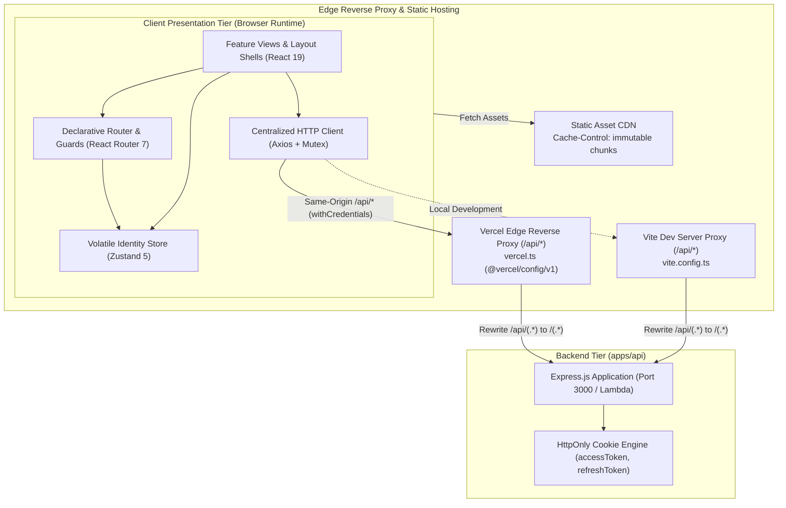
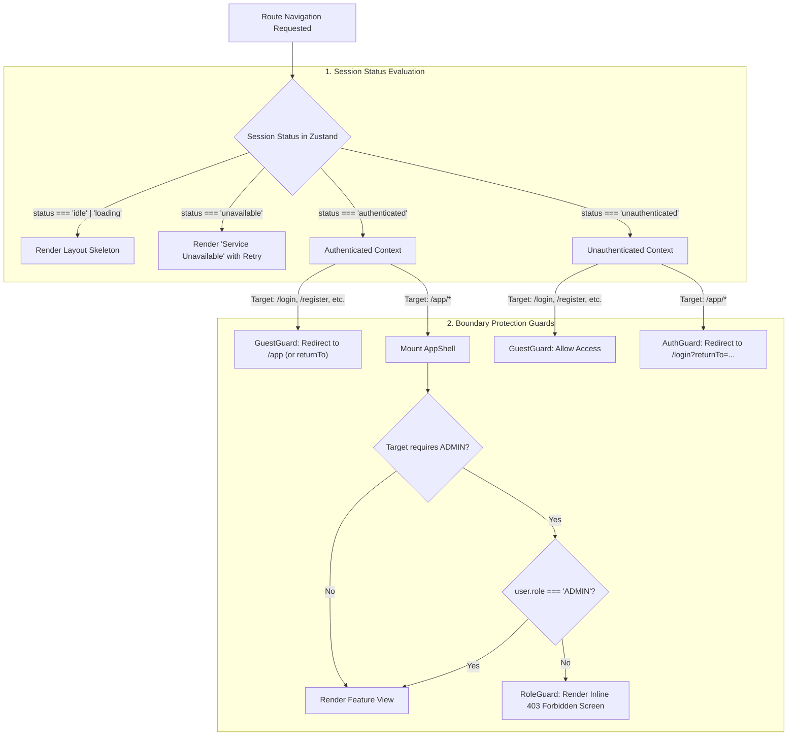
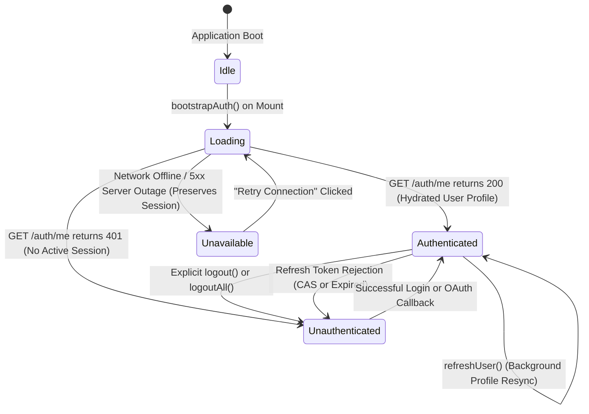
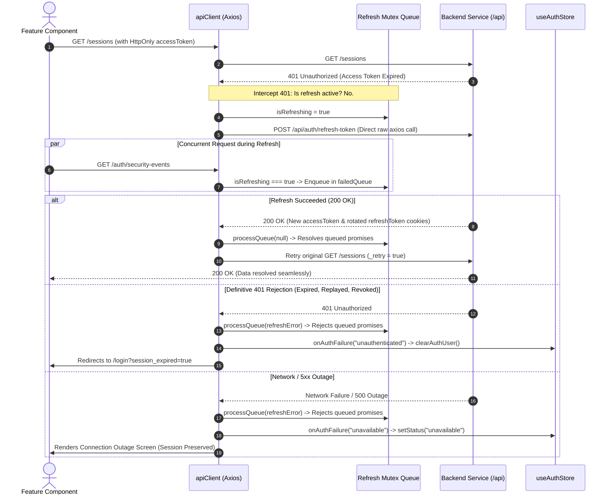
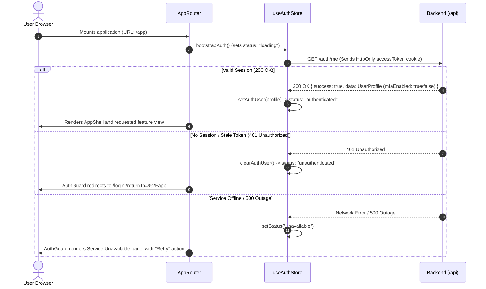
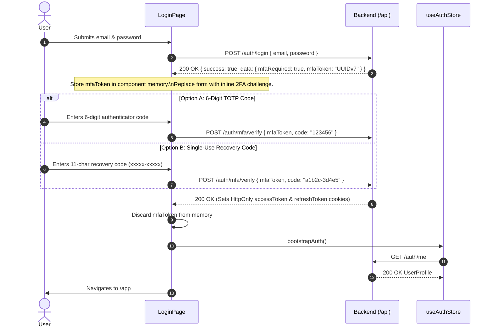
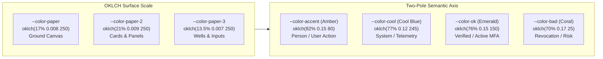

# Frontend Architecture & System Design — AuthSphere

This document provides a comprehensive overview of **AuthSphere's** frontend web architecture, component topology, client state management, security boundaries, and core user-facing execution flows.

> **AuthSphere Architecture & Engineering Documentation Suite:**
>
> - [ARCHITECTURE.md](./ARCHITECTURE.md) — System Design, Component Topology & Core Data Models
> - [FRONTEND_ARCHITECTURE.md](./FRONTEND_ARCHITECTURE.md) — Frontend Architecture, Component Topology & Control Plane
> - [Engineering-Decisions.md](./Engineering-Decisions.md) — 101 Formal ADRs, Security Invariants & Technical Trade-offs
> - [OAUTH.md](./OAUTH.md) — OAuth 2.0 PKCE Social Authentication & Integration Protocols
> - [DEPLOYMENT.md](./DEPLOYMENT.md) — Cloud Infrastructure, Dual-Compute (Lambda/ECS) & Runbooks
> - [TESTING.md](./TESTING.md) — Hermetic Test Pyramid, Invariant Verification & CI Strategies

---

## 1. System Overview & Philosophy

AuthSphere's web client (`apps/web`) is an **Identity and Access Control Plane** built to exercise, verify, and demonstrate the production-grade authentication and session capabilities of the AuthSphere backend. 

### Core Design Philosophy

1. **Engineering Control Plane over Vanity Dashboard:** The application rejects generic SaaS templates, arbitrary analytics cards, and fabricated security scores. Every screen, table row, badge, and modal maps directly to confirmed backend domain operations and verifiable cryptographic state.
2. **The "Console" Aesthetic:** Styled under the Hallmark Modern-Minimal design system with a dedicated **Console** theme. The interface relies on a dark charcoal/slate ground, high-contrast typography (Host Grotesk paired with Atkinson Hyperlegible Mono for tabular telemetry), 1px hairline rules, zero floating drop-shadows, and a disciplined two-pole semantic meaning axis.
3. **Defense-in-Depth Client Posture:** The client treats the browser runtime as inherently untrusted. Persistent authentication state flows exclusively through backend-managed `HttpOnly`, `SameSite=Lax` cookies. Client-side route guards provide responsive UX navigation, while the backend API remains the sole authority for authentication and authorization.

---

## 2. Frontend Architecture Topology

AuthSphere frontend is organized within an npm-workspaces monorepo. It compiles as a lightweight Single-Page Application (SPA) backed by same-origin edge reverse proxying:



### Technology Baseline

| Technology Layer | Selection | Version | Architectural Role |
| :--- | :--- | :--- | :--- |
| **Build & Dev Tooling** | Vite | `^8.1.1` | Ultra-fast HMR, deterministic ESM packaging, code splitting, and development proxy. |
| **UI Framework** | React | `^19.2.7` | Core component rendering engine utilizing functional components, hooks, and `<Suspense>`. |
| **Routing System** | React Router | `^7.18.1` | Declarative route topology, guard hierarchies, URL search param synchronization, and error boundaries. |
| **Styling & Design** | Tailwind CSS v4 | `^4.3.3` | `@theme static` CSS variable integration with OKLCH tokens in `@tailwindcss/vite`. |
| **Client State** | Zustand | `^5.0.14` | Minimal, in-memory store for authenticated identity and connection status. |
| **Network Client** | Axios | `^1.18.1` | Centralized transport with request/response interceptors, error sanitization, and silent refresh mutex. |
| **Form Validation** | React Hook Form & Zod | `^7.81.0` / `^4.4.3` | Schema-driven form validation isolated to local component state. |
| **Shared Domain** | `@authsphere/shared` | `workspace:*` | Canonical role names (`ADMIN`, `USER`) and permission constants. |

### Monorepo Boundaries & Ingress Parity

- **Production Edge Proxy (`apps/web/vercel.ts`):** Defined via code-first TypeScript using `@vercel/config/v1`. Rewrites all `/api/(.*)` requests to `BACKEND_URL`, preserving same-origin cookie delivery and eliminating CORS preflight overhead.
- **Development Proxy Parity (`apps/web/vite.config.ts`):** Vite's development server mirrors the `/api` rewrite identically, proxying to `http://localhost:3000`.
- **Zero Client Token Persistence:** Neither `accessToken` nor `refreshToken` is ever accessible to JavaScript, stored in `localStorage`, or stored in `sessionStorage`. All authentication tokens reside in browser cookies marked `HttpOnly`, `SameSite=Lax`, and `Secure` (in production).

---

## 3. Layered Component Architecture

AuthSphere follows a modular, feature-oriented layered structure designed to separate presentation, routing, state, and network concerns:

```text
apps/web/src/
├── api/             # Centralized Axios client, interceptors, and domain service APIs
├── components/      # Cross-cutting UI primitives and layout shells
│   ├── auth/        # Shared authentication elements (SocialAuthButtons)
│   ├── layout/      # Application shells (AuthLayout, AppShell)
│   └── ui/          # Hallmark Console UI primitives (Button, Input, Modal, Alert, etc.)
├── features/        # Feature domains (auth, overview, security, sessions, activity, admin)
├── routes/          # Declarative route configuration, guards, and root error boundary
├── schemas/         # Centralized Zod validation schemas
├── stores/          # In-memory Zustand store (auth.store.ts)
├── styles/          # OKLCH design tokens (tokens.css) and global baseline (base.css)
├── types/           # Ambient TypeScript interfaces and API response envelopes
└── utils/           # Canonical formatters (user agents, timestamps, event badges)
```

### 3.1 Presentation & Shell Layer

The interface renders within two distinct structural shells, supported by custom UI primitives:

1. **`AuthLayout` (`components/layout/AuthLayout.tsx`):**
   - Dedicated shell for unauthenticated guest flows (`/login`, `/register`, `/forgot-password`, `/reset-password`, `/verify-email`, `/magic-link/verify`).
   - Centers a constrained card (`max-w-md`) with brand lockup, application version tag, and security footer referencing privacy policies, Swagger documentation, and OpenAPI 3.1 specifications.
   - Embeds layout-level `<Suspense>` skeletons to eliminate visual flicker during route changes.

2. **`AppShell` (`components/layout/AppShell.tsx`):**
   - Authenticated workspace shell hosting all protected views.
   - **Desktop Layout (≥1024px):** Fixed 240px persistent left sidebar with route navigation, active route indicator pills, external API links, and a persistent user profile footer with sign-out trigger.
   - **Mobile/Tablet Layout (<1024px):** Sticky 48px top bar with brand badge and hamburger toggle, opening an accessible slide-over drawer with a dark backdrop (`bg-black/60`).
   - Dynamically filters administrative routes (`/app/users`, `/app/admin/roles`) based on the authenticated principal's role (`ADMIN`).

3. **Hallmark Console UI Primitives (`components/ui/`):**
   AuthSphere deliberately implements 7 custom, zero-dependency UI primitives (`Button`, `Input`, `Alert`, `Badge`, `Modal`, `Skeleton`, `Pagination`).

> [!NOTE]
> **Architectural Decision — Rejection of External UI Libraries (`shadcn/ui`):**
> External component libraries like `shadcn/ui` were evaluated and formally rejected. Adopting `shadcn/ui` would introduce 7+ third-party npm packages to replace ~450 lines of clean code, while importing HSL variables and floating drop shadows (`shadow-md`) that violate the Hallmark OKLCH Console theme and fail design linting. Custom primitives guarantee strict WCAG AA accessibility, zero bundle bloat, and seamless Tailwind CSS v4 `@theme static` integration.

---

### 3.2 Routing & Boundary Security Layer

Routing is managed via React Router 7 declarative route trees (`routes/index.tsx`), partitioned across three access boundaries:



#### Canonical Route Inventory

| Route Path | Access Guard | Layout Container | Description & Target Component |
| :--- | :--- | :--- | :--- |
| `/` | Public | Standalone | Landing page with architectural overview and adaptive sign-in / console CTAs (`HomePage`). |
| `/privacy` | Public | Standalone | Privacy and data governance policy complying with OAuth data usage terms (`PrivacyPolicyPage`). |
| `/login` | `GuestGuard` | `AuthLayout` | Password & Magic Link login with inline MFA challenge (`LoginPage`). |
| `/register` | `GuestGuard` | `AuthLayout` | Account registration with Zod password complexity validation (`RegisterPage`). |
| `/forgot-password` | `GuestGuard` | `AuthLayout` | Password reset dispatch with timing-safe confirmation banner (`ForgotPasswordPage`). |
| `/reset-password` | `GuestGuard` | `AuthLayout` | Recovery token verification and password change with inline MFA support (`ResetPasswordPage`). |
| `/verify-email` | `GuestGuard` | `AuthLayout` | Mount auto-verification of email token with resend fallback (`VerifyEmailPage`). |
| `/magic-link/verify` | `GuestGuard` | `AuthLayout` | Mount auto-consumption of magic link token with inline MFA transition (`MagicLinkVerifyPage`). |
| `/app` | `AuthGuard` | `AppShell` | Overview of identity posture, active sessions count, and recent audit activity (`OverviewPage`). |
| `/app/security` | `AuthGuard` | `AppShell` | TOTP setup wizard, recovery codes, password rotation, and OAuth linking (`SecurityPage`). |
| `/app/sessions` | `AuthGuard` | `AppShell` | Device registry, individual session revocation, and Sign Out Everywhere (`SessionsPage`). |
| `/app/activity` | `AuthGuard` | `AppShell` | Paginated security audit event ledger with search param sync (`ActivityPage`). |
| `/app/users` | `AuthGuard` + `RoleGuard` | `AppShell` | User directory with role promotion/demotion and self-demotion guards (`AdminUsersPage`). |
| `/app/admin/roles` | `AuthGuard` + `RoleGuard` | `AppShell` | Role permissions configurator with immutable ADMIN baseline (`AdminRolesPage`). |
| `*` | Public Fallback | Standalone | Accessible 404 handler (`NotFoundPage`). |

#### Guard Specifications

- **`AuthGuard`:** Validates `status === 'authenticated'`. Unauthenticated access redirects to `/login?returnTo=...`. In the event of a backend outage (`unavailable`), it renders a full-page connection failure screen with a manual "Retry Connection" action.
- **`GuestGuard`:** Prevents authenticated users from accessing login/registration views, redirecting to `/app` or a safe local relative path validated against open-redirect attacks (`isSafeLocalPath`).
- **`RoleGuard`:** Restricts access by role (`allowedRole="ADMIN"`) or specific permission (`requiredPermission="user.read"`). When rejected, it renders an inline **403 Forbidden** banner explaining required permissions while preserving the user's active session without logging them out.
- **`RootErrorBoundary`:** Catches uncaught runtime exceptions and routing failures, rendering an operational failure panel with "Reload Screen" and "Go to Overview" recovery actions.
- **`PUBLIC_AUTH_ROUTES` Bypass Contract:** Explicit array of public routes (`/`, `/privacy`, `/login`, etc.) preventing the centralized Axios interceptor from triggering unwanted redirect loops when background requests fail during public browsing.

---

### 3.3 State Management & Data Ownership

State ownership in AuthSphere is strictly partitioned according to data lifecycle and ownership:

| State Domain | Owner / Mechanism | Rationale & Boundaries |
| :--- | :--- | :--- |
| **Authentication Posture** | In-Memory Zustand (`useAuthStore`) | Minimal volatile cache of `user: UserProfile \| null` and connection status. Never written to web storage. |
| **Transient Challenges** | Local Component / Hook Memory | Intermediate tokens (`mfaToken`) exist only in memory during multi-step verification. |
| **Form Inputs & Validation** | React Hook Form & Zod | Localized to form lifecycle, preventing global store re-render cascades. |
| **Pagination & Filters** | URL Search Params (`useSearchParams`) | Keeps table pages (`?page=2&limit=20`) bookmarkable and shareable across reloads. |
| **Server Domain Data** | Local Component State (`useState`, `useEffect`) | Direct fetching via modular API services (`api/`) without bloated client-side cache stores. |
| **Ephemeral UI State** | React Local State (`useState`) | Modals, menu dropdowns, tooltip toggles, and password visibility toggles. |

#### In-Memory Auth Store State Machine

The Zustand store in `stores/auth.store.ts` manages volatile authentication status:



#### Acyclic Inversion of Control

To prevent circular ECMAScript module dependencies between the centralized HTTP client (`api/client.ts`) and the Zustand store (`stores/auth.store.ts`):
- The API client defines registry hooks: `registerAuthFailureHandler(callback)` and `registerForbiddenHandler(callback)`.
- `auth.store.ts` registers its state transitions on module initialization. The API client never directly imports the Zustand store.
- When an API request encounters a definitive 401, it invokes `onAuthFailure("unauthenticated")`. If a network/5xx failure occurs, it invokes `onAuthFailure("unavailable")`.
- When an API request receives a 403 Forbidden, `onForbidden` triggers a background `refreshUser()` call to resynchronize permissions.

---

### 3.4 Network, Transport & Error Normalization Layer

Network operations are coordinated through a centralized Axios client (`api/client.ts`) configured with `baseURL: "/api"`, `withCredentials: true`, and a 10-second request timeout:



#### Mutex Logic & Invariants

1. **Auth Bypass Registry:** Authentication endpoints (`/auth/login`, `/auth/signup`, `/auth/refresh-token`, `/auth/magic-link`, `/auth/mfa/verify`, `/auth/forgot-password`, `/auth/reset-password`) bypass 401 interception to allow credential rejection messages to reach forms directly.
2. **Loop Prevention:** Both the original failed request and all concurrent requests queued in `failedQueue` carry `_retry = true`, guaranteeing that failed re-attempts never re-trigger token refresh.
3. **Raw Axios Invocation:** The token refresh call (`POST /api/auth/refresh-token`) is executed via raw `axios.post` rather than `apiClient`, preventing recursive interceptor loops.

#### Error Sanitization (`getApiErrorMessage`)

To prevent internal implementation leakage, all API errors are normalized through `getApiErrorMessage(error)`:
- **5xx Server Errors:** Sanitized to generic safe notices (*"An unexpected server error occurred. Please try again later."*).
- **Validation Errors (400):** Extracts field-level Zod messages from `data.errors`, joining them into human-readable text.
- **Internal Leakage Firewall:** Scans error messages for database or driver terms (`prisma`, `syntax error`, `foreign key`, `unique constraint`, `connection pool`, `econnrefused`). If detected, technical internals are replaced with safe operational explanations.
- **Standard HTTP Codes:** Distinct handling for 429 Rate Limits, 403 Forbidden, 401 Unauthorized, and 404 Not Found.

---

## 4. Core End-to-End Execution Flows

### 4.1 Authentication & Session Bootstrap

Session bootstrap executes upon initial page load to verify active credentials and hydrate user posture:



### 4.2 Inline Multi-Factor Authentication (MFA)

When primary authentication (password or magic link) encounters an MFA-enabled account, verification proceeds inline without disruptive URL redirects:



### 4.3 Active Session Management & Revocation

The active device registry (`/app/sessions`) provides terminal identification and revocation controls:

```mermaid
sequenceDiagram
    autonumber
    actor User
    participant Page as SessionsPage
    participant Modal as Revocation Modal
    participant API as Backend (/api)
    participant Store as useAuthStore

    User->>Page: Navigates to /app/sessions
    Page->>API: GET /sessions
    API-->>Page: 200 OK [ { id: "s1", isCurrent: true }, { id: "s2", isCurrent: false } ]
    Page->>User: Renders active device list (Current terminal badged in green)

    alt Single Remote Session Revocation
        User->>Page: Clicks "Revoke Device" on s2
        Page->>Modal: Opens Revocation Modal
        User->>Modal: Confirms revocation
        Modal->>API: DELETE /sessions/s2
        API-->>Modal: 200 OK
        Modal->>Page: Removes session from view; displays success banner
    else Sign Out Everywhere (Global Revocation)
        User->>Page: Clicks "Sign Out Everywhere"
        Page->>Modal: Opens Danger Confirmation Modal
        User->>Modal: Confirms global sign-out
        Modal->>API: POST /auth/logout-all
        API-->>Modal: 200 OK (All database sessions purged; cookies cleared)
        Modal->>Store: clearAuthUser() -> status: "unauthenticated"
        Page->>User: Redirects to /login?signed_out_everywhere=true
    end
```

### 4.4 Role-Based Access Control (Admin RBAC & Anti-Self Demotion)

Administrative directories enforce role guards, self-demotion prevention, and immutable security baselines:

```mermaid
sequenceDiagram
    autonumber
    actor Admin
    participant UsersPage as AdminUsersPage (/app/users)
    participant RolesPage as AdminRolesPage (/app/admin/roles)
    participant API as Backend (/api)

    Admin->>UsersPage: Views user directory (RoleGuard verifies ADMIN)
    UsersPage->>API: GET /users?page=1&limit=20
    API-->>UsersPage: 200 OK { users: [...], pagination }
    UsersPage->>Admin: Displays user table with "YOU" tag on current admin row

    opt Role Promotion / Demotion
        Admin->>UsersPage: Changes role for user (USER -> ADMIN)
        Note over UsersPage: Anti-Self Demotion: USER role disabled for current admin.\nBackend enforces Last-Admin protection.
        UsersPage->>API: PATCH /users/:id/role { roleName: "ADMIN" }
        API-->>UsersPage: 200 OK Updated User
    end

    Admin->>RolesPage: Views Role Governance
    RolesPage->>API: GET /roles/USER/permissions
    RolesPage->>API: GET /roles/ADMIN/permissions
    API-->>RolesPage: 200 OK { USER: [...], ADMIN: ["*all*"] }
    RolesPage->>Admin: Displays ADMIN permissions locked (immutable);\nUSER permissions as configurable checkboxes
```

---

## 5. Design System & Visual Foundations

AuthSphere's visual identity is governed by the Hallmark Design System under the **Console** theme (`styles/tokens.css`).



### 5.1 Hallmark Console Palette & OKLCH Surface Hierarchy

1. **Surface Elevation via Tone Steps:** Grounding rejects layered drop shadows (`--shadow-card: none`). Surfaces step across three discrete OKLCH lightness levels separated by 1px rules:
   - Base Canvas (`--color-paper`): `oklch(17% 0.008 250)` — deep charcoal background.
   - Cards & Shell (`--color-paper-2`): `oklch(21% 0.009 250)` — elevated slate panels.
   - Recessed Wells (`--color-paper-3`): `oklch(13.5% 0.007 250)` — recessed input fields and table rows.
   - Hairline Rules (`--color-rule`): `oklch(31% 0.01 250)` — 1px precision panel dividers.

2. **The Two-Pole Meaning Axis:**
   - **Amber (`--color-accent`):** Denotes the **Person / Operator**. Reserved for primary user actions (*"Sign In"*, *"Save Permissions"*, *"Enable 2FA"*).
   - **Cool Blue (`--color-cool`):** Denotes the **System / Machine**. Applied to IP addresses, automated event types, and system-generated tokens.
   - **Emerald (`--color-ok`):** Denotes **Security Integrity**. Applied to verified email badges, active 2FA indicators, and successful logins.
   - **Coral (`--color-bad`):** Denotes **Revocation & Risk**. Applied to destructive actions (*"Revoke Device"*, *"Sign Out Everywhere"*), expired tokens, and error alerts.

### 5.2 Typographic Hierarchy & Tabular Figures

- **Display & Headings:** `Host Grotesk` (weight 500, tight tracking `-0.03em`, line-height `1.05` to `1.20`).
- **Body & Controls:** `Host Grotesk` (weight 400/500, line-height `1.55`).
- **Machine Figures & Telemetry:** `Atkinson Hyperlegible Mono` paired with `font-variant-numeric: tabular-nums` (`.num`, `td.num`). Applied to all IP addresses, UUIDs, recovery codes, session counts, and ISO timestamps to guarantee rigid vertical column alignment.

### 5.3 Mobile Responsive Posture & Adaptive Breakpoints

Layouts enforce strict responsive containment without sacrificing administrative density:

- **Desktop (≥1024px):** Fixed 240px persistent sidebar; content centered in `max-w-6xl` canvas; multi-column data ledgers with inline action triggers.
- **Tablet (640px – 1024px):** Persistent top header; slide-over drawer; 2-column metric cards; tables maintain horizontal scroll clipping.
- **Mobile (<640px):** Sticky 48px header with hamburger toggle; slide-over drawer with dark backdrop (`bg-black/60`); primary action buttons span full width (`w-full`) with minimum 44px touch targets; multi-column data tables convert into single-column stacked key-value cards.
- **Drift Containment:** `overflow-x: clip` enforced on root document containers to eliminate horizontal page sway across mobile viewports.

---

## 6. Operational Standards & Performance

### 6.1 Route-Level Code Splitting & Chunk Distribution

All feature pages are lazily imported via `React.lazy()` with `<Suspense>` fallbacks at layout boundaries (`routes/index.tsx`).

#### Production Build Distribution (`npm run build -w @authsphere/web`)

| Asset / Chunk | Bundle Size | Gzip Size | Scope & Purpose |
| :--- | :--- | :--- | :--- |
| `index.html` | 0.82 kB | 0.45 kB | SPA HTML entrypoint. |
| `assets/index.css` | 41.35 kB | 8.19 kB | Tailwind CSS v4 `@theme static` + Hallmark OKLCH tokens. |
| `assets/NotFoundPage.js` | 0.98 kB | 0.52 kB | 404 Error handler. |
| `assets/formatters.js` | 1.82 kB | 0.76 kB | User agent, date, and event formatters. |
| `assets/ForgotPasswordPage.js` | 2.05 kB | 0.98 kB | Password reset dispatch. |
| `assets/SocialAuthButtons.js` | 2.41 kB | 1.04 kB | Google & GitHub OAuth triggers. |
| `assets/MagicLinkVerifyPage.js` | 3.64 kB | 1.54 kB | Magic link token verification. |
| `assets/RegisterPage.js` | 3.76 kB | 1.40 kB | Account registration form. |
| `assets/VerifyEmailPage.js` | 3.96 kB | 1.56 kB | Email verification route. |
| `assets/ResetPasswordPage.js` | 4.02 kB | 1.50 kB | Password reset form. |
| `assets/ActivityPage.js` | 5.39 kB | 1.96 kB | Paginated security event ledger. |
| `assets/HomePage.js` | 5.90 kB | 1.70 kB | Public marketing and architecture landing page. |
| `assets/SessionsPage.js` | 6.68 kB | 2.22 kB | Active session management & revocation. |
| `assets/LoginPage.js` | 7.40 kB | 2.57 kB | Password & magic link sign-in. |
| `assets/PrivacyPolicyPage.js` | 8.07 kB | 2.38 kB | Legal and privacy policy page. |
| `assets/AdminRolesPage.js` | 8.56 kB | 2.59 kB | Role permissions configurator. |
| `assets/AdminUsersPage.js` | 9.08 kB | 2.92 kB | User directory & role assignment. |
| `assets/OverviewPage.js` | 10.36 kB | 2.40 kB | Identity posture & hardware telemetry. |
| `assets/ui.js` | 10.41 kB | 2.73 kB | Reusable UI primitives. |
| `assets/SecurityPage.js` | 42.54 kB | 14.25 kB | MFA enrollment, password rotation, OAuth linking. |
| `assets/auth.schemas.js` | 110.67 kB | 33.74 kB | Centralized Zod validation schemas. |
| `assets/index.js` | 361.51 kB | 115.97 kB | React 19, React Router 7, Axios, Zustand baseline. |

*Total production build completes in ~2.1 seconds with zero bundle size warnings.*

---

### 6.2 HTTP Caching Directives & Proxy Parity

AuthSphere applies strict caching policies across static code assets, documentation, and dynamic API endpoints:

| Target Resource | Cache-Control Header | Enforcement Layer | Operational Behavior |
| :--- | :--- | :--- | :--- |
| **API Endpoints (`/api/*`)** | `Cache-Control: no-store` | Express Global Ingress (`app.ts`) | Prohibits browsers, shared proxies, and CDNs from storing sensitive auth, session, or profile data. |
| **OpenAPI Docs (`/openapi.json`, `/docs`)** | `Cache-Control: no-cache` | OpenAPI Router (`common/openapi/index.ts`) | Enables RFC 9111 conditional revalidation via `ETag` / `304 Not Modified`, preventing stale schema drift. |
| **Static Assets (`/assets/*-[hash].*`)** | `public, max-age=31536000, immutable` | Web Server / Edge CDN | Content-hashed bundles emitted by Vite are cached indefinitely across edge nodes and browsers. |
| **SPA Root (`index.html`)** | `Cache-Control: no-cache` | Web Server / Edge CDN | Forces conditional revalidation to guarantee immediate adoption of new deployment chunk hashes. |

---

### 6.3 Resilient Error Handling Matrix

Every meaningful operational state provides clear user feedback and recovery actions:

| Operational State | UI Presentation & Behavior | Recovery Path |
| :--- | :--- | :--- |
| **Initial Loading** | Layout-matching geometric pulsing skeleton (`Skeleton.tsx`). | Resolves automatically upon data arrival; zero cumulative layout shift. |
| **Empty Data State** | Direct explanation of missing data (e.g. *"No active sessions found"*). | Contextual primary action (e.g. *"Refresh"* or *"Invite User"*). |
| **Validation Error (400)** | Accessible inline field descriptions with red rule borders. | User corrects invalid form input; errors clear on change. |
| **Session Expired (401)** | Silent CAS token refresh; redirects to `/login?session_expired=true` if unrecoverable. | Re-authenticates; return path preserved via `?returnTo=...`. |
| **Forbidden Access (403)** | Inline 403 Forbidden banner explaining required roles or permissions. | Active session preserved; CTA button to *"Return to Overview"*. |
| **Rate Limited (429)** | Coral alert banner (*"Too many requests. Please slow down and try again."*). | Actions disabled during rate limit cooldown period. |
| **Service Outage (5xx/Offline)** | Full-page / panel "Service Unavailable" screen. | Session preserved in memory; manual *"Retry Connection"* button. |

---

### 6.4 Quality Gate Verification

All frontend code and architecture artifacts comply with strict repository quality gates:

- **TypeScript Compilation:** `npm run typecheck` passes with **0 errors** across all monorepo workspaces.
- **ESLint Analysis:** `npx eslint apps/web/src` passes with **0 warnings / 0 errors**.
- **Hallmark SlopLint Sweep:** `sloplint.mjs --scope app apps/web/src` passes with **0 FAIL across 36 files**.
- **Vite Production Build:** `npm run build -w @authsphere/web` cleanly compiles optimized chunks in ~2.1 seconds.
- **Accessibility Compliance:** WCAG 2.1 AA certified with focus rings (`:focus-visible`), aria roles, live regions, accessible SVGs, and minimum 44px mobile touch targets.
