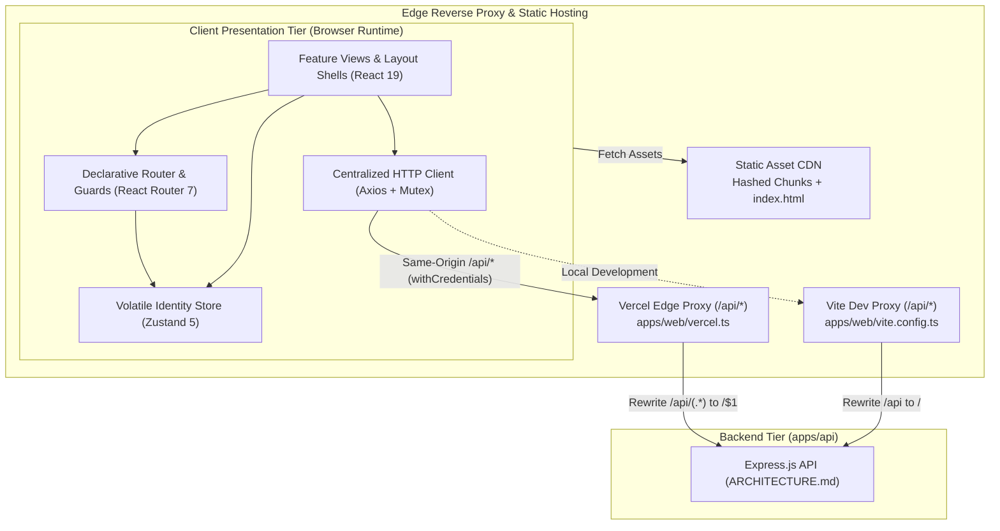
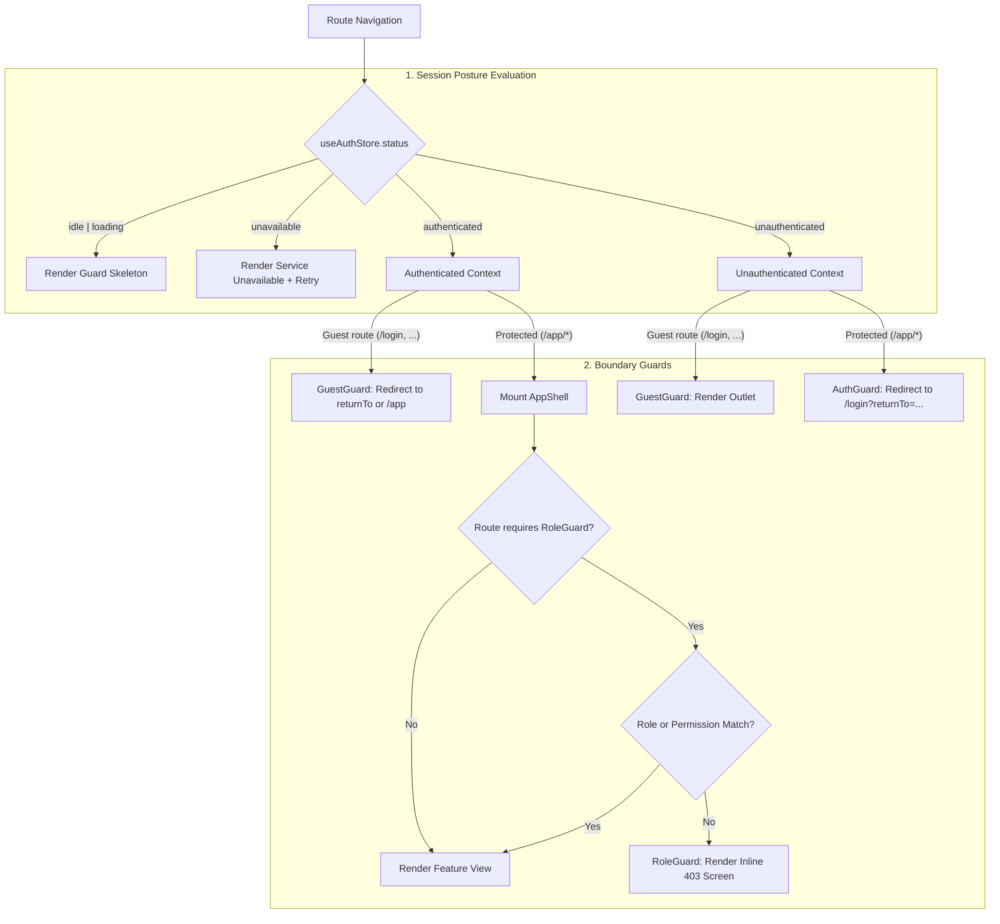
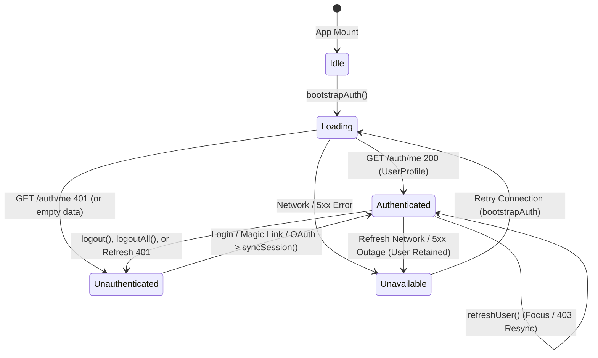
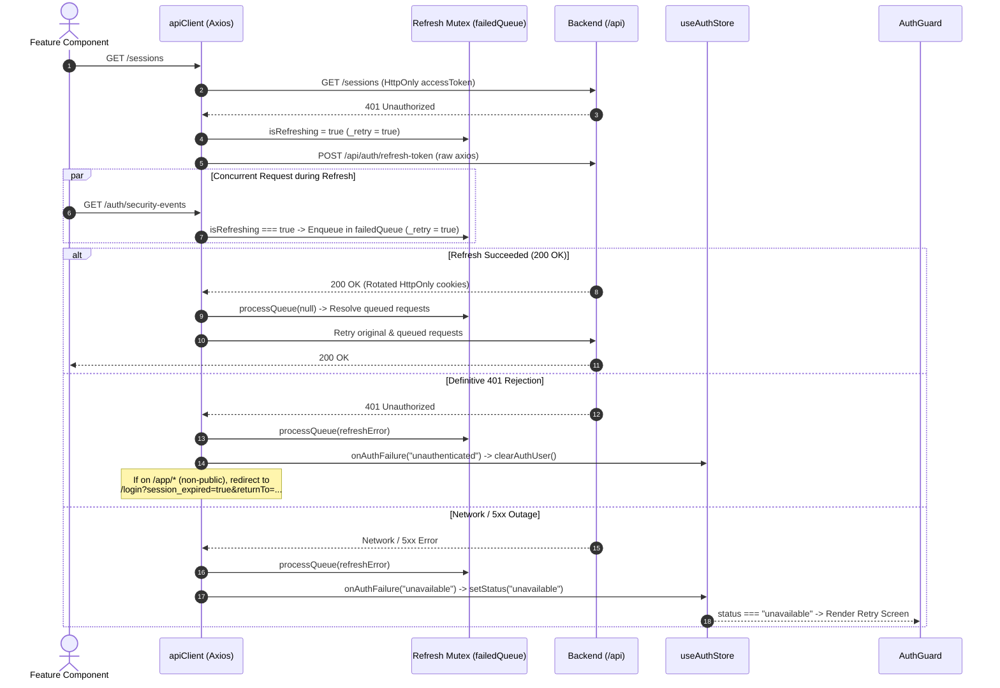
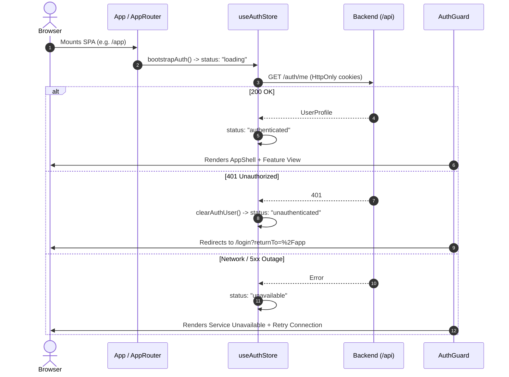
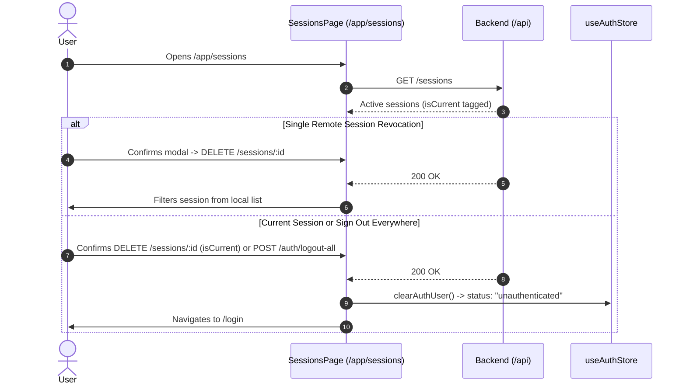
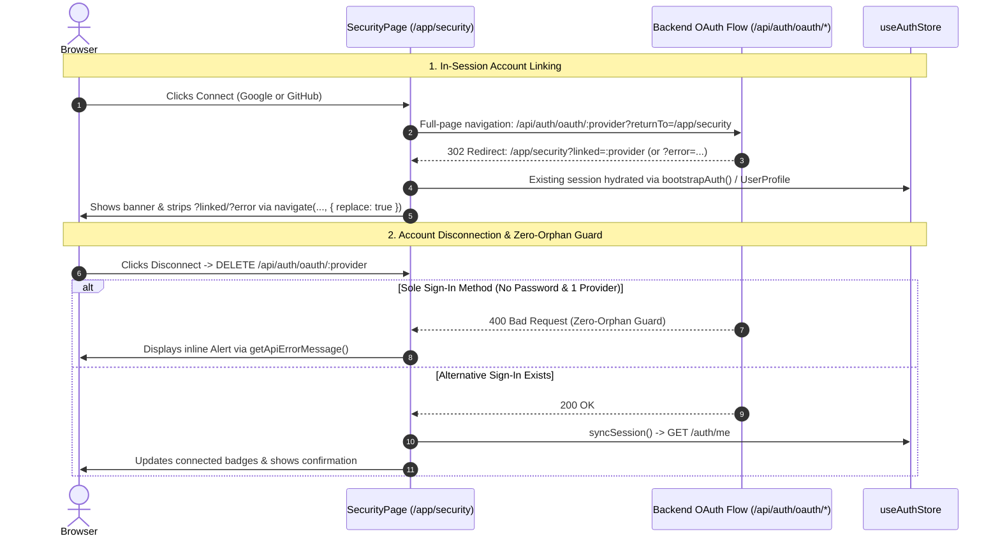
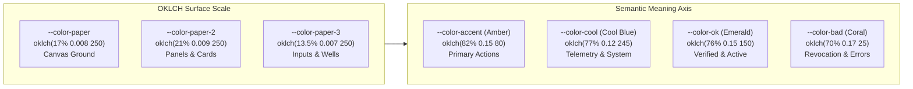

# Frontend Architecture & System Design — AuthSphere

This document is the single source of truth (SSOT) for **AuthSphere's** frontend web architecture (`apps/web`), covering presentation shells, declarative routing and guards, client state management, the HTTP refresh mutex, Hallmark OKLCH visual tokens, and client-side execution flows.

> **AuthSphere Architecture & Engineering Documentation Suite:**
>
> - [ARCHITECTURE.md](./ARCHITECTURE.md) — System Design, Component Topology & Core Data Models
> - [FRONTEND_ARCHITECTURE.md](./FRONTEND_ARCHITECTURE.md) — Frontend Architecture, Component Topology & Control Plane
> - [Engineering-Decisions.md](./Engineering-Decisions.md) — 107 Formal ADRs, Security Invariants & Technical Trade-offs
> - [OAUTH.md](./OAUTH.md) — OAuth 2.0 PKCE Social Authentication & Integration Protocols
> - [DEPLOYMENT.md](./DEPLOYMENT.md) — Cloud Infrastructure, Dual-Compute (Lambda/ECS) & Runbooks
> - [TESTING.md](./TESTING.md) — Hermetic Test Pyramid, Invariant Verification & CI Strategies

---

## 1. System Overview & Philosophy

AuthSphere's web client (`apps/web`) is an identity and session management control plane built as a React single-page application (SPA). It provides self-service authentication, credential rotation, multi-factor authentication (MFA), active session revocation, security event auditing, and administrative governance for users and roles.

### Core Architectural Principles

1. **Direct Operational Mapping:** Views map directly to backend authentication and authorization contracts (`@authsphere/shared` and [ARCHITECTURE.md](./ARCHITECTURE.md)) without synthetic metrics.
2. **Untrusted Client Environment:** The browser runtime is treated as untrusted. Persistent session credentials live exclusively in server-set `HttpOnly`, `SameSite=Lax` cookies. Client-side route guards provide responsive navigation UX while backend middleware acts as the authoritative security gate.
3. **Hallmark Console Design System:** Built with CSS variables and dark-mode OKLCH tokens (`styles/tokens.css`), emphasizing hairline 1px panel borders (`--shadow-card: none`), restrained semantic color accents, and tabular monospace telemetry (`Atkinson Hyperlegible Mono` paired with `Host Grotesk`).
4. **Reactive State Reconciliation:** In-flight privilege or session changes reconcile automatically on window focus and `403 Forbidden` responses without requiring full browser reloads.

---

## 2. Frontend Architecture Topology

The SPA compiles within the npm-workspaces monorepo and communicates with `apps/api` over same-origin `/api/*` paths so `HttpOnly` session cookies flow without cross-origin CORS overhead:



### Technology Baseline (`apps/web/package.json`)

| Technology Layer       | Package & Version                                                        | Primary Role                                                                         |
| :--------------------- | :----------------------------------------------------------------------- | :----------------------------------------------------------------------------------- |
| **Build & Tooling**    | `vite` `8.1.1`, `@vitejs/plugin-react` `6.0.3`                           | ES module dev server, HMR, code splitting, and local `/api` dev proxy.               |
| **UI Framework**       | `react` `19.2.7`, `react-dom` `19.2.7`                                   | Declarative component rendering, hooks, and `<Suspense>` boundaries.                 |
| **Routing System**     | `react-router-dom` `7.18.1`                                              | Declarative routes, boundary guards, URL search param sync, and error boundaries.    |
| **Styling & Tokens**   | `tailwindcss` `4.3.3`, `@tailwindcss/vite` `4.3.3`                       | `@theme static` integration with Hallmark dark OKLCH tokens.                         |
| **Client State**       | `zustand` `5.0.14`                                                       | Volatile in-memory session posture and auth lifecycle state.                         |
| **HTTP Transport**     | `axios` `1.18.1`                                                         | Request/response interceptors, error sanitization, and silent token refresh mutex.   |
| **Forms & Validation** | `react-hook-form` `7.81.0`, `zod` `4.4.3`, `@hookform/resolvers` `5.4.0` | Isolated form state and schema-backed client validation (`schemas/auth.schemas.ts`). |
| **TOTP QR Codes**      | `qrcode` `1.5.4`                                                         | Client-side QR data URL generation for authenticator enrollment.                     |
| **Edge Configuration** | `@vercel/config` `0.12.0`                                                | Code-first production rewrites, SPA fallback, and docs redirects (`vercel.ts`).      |
| **Shared Domain**      | `@authsphere/shared` (`*`)                                               | Canonical role names, permissions, OAuth providers, and security event types.        |

### Ingress & Cookie Boundary

- **Same-Origin Proxy (`vercel.ts` / `vite.config.ts`):** Both production (Vercel rewrites via `BACKEND_URL`) and local development (Vite proxy via `VITE_API_URL`, defaulting to `http://localhost:3000`) rewrite `/api/*` to the backend origin and redirect `/docs`, `/docs/`, `/api/docs`, and `/openapi.json` to `/api/docs/` or `/api/openapi.json`. See [DEPLOYMENT.md](./DEPLOYMENT.md) for edge topology, TLS termination, and proxy hop configuration.
- **Zero Web-Storage Token Rule:** `accessToken` and `refreshToken` are never stored in `localStorage` or `sessionStorage`; they are managed solely via backend `HttpOnly`, `SameSite=Lax` cookies (`Secure` in production).

---

## 3. Layered Component Architecture

```text
apps/web/src/
├── api/             # Axios client, refresh mutex, error sanitizer, and domain API modules
├── components/
│   ├── auth/        # Shared authentication controls (SocialAuthButtons)
│   ├── layout/      # Presentation shells (AuthLayout, AppShell)
│   └── ui/          # Zero-dependency primitives (Alert, Badge, Button, Input, Modal, Pagination, Skeleton)
├── features/        # Feature views (activity, admin, auth, common, overview, public, security, sessions)
├── routes/          # Router definition, canonical route config, boundary guards, and error boundary
├── schemas/         # Centralized Zod validation schemas (auth.schemas.ts)
├── stores/          # Volatile Zustand auth store (auth.store.ts)
├── styles/          # OKLCH tokens (tokens.css) and global base rules (base.css)
├── types/           # TypeScript domain models and API response envelopes (auth.types.ts)
└── utils/           # Presentation formatters (user agents, event labels, timestamps)
```

### 3.1 Presentation & Shell Layer

1. **`AuthLayout` (`components/layout/AuthLayout.tsx`):**
   - Shell for guest authentication flows (`/login`, `/register`, `/forgot-password`, `/reset-password`, `/verify-email`, `/magic-link/verify`).
   - Centers a `max-w-md` card (`bg-paper-2 border border-rule rounded-card`) with header branding, version tag (`v1.0.0`), layout-level `<Suspense>` skeleton fallback, and footer links (`/privacy`, `/api/docs/`, `/api/openapi.json`, `/`).

2. **`AppShell` (`components/layout/AppShell.tsx`):**
   - Shell for authenticated routes (`/app/*`).
   - **Desktop (`>= 1024px` / `lg`):** Persistent `256px` (`w-64`) sidebar with active route highlighting, developer API links, user badge, and Sign Out action; `<main>` is constrained to `max-w-6xl`.
   - **Mobile & Tablet (`< 1024px`):** Sticky header bar with slide-over navigation drawer and backdrop overlay.
   - Filters navigation links dynamically by `ROLES.ADMIN` (`adminOnly` for `/app/admin/roles`) and `PERMISSIONS.USER_READ` (`requiredPermission` for `/app/users`).
   - Registers a `window.focus` listener that triggers `refreshUser()` in the background.

3. **Custom UI Primitives (`components/ui/`):**
   - Seven zero-dependency primitives (`Alert`, `Badge`, `Button`, `Input`, `Modal`, `Pagination`, `Skeleton`) styled with Tailwind CSS v4 and Hallmark OKLCH variables.
   - Enforces `:focus-visible` outlines, accessible ARIA attributes (`aria-modal`, `aria-busy`, `aria-hidden`), and `44px` minimum touch targets on `md` (mobile) and `lg` buttons.

---

### 3.2 Routing & Access Control Guards

Routing is declared in `apps/web/src/routes/index.tsx` using React Router 7 and partitioned across public routes, guest-only flows, and authenticated console views:



#### Canonical Route Inventory (`routes/index.tsx` & `routes/routes.config.ts`)

| Route Path           | Access Guard              | Layout Shell | View Component & Responsibility                                                           |
| :------------------- | :------------------------ | :----------- | :---------------------------------------------------------------------------------------- |
| `/`                  | Public                    | Standalone   | Landing page with adaptive authenticated/guest CTAs (`HomePage`).                         |
| `/privacy`           | Public                    | Standalone   | Data governance and OAuth privacy policy (`PrivacyPolicyPage`).                           |
| `/login`             | `GuestGuard`              | `AuthLayout` | Password, magic link, OAuth entry, and inline MFA challenge (`LoginPage`).                |
| `/register`          | `GuestGuard`              | `AuthLayout` | Account signup with Zod password complexity rules (`RegisterPage`).                       |
| `/forgot-password`   | `GuestGuard`              | `AuthLayout` | Password reset request dispatch (`ForgotPasswordPage`).                                   |
| `/reset-password`    | `GuestGuard`              | `AuthLayout` | Token-based password reset with inline MFA prompt when enabled (`ResetPasswordPage`).     |
| `/verify-email`      | `GuestGuard`              | `AuthLayout` | Automated email token confirmation with resend option (`VerifyEmailPage`).                |
| `/magic-link/verify` | `GuestGuard`              | `AuthLayout` | One-time magic link verification with inline MFA challenge (`MagicLinkVerifyPage`).       |
| `/app`               | `AuthGuard`               | `AppShell`   | Account posture summary, current session, and recent events (`OverviewPage`).             |
| `/app/security`      | `AuthGuard`               | `AppShell`   | TOTP enrollment/disable, recovery codes, password change, OAuth linking (`SecurityPage`). |
| `/app/sessions`      | `AuthGuard`               | `AppShell`   | Active device session registry and revocation controls (`SessionsPage`).                  |
| `/app/activity`      | `AuthGuard`               | `AppShell`   | Paginated security event audit log synced with `?page=` (`ActivityPage`).                 |
| `/app/users`         | `AuthGuard` + `RoleGuard` | `AppShell`   | User directory and role assignment (`AdminUsersPage`). Requires `ADMIN` or `user.read`.   |
| `/app/admin/roles`   | `AuthGuard` + `RoleGuard` | `AppShell`   | Role permission configurator (`AdminRolesPage`). Restricted to `ADMIN`.                   |
| `*`                  | Public Fallback           | Standalone   | 404 Not Found recovery page (`NotFoundPage`).                                             |

#### Guard & Route Contracts

- **`AuthGuard` (`routes/guards/AuthGuard.tsx`):** Permits `status === "authenticated"`; redirects `unauthenticated` users to `/login?returnTo=<encoded>`; renders a full-page Service Unavailable recovery screen with a `Retry Connection` button (`bootstrapAuth()`) on `unavailable`.
- **`GuestGuard` (`routes/guards/GuestGuard.tsx`):** Redirects already-authenticated users away from guest auth pages to a validated local `returnTo` path (checked by `isSafeLocalPath` to reject non-`/` prefixes, `//`, `/\`, and `/app/security`) or `/app`.
- **`RoleGuard` (`routes/guards/RoleGuard.tsx`):** Grants access when `user.role === allowedRole` or `user.permissions` includes `requiredPermission`. Denied requests render an inline `403 Forbidden` panel preserving the active session.
- **`RootErrorBoundary` (`routes/guards/RootErrorBoundary.tsx`):** Top-level router `errorElement` providing `"Reload Screen"` and `"Go to Overview"` recovery actions.
- **`routes.config.ts` SSOT:** Centralizes `ROUTES`, `OAUTH_URLS`, `DOCS_URLS`, and `PUBLIC_AUTH_ROUTES` (used by `api/client.ts` so `401` failures on public pages do not trigger `/app/*` expiration redirects).

---

### 3.3 State Management & Data Ownership

| State Domain                 | Owner / Mechanism                                 | Scope & Boundary                                                                                                |
| :--------------------------- | :------------------------------------------------ | :-------------------------------------------------------------------------------------------------------------- |
| **Authentication Posture**   | Zustand Store (`useAuthStore`)                    | Volatile in-memory cache of `user: UserProfile \| null` and `status: AuthStatus`. Never persisted to storage.   |
| **Transient MFA Challenges** | Local Component State (`useState`)                | `mfaToken` is held in page state (`LoginPage`, `MagicLinkVerifyPage`) or read from OAuth redirect `?mfaToken=`. |
| **Form Inputs & Validation** | React Hook Form + Zod (`schemas/auth.schemas.ts`) | Isolated per form to prevent parent re-renders.                                                                 |
| **Pagination**               | URL Search Params (`useSearchParams`)             | Keeps `?page=` bookmarkable across reloads (`ActivityPage`, `AdminUsersPage`).                                  |
| **Server Domain Data**       | Local Component State (`useState`, `useEffect`)   | Fetched via modular services in `api/` without a global query cache.                                            |
| **Ephemeral UI State**       | Local Component State (`useState`)                | Modals, mobile drawer state, password visibility toggles, and alert banners.                                    |

#### Auth Store State Machine (`stores/auth.store.ts`)



- **`UserProfile` Contract (`types/auth.types.ts`):** Holds `id`, `email`, `firstName`, `lastName`, `role`, `permissions`, `mfaEnabled`, `verifiedAt`, `createdAt`, `oauthProviders`, `hasPassword`, and `remainingRecoveryCodes` ([ADR-101](./Engineering-Decisions.md#adr-101--zero-side-effect-client-mfa-state-introspection-via-current-user-profile-contract)).
- **Out-of-Order & Duplicate Bootstrap Mitigation:** `bootstrapAuth()` deduplicates concurrent calls via `inflightBootstrap`, and shares `resolveSession()` with `syncSession()` / `refreshUser()` using a module-scoped `bootstrapSequence` counter so stale `GET /auth/me` responses are discarded. `syncSession()` hydrates `user` without flipping `status` to `"loading"`, avoiding mid-action guard unmounts.
- **Inversion of Control (Zero Circular Imports):** `api/client.ts` exposes `registerAuthFailureHandler` and `registerForbiddenHandler`, which `auth.store.ts` registers at module load. On `403 Forbidden`, `onForbidden` awaits `refreshUser()` before rejecting to the caller so updated permissions apply immediately.

---

### 3.4 Network Client & Refresh Mutex

All domain requests use `apiClient` (`apps/web/src/api/client.ts`) configured with `baseURL: "/api"`, `withCredentials: true`, and a `15000ms` (`API_TIMEOUT_MS`) timeout:



#### Refresh Mutex & Error Sanitization Invariants

- **Auth Endpoint Bypass (`AUTH_BYPASS_URLS`):** Eight auth endpoints (`/auth/login`, `/auth/signup`, `/auth/refresh-token`, `/auth/magic-link`, `/auth/magic-link/verify`, `/auth/mfa/verify`, `/auth/forgot-password`, `/auth/reset-password`) bypass 401 refresh interception so credential errors reach forms directly.
- **Recursion Guards:** Both initial and queued retries set `_retry = true`, and the refresh call invokes raw `axios.post("/api/auth/refresh-token", ...)` rather than `apiClient`.
- **Error Sanitization (`getApiErrorMessage`):** Maps `5xx` responses to a generic safe notice, joins safe `400` Zod field validation errors, strips database/driver error strings (e.g., `prisma`, `foreign key`, `unique constraint`, `econnrefused`), and provides clear messages for `429`, `403`, `401`, and `404`.

---

## 4. Core Client Execution Flows

For backend endpoint contracts, middleware pipelines, and server-side token mechanics, see [ARCHITECTURE.md](./ARCHITECTURE.md).

### 4.1 Application Bootstrap & Session Validation



### 4.2 Multi-Factor Authentication (MFA)

Password login (`LoginPage`), magic link verification (`MagicLinkVerifyPage`), and MFA-gated social OAuth callbacks (`/login?mfaToken=...&provider=...`) share an inline two-step verification flow:

```mermaid
sequenceDiagram
    autonumber
    actor User
    participant Page as LoginPage / MagicLinkVerifyPage
    participant API as Backend (/api)
    participant Store as useAuthStore

    User->>Page: Submits credentials or verifies magic link
    API-->>Page: 200 OK { mfaRequired: true, mfaToken }
    Note over Page: Hold mfaToken in component state;<br/>switch view to inline verification form.

    User->>Page: Enters 6-digit TOTP or recovery code
    Page->>API: POST /auth/mfa/verify { mfaToken, code }
    API-->>Page: 200 OK (Sets HttpOnly session cookies)
    Page->>Store: syncSession() -> GET /auth/me
    Page->>User: Navigates to returnTo or /app
```

### 4.3 Session Management & Revocation (`SessionsPage`)



### 4.4 Role-Based Access Control (`AdminUsersPage` & `AdminRolesPage`)

- **Guard & Navigation Filtering:** `AppShell` hides admin items unless the user holds `ADMIN` or `user.read`, while `RoleGuard` enforces route access on `/app/users` (`ADMIN` or `user.read`) and `/app/admin/roles` (`ADMIN` only).
- **Anti-Self-Demotion UI:** In `AdminUsersPage`, opening the role modal for the current operator (`targetUser.id === currentAuthUser.id`) displays a warning and disables the `USER` role option; backend middleware additionally enforces Last-Admin protection ([ARCHITECTURE.md](./ARCHITECTURE.md)).
- **Role Governance:** `AdminRolesPage` allows `ADMIN` operators to inspect immutable `ADMIN` capabilities and toggle configurable `USER` permissions (`dashboard.view`, `user.read`, while keeping `profile.read` locked and marking roadmap capabilities read-only).

### 4.5 Federated OAuth 2.0 & Account Linking Lifecycle

The backend PKCE handshake, identity resolution, and Pre-Resolution Session Gate are specified in [OAUTH.md](./OAUTH.md). From the SPA boundary:



- **Redirect Hygiene:** Both `GuestGuard` and `LoginPage` sanitize `returnTo` values, and `SecurityPage` / `LoginPage` intercept `?error=` or `?linked=` parameters cleanly (`SecurityPage` strips them via `navigate(ROUTES.APP.SECURITY, { replace: true })`).
- **Zero-Orphan Governance:** `SecurityPage` relies on `UserProfile.oauthProviders` from `GET /auth/me` ([ADR-101](./Engineering-Decisions.md#adr-101--zero-side-effect-client-mfa-state-introspection-via-current-user-profile-contract)) and backend Zero-Orphan validation ([ADR-104](./Engineering-Decisions.md#adr-104--zero-orphan-disconnect-protection-and-oauth-account-disconnection-governance)) to prevent locking out passwordless single-provider accounts.

---

## 5. Design System & Visual Tokens

The frontend uses the Hallmark Console theme (`apps/web/src/styles/tokens.css`, `apps/web/src/styles/base.css`, and `apps/web/src/index.css`):



### 5.1 OKLCH Surfaces & Semantic Tokens

- **Elevation by Tone & Hairline Rules:** Hierarchy uses discrete dark OKLCH surfaces (`--color-paper`, `--color-paper-2`, `--color-paper-3`) separated by `1px` borders (`--color-rule`, `--color-rule-2`) with `--shadow-card: none`.
- **Semantic Accents:** Amber (`--color-accent`) for primary operator actions, Cool Blue (`--color-cool`) for telemetry and system identifiers, Emerald (`--color-ok`) for verified/active states, and Coral (`--color-bad`) for destructive actions and errors.

### 5.2 Typography & Tabular Figures

- **Prose & Controls:** `Host Grotesk` (`--font-display`, `--font-body`) loaded via `apps/web/index.html`, with tight display tracking (`--tracking-display: -0.03em`).
- **Telemetry & Identifiers:** `Atkinson Hyperlegible Mono` (`--font-outlier`) with `font-variant-numeric: tabular-nums` (`.num`, `.figure`, `td.num`) for IP addresses, timestamps, UUIDs, and recovery codes.

### 5.3 Responsive Layout & Containment

- **Desktop (`>= 1024px` / `lg`):** Persistent `256px` (`w-64`) sidebar with centered `max-w-6xl` main workspace.
- **Tablet & Mobile (`< 1024px`):** Sticky mobile header with slide-over navigation drawer; `base.css` scales `--gutter` (`64px` -> `24px` at `<= 60rem` -> `16px` at `<= 40rem`) and feature grids collapse via `sm:` (`640px`) breakpoints with horizontal scroll wrappers (`overflow-x-auto`) on dense tables.
- **Viewport Stability:** `overflow-x: clip` on `html, body` prevents horizontal viewport overflow, and `prefers-reduced-motion: reduce` collapses transition/animation durations.

---

## 6. Operational Standards & Quality

### 6.1 Code Splitting & Asset Strategy

- **Route-Level Lazy Loading:** All 15 page components in `apps/web/src/routes/index.tsx` load asynchronously via `React.lazy()`, wrapped in `<Suspense>` boundaries at the layout (`AuthLayout`, `AppShell`) and standalone route level.
- **Automatic Chunk Sharing:** Vite/Rollup automatically extracts shared vendor and utility modules across lazy route chunks without manual chunk overrides in `vite.config.ts`.

### 6.2 HTTP Caching Directives

AuthSphere enforces strict cache separation across dynamic API payloads, OpenAPI docs, and static SPA assets ([ADR-106](./Engineering-Decisions.md#adr-106--global-non-cacheable-http-baseline-cache-control-no-store-with-targeted-documentation-revalidation-no-cache)):

| Resource Type                               | Cache-Control Directive               | Enforcement Layer                                               | Operational Behavior                                                              |
| :------------------------------------------ | :------------------------------------ | :-------------------------------------------------------------- | :-------------------------------------------------------------------------------- |
| **API Endpoints (`/api/*`)**                | `Cache-Control: no-store`             | Express Global Ingress (`apps/api/src/app.ts`)                  | Prohibits browsers, proxies, and CDNs from storing sensitive auth/session data.   |
| **OpenAPI Docs (`/openapi.json`, `/docs`)** | `Cache-Control: no-cache`             | Express OpenAPI Router (`apps/api/src/common/openapi/index.ts`) | Enables `ETag` conditional revalidation (`304 Not Modified`) without stale specs. |
| **Static Assets (`/assets/*-[hash].*`)**    | `public, max-age=31536000, immutable` | Web Server / Edge CDN                                           | Content-hashed Vite bundles cache indefinitely across edge nodes and browsers.    |
| **SPA Entry (`index.html`)**                | `Cache-Control: no-cache`             | Web Server / Edge CDN                                           | Forces conditional revalidation so clients adopt newly deployed chunk hashes.     |

### 6.3 Error Handling Matrix

| Operational State                | UI Presentation & Behavior                                                                                | Recovery Path                                                                       |
| :------------------------------- | :-------------------------------------------------------------------------------------------------------- | :---------------------------------------------------------------------------------- |
| **Initial Loading**              | Layout-matching pulsing skeleton (`Skeleton.tsx`, guard skeletons).                                       | Resolves automatically on data arrival without layout shift.                        |
| **Empty Data State**             | Explicit zero-state copy (e.g., _"No active sessions found."_).                                           | Contextual refresh or creation action.                                              |
| **Validation Error (400)**       | Inline field error messages via React Hook Form + Zod (`auth.schemas.ts`).                                | User corrects invalid input; clears on validation pass.                             |
| **Session Expired (401)**        | Silent refresh via mutex; on protected `/app/*`, redirects to `/login?session_expired=true&returnTo=...`. | Re-authenticates and returns to preserved `returnTo` path.                          |
| **Forbidden Access (403)**       | Inline 403 panel (`RoleGuard`) or permission alert + background `refreshUser()`.                          | Active session preserved; _"Return to Overview"_ navigation action.                 |
| **Rate Limited (429)**           | Sanitized `Alert` notice (`getApiErrorMessage`).                                                          | User waits for rate-limit cooldown before retrying.                                 |
| **Service Outage (5xx/Offline)** | Guard-level `"Service Unavailable"` panel (`status === "unavailable"`).                                   | In-memory session retained; manual `"Retry Connection"` triggers `bootstrapAuth()`. |

### 6.4 Quality Gates & Verification

- **Type Checking:** `npm run typecheck` (or `npm run typecheck -w @authsphere/web`, running `tsc -b --noEmit`).
- **Linting:** `npm run lint` (or `npm run lint -w @authsphere/web`, running `eslint .`).
- **Production Build:** `npm run build:web` (or `npm run build -w @authsphere/web` orchestrated after `npm run build:shared`).
- **Accessibility:** `:focus-visible` outlines (`--color-focus`), semantic dialog/alert ARIA attributes, `44px` mobile touch targets on standard controls, and `prefers-reduced-motion` support.
