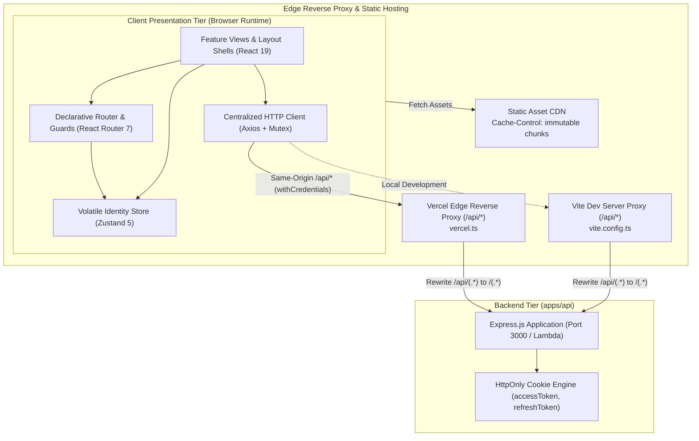
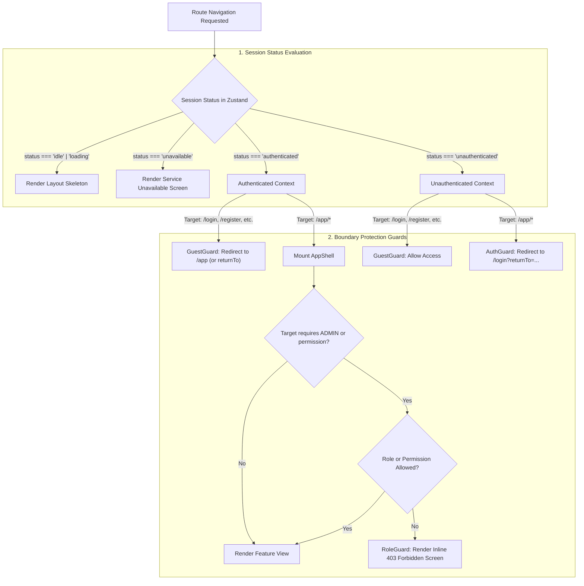
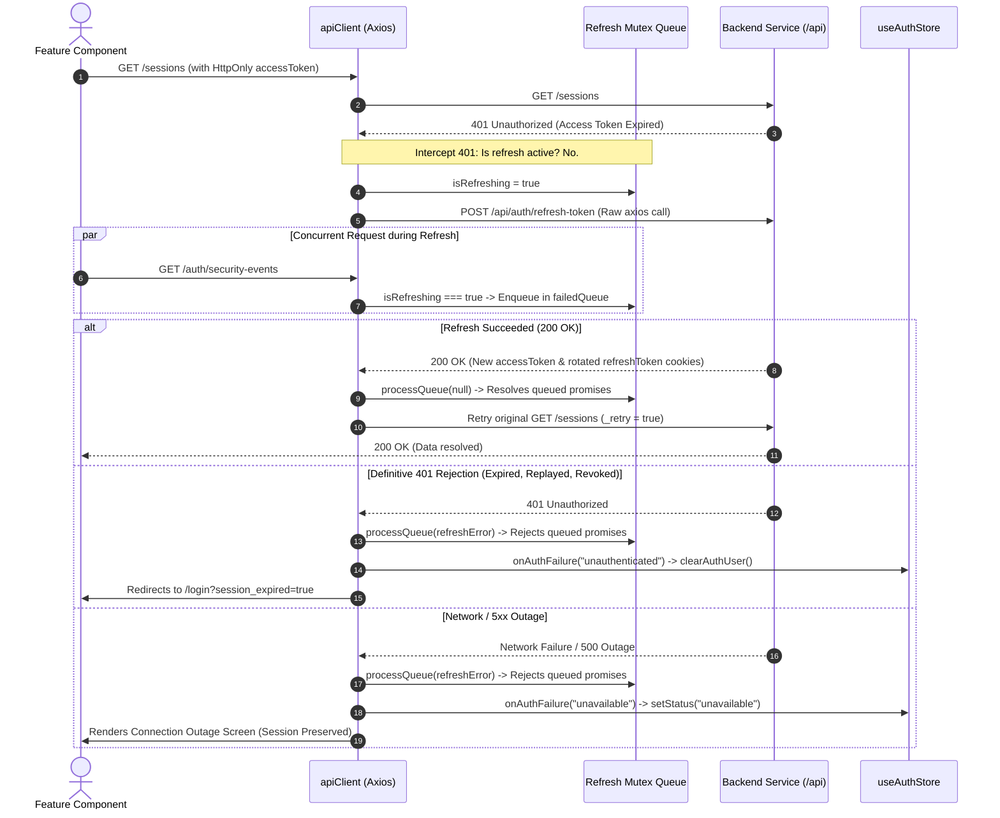
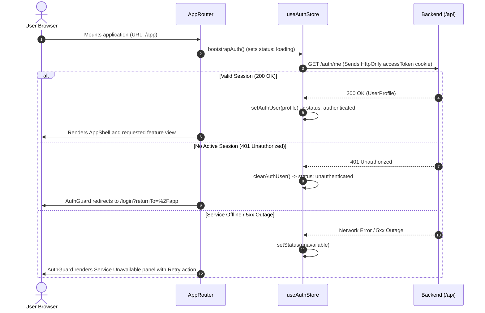
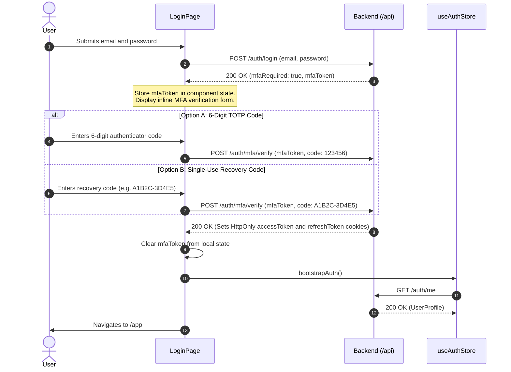
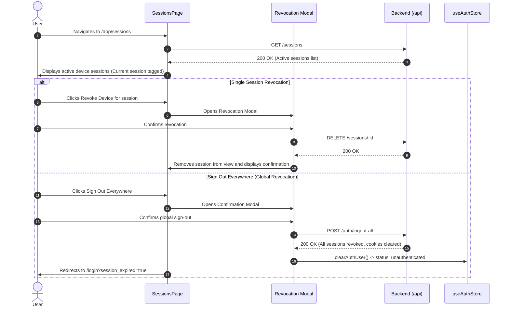
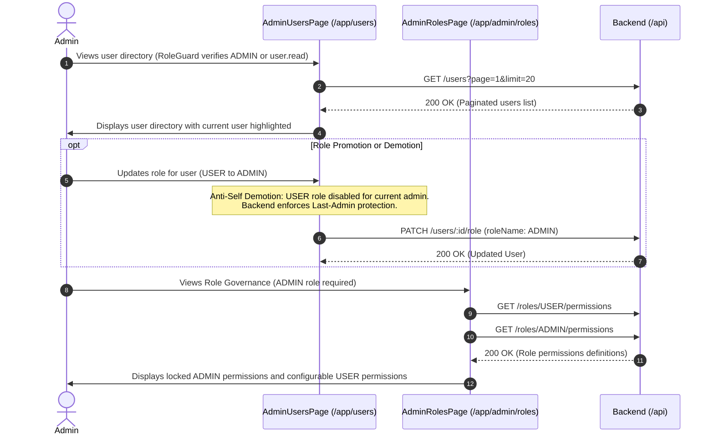
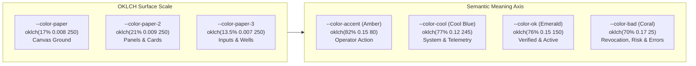

# Frontend Architecture & System Design — AuthSphere

This document provides an overview of **AuthSphere's** frontend web architecture, component topology, client state management, security boundaries, and core user-facing execution flows.

> **AuthSphere Architecture & Engineering Documentation Suite:**
>
> - [ARCHITECTURE.md](./ARCHITECTURE.md) — System Design, Component Topology & Core Data Models
> - [FRONTEND_ARCHITECTURE.md](./FRONTEND_ARCHITECTURE.md) — Frontend Architecture, Component Topology & Control Plane
> - [Engineering-Decisions.md](./Engineering-Decisions.md) — Architecture Decision Records (ADRs) & Technical Trade-offs
> - [OAUTH.md](./OAUTH.md) — OAuth 2.0 PKCE Social Authentication & Integration Protocols
> - [DEPLOYMENT.md](./DEPLOYMENT.md) — Cloud Infrastructure, Dual-Compute (Lambda/ECS) & Runbooks
> - [TESTING.md](./TESTING.md) — Hermetic Test Pyramid, Invariant Verification & CI Strategies

---

## 1. System Overview & Philosophy

AuthSphere's web client (`apps/web`) is an identity and session management control plane built as a single-page application (SPA). It provides self-service authentication, profile management, credential rotation, multi-factor authentication (MFA), active session revocation, and administrative governance for users and roles.

### Core Architectural Principles

7. **Direct Operational Mapping:** Every screen, table, badge, and form maps directly to backend authentication and authorization operations. Views avoid synthetic or fabricated metrics.
8. **Untrusted Client Environment:** The browser runtime is treated as untrusted. Persistent session state is managed exclusively through server-set `HttpOnly`, `SameSite=Lax` cookies. Client-side route guards provide responsive UX navigation, while backend middleware acts as the authoritative gate for all protected operations.
9. **Hallmark Design System:** Implemented under the Hallmark Modern-Minimal Console theme using CSS variables and OKLCH color tokens in dark mode. The interface emphasizes information density, 1px hairline panel borders, no decorative drop shadows, and high-contrast typography (Host Grotesk for prose and controls, Atkinson Hyperlegible Mono with tabular figures for dates, IPs, and identifiers).

---

## 2. Frontend Architecture Topology

AuthSphere's frontend compiles as a single-page application within the npm-workspaces monorepo. It relies on same-origin edge reverse proxying for seamless API communication without cross-origin configuration overhead:



### Technology Baseline

| Technology Layer       | Library / Tool                        | Primary Role                                                                                    |
| :--------------------- | :------------------------------------ | :---------------------------------------------------------------------------------------------- |
| **Build & Tooling**    | Vite 8                                | ES module development server, HMR, code splitting, and development proxy.                       |
| **UI Framework**       | React 19 (`react`, `react-dom`)       | Declarative component rendering, hooks, and `<Suspense>` boundaries.                            |
| **Routing System**     | React Router 7 (`react-router-dom`)   | Declarative routing, navigation guards, URL search param synchronization, and error boundaries. |
| **Styling & Tokens**   | Tailwind CSS v4 (`@tailwindcss/vite`) | `@theme static` CSS variable integration with dark OKLCH tokens.                                |
| **Client State**       | Zustand 5                             | In-memory store for session posture and authentication state.                                   |
| **HTTP Transport**     | Axios                                 | Request/response interceptors, error normalization, and silent refresh mutex.                   |
| **Forms & Validation** | React Hook Form & Zod                 | Isolated form state and schema-based client validation.                                         |
| **TOTP QR Codes**      | QRCode (`qrcode`)                     | Client-side QR code canvas rendering for authenticator setup.                                   |
| **Shared Domain**      | `@authsphere/shared`                  | Monorepo package defining canonical role names, permissions, and event types.                   |

### Ingress & Cookie Configuration

- **Production Edge Proxy (`apps/web/vercel.ts`):** Defined using `@vercel/config/v1`. Rewrites all `/api/(.*)` requests to the backend origin, preserving same-origin cookie delivery and eliminating CORS preflight overhead. Also redirects documentation paths (`/docs`, `/docs/`, `/api/docs`) to `/api/docs/`, and `/openapi.json` to `/api/openapi.json`.
- **Development Proxy (`apps/web/vite.config.ts`):** Mirrors production rewrites by proxying `/api`, `/api/docs`, `/docs`, and `/openapi.json` to `http://localhost:3000`.
- **Cookie Security:** Authentication tokens (`accessToken` and `refreshToken`) are never persisted in `localStorage` or `sessionStorage`. Tokens reside in browser cookies configured with `HttpOnly`, `SameSite=Lax`, and `Secure` (in production).

---

## 3. Layered Component Architecture

The frontend follows a modular, feature-oriented structure separating presentation, routing, state, and network communication:

```text
apps/web/src/
├── api/             # Centralized Axios client, interceptors, and modular API services
├── components/      # Shared presentation primitives and structural layouts
│   ├── auth/        # Shared authentication elements (SocialAuthButtons)
│   ├── layout/      # Application shells (AuthLayout, AppShell)
│   └── ui/          # UI primitives (Button, Input, Modal, Alert, Badge, etc.)
├── features/        # Feature domains (auth, overview, security, sessions, activity, admin)
├── routes/          # Declarative route configuration, guards, and error boundary
├── schemas/         # Centralized Zod validation schemas
├── stores/          # In-memory Zustand store (auth.store.ts)
├── styles/          # OKLCH tokens (tokens.css) and global base styles (base.css)
├── types/           # TypeScript interfaces, domain models, and API response types
└── utils/           # Canonical formatters (user agents, timestamps, badge variants)
```

### 3.1 Presentation & Shell Layer

Feature pages render within two structural shells supported by custom UI primitives:

1. **`AuthLayout` (`components/layout/AuthLayout.tsx`):**
   - Structural shell for unauthenticated guest flows (`/login`, `/register`, `/forgot-password`, `/reset-password`, `/verify-email`, `/magic-link/verify`).
   - Centers a constrained card (`max-w-md`) with brand lockup, application version tag, and links to privacy policy and OpenAPI documentation.
   - Includes layout-level `<Suspense>` skeletons to avoid visual layout shifts during page transitions.

2. **`AppShell` (`components/layout/AppShell.tsx`):**
   - Structural shell for authenticated routes (`/app/*`).
   - **Desktop (≥1024px):** Persistent 240px sidebar with route navigation, active route indicators, external documentation links, and user sign-out controls.
   - **Mobile & Tablet (<1024px):** 48px sticky header with slide-over navigation drawer and dark backdrop overlay.
   - Dynamically filters administrative navigation links (`/app/users`, `/app/admin/roles`) based on the authenticated user's role and assigned permissions.

3. **Custom UI Primitives (`components/ui/`):**
   AuthSphere implements custom, zero-dependency UI primitives (`Button`, `Input`, `Alert`, `Badge`, `Modal`, `Skeleton`, `Pagination`) styled with Tailwind CSS v4 and Hallmark OKLCH tokens. Avoiding heavy external component libraries eliminates bundle bloat, prevents CSS variable conflicts, and ensures accessible focus states (`:focus-visible`) and touch targets (minimum 44px on mobile).

---

### 3.2 Routing & Access Control Guards

Routing is configured through React Router 7 (`routes/index.tsx`) and partitioned across three access boundaries:



#### Canonical Route Inventory

| Route Path           | Access Guard              | Layout Shell | Description & View Component                                                                                  |
| :------------------- | :------------------------ | :----------- | :------------------------------------------------------------------------------------------------------------ |
| `/`                  | Public                    | Standalone   | Landing page with architecture highlights and adaptive CTAs (`HomePage`).                                     |
| `/privacy`           | Public                    | Standalone   | Data governance and privacy policy for OAuth compliance (`PrivacyPolicyPage`).                                |
| `/login`             | `GuestGuard`              | `AuthLayout` | Password & magic link login with inline MFA challenge (`LoginPage`).                                          |
| `/register`          | `GuestGuard`              | `AuthLayout` | User registration with password complexity validation (`RegisterPage`).                                       |
| `/forgot-password`   | `GuestGuard`              | `AuthLayout` | Password reset dispatch with safe confirmation banner (`ForgotPasswordPage`).                                 |
| `/reset-password`    | `GuestGuard`              | `AuthLayout` | Password reset token verification with inline MFA support (`ResetPasswordPage`).                              |
| `/verify-email`      | `GuestGuard`              | `AuthLayout` | Automated token verification with resend action (`VerifyEmailPage`).                                          |
| `/magic-link/verify` | `GuestGuard`              | `AuthLayout` | Automated magic link token consumption (`MagicLinkVerifyPage`).                                               |
| `/app`               | `AuthGuard`               | `AppShell`   | Overview of account posture, current session, and recent security events (`OverviewPage`).                    |
| `/app/security`      | `AuthGuard`               | `AppShell`   | TOTP setup wizard, recovery codes, password rotation, and OAuth linking (`SecurityPage`).                     |
| `/app/sessions`      | `AuthGuard`               | `AppShell`   | Active session registry, individual revocation, and Sign Out Everywhere (`SessionsPage`).                     |
| `/app/activity`      | `AuthGuard`               | `AppShell`   | Paginated security event ledger with URL search param synchronization (`ActivityPage`).                       |
| `/app/users`         | `AuthGuard` + `RoleGuard` | `AppShell`   | User directory with role management (`AdminUsersPage`). Accessible to `ADMIN` or principals with `user.read`. |
| `/app/admin/roles`   | `AuthGuard` + `RoleGuard` | `AppShell`   | Role permissions configurator (`AdminRolesPage`). Restricted to `ADMIN`.                                      |
| `*`                  | Public Fallback           | Standalone   | 404 Not Found recovery view (`NotFoundPage`).                                                                 |

#### Guard Specifications

- **`AuthGuard` (`routes/guards/AuthGuard.tsx`):** Requires `status === 'authenticated'`. Unauthenticated requests redirect to `/login?returnTo=...`. In the event of a backend outage (`unavailable`), it renders a full-page connection failure screen with a manual "Retry Connection" action.
- **`GuestGuard` (`routes/guards/GuestGuard.tsx`):** Prevents authenticated users from accessing login and registration views, redirecting them to `/app` or a validated relative path (`isSafeLocalPath`) to prevent open-redirect vulnerabilities.
- **`RoleGuard` (`routes/guards/RoleGuard.tsx`):** Restricts access by role (`allowedRole`) or permission (`requiredPermission`). When access is denied, it renders an inline 403 Forbidden screen explaining the required capability, preserving the user's active session without logging them out.
- **`RootErrorBoundary` (`routes/guards/RootErrorBoundary.tsx`):** Catches unexpected runtime and routing errors, presenting recovery actions ("Reload Screen" and "Go to Overview").
- **`PUBLIC_AUTH_ROUTES` Contract:** An explicit list of public paths preventing background network failures from triggering unwanted redirect loops while browsing unauthenticated views.

---

### 3.3 State Management & Data Ownership

Client state is partitioned according to data lifecycle and ownership requirements:

| State Domain                 | Owner / Mechanism                               | Scope & Boundary                                                                                             |
| :--------------------------- | :---------------------------------------------- | :----------------------------------------------------------------------------------------------------------- |
| **Authentication Posture**   | Zustand Store (`useAuthStore`)                  | Volatile in-memory cache of `user: UserProfile \| null` and connection status. Never written to web storage. |
| **Transient Challenges**     | Local Component State                           | Intermediate tokens (`mfaToken`) exist only in memory during multi-step authentication.                      |
| **Form Inputs & Validation** | React Hook Form & Zod                           | Localized to individual forms, preventing unnecessary re-renders in parent components.                       |
| **Pagination & Filters**     | URL Search Params (`useSearchParams`)           | Keeps table pages (e.g. `?page=2&limit=20`) bookmarkable and shareable across browser reloads.               |
| **Server Domain Data**       | Local Component State (`useState`, `useEffect`) | Fetched directly through modular API services (`api/`) without complex global caching layers.                |
| **Ephemeral UI State**       | Local Component State (`useState`)              | Modals, menu dropdowns, tooltip toggles, and password visibility toggles.                                    |

#### Auth Store State Machine

The Zustand store (`stores/auth.store.ts`) manages authentication lifecycle transitions:


#### Decoupling API Client and Auth Store

To avoid circular module dependencies between the HTTP client (`api/client.ts`) and the Zustand store (`stores/auth.store.ts`):

- The API client exposes registry hooks: `registerAuthFailureHandler(callback)` and `registerForbiddenHandler(callback)`.
- `auth.store.ts` registers its state handlers during module initialization. The API client never directly imports the store.
- On a definitive 401 response, the API client calls `onAuthFailure("unauthenticated")`. On network or 5xx failures, it calls `onAuthFailure("unavailable")`.
- On a 403 Forbidden response, `onForbidden` triggers a background `refreshUser()` call to resynchronize the user's latest permissions.

---

### 3.4 Network Client & Refresh Mutex

Network requests are managed by a centralized Axios client (`api/client.ts`) configured with `baseURL: "/api"`, `withCredentials: true`, and a 10-second timeout:



#### Refresh Mutex Invariants

7. **Authentication Endpoint Bypass:** Login, registration, password reset, and verification endpoints bypass 401 interception, allowing credential rejection messages to reach forms directly.
8. **Loop Prevention:** Both the initial failed request and all queued requests carry `_retry = true`, ensuring failed retries do not trigger recursive refresh attempts.
9. **Raw Axios Invocation:** The token refresh call (`POST /api/auth/refresh-token`) is executed using raw `axios.post` instead of `apiClient`, preventing recursive interceptor loops.

#### Error Sanitization (`getApiErrorMessage`)

All API errors pass through `getApiErrorMessage(error)` before display:

- **Server Errors (5xx):** Sanitized to generic safe notices (_"An unexpected server error occurred. Please try again later."_).
- **Validation Errors (400):** Extracts field-level Zod messages from `data.errors` and joins them into readable text.
- **Internal Details Filtering:** Identifies and filters database or driver details (`prisma`, `syntax error`, `foreign key`, `unique constraint`, `connection pool`, `econnrefused`), replacing them with safe operational messages.
- **Standard HTTP Codes:** Distinct handling for 429 Rate Limits, 403 Forbidden, 401 Unauthorized, and 404 Not Found.

---

## 4. Core Execution Flows

### 4.1 Application Bootstrap & Session Validation

Session bootstrap executes on initial mount to verify active cookies and hydrate the user profile:



---

### 4.2 Multi-Factor Authentication (MFA)

When primary authentication encounters an MFA-enabled account, verification proceeds inline within the login view:



---

### 4.3 Session Management & Revocation

The active session registry (`/app/sessions`) displays active client terminals and provides revocation controls:



---

### 4.4 Role-Based Access Control (RBAC)

Administrative views enforce role verification, self-demotion prevention, and permission immutability:



---

## 5. Design System & Visual Tokens

The frontend interface is governed by the Hallmark Design System Console theme (`styles/tokens.css`):



### 5.1 Hallmark Console Palette & OKLCH Surfaces

- **Surface Elevation by Tone:** Surface elevation is established through discrete OKLCH lightness levels separated by 1px rules rather than drop shadows (`--shadow-card: none`):
  - Base Canvas (`--color-paper`): Dark charcoal background.
  - Panels & Cards (`--color-paper-2`): Elevated slate containers.
  - Inputs & Wells (`--color-paper-3`): Recessed input controls and table rows.
  - Hairline Dividers (`--color-rule`): 1px precision panel dividers.
- **Semantic Color Meaning:**
  - **Amber (`--color-accent`):** Reserved for primary operator actions (_"Sign In"_, _"Save Changes"_, _"Enable 2FA"_).
  - **Cool Blue (`--color-cool`):** Applied to system-generated tokens, IP addresses, and metadata labels.
  - **Emerald (`--color-ok`):** Indicates verified security status, active MFA, and successful events.
  - **Coral (`--color-bad`):** Denotes destructive actions (_"Revoke Device"_, _"Sign Out Everywhere"_), expired tokens, and critical errors.

### 5.2 Typographic Hierarchy & Tabular Figures

- **Headings & Body:** `Host Grotesk` (weights 400 and 500) with tight letter tracking on display headings.
- **Machine Figures & Telemetry:** `Atkinson Hyperlegible Mono` paired with `font-variant-numeric: tabular-nums` (`.num`, `td.num`). Applied to IP addresses, UUIDs, recovery codes, and ISO timestamps to guarantee vertical alignment in data tables.

### 5.3 Responsive Layouts & Breakpoints

- **Desktop (≥1024px):** Fixed 240px sidebar; content centered in `max-w-6xl` canvas; multi-column data tables with inline actions.
- **Tablet (640px – 1024px):** Persistent header bar with slide-over drawer; 2-column metric cards; tables maintain horizontal scroll containers.
- **Mobile (<640px):** Sticky 48px header with drawer toggle; touch targets minimum 44px; multi-column tables adapt into stacked key-value cards.
- **Horizontal Containment:** `overflow-x: clip` applied on root layout containers to prevent horizontal viewport sway.

---

## 6. Operational Standards & Quality

### 6.1 Code Splitting & Asset Strategy

- **Route-Level Splitting:** Feature pages are loaded on demand using `React.lazy()` with `<Suspense>` boundaries located at the layout level (`routes/index.tsx`).
- **Vendor Splitting:** Core application runtime dependencies (React, React Router, Axios, Zustand) are packaged separately from feature views, allowing browsers to cache shared libraries across route navigations.
- **Shared Utilities:** Validation schemas, formatters, and reusable UI primitives form shared chunks referenced as needed.

---

### 6.2 HTTP Caching Directives

AuthSphere applies distinct caching policies across static assets, documentation, and dynamic API endpoints:

| Resource Type                               | Cache-Control Header                  | Enforcement Layer                                  | Operational Behavior                                                                                          |
| :------------------------------------------ | :------------------------------------ | :------------------------------------------------- | :------------------------------------------------------------------------------------------------------------ |
| **API Endpoints (`/api/*`)**                | `Cache-Control: no-store`             | Express Global Ingress (`app.ts`)                  | Prohibits browsers, shared proxies, and CDNs from storing sensitive authentication, session, or profile data. |
| **OpenAPI Docs (`/openapi.json`, `/docs`)** | `Cache-Control: no-cache`             | Express OpenAPI Router (`common/openapi/index.ts`) | Enables conditional revalidation via `ETag` and `304 Not Modified`, preventing schema drift.                  |
| **Static Assets (`/assets/*-[hash].*`)**    | `public, max-age=31536000, immutable` | Web Server / Edge CDN                              | Content-hashed bundles emitted by Vite are cached indefinitely across edge nodes and browsers.                |
| **SPA Root (`index.html`)**                 | `Cache-Control: no-cache`             | Web Server / Edge CDN                              | Forces conditional revalidation to ensure immediate adoption of new deployment chunk hashes.                  |

---

### 6.3 Error Handling Matrix

Every meaningful operational state provides clear user feedback and explicit recovery actions:

| Operational State                | UI Presentation & Behavior                                                         | Recovery Path                                                           |
| :------------------------------- | :--------------------------------------------------------------------------------- | :---------------------------------------------------------------------- |
| **Initial Loading**              | Layout-matching geometric pulsing skeleton (`Skeleton.tsx`).                       | Resolves automatically upon data arrival; zero cumulative layout shift. |
| **Empty Data State**             | Direct explanation of missing data (e.g. _"No active sessions found"_).            | Contextual action (e.g. _"Refresh"_).                                   |
| **Validation Error (400)**       | Accessible inline field descriptions with error borders.                           | User corrects invalid form input; error clears on input change.         |
| **Session Expired (401)**        | Silent token refresh; redirects to `/login?session_expired=true` if unrecoverable. | Re-authenticates; return path preserved via `?returnTo=...`.            |
| **Forbidden Access (403)**       | Inline 403 Forbidden banner explaining required roles or permissions.              | Active session preserved; CTA button to _"Return to Overview"_.         |
| **Rate Limited (429)**           | Alert banner (_"Too many requests. Please slow down and try again."_).             | Actions disabled during rate limit cooldown period.                     |
| **Service Outage (5xx/Offline)** | Full-page / panel "Service Unavailable" screen.                                    | Session preserved in memory; manual _"Retry Connection"_ button.        |

---

### 6.4 Quality Gates & Verification

All frontend code and architecture artifacts are verified through automated quality gates:

- **TypeScript Compilation:** `npm run typecheck` validates strict typing across monorepo workspaces without errors.
- **ESLint Analysis:** `npm run lint` enforces React hooks and formatting rules.
- **Production Build:** `npm run build -w @authsphere/web` verifies clean Vite bundle compilation and tree-shaking.
- **Accessibility:** Designed to comply with WCAG 2.1 AA standards, including visible focus indicators (`:focus-visible`), proper ARIA roles, live regions, accessible SVGs, and minimum 44px mobile touch targets.
