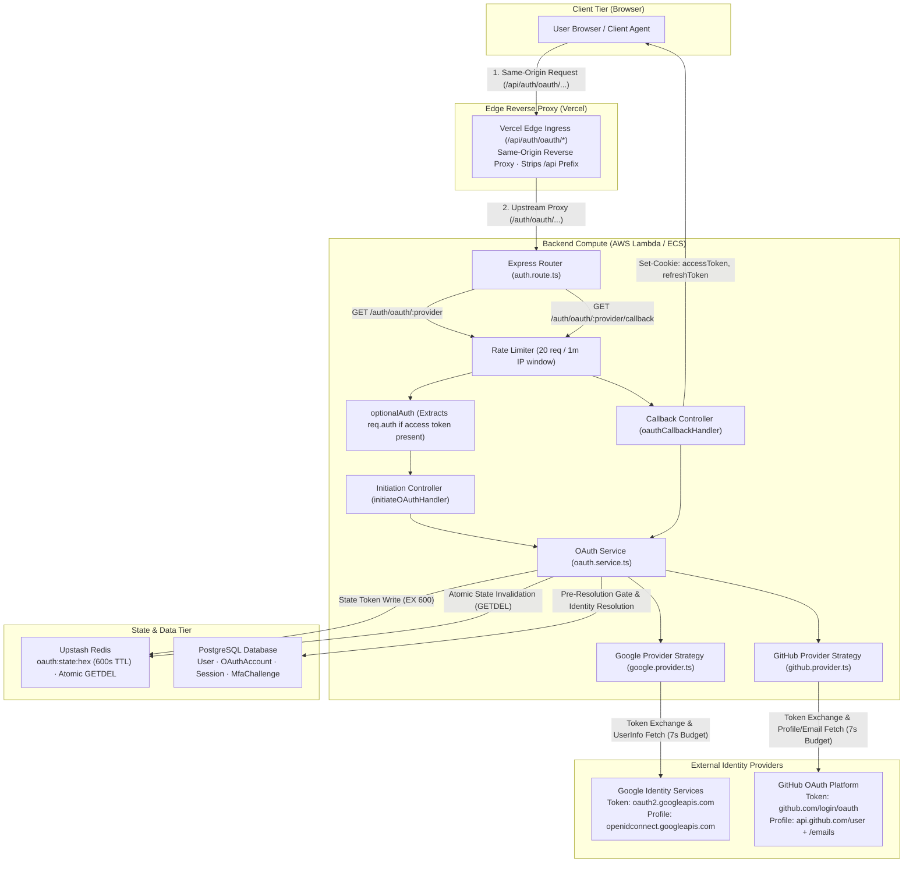
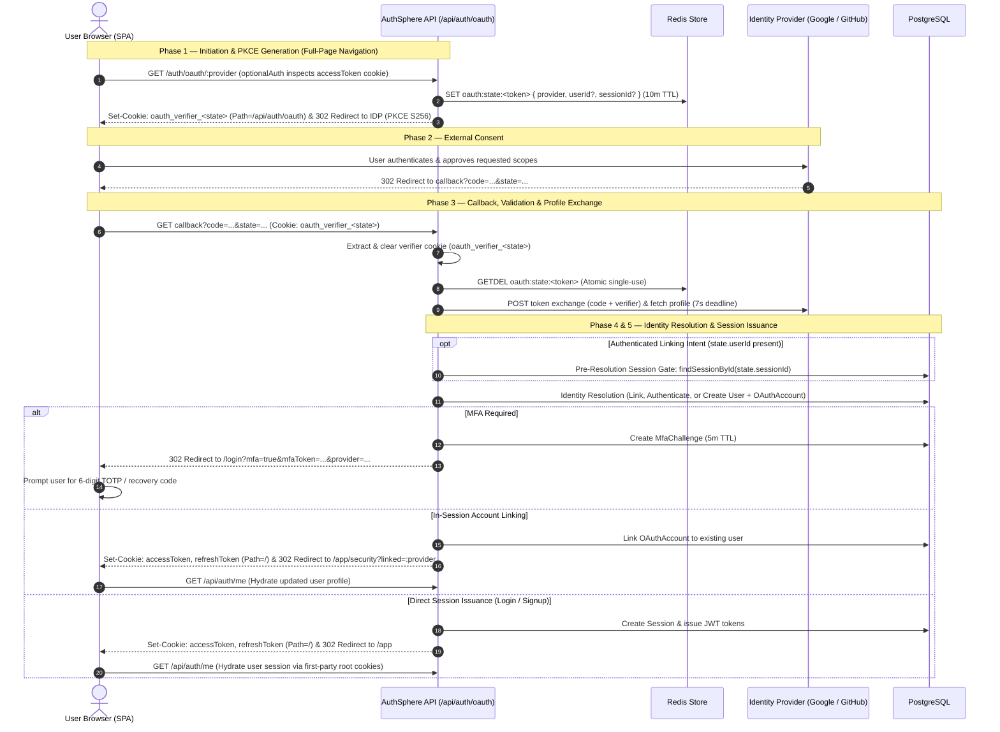
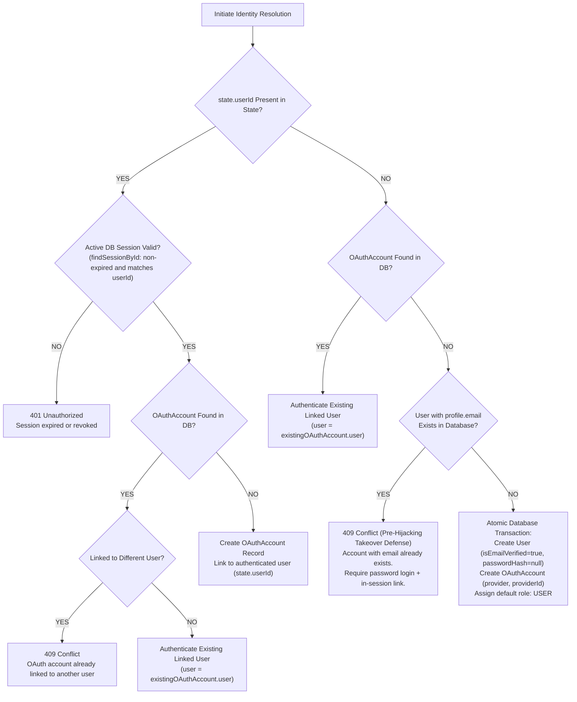
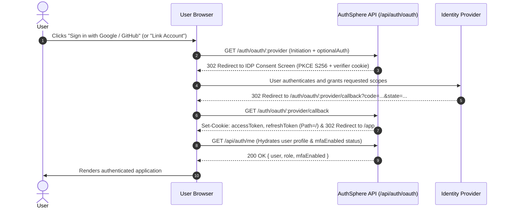

# OAuth 2.0 Architecture & Integration Guide — AuthSphere

This document specifies the OAuth 2.0 social authentication and account-linking architecture for AuthSphere across Google and GitHub identity providers.

> **Companion Architecture, Security & Operations Guides:**
>
> - [System Architecture & Design (ARCHITECTURE.md)](./ARCHITECTURE.md) — System mental model, layered middleware pipeline, entity models, and runtime compute topology.
> - [Architecture Decision Records (Engineering-Decisions.md)](./Engineering-Decisions.md) — Formal ADRs documenting architectural context, trade-offs, security invariants, and failure boundaries.
> - [Cloud Deployment & DevOps Guide (DEPLOYMENT.md)](./DEPLOYMENT.md) — Production deployment guide covering dual-target compute (AWS Lambda vs ECS Fargate), environment configuration, and operational runbooks.
> - [Testing Architecture & Quality Guide (TESTING.md)](./TESTING.md) — Complete specification of the hermetic multi-tier test pyramid and automated verification suites.

---

## 1. System Overview & Architecture Snapshot

> [!IMPORTANT]
> **Architectural Role — OAuth 2.0 Client Only (No Local OIDC ID-Token Validation):**
> AuthSphere acts strictly as an **OAuth 2.0 Client** implementing the **Authorization Code Grant with PKCE (RFC 7636 / RFC 9700)** for federated social login and account linking with external identity providers.
>
> - **Not an Authorization Server:** AuthSphere is **not an Identity Provider (IdP) or OAuth 2.0 Authorization Server**; it does not issue authorization codes or OAuth tokens to third parties, host public token endpoints for external integrations, or implement `client_credentials`, `resource_owner_password_credentials`, or `device_code` grant types.
> - **Trust Model & ID-Token Limitation:** For Google social login, AuthSphere requests `openid email profile` scopes and exchanges the authorization code for an access token. Identity claims (`sub`, `email`, `email_verified`) are resolved by querying Google's authenticated UserInfo endpoint (`https://openidconnect.googleapis.com/v1/userinfo`) over TLS. AuthSphere does **not** perform local cryptographic validation of Google's `id_token` JWT signatures against Google JWKS. Rather than claiming full OpenID Connect (OIDC) Relying Party compliance, AuthSphere is described specifically as an **OAuth 2.0 Authorization Code client utilizing authenticated UserInfo over TLS**. GitHub social login similarly uses standard OAuth 2.0 Web Application Flow via GitHub's REST API.

AuthSphere implements the standard **OAuth 2.0 Authorization Code Grant with Proof Key for Code Exchange (PKCE, RFC 7636 / RFC 9700)** across two external identity providers:

| Provider   | Protocol / Specification       | Initiation Endpoint      | Callback Endpoint                 | Default Scopes         | Stable Identity Claim             | Profile Resolution Mechanism                 |
| :--------- | :----------------------------- | :----------------------- | :-------------------------------- | :--------------------- | :-------------------------------- | :------------------------------------------- |
| **Google** | OAuth 2.0 + UserInfo over TLS  | `GET /auth/oauth/google` | `GET /auth/oauth/google/callback` | `openid email profile` | `sub` (OpenID Connect Subject ID) | Authenticated UserInfo GET over TLS (Bearer) |
| **GitHub** | OAuth 2.0 Web Application Flow | `GET /auth/oauth/github` | `GET /auth/oauth/github/callback` | `read:user user:email` | `String(id)` (Numeric Account ID) | Authenticated GitHub User & Emails API       |

Both flows share a unified strategy abstraction, Redis-backed state management, identity resolution logic, session issuance, and cookie delivery pipeline. Only provider-specific details (authorization URL parameters, token exchange endpoints, and profile normalization) are isolated in provider strategies.

### Unified Edge Ingress & Architecture Topology



---

## 2. OAuth Flow Sequence



---

## 3. End-to-End Implementation Lifecycle

### 3.1. Phase 1 — Initiation & State Generation

- **Route:** `GET /auth/oauth/google` and `GET /auth/oauth/github` (mounted on Express router at `/oauth/:provider`)
- **Rate Limit:** `rateLimiter(RATE_LIMIT_POLICIES.OAUTH_INITIATE)` (20 requests per minute per IP)
- **Middleware Pipeline:** `rateLimiter` → `optionalAuth` → `initiateOAuthHandler(provider)`

#### Context Detection & Account Linking Intent (`optionalAuth`)

The `optionalAuth` middleware (`apps/api/src/middlewares/auth.ts`) inspects incoming cookies for `req.cookies.accessToken`:

- **Valid Access Token Detected (Authenticated Account Linking):**
  1. Validates and decodes the cryptographically signed JWT access token (`{ sub, sid, role }`).
  2. Resolves active permissions dynamically via `authorizationService.getPermissionsByRole()`.
  3. Populates `req.auth = { userId, role, sessionId, permissions }`.
  4. The initiation controller captures both `userId` and `sessionId`, storing them in the Redis state payload. This designates the flow as an **explicit account-linking request**.
- **No Valid Access Token (Unauthenticated Login / Registration):**
  1. Leaves `req.auth` as `undefined`.
  2. The initiation controller stores only `{ provider }` in the Redis state payload.
  3. This designates the flow as an **unauthenticated social login or new account creation**.
- **Silent Degradation & Failure Boundaries:**
  `optionalAuth` never throws on missing, expired, or invalid tokens. Unauthenticated states degrade gracefully to standard login/signup flows without aborting initiation. If a user was previously logged in but their access token expired, the flow treats them safely as unauthenticated. Subsequent session linking is prevented unless the session is actively authenticated and valid.

#### PKCE Verifier Generation & Browser-Binding Cookie

To protect against Login CSRF and authorization code injection across all clients (recommended by RFC 7636 and RFC 9700 §2.1.1), AuthSphere implements native PKCE with the `S256` challenge method without external dependencies:

1. **PKCE Verifier Specification:**
   - 32 cryptographically secure random bytes generated via `crypto.randomBytes(32)`.
   - Formatted as an unpadded `base64url` string (43 characters).
2. **S256 Code Challenge Computation:**
   - Evaluated as `SHA-256(verifier)` digest formatted in `base64url`.
   - Sent to the identity provider authorization endpoint as `code_challenge` with `code_challenge_method=S256`.
3. **Browser-Binding Cookie Storage:**
   - Binds the transaction to the initiating browser using a dedicated HttpOnly cookie keyed by state:
     - **Name:** `oauth_verifier_<state>` (per-transaction state suffix isolates concurrent multi-tab flows).
     - **Path:** `/api/auth/oauth` (evaluated by the browser against the public Vercel edge reverse-proxy path).
     - **Attributes:** `httpOnly: true`, `secure: production`, `sameSite: "lax"`, `maxAge: 600000` (10 minutes).

#### Cryptographic State Generation & Redis Caching

`createOAuthState()` (`apps/api/src/modules/auth/oauth/oauth.service.ts`):

1. Generates 32 bytes of cryptographically secure randomness formatted as a 64-character hexadecimal string (`crypto.randomBytes(32).toString("hex")`).
2. Serializes flow metadata payload:
   ```typescript
   interface OAuthStateData {
     provider: OAuthProviderName;
     userId?: string;
     sessionId?: string;
   }
   ```
3. Persists the payload in Redis under key `oauth:state:<state>` with a strict 10-minute expiration (`EX 600`).

#### Authorization URL Construction

The provider strategy constructs the external identity provider authorization URL, appending the PKCE challenge and transaction state:

- **Google Strategy (`google.provider.ts`):**
  - Endpoint: `https://accounts.google.com/o/oauth2/v2/auth`
  - Parameters: `client_id`, `redirect_uri`, `response_type=code`, `scope="openid email profile"`, `state`, `prompt="select_account"`, `code_challenge`, `code_challenge_method="S256"`
  - _Scope Policy:_ `access_type="offline"` is omitted because AuthSphere uses short-lived identity resolution and does not store upstream provider refresh tokens.
- **GitHub Strategy (`github.provider.ts`):**
  - Endpoint: `https://github.com/login/oauth/authorize`
  - Parameters: `client_id`, `redirect_uri`, `scope="read:user user:email"`, `state`, `code_challenge`, `code_challenge_method="S256"`

The API controller issues an HTTP 302 redirect sending the browser directly to the external provider consent screen.

---

### 3.2. Phase 2 — External Consent

1. The browser navigates to the external provider (Google or GitHub).
2. The user authenticates (or selects an active account) and grants requested scopes.
3. Upon approval, the identity provider redirects the browser back to AuthSphere's registered callback URI:
   ```http
   GET /auth/oauth/:provider/callback?code=<AUTHORIZATION_CODE>&state=<STATE_TOKEN>
   ```

---

### 3.3. Phase 3 — State Verification, PKCE Validation & Profile Exchange

- **Route:** `GET /auth/oauth/google/callback` and `GET /auth/oauth/github/callback`
- **Rate Limit:** `rateLimiter(RATE_LIMIT_POLICIES.OAUTH_CALLBACK)` (20 requests per minute per IP)
- **Validation Pipeline:** Validation is performed **imperatively** in the controller and service layers:
  1. `oauthCallbackHandler` extracts and validates `req.query.state` (returns `400 Invalid or missing OAuth state parameter`).
  2. `oauthCallbackHandler` extracts and validates the transaction cookie `oauth_verifier_<state>` (returns `400 Missing or expired OAuth transaction cookie`).
  3. `oauth.service.ts` validates `code` string presence (returns `400 Missing or invalid authorization code`).
     _(Note: Express routes do not attach route-level Zod validation middleware for callback queries; validation is handled directly by controller and service guards)._

#### Browser-Binding PKCE Verifier Retrieval & Clearance

The callback controller validates browser ownership and immediately destroys the transient verifier cookie:

1. Looks up cookie `oauth_verifier_<state>` from `req.cookies`.
2. Immediately clears the cookie via `clearOAuthVerifierCookie(res, state)` (`res.clearCookie` with `Path=/api/auth/oauth`).
3. If the cookie is absent or expired, the callback aborts immediately with `400 Bad Request` ("Missing or expired OAuth transaction cookie"), thwarting Login CSRF, stolen callback injection, and cross-browser code redemption.

#### Atomic State Invalidation (`GETDEL`)

`consumeOAuthState()` executes an atomic read-and-delete against Redis:

```typescript
const rawData = await redis.getdel(`oauth:state:${state}`);
```

- **Replay & Race Immunity:** Because `GETDEL` is atomic in Redis, an intercepted or replayed state token cannot be redeemed twice.
- **Expiration Enforcement:** Expired keys return `null`, failing immediately with `400 Bad Request` ("Invalid, expired, or already consumed OAuth state").
- **Cross-Provider Mismatch Check:** Verifies that `stateData.provider === expectedProvider`. A state generated for Google cannot be consumed on a GitHub callback route.

#### Shared Upstream Network Deadline (7-Second Abort Budget)

To prevent slow third-party networks from starving serverless compute or exceeding AWS Lambda's 15-second execution ceiling, a single cumulative 7-second `AbortController` deadline is shared across all sequential provider requests (token exchange, profile fetch, and email resolution):

- A unified `AbortController` is initialized before upstream requests (`setTimeout(() => controller.abort(), 7000)`).
- The `controller.signal` is passed to all sequential `fetch` requests and response body streaming calls (`response.json()`).
- In the `finally` block, `clearTimeout(timeoutId)` ensures no lingering timers remain on serverless execution threads.
- If the upstream provider stalls or exceeds the 7-second budget, `controller.signal.aborted` triggers an explicit mapping to HTTP `504 Gateway Timeout` (`AppError("Timeout while communicating with <Provider> OAuth provider", 504)`).

#### Server-to-Server Token Exchange

The provider strategy performs a direct server-to-server HTTP POST request exchanging the short-lived authorization code and the required PKCE `code_verifier` for an upstream access token:

| Exchange Attribute          | Google Provider                                                                                                   | GitHub Provider                                                                  |
| :-------------------------- | :---------------------------------------------------------------------------------------------------------------- | :------------------------------------------------------------------------------- |
| **Token Endpoint**          | `https://oauth2.googleapis.com/token`                                                                             | `https://github.com/login/oauth/access_token`                                    |
| **Content-Type**            | `application/x-www-form-urlencoded`                                                                               | `application/x-www-form-urlencoded`                                              |
| **Accept Header**           | `application/json`                                                                                                | `application/json`                                                               |
| **Body Parameters**         | `code`, `client_id`, `client_secret`, `redirect_uri`, `grant_type=authorization_code`, `code_verifier` (Required) | `code`, `client_id`, `client_secret`, `redirect_uri`, `code_verifier` (Required) |
| **Timeout Budget**          | Bound to shared 7-second `AbortSignal`                                                                            | Bound to shared 7-second `AbortSignal`                                           |
| **Upstream Error Handling** | Logged via Pino (`logger.error`); returns generic `400 Bad Request`                                               | Logged via Pino (`logger.error`); returns generic `400 Bad Request`              |

#### Profile Retrieval & Email Verification Enforcement

1. **Google Strategy & Trust Boundary Qualification:**
   - Queries `https://openidconnect.googleapis.com/v1/userinfo` with `Authorization: Bearer <access_token>`.
   - **Enforces email verification:** Validates that `userInfo.email_verified === true`. Unverified Google emails are rejected with `400 Bad Request`.
   - Uses `sub` (OpenID Connect Subject identifier) as the immutable `providerId`.
   - **Trust Boundary & ID Token Specification:** AuthSphere implements Google federated identity by querying Google's authenticated UserInfo endpoint over TLS using the bearer access token. AuthSphere does not cryptographically verify the RSA/ECDSA signature of Google's `id_token` JWT against Google's JWKS endpoint (`https://www.googleapis.com/oauth2/v3/certs`). The trust boundary relies on direct server-to-server TLS exchange with Google's token and userinfo endpoints.

2. **GitHub Strategy:**
   - Queries `https://api.github.com/user` with `Authorization: Bearer <access_token>` and mandatory headers `User-Agent: AuthSphere-API` and `Accept: application/vnd.github+json`.
   - **Mandatory secondary query:** Queries `https://api.github.com/user/emails` because GitHub's primary user profile does not expose email verification status.
   - Evaluates email priority:
     1. Primary **and** verified email.
     2. Any verified email attached to the account.
     3. If no verified email exists, aborts with `400 Bad Request` ("GitHub account has no verified email address").
   - Uses `String(id)` (GitHub's stable numeric user ID) as the immutable `providerId`.

#### Normalized Profile Interface

Both providers return a standardized `OAuthProfile` DTO:

```typescript
export interface OAuthProfile {
  providerId: string; // Google 'sub' or GitHub stringified numeric 'id'
  email: string; // Lowercased, trimmed, strictly verified email
  firstName: string | null; // Parsed given name or first token of full name
  lastName: string | null; // Parsed family name or remaining tokens
  avatarUrl: string | null; // Profile picture URL
}
```

---

### 3.4. Phase 4 — Identity Resolution Matrix

AuthSphere resolves identity using a deterministic decision matrix governed by a mandatory pre-resolution session validation gate:



#### Detailed Resolution Cases

> **Pre-Resolution Invariant:** Whenever `state.userId` is present, AuthSphere revalidates that `state.sessionId` exists in PostgreSQL, belongs to `state.userId`, and is unexpired (`expiresAt > NOW()`). If the session is missing, expired, or revoked, AuthSphere rejects immediately with HTTP `401 Unauthorized` prior to evaluating any identity resolution branch. Never downgrade to an unauthenticated login.

| Case        | Scenario                                      | Preconditions                                                         | Executed Action                                                                                                                                                                   |
| :---------- | :-------------------------------------------- | :-------------------------------------------------------------------- | :-------------------------------------------------------------------------------------------------------------------------------------------------------------------------------- |
| **Case A**  | **Returning OAuth User**                      | `OAuthAccount(provider, providerId)` exists                           | Authenticates linked user. If `state.userId` was provided (and session revalidated), verifies `existingOAuthAccount.userId === state.userId` (throws `409 Conflict` on mismatch). |
| **Case B1** | **Explicit Account Linking**                  | No `OAuthAccount`, `state.userId` present                             | Session pre-validated. Inserts a new `OAuthAccount` record linked to `state.userId`.                                                                                              |
| **Case B2** | **Email Conflict (Account Takeover Defense)** | No `OAuthAccount`, no `state.userId`, user exists with matching email | **Throws HTTP 409 Conflict.** Prevents pre-hijacking account takeover attacks. User must log in via password and link from settings.                                              |
| **Case B3** | **New User Signup**                           | No `OAuthAccount`, no `state.userId`, no matching email               | Atomically inserts `User` (`isEmailVerified: true`, `verifiedAt: NOW()`, `passwordHash: null`, `roleId: USER`) and associated `OAuthAccount`.                                     |

---

### 3.5. Phase 5 — MFA Challenge or Session Issuance

#### Scenario 1: Multi-Factor Authentication Challenge

If the resolved user has MFA enabled (`user.mfaEnabled === true`) and the flow is an unauthenticated login (`!stateData.userId`):

1. **Creates Ephemeral Challenge:** Generates a database `MfaChallenge` record (`mfaToken` UUIDv7, 5-minute expiration).
2. **Records Audit Event:** Records an `OAUTH_LOGIN` security event with metadata `{ provider, mfaRequired: true }`.
   ```
4. **Redirects to MFA Challenge Screen:** Issues HTTP `302 Redirect` to the frontend login route:
   ```

   ```
   Location: ${env.FRONTEND_URL}/login?mfa=true&mfaToken=${challenge.id}&provider=${provider}
   ```

   ```
6. **Completion:** The client reads `mfaToken` from query parameters, presents the inline TOTP challenge modal, and submits `mfaToken` + 6-digit TOTP code (or recovery code) to `POST /auth/mfa/verify` to receive final session cookies and navigate to `/app`.

#### Scenario 2: Direct Session Issuance & Account Linking

If MFA is disabled (or during in-session account linking):

1. **Creates Persistent Session:** Calls `generateAuthTokensAndSession()`, creating a `Session` record with UUIDv7 ID, SHA-256 hashed refresh token, client IP address, User-Agent, and 30-day expiration.
2. **Generates JWT Tokens:**
   - **Access Token:** 15-minute validity containing claims `{ sub, sid, role }` (permissions resolved dynamically at authorization layer).
   - **Refresh Token:** 30-day validity containing claims `{ sub, sid, role }`.
3. **Sets HttpOnly Cookies:** Sets both `accessToken` and `refreshToken` on root path `/` for edge reverse-proxy compatibility (`httpOnly: true`, `secure: production`, `sameSite: "lax"`).
4. **Records Audit Event:** Records an `OAUTH_LOGIN` security event with metadata `{ provider }`.
6. **Issues 302 Redirect:**
   - **In-Session Account Linking:** Redirects to `${env.FRONTEND_URL}/app/security?linked=${provider}`.
   - **Standard Social Sign-in / Sign-up:** Redirects to `${env.FRONTEND_URL}/app`.

---

### 3.6. Phase 6 — Canonical Full-Page Redirect Architecture

AuthSphere standardizes on **Full-Page Redirect (HTTP 302)** as the canonical OAuth completion flow across desktop and mobile browsers:



#### Architectural Advantages:

1. **Zero Popup Blocker Vulnerability:** Never blocked by Safari ITP, Brave Shields, or strict Chrome pop-up settings.
2. **First-Class Mobile Responsiveness:** Eliminates severed `window.opener` contexts caused by mobile browsers opening popups as new tabs.
3. **Reduced Attack Surface:** Eliminates cross-window `postMessage` event listeners and origin validation complexity in the SPA.
4. **Clean Error Handling:** If third-party consent is cancelled (`?error=access_denied`), the backend redirects cleanly to `${env.FRONTEND_URL}/login?error=...`, where the client renders an inline error alert banner.
5. **Session Hydration:** Upon landing on `/app` (or `/app/security?linked=:provider`), the frontend SPA bootstrap hook calls `GET /api/auth/me` to hydrate in-memory authentication state and permissions cleanly.

---

## 4. Provider Strategy Comparison

| Technical Dimension           | Google Provider Strategy                                           | GitHub Provider Strategy                                                        |
| :---------------------------- | :----------------------------------------------------------------- | :------------------------------------------------------------------------------ |
| **Strategy Implementation**   | `GoogleOAuthProvider` (`google.provider.ts`)                       | `GitHubOAuthProvider` (`github.provider.ts`)                                    |
| **Authorization Endpoint**    | `https://accounts.google.com/o/oauth2/v2/auth`                     | `https://github.com/login/oauth/authorize`                                      |
| **Token Exchange Endpoint**   | `https://oauth2.googleapis.com/token`                              | `https://github.com/login/oauth/access_token`                                   |
| **User Profile Endpoint**     | `https://openidconnect.googleapis.com/v1/userinfo`                 | `https://api.github.com/user`                                                   |
| **Email Resolution Endpoint** | Included in `/userinfo` response                                   | Dedicated secondary query: `https://api.github.com/user/emails`                 |
| **Required Scopes**           | `openid email profile`                                             | `read:user user:email`                                                          |
| **Immutable Subject ID**      | `sub` (OIDC string subject identifier)                             | `String(id)` (Stable numeric GitHub account ID)                                 |
| **Email Verification Rule**   | Enforces `email_verified === true`                                 | Primary verified email, fallback to any verified email; reject if none          |
| **Name Normalization**        | Uses `given_name` / `family_name`; falls back to `name.split(" ")` | Uses `name.split(" ")`; falls back to GitHub `login` username                   |
| **Custom HTTP Headers**       | Standard headers                                                   | Requires `User-Agent: AuthSphere-API` and `Accept: application/vnd.github+json` |

---

## 5. Database Schema & Data Integrity

AuthSphere stores social account links in the `oauth_accounts` PostgreSQL table managed by Prisma:

```prisma
model OAuthAccount {
  id String @id @default(uuid(7))

  userId String @map("user_id")

  provider   OAuthProvider
  providerId String        @map("provider_id")

  createdAt DateTime @default(now()) @map("created_at")
  updatedAt DateTime @updatedAt @map("updated_at")

  user User @relation(fields: [userId], references: [id], onDelete: Cascade)

  @@unique([provider, providerId])
  @@unique([userId, provider])
  @@index([userId])
  @@map("oauth_accounts")
}
```

### Key Data Integrity Invariants

1. **`@@unique([provider, providerId])`:** A single external social identity (e.g. Google subject ID `109283...`) can be linked to at most one AuthSphere user.
2. **`@@unique([userId, provider])`:** An AuthSphere user can link at most one account per provider (e.g. one Google account and one GitHub account).
3. **`onDelete: Cascade`:** Deleting a `User` record automatically cleans up all associated social identities.
4. **UUIDv7 Primary Keys:** Time-ordered UUIDv7 identifiers provide natural chronological database clustering.

---

## 6. Edge Ingress & Reverse Proxy Integration

In production environments (e.g. Vercel + AWS Lambda / ECS), OAuth traffic routes through Vercel's Edge Reverse Proxy:

- **Path Rewrite Rule:** The edge proxy accepts same-origin browser requests on `https://<PROJECT>.vercel.app/api/auth/oauth/(.*)` and strips the `/api` prefix, forwarding upstream to backend compute at `/auth/oauth/$1`.
- **First-Party Cookie Isolation:** Because the browser only makes requests to the primary domain (`/api/auth/oauth/*`), cookies are treated as first-party by Safari ITP, Firefox ETP, and Chrome privacy sandboxes.
- **Cookie Path Differentiation:**
  - The PKCE verifier cookie (`oauth_verifier_<state>`) is scoped strictly to `Path=/api/auth/oauth` so it only travels during OAuth initiation and callback requests.
  - Final authentication cookies (`accessToken`, `refreshToken`) are scoped to `Path=/` so all subsequent application requests across the domain carry credentials.

### Callback URI Resolution Logic

Both provider strategies determine the redirect URI dynamically via:

```typescript
const base =
  env.OAUTH_CALLBACK_BASE_URL || `${env.FRONTEND_URL}/api/auth/oauth`;
return `${base.replace(/\/$/, "")}/${provider.toLowerCase()}/callback`;
```

By pointing `OAUTH_CALLBACK_BASE_URL` or `FRONTEND_URL` to the public Vercel domain, callbacks return through the same-origin reverse proxy, guaranteeing symmetric cookie access and avoiding cross-origin issues.

---

## 7. Security Architecture & Threat Mitigation Matrix

| Threat Category                      | Potential Attack Vector                                                                            | AuthSphere Defensive Countermeasure                                                                                                                                                                                                                |
| :----------------------------------- | :------------------------------------------------------------------------------------------------- | :------------------------------------------------------------------------------------------------------------------------------------------------------------------------------------------------------------------------------------------------- |
| **Login CSRF & Code Injection**      | Attacker completes an OAuth flow and tricks victim browser into consuming the attacker's callback. | **Browser-Bound PKCE (`S256`):** Native `code_challenge` / `code_verifier` with transient `oauth_verifier_<state>` HttpOnly cookie (`Path=/api/auth/oauth`, 10m TTL). Stolen callback URLs cannot be consumed in another browser.                  |
| **State Replay & Race Conditions**   | Intercepted or duplicated callback request attempts to reuse state.                                | **Atomic `redis.getdel()` Consumption:** Single-use state retrieval and immediate invalidation prevents race conditions and replay attacks.                                                                                                        |
| **Stale / Revoked Account Linking**  | Initiating session is revoked or expires while external consent is pending.                        | **Pre-Resolution Session Gate:** Queries `findSessionById` in PostgreSQL before identity resolution whenever `state.userId` is present, verifying session is active, unexpired, and owned by `state.userId`; throws `401 Unauthorized` if invalid. |
| **Cross-Provider State Spoofing**    | Consuming a Google state token on a GitHub callback route.                                         | **Provider Validation:** Verifies `stateData.provider === expectedProvider` prior to processing.                                                                                                                                                   |
| **Pre-Hijacking Account Takeover**   | Attacker registers a victim's email on an external provider to steal an existing password account. | **Strict 409 Conflict Guard (Anti-Auto-Link):** Unauthenticated OAuth flows never auto-link to existing email accounts. In-session password authentication is mandatory.                                                                           |
| **Upstream Stalls & Lambda Timeout** | Upstream IDP network latency exhausts serverless compute or exceeds Lambda 15s limit.              | **Shared 7-Second Abort Budget:** A cumulative `AbortController` signal is passed to all sequential upstream requests (`fetch`), cleanly aborting with `504 Gateway Timeout` on latency spikes.                                                    |
| **Identifier Mutation / Recycling**  | User changes their Google display name or GitHub username/handle.                                  | **Immutable Subject Identifiers:** Binds accounts to Google `sub` (OIDC string) and GitHub numeric `id`.                                                                                                                                           |
| **Unverified Email Impersonation**   | Attacker registers an unverified email address on GitHub to claim an account.                      | **Mandatory Verification Gate:** Google checks `email_verified === true`; GitHub explicitly checks `/user/emails`.                                                                                                                                 |
| **Over-Privileged Scopes**           | Requesting offline access or sensitive scopes without functional need.                             | **Minimal Scope Grants:** Google requests `openid email profile` without `access_type=offline`; GitHub requests `read:user user:email`. No unnecessary third-party refresh tokens are stored.                                                      |
| **Credential & Secret Leakage**      | Client secrets exposed via client bundles or public endpoints.                                     | **Server-Side Secret Isolation:** Secrets stored in environment variables, validated at boot by Zod, and used only server-to-server.                                                                                                               |
| **Information Disclosure**           | Upstream provider outage or invalid credentials leaking system details.                            | **Error Masking:** Upstream error bodies logged internally via Pino; generic client errors returned.                                                                                                                                               |
| **Endpoint Denial of Service**       | Flooding initiation or callback routes to exhaust Redis or rate limits.                            | **IP Rate Limiting:** Fixed-window limits of 20 requests per minute per IP on initiation and callback routes.                                                                                                                                      |
| **Cross-Window Eavesdropping**       | Malicious windows listen to browser broadcast messages or manipulate popup openers.                | **Full-Page Redirect Elimination:** AuthSphere eliminates cross-window `postMessage` entirely. Session credentials flow strictly via first-party HttpOnly SameSite=Lax cookies on root `Path=/`.                                                   |
| **UI Redress & Clickjacking**        | Attacker frames the OAuth flow within an `<iframe>` to intercept user consent or callbacks.        | **`X-Frame-Options: DENY` Enforcement:** Express Helmet configuration strictly denies framing across all endpoints. Full-page navigations execute as top-level browsing contexts, while embedded iframes are rejected by the browser.              |

---

## 8. File Reference Map

```text
apps/api/src/
├── config/
│   └── env.ts                           # Zod validation for OAuth credentials & callback base URL
├── middlewares/
│   ├── auth.ts                          # optionalAuth (extracts authenticated context if valid access token detected)
│   ├── rate-limit.ts                    # OAUTH_INITIATE and OAUTH_CALLBACK rate limit policies (20 req / 1m IP)
│   └── validate.ts                      # Multi-target Zod request validator
└── modules/auth/
    ├── auth.route.ts                    # Mounts /oauth/google[/callback] and /oauth/github[/callback]
    ├── auth.openapi.ts                  # OpenAPI 3.1 specifications for OAuth endpoints
    ├── auth.repository.ts               # findOAuthAccount, createOAuthAccount, createUserWithOAuthAccount
    ├── auth.service.ts                  # generateAuthTokensAndSession, recordSecurityEvent
    ├── auth.validation.ts               # oauthCallbackQuery schema (code, state)
    └── oauth/
        ├── oauth.types.ts               # OAuthStateData, OAuthProfile, OAuthProviderStrategy interfaces
        ├── oauth.service.ts             # createOAuthState, consumeOAuthState, initiateOAuth, handleOAuthCallback
        ├── oauth.controller.ts          # initiateOAuthHandler & oauthCallbackHandler factory functions
        ├── google.provider.ts           # GoogleOAuthProvider strategy implementation
        └── github.provider.ts           # GitHubOAuthProvider strategy implementation
```

---

## 9. Operational Verification & Testing

> **Operational Endpoint Paths:**
>
> - **Public Edge URL (Browser / Vercel Proxy):** `https://<PUBLIC_DOMAIN>/api/auth/oauth/...` (evaluates against cookie `Path=/api/auth/oauth`).
> - **Direct Backend Testing (Local Express):** `http://localhost:3000/auth/oauth/...` (bypasses reverse-proxy `/api` prefix strip).
>
> The examples below test the browser-facing public edge URL (`/api/auth/oauth/...`) so that transaction cookies scoped to `Path=/api/auth/oauth` are matched and delivered.

### 9.1. Initiation Verification

Initiate an OAuth flow via `curl` and inspect response headers:

```bash
# Test Google OAuth Initiation (Verify 302 Redirect, State Token, Scopes, and PKCE Cookie)
curl -i -X GET https://<PUBLIC_DOMAIN>/api/auth/oauth/google

# Expected Response:
# HTTP/1.1 302 Found
# Location: https://accounts.google.com/o/oauth2/v2/auth?client_id=...&state=<64_HEX_CHARS>&scope=openid+email+profile&prompt=select_account&code_challenge=<CHALLENGE>&code_challenge_method=S256
# Set-Cookie: oauth_verifier_<64_HEX_CHARS>=<VERIFIER>; Path=/api/auth/oauth; HttpOnly; SameSite=Lax; Max-Age=600; Secure
```

### 9.2. State Invalidation & Replay Testing

Verify that replaying or tampering with state parameters fails fast:

```bash
# 1. Attempt callback with invalid state parameter
curl -i -X GET "https://<PUBLIC_DOMAIN>/api/auth/oauth/google/callback?code=test-code&state=invalid-state-token"

# Expected Response (State Invalidation Guard):
# HTTP/1.1 400 Bad Request
# {"success":false,"message":"Invalid, expired, or already consumed OAuth state"}
```

```bash
# 2. Attempt callback without transaction cookie (Login-CSRF or cross-browser replay defense)
curl -i -X GET "https://<PUBLIC_DOMAIN>/api/auth/oauth/google/callback?code=test-code&state=0123456789abcdef0123456789abcdef0123456789abcdef0123456789abcdef"

# Expected Response (PKCE Transaction Cookie Guard):
# HTTP/1.1 400 Bad Request
# {"success":false,"message":"Missing or expired OAuth transaction cookie"}
```

```bash
# 3. Attempt callback with transaction cookie present but missing authorization code
curl -i -X GET "https://<PUBLIC_DOMAIN>/api/auth/oauth/google/callback?state=<VALID_STATE>" \
  -H "Cookie: oauth_verifier_<VALID_STATE>=<VALID_VERIFIER>"

# Expected Response (Code Presence Guard):
# HTTP/1.1 400 Bad Request
# {"success":false,"message":"Missing or invalid authorization code"}
```

### 9.3. Account Linking Verification

To verify in-session account linking:

1. Authenticate via password to obtain an `accessToken` cookie.
2. Invoke `GET /api/auth/oauth/google` carrying the cookie:
   ```bash
   curl -i -X GET https://<PUBLIC_DOMAIN>/api/auth/oauth/google \
     -H "Cookie: accessToken=<VALID_ACCESS_TOKEN>"
   ```
3. Complete the provider consent flow. Upon callback, AuthSphere revalidates that the session is still active and unexpired in PostgreSQL, then inserts the new `OAuthAccount` row linked to the authenticated user's ID without prompting for MFA or creating duplicate user accounts.

### 9.4. Browser-Bound PKCE Verification

Verify that the callback enforces the presence of the initiating browser's transaction cookie and isolates concurrent flows:

```bash
# 1. Missing Cookie Test (Simulating cross-browser code redemption or victim browser without cookie)
# Attempt callback with valid state format but without the corresponding HttpOnly cookie:
curl -i -X GET "https://<PUBLIC_DOMAIN>/api/auth/oauth/google/callback?code=mock-code&state=0123456789abcdef0123456789abcdef0123456789abcdef0123456789abcdef"

# Expected Response:
# HTTP/1.1 400 Bad Request
# {"success":false,"message":"Missing or expired OAuth transaction cookie"}
```

```bash
# 2. Cross-Browser Replay Test
# Obtain valid callback URL and cookie from Browser Profile A. Attempt to redeem the callback in Browser Profile B (different jar):
# Profile B lacks oauth_verifier_<state> -> Fails immediately with HTTP 400 Bad Request.
```

```bash
# 3. Concurrent Multi-Tab Isolation Test
# Open two simultaneous flows in separate browser tabs:
# Tab 1 -> GET /api/auth/oauth/google -> receives Set-Cookie: oauth_verifier_<state_1>
# Tab 2 -> GET /api/auth/oauth/google -> receives Set-Cookie: oauth_verifier_<state_2>
# Both cookies coexist under distinct names without collisions; completing Tab 1 leaves Tab 2's cookie intact.
```

---

## 10. Architectural Decision Records (ADRs)

AuthSphere's OAuth implementation is governed by formal Architectural Decision Records in [Engineering-Decisions.md](Engineering-Decisions.md):

- [ADR-032: Social Login Account Guarding](Engineering-Decisions.md#adr-032--social-login-account-guarding) — Guarded social login accounts without local passwords from direct password authentication and password reset mutations.
- [ADR-059: Provider-Agnostic OAuth 2.0 Strategy Pattern](Engineering-Decisions.md#adr-059--provider-agnostic-oauth-20-strategy-pattern) — Established strategy pattern abstraction for identity providers.
- [ADR-060: Redis-Backed Ephemeral OAuth State with Atomic Single-Use Invalidation](Engineering-Decisions.md#adr-060--redis-backed-ephemeral-oauth-state-with-atomic-single-use-invalidation) — Codified 32-byte crypto state tokens and atomic `GETDEL` consumption.
- [ADR-061: Strict Conflict-Guarded OAuth Identity Resolution Workflow](Engineering-Decisions.md#adr-061--strict-conflict-guarded-oauth-identity-resolution-workflow) — Mandated strict 409 conflict responses on email collisions to prevent pre-hijacking account takeover.
- [ADR-062: Verified Email Enforcement for Social Identity Providers](Engineering-Decisions.md#adr-062--verified-email-enforcement-for-social-identity-providers) — Required verified email enforcement and secondary `/user/emails` query on GitHub.
- [ADR-063: Higher-Order Controller Factories for Provider-Agnostic OAuth Handlers](Engineering-Decisions.md#adr-063--higher-order-controller-factories-for-provider-agnostic-oauth-handlers) — Adopted higher-order factory functions for DRY, type-safe route controllers.
- [ADR-066: Multi-Tier Rate Limiting for OAuth Callbacks and Passwordless Magic Links](Engineering-Decisions.md#adr-066--multi-tier-rate-limiting-for-oauth-callbacks-and-passwordless-magic-links) — Enforced dedicated IP rate limiting on OAuth initiation and callback endpoints.
- [ADR-079: Serverless Lambda Runtime, Synchronous Execution Guard, and Reverse-Proxy Cookie Bridge](Engineering-Decisions.md#adr-079--serverless-lambda-runtime-synchronous-execution-guard-and-reverse-proxy-cookie-bridge) — Codified root-scoped authentication cookies for reverse-proxy edge traversal.
- [ADR-080: Browser-Bound PKCE (RFC 7636 / RFC 9700) and Per-Transaction Cookie Architecture](Engineering-Decisions.md#adr-080--browser-bound-pkce-rfc-7636--rfc-9700-and-per-transaction-cookie-architecture) — Mandated PKCE with S256 challenges and per-transaction HttpOnly verifier cookies.
- [ADR-081: Cumulative Upstream Provider Abort Deadline and Gateway Timeout Mapping](Engineering-Decisions.md#adr-081--cumulative-upstream-provider-abort-deadline-and-gateway-timeout-mapping) — Implemented cumulative 7-second abort deadline mapped to HTTP 504 Gateway Timeout.
- [ADR-082: Pre-Resolution Session Gate for Authenticated Account Linking](Engineering-Decisions.md#adr-082--pre-resolution-session-gate-for-authenticated-account-linking) — Enforced database session revalidation prior to identity resolution for account linking.
- [ADR-085: Code-First Edge Reverse Proxy Configuration via `@vercel/config/v1`](Engineering-Decisions.md#adr-085--code-first-edge-reverse-proxy-configuration-via-vercelconfigv1) — Documented dynamic edge rewrite `/api/auth/oauth/(.*)` to backend infrastructure.
- [ADR-086: Development-to-Production Reverse Proxy Parity via Vite Local Server](Engineering-Decisions.md#adr-086--development-to-production-reverse-proxy-parity-via-vite-local-server) — Ensured identical `/api` routing and cookie transport in local development.
