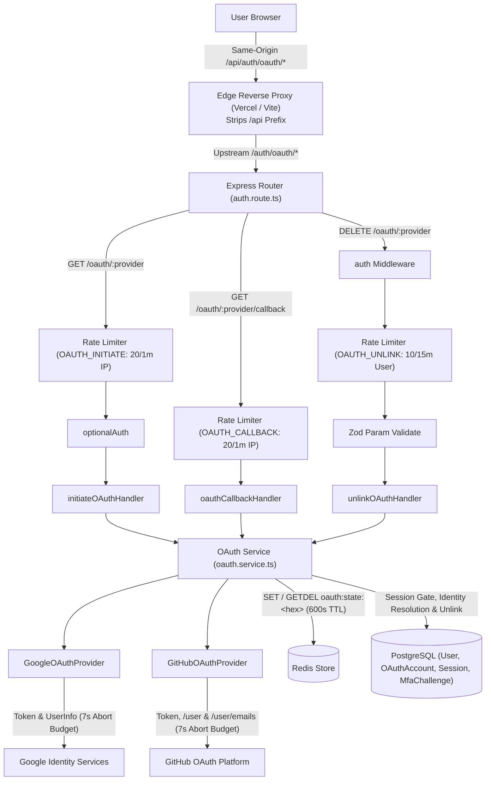
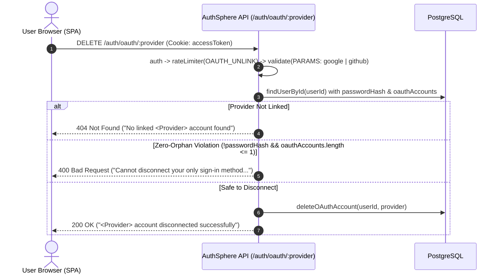
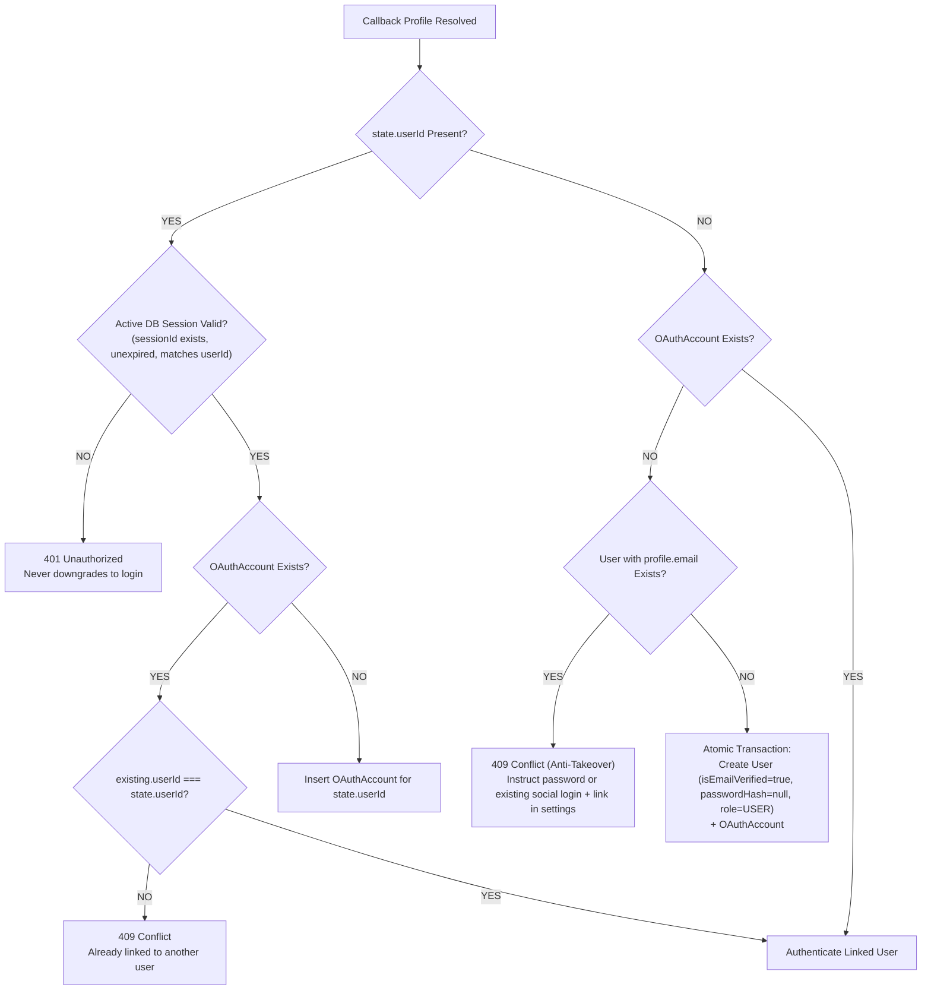

# OAuth 2.0 Architecture & Integration Guide — AuthSphere

This document is the Single Source of Truth (SSOT) for **AuthSphere's** OAuth 2.0 PKCE federated authentication protocol, Google and GitHub provider strategies, identity resolution matrix, Zero-Orphan disconnection protection, and OAuth threat mitigation matrix.

> **AuthSphere Architecture & Engineering Documentation Suite:**
>
> - [ARCHITECTURE.md](./ARCHITECTURE.md) — System Design, Component Topology & Core Data Models
> - [FRONTEND_ARCHITECTURE.md](./FRONTEND_ARCHITECTURE.md) — Frontend Architecture, Component Topology & Control Plane
> - [Engineering-Decisions.md](./Engineering-Decisions.md) — 107 Formal ADRs, Security Invariants & Technical Trade-offs
> - [OAUTH.md](./OAUTH.md) — OAuth 2.0 PKCE Social Authentication & Integration Protocols
> - [DEPLOYMENT.md](./DEPLOYMENT.md) — Cloud Infrastructure, Dual-Compute (Lambda/ECS) & Runbooks
> - [TESTING.md](./TESTING.md) — Hermetic Test Pyramid, Invariant Verification & CI Strategies

---

## 1. System Overview & Trust Boundary

> [!IMPORTANT]
> **Architectural Role — OAuth 2.0 Client Only (No Local OIDC ID-Token Validation):**
> AuthSphere acts strictly as an **OAuth 2.0 Client** implementing the **Authorization Code Grant with PKCE (RFC 7636 / RFC 9700)** for social login, account linking, and provider disconnection. It is **not** an Identity Provider or Authorization Server.
>
> For Google, AuthSphere requests `openid email profile`, exchanges the authorization code for an access token, and resolves identity claims (`sub`, `email`, `email_verified`) from Google's authenticated UserInfo endpoint over TLS (`https://openidconnect.googleapis.com/v1/userinfo`) without locally verifying `id_token` JWT signatures against Google JWKS. GitHub uses OAuth 2.0 Web Application Flow via GitHub's REST API.

| Provider   | Protocol / Flow                | Initiation Endpoint      | Callback Endpoint                 | Scopes                 | Stable `providerId` | Profile & Email Resolution                        |
| :--------- | :----------------------------- | :----------------------- | :-------------------------------- | :--------------------- | :------------------ | :------------------------------------------------ |
| **Google** | OAuth 2.0 + UserInfo over TLS  | `GET /auth/oauth/google` | `GET /auth/oauth/google/callback` | `openid email profile` | `sub`               | UserInfo GET over TLS (`email_verified === true`) |
| **GitHub** | OAuth 2.0 Web Application Flow | `GET /auth/oauth/github` | `GET /auth/oauth/github/callback` | `read:user user:email` | `String(id)`        | `/user` + `/user/emails` (verified email)         |

| Action              | HTTP Endpoint                  | Guard / Middleware                                              | Rate Limit Policy                   | Key Invariant                                                      |
| :------------------ | :----------------------------- | :-------------------------------------------------------------- | :---------------------------------- | :----------------------------------------------------------------- |
| **Unlink Provider** | `DELETE /auth/oauth/:provider` | `auth` -> `rateLimiter` -> `validate(PARAMS: google \| github)` | `OAUTH_UNLINK` (10 req / 15m, User) | **Zero-Orphan Protection:** Cannot disconnect sole sign-in method. |

### Unified Edge Ingress & Component Topology



---

## 2. Canonical OAuth Flows

### 2.1 Social Login & In-Session Account Linking

```mermaid
sequenceDiagram
    autonumber
    actor Browser as User Browser (SPA)
    participant API as AuthSphere API (/auth/oauth)
    participant Redis as Redis Store
    participant IDP as Identity Provider (Google / GitHub)
    participant DB as PostgreSQL

    Note over Browser, API: Phase 1 — Initiation & PKCE Generation (Full-Page Navigation)
    Browser->>API: GET /auth/oauth/:provider?returnTo=/app/security (optionalAuth inspects accessToken cookie)
    API->>Redis: SET oauth:state:<64-hex> { provider, userId?, sessionId?, returnTo? } (EX 600)
    API-->>Browser: Set-Cookie: oauth_verifier_<state> (Path=getOAuthVerifierCookiePath()) & 302 Redirect to IDP (PKCE S256)

    Note over Browser, IDP: Phase 2 — External Consent
    alt User Grants Consent
        Browser->>IDP: Authenticate & approve scopes
        IDP-->>Browser: 302 Redirect to callback?code=...&state=...
    else User Cancels Consent
        IDP-->>Browser: 302 Redirect to callback?error=access_denied&state=...
        Browser->>API: GET callback?error=access_denied&state=...
        API->>API: Clear oauth_verifier_<state> cookie
        API->>Redis: GETDEL oauth:state:<state> (Resolve returnTo/userId)
        API-->>Browser: 302 Redirect to /login (or returnTo / /app/security) + ?error=Authentication%20cancelled
    end

    Note over Browser, DB: Phase 3 — Callback Validation & Profile Exchange
    Browser->>API: GET callback?code=...&state=... (Cookie: oauth_verifier_<state>)
    API->>API: Clear & validate oauth_verifier_<state> cookie
    API->>Redis: GETDEL oauth:state:<state> (Atomic single-use; verify provider match)
    API->>IDP: POST token exchange (code + code_verifier) & fetch profile (7s shared AbortController)

    Note over API, DB: Phase 4 & 5 — Identity Resolution & Session / MFA Outcome
    opt Authenticated Linking Intent (state.userId present)
        API->>DB: Pre-Resolution Session Gate: findSessionById(state.sessionId) (401 if missing/expired/mismatched)
    end
    API->>DB: Resolve Identity (Link, Authenticate, Reject 409 Conflict, or Create User + OAuthAccount)
    alt MFA Required (Unauthenticated Login with mfaEnabled === true)
        API->>DB: Create MfaChallenge (5m TTL, type=OAUTH_LOGIN)
        API-->>Browser: 302 Redirect to /login?mfa=true&mfaToken=...&provider=...
    else In-Session Account Linking
        API->>DB: Create Session (supersedes device) & record OAUTH_LOGIN event
        API-->>Browser: Set-Cookie: accessToken, refreshToken (Path=/) & 302 Redirect to returnTarget?linked=:provider
    else Direct Social Login / Signup
        API->>DB: Create Session (supersedes device) & record OAUTH_LOGIN event
        API-->>Browser: Set-Cookie: accessToken, refreshToken (Path=/) & 302 Redirect to returnTarget (default /app)
    end
```

### 2.2 Provider Disconnection (`DELETE /auth/oauth/:provider`)



---

## 3. Protocol Mechanics & Lifecycle Rules

### 3.1 Initiation, State & Browser-Bound PKCE

- **Route & Pipeline:** `GET /auth/oauth/google` and `GET /auth/oauth/github` execute `rateLimiter(OAUTH_INITIATE)` (20 req/1m IP) -> `optionalAuth` -> `initiateOAuthHandler(provider)`.
- **Linking Intent (`optionalAuth`):** If a valid, non-revoked `accessToken` cookie is present, `req.auth` supplies `userId` and `sessionId` into `OAuthStateData` to mark an account-linking intent. Missing or expired tokens degrade silently to an unauthenticated login/signup flow without throwing.
- **Open-Redirect Guard:** `req.query.returnTo` is persisted only when it is a string starting with `/` and **not** starting with `//` or `/\`.
- **PKCE (`S256`):** Generates 32 cryptographically random bytes (`base64url` verifier) and derives `code_challenge = base64url(SHA-256(verifier))`. The verifier is stored in a browser-bound `HttpOnly`, `SameSite=Lax` cookie named `oauth_verifier_<state>` (`maxAge: 600000`, `secure: NODE_ENV === "production"`, `path: getOAuthVerifierCookiePath()`).
- **Redis State:** Requires `redis.status === "ready"` (otherwise throws `503`). Generates a 64-char hex token (`crypto.randomBytes(32)`) and stores `{ provider, userId?, sessionId?, returnTo? }` under `oauth:state:<state>` with `EX 600`.

### 3.2 Callback Validation, Timeout Budget & Error Handling

- **Route & Pipeline:** `GET /auth/oauth/{google,github}/callback` executes `rateLimiter(OAUTH_CALLBACK)` (20 req/1m IP) -> `oauthCallbackHandler(provider)`. Validation is imperative rather than middleware-bound so provider cancellation redirects (`?error=...`) are handled cleanly before checking `code`.
- **Cookie & State Consumption:**
  1. Clears `oauth_verifier_<state>` immediately.
  2. Requires both `req.query.state` and the matching `oauth_verifier_<state>` cookie (`400` if missing).
  3. Consumes `oauth:state:<state>` atomically via `redis.getdel()` (`400` if expired/replayed/corrupted or if `stateData.provider !== expectedProvider`).
  4. Validates `code` string presence (`400` if missing).
- **Shared 7-Second Upstream Abort Budget:** A single `AbortController` (`7000ms`, cleared in `finally`) bounds sequential upstream `fetch` calls (token exchange + profile/email fetches). Exceeding the deadline maps to `504 Gateway Timeout`.
- **Error Routing Semantics:** `AppError` instances with status `400` (missing state/cookie/code, state mismatch, unverified provider email) are forwarded directly to the global error handler as JSON `400` responses; all other errors (`401`, `409`, `504`, `500`) redirect to `${FRONTEND_URL}${errorTarget}?error=<message>` where `errorTarget` defaults to `/app/security` (linking) or `/login` (unauthenticated).

### 3.3 Identity Resolution Matrix



- **Pre-Resolution Session Gate (`[ADR-082]`):** Whenever `state.userId` is set, PostgreSQL session validity (`findSessionById(state.sessionId)`) is verified _before_ any identity branch runs.
- **Anti-Account Takeover Guard (`[ADR-061]`):** Unauthenticated OAuth logins never auto-link to an existing user by email; `409 Conflict` distinguishes password accounts from existing social-only accounts.
- **Deferred MFA Security Event (`[ADR-107]`):** For unauthenticated logins on MFA-enabled accounts (`!stateData.userId && user.mfaEnabled`), an ephemeral 5-minute `MfaChallenge` is created with `type: OAUTH_LOGIN` and the user redirects to `/login?mfa=true&mfaToken=...&provider=...`. The `OAUTH_LOGIN` security event is recorded only after `POST /auth/mfa/verify` succeeds.
- **Canonical Full-Page 302 Redirect:** Standardizes on full-page `302` redirects (with `accessToken` and `refreshToken` cookies on `Path=/`) rather than popups/`postMessage`, avoiding Safari ITP/popup blockers, mobile tab-context loss, and cross-window XSS surfaces. On landing, the SPA calls `GET /auth/me` to hydrate profile, `hasPassword`, and `oauthProviders`.

### 3.4 Provider Disconnection & Zero-Orphan Invariant

`DELETE /auth/oauth/:provider` (`auth` -> `rateLimiter(OAUTH_UNLINK)` -> `validate(PARAMS)`) executes `unlinkOAuthAccount`:

1. Verifies the provider (`GOOGLE` or `GITHUB`) is currently linked to the caller (`404` if not).
2. Enforces the **Zero-Orphan Security Invariant** (`!user.passwordHash && user.oauthAccounts.length <= 1` -> `400 Bad Request`), ensuring users cannot delete their sole remaining authentication method (`[ADR-104]`).
3. Deletes the `OAuthAccount` row and returns `200 OK` (`data: null`).

---

## 4. Provider Strategy Comparison

| Technical Dimension         | `GoogleOAuthProvider` (`google.provider.ts`)                                                       | `GitHubOAuthProvider` (`github.provider.ts`)                                                        |
| :-------------------------- | :------------------------------------------------------------------------------------------------- | :-------------------------------------------------------------------------------------------------- |
| **Authorization Endpoint**  | `https://accounts.google.com/o/oauth2/v2/auth` (`prompt=select_account`, no `access_type=offline`) | `https://github.com/login/oauth/authorize`                                                          |
| **Token Exchange Endpoint** | `POST https://oauth2.googleapis.com/token` (`form-urlencoded`)                                     | `POST https://github.com/login/oauth/access_token` (`form-urlencoded`)                              |
| **Profile Endpoint**        | `GET https://openidconnect.googleapis.com/v1/userinfo`                                             | `GET https://api.github.com/user`                                                                   |
| **Email Verification**      | Requires `email_verified === true` in UserInfo                                                     | Secondary `GET https://api.github.com/user/emails`: primary+verified, else any verified, else `400` |
| **Scopes**                  | `openid email profile`                                                                             | `read:user user:email`                                                                              |
| **Immutable `providerId`**  | `sub` (string)                                                                                     | `String(id)` (numeric GitHub ID)                                                                    |
| **Name Normalization**      | `given_name` / `family_name`, falling back to `name.split(" ")`                                    | `name` (or `login` fallback) split on whitespace                                                    |
| **Required Headers**        | `Authorization: Bearer ...`, `Accept: application/json`                                            | Same + `User-Agent: AuthSphere-API`, `Accept: application/vnd.github+json`                          |

---

## 5. Data Integrity & Edge Ingress Integration

### Persistence Invariants (`OAuthAccount`)

The canonical Prisma `OAuthAccount` schema lives in [ARCHITECTURE.md — Data Architecture](./ARCHITECTURE.md#3-data-architecture--entity-relationship-model). Key relational constraints enforced at the database layer:

- `@@unique([provider, providerId])`: An external social identity maps to at most one AuthSphere user.
- `@@unique([userId, provider])`: A user can link at most one account per provider (`GOOGLE`, `GITHUB`).
- `onDelete: Cascade`: Deleting a `User` cascades to all linked `OAuthAccount` rows.

### Edge Reverse Proxy & Cookie Path Alignment

- **Proxy Parity:** Production (`apps/web/vercel.ts`) and local dev (`apps/web/vite.config.ts`) proxy same-origin `/api/*` requests upstream by stripping the `/api` prefix, keeping `SameSite=Lax` cookies first-party.
- **Callback URI Resolution:** Both strategies resolve redirect URIs dynamically as `${(env.OAUTH_CALLBACK_BASE_URL || `${env.FRONTEND_URL}/api/auth/oauth`).replace(/\/$/, "")}/{provider}/callback`.
- **Cookie Path Isolation:** `getOAuthVerifierCookiePath()` derives its `Path` from that same base URL (resolving to `/api/auth/oauth` behind the proxy or `/auth/oauth` in direct backend calls), so the transient verifier cookie travels only to OAuth routes while final session cookies (`accessToken`, `refreshToken`) use `Path=/`.

---

## 6. OAuth Security Threat Mitigation Matrix

| Threat Category                      | Attack Vector                                                                  | AuthSphere Countermeasure                                                                                                     |
| :----------------------------------- | :----------------------------------------------------------------------------- | :---------------------------------------------------------------------------------------------------------------------------- |
| **Login CSRF & Code Injection**      | Attacker tricks victim browser into consuming attacker's OAuth callback URL.   | **Browser-Bound PKCE (`S256`):** `code_challenge` paired with per-state `HttpOnly` `oauth_verifier_<state>` cookie (10m TTL). |
| **State Replay & Race Conditions**   | Intercepted or concurrent callback requests attempt to reuse `state`.          | **Atomic `redis.getdel()`:** Single-use state fetch-and-delete prevents replay and duplicate redemption.                      |
| **Stale / Revoked Account Linking**  | Initiating session expires or is revoked while user is on external consent UI. | **Pre-Resolution Session Gate:** Validates active, unexpired `sessionId` in PostgreSQL before identity resolution (`401`).    |
| **Cross-Provider State Spoofing**    | Redeeming a Google `state` token on the GitHub callback endpoint.              | **Provider Binding Check:** Verifies `stateData.provider === expectedProvider` (`400` on mismatch).                           |
| **Pre-Hijacking Account Takeover**   | Attacker creates external account with victim's email to claim local account.  | **Strict `409 Conflict` Guard:** Unauthenticated OAuth never auto-links by email; in-session auth is mandatory.               |
| **Upstream Stalls & Lambda Timeout** | Hanging third-party token/profile calls exhaust serverless execution budget.   | **Shared 7s `AbortController`:** Cumulative deadline across all provider HTTP calls mapped to `504 Gateway Timeout`.          |
| **Account Lockout / Orphan State**   | User disconnects their sole authentication method.                             | **Zero-Orphan Invariant:** `unlinkOAuthAccount` rejects unlinking if `!passwordHash && oauthAccounts.length <= 1` (`400`).    |
| **Open Redirect Hijacking**          | Malicious `returnTo=//evil.com` redirects user off-site post-login.            | **Relative Path Allowlist:** `returnTo` accepted only if starting with `/` and not `//` or `/\`.                              |
| **Identifier Mutation / Recycling**  | User changes Google display name or GitHub `login` handle.                     | **Immutable Subject IDs:** Binds to Google `sub` and GitHub numeric `id`.                                                     |
| **Unverified Email Impersonation**   | Attacker attaches unverified email on external provider.                       | **Verified Email Gate:** Enforces Google `email_verified === true` and GitHub `/user/emails` verification status.             |
| **Over-Privileged Scopes & Leakage** | Storing unnecessary provider refresh tokens or exposing client secrets.        | **Minimal Scopes & Server-Side Secrets:** No `access_type=offline`; secrets validated by Zod and used only server-to-server.  |
| **Endpoint Abuse / DoS**             | Flooding initiation, callback, or disconnect routes.                           | **Tiered Rate Limits:** `20/1m` IP on initiation/callback; `10/15m` User on `DELETE /auth/oauth/:provider`.                   |

---

## 7. File Reference Map

```text
apps/api/src/
├── config/env.ts                        # Zod env validation (OAuth client credentials, FRONTEND_URL, OAUTH_CALLBACK_BASE_URL)
├── common/utils/cookie.ts               # oauth_verifier_<state> cookie helpers & dynamic getOAuthVerifierCookiePath()
├── middlewares/
│   ├── auth.ts                          # auth & optionalAuth (JWT + Redis mget revocation/permission check)
│   ├── rate-limit.ts                    # OAUTH_INITIATE, OAUTH_CALLBACK, OAUTH_UNLINK policies
│   └── validate.ts                      # Multi-target Zod request validator
└── modules/auth/
    ├── auth.route.ts                    # Mounts /oauth/{google,github}, callbacks, and DELETE /oauth/:provider
    ├── auth.openapi.ts                  # OpenAPI 3.1 registrations for all 5 OAuth operations
    ├── auth.repository.ts               # findOAuthAccount, createOAuthAccount, createUserWithOAuthAccount, deleteOAuthAccount
    ├── auth.service.ts                  # generateAuthTokensAndSession, recordSecurityEvent
    ├── auth.validation.ts               # oauthProviderParam (google | github)
    └── oauth/
        ├── oauth.types.ts               # OAuthStateData, OAuthProfile, OAuthProviderStrategy
        ├── oauth.service.ts             # createOAuthState, consumeOAuthState, initiateOAuth, handleOAuthCallback, unlinkOAuthAccount
        ├── oauth.controller.ts          # initiateOAuthHandler, oauthCallbackHandler, google/github handlers, unlinkOAuthHandler
        ├── google.provider.ts           # GoogleOAuthProvider strategy
        └── github.provider.ts           # GitHubOAuthProvider strategy
```

---

## 8. Verification & Testing

- **Path Parity for Manual Testing:** Browser/proxy requests hit `/api/auth/oauth/*` (matching default `Path=/api/auth/oauth` on `oauth_verifier_<state>`); direct local Express requests hit `/auth/oauth/*` (configure `OAUTH_CALLBACK_BASE_URL` if testing direct without the Vite proxy).
- **Automated Integration & E2E Coverage:** Hermetic verification of Redis `GETDEL` state replay (`400`), browser-bound PKCE cookie validation (`400`), first-time social signup (`isEmailVerified: true`), `409` account-takeover defense, MFA challenge deferral, pre-resolution session gate (`401`), and Zero-Orphan disconnect protection (`400`) is documented in **[TESTING.md](./TESTING.md)**.
- **Provider Credentials & Proxy Env Setup:** Required environment variables (`GOOGLE_CLIENT_ID`, `GOOGLE_CLIENT_SECRET`, `GITHUB_CLIENT_ID`, `GITHUB_CLIENT_SECRET`, `OAUTH_CALLBACK_BASE_URL`, `FRONTEND_URL`) are documented in **[DEPLOYMENT.md](./DEPLOYMENT.md)**.

---

## 9. Related Architectural Decision Records (ADRs)

- [ADR-032: Social Login Account Guarding](./Engineering-Decisions.md#adr-032--social-login-account-guarding)
- [ADR-059: Provider-Agnostic OAuth 2.0 Strategy Pattern](./Engineering-Decisions.md#adr-059--provider-agnostic-oauth-20-strategy-pattern)
- [ADR-060: Redis-Backed Ephemeral OAuth State with Atomic Single-Use Invalidation](./Engineering-Decisions.md#adr-060--redis-backed-ephemeral-oauth-state-with-atomic-single-use-invalidation)
- [ADR-061: Strict Conflict-Guarded OAuth Identity Resolution Workflow](./Engineering-Decisions.md#adr-061--strict-conflict-guarded-oauth-identity-resolution-workflow)
- [ADR-062: Verified Email Enforcement for Social Identity Providers](./Engineering-Decisions.md#adr-062--verified-email-enforcement-for-social-identity-providers)
- [ADR-063: Higher-Order Controller Factories for Provider-Agnostic OAuth Handlers](./Engineering-Decisions.md#adr-063--higher-order-controller-factories-for-provider-agnostic-oauth-handlers)
- [ADR-066: Multi-Tier Rate Limiting for OAuth Callbacks and Passwordless Magic Links](./Engineering-Decisions.md#adr-066--multi-tier-rate-limiting-for-oauth-callbacks-and-passwordless-magic-links)
- [ADR-080: Browser-Bound PKCE (RFC 7636 / RFC 9700) and Per-Transaction Cookie Architecture](./Engineering-Decisions.md#adr-080--browser-bound-pkce-rfc-7636--rfc-9700-and-per-transaction-cookie-architecture)
- [ADR-081: Cumulative Upstream Provider Abort Deadline and Gateway Timeout Mapping](./Engineering-Decisions.md#adr-081--cumulative-upstream-provider-abort-deadline-and-gateway-timeout-mapping)
- [ADR-082: Pre-Resolution Session Gate for Authenticated Account Linking](./Engineering-Decisions.md#adr-082--pre-resolution-session-gate-for-authenticated-account-linking)
- [ADR-085: Code-First Edge Reverse Proxy Configuration via `@vercel/config/v1`](./Engineering-Decisions.md#adr-085--code-first-edge-reverse-proxy-configuration-via-vercelconfigv1)
- [ADR-086: Development-to-Production Reverse Proxy Parity via Vite Local Server](./Engineering-Decisions.md#adr-086--development-to-production-reverse-proxy-parity-via-vite-local-server)
- [ADR-101: Zero-Side-Effect Client MFA State Introspection via Current User Profile Contract](./Engineering-Decisions.md#adr-101--zero-side-effect-client-mfa-state-introspection-via-current-user-profile-contract)
- [ADR-102: Client-Device Session Supersession on Authentication](./Engineering-Decisions.md#adr-102--client-device-session-supersession-on-authentication)
- [ADR-104: Zero-Orphan Disconnect Protection and OAuth Account Disconnection Governance](./Engineering-Decisions.md#adr-104--zero-orphan-disconnect-protection-and-oauth-account-disconnection-governance)
- [ADR-105: Redis-Backed Dual-Tier Session Revocation Engine with Multi-Key Pipelining (`redis.mget`)](./Engineering-Decisions.md#adr-105--redis-backed-dual-tier-session-revocation-engine-with-multi-key-pipelining-redismget)
- [ADR-107: Deferred MFA Security Event Attribution via Polymorphic Challenge State](./Engineering-Decisions.md#adr-107--deferred-mfa-security-event-attribution-via-polymorphic-challenge-state)
