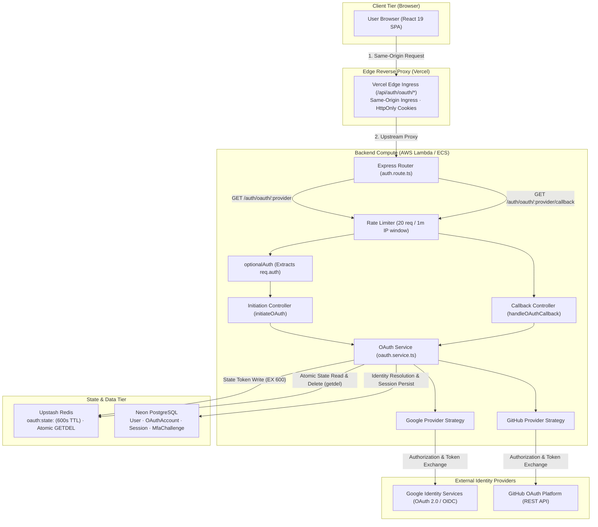
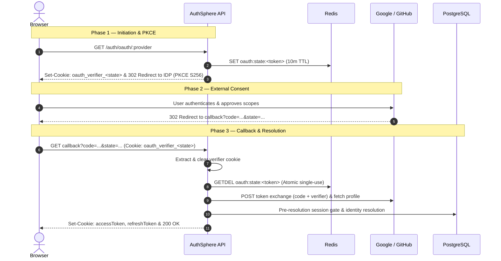
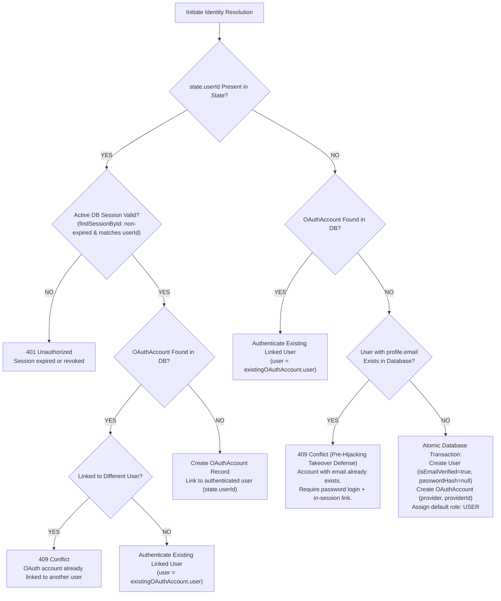
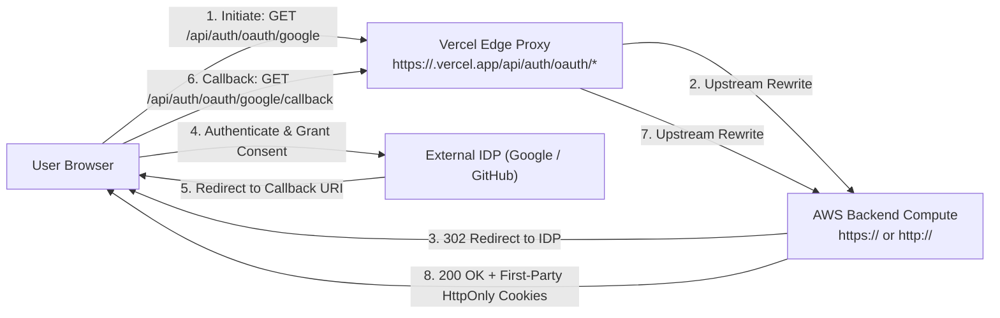

# OAuth 2.0 Architecture & Integration Guide — AuthSphere

This document specifies the OAuth 2.0 social authentication and account-linking architecture for AuthSphere across Google and GitHub identity providers.

---

## 1. System Overview & Architecture Snapshot

AuthSphere implements the standard **OAuth 2.0 Authorization Code Grant** flow across two external identity providers:

| Provider   | Initiation Endpoint      | Callback Endpoint                 | Default Scopes         | Stable Identity Claim             |
| :--------- | :----------------------- | :-------------------------------- | :--------------------- | :-------------------------------- |
| **Google** | `GET /auth/oauth/google` | `GET /auth/oauth/google/callback` | `openid email profile` | `sub` (OpenID Connect Subject ID) |
| **GitHub** | `GET /auth/oauth/github` | `GET /auth/oauth/github/callback` | `read:user user:email` | `String(id)` (Numeric Account ID) |

Both flows share a unified strategy abstraction, Redis-backed state management, identity resolution logic, session issuance, and cookie delivery pipeline. Only provider-specific details (authorization URL parameters, token exchange endpoints, and profile normalization) are isolated in provider strategies.

### Architecture Topology



---

## 2. OAuth Flow Sequence



> **Note:** For the branching logic evaluated at Step 9 (session revalidation gate, account linking, anti-hijacking conflict checks, and MFA challenges), see [Section 3.4 Identity Resolution Matrix](#34-phase-4--identity-resolution-matrix).

---

## 3. Five-Phase Implementation Lifecycle

### 3.1. Phase 1 — Initiation & State Generation

- **Route:** `GET /auth/oauth/google` and `GET /auth/oauth/github`
- **Rate Limit:** `rateLimiter(RATE_LIMIT_POLICIES.OAUTH_INITIATE)` (20 requests per minute per IP)
- **Middleware Pipeline:** `optionalAuth` → `initiateOAuthHandler(provider)`

#### Context Detection (`optionalAuth`)

The `optionalAuth` middleware (`apps/api/src/middlewares/auth.ts`) inspects `req.cookies.accessToken`:

- **Valid Access Token Detected:** Validates and decodes the cryptographically signed JWT access token, populating `req.auth = { userId, role, sessionId, permissions }`. Both `userId` and `sessionId` are captured so the flow can act as an **explicit account-linking request**. Note that `optionalAuth` statelessly verifies token cryptography; database session revalidation occurs during the callback phase.
- **No Valid Access Token:** Leaves `req.auth` as `undefined`. This flow acts as an **unauthenticated login/signup request**.
- Unlike standard authentication middleware, `optionalAuth` never throws on missing or invalid tokens; expired or invalid tokens are silently treated as unauthenticated.

#### PKCE Verifier Generation & Browser-Binding Cookie

To protect against Login CSRF and authorization code injection across all clients (recommended by OAuth 2.0 Security BCP / RFC 9700), AuthSphere implements native PKCE with the `S256` challenge method without external dependencies:

1. **Generates PKCE Verifier:** Generates 32 cryptographically secure random bytes in `base64url` format:
   ```typescript
   const verifier = crypto.randomBytes(32).toString("base64url");
   ```
2. **Computes S256 Challenge:** Computes the SHA-256 hash of the verifier in `base64url` format:
   ```typescript
   const challenge = crypto
     .createHash("sha256")
     .update(verifier)
     .digest("base64url");
   ```
3. **Stores Verifier in Per-Transaction Cookie:** Binds the transaction to the initiating browser using a dedicated HttpOnly cookie keyed by state:
   - **Name:** `oauth_verifier_<state>` (per-transaction naming prevents collisions across concurrent multi-tab flows)
   - **Path:** `/api/auth/oauth` (evaluated by the browser against the public Vercel edge reverse-proxy path)
   - **Security Flags:** `httpOnly: true`, `secure: production`, `sameSite: "lax"`, `maxAge: 600000` (10 minutes)

#### Cryptographic State Generation & Redis Caching

`createOAuthState()` (`apps/api/src/modules/auth/oauth/oauth.service.ts`):

1. Generates 32 bytes of cryptographically secure random bytes:
   ```typescript
   const state = crypto.randomBytes(32).toString("hex"); // 64-character hex string
   ```
2. Serializes flow metadata payload:
   ```typescript
   const payload: OAuthStateData = {
     provider,
     ...(userId && { userId }),
     ...(sessionId && { sessionId }),
   };
   ```
3. Stores the payload in Redis under key `oauth:state:<state>` with a strict 10-minute expiration (`EX 600`).

#### Authorization URL Construction

The provider strategy constructs the target identity provider URL, appending the PKCE challenge:

- **Google Strategy (`google.provider.ts`):**
  - Endpoint: `https://accounts.google.com/o/oauth2/v2/auth`
  - Parameters: `client_id`, `redirect_uri`, `response_type=code`, `scope="openid email profile"`, `state`, `prompt="select_account"`, `code_challenge`, `code_challenge_method="S256"`
  - _Note on scopes:_ `access_type="offline"` is omitted because AuthSphere uses short-lived identity resolution without storing upstream provider refresh tokens.
- **GitHub Strategy (`github.provider.ts`):**
  - Endpoint: `https://github.com/login/oauth/authorize`
  - Parameters: `client_id`, `redirect_uri`, `scope="read:user user:email"`, `state`, `code_challenge`, `code_challenge_method="S256"`

The API controller issues an HTTP 302 redirect sending the browser directly to the external provider.

---

### 3.2. Phase 2 — External Consent

1. The browser navigates to Google or GitHub.
2. The user authenticates (or selects an active provider session) and reviews requested scopes.
3. Upon approval, the identity provider redirects the browser back to AuthSphere's registered callback URI:
   ```http
   GET /auth/oauth/:provider/callback?code=<AUTHORIZATION_CODE>&state=<STATE_TOKEN>
   ```

---

### 3.3. Phase 3 — State Verification, PKCE Validation & Profile Exchange

- **Route:** `GET /auth/oauth/google/callback` and `GET /auth/oauth/github/callback`
- **Rate Limit:** `rateLimiter(RATE_LIMIT_POLICIES.OAUTH_CALLBACK)` (20 requests per minute per IP)
- **Validation:** `validate(authRequestSchema.oauthCallbackQuery)` enforces non-empty `code` and `state` strings.

#### Browser-Binding PKCE Verifier Retrieval & Clearance

The callback controller validates browser ownership and immediately destroys the transient verifier cookie:

1. Looks up cookie `oauth_verifier_<state>`.
2. Immediately clears the cookie via `res.clearCookie(cookieName, { path: "/api/auth/oauth" })`.
3. If the cookie is absent or expired, the callback fails immediately with `400 Bad Request` ("Missing or expired OAuth transaction cookie"), thwarting Login CSRF and stolen callback injection.

#### Atomic State Invalidation (`GETDEL`)

`consumeOAuthState()` executes an atomic read-and-delete against Redis:

```typescript
const rawData = await redis.getdel(`oauth:state:${state}`);
```

- **Replay & Race Immunity:** Because `GETDEL` is atomic in Redis, an intercepted or replayed state token cannot be redeemed twice.
- **Expiration Enforcement:** Expired keys return `null`, failing immediately with `400 Bad Request`.
- **Cross-Provider Mismatch Check:** Verifies that `stateData.provider === expectedProvider`. A state generated for Google cannot be consumed on a GitHub callback route.

#### Shared Upstream Network Deadline (7-Second Abort Budget)

To prevent slow third-party networks from starving serverless compute or exceeding Lambda's 15-second execution ceiling, a single cumulative 7-second `AbortController` deadline is shared across all sequential provider requests (token exchange, profile fetch, and email resolution):

```typescript
const controller = new AbortController();
const timeoutId = setTimeout(() => controller.abort(), 7000);

try {
  // One controller.signal is passed to every sequential fetch call:
  // 1. Token exchange: fetch(TOKEN_URL, { signal: controller.signal })
  // 2. Profile fetch: fetch(PROFILE_URL, { signal: controller.signal })
  // 3. GitHub emails: fetch(EMAILS_URL, { signal: controller.signal })
  // Response body consumption (await response.json()) is awaited under this budget
  profile = await strategy.getUserProfile(
    code,
    codeVerifier,
    controller.signal,
  );
} catch (error: unknown) {
  if (controller.signal.aborted) {
    throw new AppError(
      `Timeout while communicating with ${provider} OAuth provider`,
      504,
    );
  }
  throw error;
} finally {
  clearTimeout(timeoutId);
}
```

If the upstream provider stalls or exceeds the 7-second budget, the request is cleanly aborted and explicitly mapped to HTTP `504 Gateway Timeout`.

#### Server-to-Server Token Exchange

The provider strategy performs a direct server-to-server HTTP POST request exchanging the short-lived authorization code and the required PKCE `code_verifier` for an upstream access token:

| Exchange Attribute          | Google Provider                                                                                                   | GitHub Provider                                                                  |
| :-------------------------- | :---------------------------------------------------------------------------------------------------------------- | :------------------------------------------------------------------------------- |
| **Token Endpoint**          | `https://oauth2.googleapis.com/token`                                                                             | `https://github.com/login/oauth/access_token`                                    |
| **Content-Type**            | `application/x-www-form-urlencoded`                                                                               | `application/x-www-form-urlencoded`                                              |
| **Accept Header**           | `application/json`                                                                                                | `application/json`                                                               |
| **Body Parameters**         | `code`, `client_id`, `client_secret`, `redirect_uri`, `grant_type=authorization_code`, `code_verifier` (Required) | `code`, `client_id`, `client_secret`, `redirect_uri`, `code_verifier` (Required) |
| **Timeout Budget**          | Bound to shared 7-second `AbortSignal`                                                                            | Bound to shared 7-second `AbortSignal`                                           |
| **Upstream Error Handling** | Logged via Pino (`logger.error`); returns generic `400 Bad Request`                                               | Logged via Pino (`logger.error`); returns generic `400 Bad Request`              |

#### Profile Retrieval & Email Verification Enforcement

1. **Google Strategy:**
   - Queries `https://openidconnect.googleapis.com/v1/userinfo` with `Authorization: Bearer <access_token>`.
   - **Enforces email verification:** Validates that `userInfo.email_verified === true`. Unverified Google emails are rejected with `400 Bad Request`.
   - Uses `sub` (OpenID Connect Subject identifier) as the immutable `providerId`.
   - _OpenID Connect claim retrieval note:_ AuthSphere retrieves identity claims through Google's authenticated OIDC UserInfo endpoint using the access token. It does not currently validate the ID token returned by Google's token endpoint.

2. **GitHub Strategy:**
   - Queries `https://api.github.com/user` with `Authorization: Bearer <access_token>` and mandatory `User-Agent: AuthSphere-API`.
   - **Mandatory secondary query:** Queries `https://api.github.com/user/emails` because GitHub's primary user profile does not expose email verification status.
   - Evaluates email priority:
     1. Primary **and** verified email.
     2. Any verified email attached to the account.
     3. If no verified email exists, aborts with `400 Bad Request` ("GitHub account has no verified email address").
   - Uses `String(id)` (GitHub's stable numeric user ID) as the immutable `providerId`.

#### Normalized Profile Interface

Both providers return a standardized `OAuthProfile` DTO:

```typescript
export interface OAuthProfile {
  providerId: string; // Google 'sub' or GitHub stringified numeric 'id'
  email: string; // Lowercased, trimmed, strictly verified email
  firstName: string | null; // Parsed given name or first token of full name
  lastName: string | null; // Parsed family name or remaining tokens
  avatarUrl: string | null; // Profile picture URL
}
```

---

### 3.4. Phase 4 — Identity Resolution Matrix

AuthSphere resolves identity using a deterministic decision matrix with a mandatory pre-resolution session validation gate:



#### Detailed Resolution Cases

> **Pre-Resolution Invariant:** Whenever `state.userId` is present, AuthSphere revalidates that `state.sessionId` exists in PostgreSQL, belongs to `state.userId`, and is unexpired (`expiresAt > NOW()`). If the session is missing, expired, or revoked, AuthSphere rejects immediately with HTTP `401 Unauthorized` prior to evaluating any identity resolution branch. Never downgrade to an unauthenticated login.

| Case        | Scenario                                      | Preconditions                                                         | Executed Action                                                                                                                                                                   |
| :---------- | :-------------------------------------------- | :-------------------------------------------------------------------- | :-------------------------------------------------------------------------------------------------------------------------------------------------------------------------------- |
| **Case A**  | **Returning OAuth User**                      | `OAuthAccount(provider, providerId)` exists                           | Authenticates linked user. If `state.userId` was provided (and session revalidated), verifies `existingOAuthAccount.userId === state.userId` (throws `409 Conflict` on mismatch). |
| **Case B1** | **Explicit Account Linking**                  | No `OAuthAccount`, `state.userId` present                             | Session pre-validated. Inserts a new `OAuthAccount` record linked to `state.userId`.                                                                                              |
| **Case B2** | **Email Conflict (Account Takeover Defense)** | No `OAuthAccount`, no `state.userId`, user exists with matching email | **Throws HTTP 409 Conflict.** Prevents pre-hijacking account takeover attacks. User must log in via password and link from settings.                                              |
| **Case B3** | **New User Signup**                           | No `OAuthAccount`, no `state.userId`, no matching email               | Atomically inserts `User` (`isEmailVerified: true`, `verifiedAt: NOW()`, `passwordHash: null`, `roleId: USER`) and associated `OAuthAccount`.                                     |

---

### 3.5. Phase 5 — MFA Challenge or Session Issuance

#### Scenario 1: Multi-Factor Authentication Challenge

If the resolved user has MFA enabled (`user.mfaEnabled === true`) and the flow is an unauthenticated login (`!stateData.userId`):

1. **Creates Ephemeral Challenge:** Generates a database `MfaChallenge` record (`mfaToken` UUIDv7, 5-minute expiration).
2. **Records Audit Event:** Records an `OAUTH_LOGIN` security event with metadata `{ provider, mfaRequired: true }`.
3. **Responds with Challenge Token:** Returns HTTP `200 OK`:
   ```json
   {
     "success": true,
     "message": "MFA verification required to complete login",
     "data": {
       "mfaRequired": true,
       "mfaToken": "019318b2-5f60-7000-8000-..."
     }
   }
   ```
4. **Completion:** The browser prompts for the second factor and submits `mfaToken` + 6-digit TOTP code (or recovery code) to `POST /auth/mfa/verify` to receive final session cookies.

#### Scenario 2: Direct Session Issuance

If MFA is disabled (or during in-session account linking):

1. **Creates Persistent Session:** Calls `generateAuthTokensAndSession()`, creating a `Session` record with UUIDv7 ID, SHA-256 hashed refresh token, client IP address, User-Agent, and 30-day expiration.
2. **Generates JWT Tokens:**
   - **Access Token:** 15-minute validity containing claims `{ sub, sid, role, permissions }`.
   - **Refresh Token:** 30-day validity containing claims `{ sub, sid, role }`.
3. **Sets HttpOnly Cookies:** Sets both `accessToken` and `refreshToken` on root path `/` for edge reverse-proxy compatibility (`httpOnly: true`, `secure: true` in production, `sameSite: "lax"`, per ADR-079).
4. **Records Audit Event:** Records an `OAUTH_LOGIN` security event with metadata `{ provider }`.
5. **Returns Success:** Responds with HTTP `200 OK` and message `"Authenticated successfully via <Provider> OAuth"`.

---

## 4. Provider Strategy Comparison

| Technical Dimension           | Google Provider Strategy                                           | GitHub Provider Strategy                                                        |
| :---------------------------- | :----------------------------------------------------------------- | :------------------------------------------------------------------------------ |
| **Strategy Implementation**   | `GoogleOAuthProvider` (`google.provider.ts`)                       | `GitHubOAuthProvider` (`github.provider.ts`)                                    |
| **Authorization Endpoint**    | `https://accounts.google.com/o/oauth2/v2/auth`                     | `https://github.com/login/oauth/authorize`                                      |
| **Token Exchange Endpoint**   | `https://oauth2.googleapis.com/token`                              | `https://github.com/login/oauth/access_token`                                   |
| **User Profile Endpoint**     | `https://openidconnect.googleapis.com/v1/userinfo`                 | `https://api.github.com/user`                                                   |
| **Email Resolution Endpoint** | Included in `/userinfo` response                                   | Dedicated secondary query: `https://api.github.com/user/emails`                 |
| **Required Scopes**           | `openid email profile`                                             | `read:user user:email`                                                          |
| **Immutable Subject ID**      | `sub` (OIDC string subject identifier)                             | `String(id)` (Stable numeric GitHub account ID)                                 |
| **Email Verification Rule**   | Enforces `email_verified === true`                                 | Primary verified email, fallback to any verified email; reject if none          |
| **Name Normalization**        | Uses `given_name` / `family_name`; falls back to `name.split(" ")` | Uses `name.split(" ")`; falls back to GitHub `login` username                   |
| **Custom HTTP Headers**       | Standard headers                                                   | Requires `User-Agent: AuthSphere-API` and `Accept: application/vnd.github+json` |

---

## 5. Database Schema & Data Integrity

AuthSphere stores social account links in the `oauth_accounts` PostgreSQL table managed by Prisma:

```prisma
model OAuthAccount {
  id String @id @default(uuid(7))

  userId String @map("user_id")

  provider   OAuthProvider
  providerId String        @map("provider_id")

  createdAt DateTime @default(now()) @map("created_at")
  updatedAt DateTime @updatedAt @map("updated_at")

  user User @relation(fields: [userId], references: [id], onDelete: Cascade)

  @@unique([provider, providerId])
  @@unique([userId, provider])
  @@index([userId])
  @@map("oauth_accounts")
}
```

### Key Data Integrity Invariants

1. **`@@unique([provider, providerId])`:** A single external social identity (e.g. Google subject ID `109283...`) can be linked to at most one AuthSphere user.
2. **`@@unique([userId, provider])`:** An AuthSphere user can link at most one account per provider (e.g. one Google account and one GitHub account).
3. **`onDelete: Cascade`:** Deleting a `User` record automatically cleans up all associated social identities.
4. **UUIDv7 Primary Keys:** Time-ordered UUIDv7 identifiers provide natural chronological database clustering.

---

## 6. Edge Ingress & Reverse Proxy Integration

In production environments (e.g. Vercel + AWS Lambda / ECS), OAuth traffic routes through Vercel's Edge Reverse Proxy:



### Callback URI Resolution Logic

Both provider strategies determine the redirect URI dynamically via:

```typescript
const base =
  env.OAUTH_CALLBACK_BASE_URL || `${env.FRONTEND_URL}/api/auth/oauth`;
return `${base.replace(/\/$/, "")}/${provider.toLowerCase()}/callback`;
```

- **Production Edge Alignment:** By pointing `OAUTH_CALLBACK_BASE_URL` or `FRONTEND_URL` to the public Vercel domain, callbacks return through the same-origin reverse proxy.
- **Cookie Security:** The browser receives auth cookies on the first-party domain, completely avoiding third-party cookie restrictions and cross-site tracking protections.

---

## 7. Security Architecture & Threat Mitigation Matrix

| Threat Category                      | Potential Attack Vector                                                                            | AuthSphere Defensive Countermeasure                                                                                                                                                                                                                |
| :----------------------------------- | :------------------------------------------------------------------------------------------------- | :------------------------------------------------------------------------------------------------------------------------------------------------------------------------------------------------------------------------------------------------- |
| **Login CSRF & Code Injection**      | Attacker completes an OAuth flow and tricks victim browser into consuming the attacker's callback. | **Browser-Bound PKCE (`S256`):** Native `code_challenge` / `code_verifier` with transient `oauth_verifier_<state>` HttpOnly cookie (`Path=/api/auth/oauth`, 10m TTL). Stolen callback URLs cannot be consumed in another browser.                  |
| **State Replay & Race Conditions**   | Intercepted or duplicated callback request attempts to reuse state.                                | **Atomic `redis.getdel()` Consumption:** Single-use state retrieval and immediate invalidation prevents race conditions and replay attacks.                                                                                                        |
| **Stale / Revoked Account Linking**  | Initiating session is revoked or expires while external consent is pending.                        | **Pre-Resolution Session Gate:** Queries `findSessionById` in PostgreSQL before identity resolution whenever `state.userId` is present, verifying session is active, unexpired, and owned by `state.userId`; throws `401 Unauthorized` if invalid. |
| **Cross-Provider State Spoofing**    | Consuming a Google state token on a GitHub callback route.                                         | **Provider Validation:** Verifies `stateData.provider === expectedProvider` prior to processing.                                                                                                                                                   |
| **Pre-Hijacking Account Takeover**   | Attacker registers a victim's email on an external provider to steal an existing password account. | **Strict 409 Conflict Guard (Anti-Auto-Link):** Unauthenticated OAuth flows never auto-link to existing email accounts. In-session password authentication is mandatory.                                                                           |
| **Upstream Stalls & Lambda Timeout** | Upstream IDP network latency exhausts serverless compute or exceeds Lambda 15s limit.              | **Shared 7-Second Abort Budget:** A cumulative `AbortController` signal is passed to all sequential upstream requests (`fetch`), cleanly aborting with `504 Gateway Timeout` on latency spikes.                                                    |
| **Identifier Mutation / Recycling**  | User changes their Google display name or GitHub username/handle.                                  | **Immutable Subject Identifiers:** Binds accounts to Google `sub` (OIDC string) and GitHub numeric `id`.                                                                                                                                           |
| **Unverified Email Impersonation**   | Attacker registers an unverified email address on GitHub to claim an account.                      | **Mandatory Verification Gate:** Google checks `email_verified === true`; GitHub explicitly checks `/user/emails`.                                                                                                                                 |
| **Over-Privileged Scopes**           | Requesting offline access or sensitive scopes without functional need.                             | **Minimal Scope Grants:** Google requests `openid email profile` without `access_type=offline`; GitHub requests `read:user user:email`. No unnecessary third-party refresh tokens are stored.                                                      |
| **Credential & Secret Leakage**      | Client secrets exposed via client bundles or public endpoints.                                     | **Server-Side Secret Isolation:** Secrets stored in environment variables, validated at boot by Zod, and used only server-to-server.                                                                                                               |
| **Information Disclosure**           | Upstream provider outage or invalid credentials leaking system details.                            | **Error Masking:** Upstream error bodies logged internally via Pino; generic client errors returned.                                                                                                                                               |
| **Endpoint Denial of Service**       | Flooding initiation or callback routes to exhaust Redis or rate limits.                            | **IP Rate Limiting:** Fixed-window limits of 20 requests per minute per IP on initiation and callback routes.                                                                                                                                      |

---

## 8. File Reference Map

```
apps/api/src/
├── config/
│   └── env.ts                           # Zod validation for OAuth credentials & callback base URL
├── middlewares/
│   ├── auth.ts                          # optionalAuth (extracts authenticated context if valid access token detected)
│   ├── rate-limit.ts                    # OAUTH_INITIATE and OAUTH_CALLBACK rate limit policies
│   └── validate.ts                      # Zod schema validation for OAuth callback queries
└── modules/auth/
    ├── auth.route.ts                    # Mounts /oauth/google[/callback] and /oauth/github[/callback]
    ├── auth.openapi.ts                  # OpenAPI 3.1 specifications for OAuth endpoints
    ├── auth.repository.ts               # findOAuthAccount, createOAuthAccount, createUserWithOAuthAccount
    ├── auth.service.ts                  # generateAuthTokensAndSession, recordSecurityEvent
    ├── auth.validation.ts               # oauthCallbackQuery schema (code, state)
    └── oauth/
        ├── oauth.types.ts               # OAuthStateData, OAuthProfile, OAuthProviderStrategy interfaces
        ├── oauth.service.ts             # createOAuthState, consumeOAuthState, initiateOAuth, handleOAuthCallback
        ├── oauth.controller.ts          # initiateOAuthHandler & oauthCallbackHandler factory functions
        ├── google.provider.ts           # GoogleOAuthProvider strategy implementation
        └── github.provider.ts           # GitHubOAuthProvider strategy implementation
```

---

## 9. Operational Verification & Testing

> **Operational Endpoint Paths:**
>
> - **Public Edge URL (Browser / Vercel Proxy):** `https://<PUBLIC_DOMAIN>/api/auth/oauth/...` (evaluates against cookie `Path=/api/auth/oauth`).
> - **Direct Backend Testing (Local Express):** `http://localhost:3000/auth/oauth/...` (bypasses reverse-proxy `/api` prefix strip).
>
> The examples below test the browser-facing public edge URL (`/api/auth/oauth/...`) so that transaction cookies scoped to `Path=/api/auth/oauth` are matched and delivered.

### 9.1. Initiation Verification

Initiate an OAuth flow via `curl` and inspect response headers:

```bash
# Test Google OAuth Initiation (Verify 302 Redirect, State Token, Scopes, and PKCE Cookie)
curl -i -X GET https://<PUBLIC_DOMAIN>/api/auth/oauth/google

# Expected Response:
# HTTP/1.1 302 Found
# Location: https://accounts.google.com/o/oauth2/v2/auth?client_id=...&state=<64_HEX_CHARS>&scope=openid+email+profile&prompt=select_account&code_challenge=<CHALLENGE>&code_challenge_method=S256
# Set-Cookie: oauth_verifier_<64_HEX_CHARS>=<VERIFIER>; Path=/api/auth/oauth; HttpOnly; SameSite=Lax; Max-Age=600; Secure
```

### 9.2. State Invalidation & Replay Testing

Verify that replaying or tampering with state parameters fails fast:

```bash
# 1. Attempt callback with invalid state parameter
curl -i -X GET "https://<PUBLIC_DOMAIN>/api/auth/oauth/google/callback?code=test-code&state=invalid-state-token"

# Expected Response:
# HTTP/1.1 400 Bad Request
# {"success":false,"message":"Invalid, expired, or already consumed OAuth state"}
```

```bash
# 2. Attempt callback with missing authorization code
curl -i -X GET "https://<PUBLIC_DOMAIN>/api/auth/oauth/google/callback?state=some-state"

# Expected Response:
# HTTP/1.1 400 Bad Request
# {"success":false,"message":"Validation failed", ...}
```

### 9.3. Account Linking Verification

To verify in-session account linking:

1. Authenticate via password to obtain an `accessToken` cookie.
2. Invoke `GET /api/auth/oauth/google` carrying the cookie:
   ```bash
   curl -i -X GET https://<PUBLIC_DOMAIN>/api/auth/oauth/google \
     -H "Cookie: accessToken=<VALID_ACCESS_TOKEN>"
   ```
3. Complete the provider consent flow. Upon callback, AuthSphere revalidates that the session is still active and unexpired in PostgreSQL, then inserts the new `OAuthAccount` row linked to the authenticated user's ID without prompting for MFA or creating duplicate user accounts.

### 9.4. Browser-Bound PKCE Verification

Verify that the callback enforces the presence of the initiating browser's transaction cookie and isolates concurrent flows:

```bash
# 1. Missing Cookie Test (Simulating cross-browser code redemption or victim browser without cookie)
# Attempt callback with valid state format but without the corresponding HttpOnly cookie:
curl -i -X GET "https://<PUBLIC_DOMAIN>/api/auth/oauth/google/callback?code=mock-code&state=0123456789abcdef0123456789abcdef0123456789abcdef0123456789abcdef"

# Expected Response:
# HTTP/1.1 400 Bad Request
# {"success":false,"message":"Missing or expired OAuth transaction cookie"}
```

```bash
# 2. Cross-Browser Replay Test
# Obtain valid callback URL and cookie from Browser Profile A. Attempt to redeem the callback in Browser Profile B (different jar):
# Profile B lacks oauth_verifier_<state> -> Fails immediately with HTTP 400 Bad Request.
```

```bash
# 3. Concurrent Multi-Tab Isolation Test
# Open two simultaneous flows in separate browser tabs:
# Tab 1 -> GET /api/auth/oauth/google -> receives Set-Cookie: oauth_verifier_<state_1>
# Tab 2 -> GET /api/auth/oauth/google -> receives Set-Cookie: oauth_verifier_<state_2>
# Both cookies coexist under distinct names without collisions; completing Tab 1 leaves Tab 2's cookie intact.
```

---

## 10. Architectural Decision Records (ADRs)

AuthSphere's OAuth implementation is governed by formal Architectural Decision Records in [Engineering-Decisions.md](Engineering-Decisions.md):

- [ADR-032: Social Login Account Guarding](Engineering-Decisions.md#adr-032--social-login-account-guarding) — Guarded social login accounts without local passwords from direct password authentication and password reset mutations.
- [ADR-059: Provider-Agnostic OAuth 2.0 Strategy Pattern](Engineering-Decisions.md#adr-059--provider-agnostic-oauth-20-strategy-pattern) — Established strategy pattern abstraction for identity providers.
- [ADR-060: Redis-Backed Ephemeral OAuth State with Atomic Single-Use Invalidation](Engineering-Decisions.md#adr-060--redis-backed-ephemeral-oauth-state-with-atomic-single-use-invalidation) — Codified 32-byte crypto state tokens and atomic `GETDEL` consumption.
- [ADR-061: Strict Conflict-Guarded OAuth Identity Resolution Workflow](Engineering-Decisions.md#adr-061--strict-conflict-guarded-oauth-identity-resolution-workflow) — Mandated strict 409 conflict responses on email collisions to prevent pre-hijacking account takeover.
- [ADR-062: Verified Email Enforcement for Social Identity Providers](Engineering-Decisions.md#adr-062--verified-email-enforcement-for-social-identity-providers) — Required verified email enforcement and secondary `/user/emails` query on GitHub.
- [ADR-063: Higher-Order Controller Factories for Provider-Agnostic OAuth Handlers](Engineering-Decisions.md#adr-063--higher-order-controller-factories-for-provider-agnostic-oauth-handlers) — Adopted higher-order factory functions for DRY, type-safe route controllers.
- [ADR-066: Multi-Tier Rate Limiting for OAuth Callbacks and Passwordless Magic Links](Engineering-Decisions.md#adr-066--multi-tier-rate-limiting-for-oauth-callbacks-and-passwordless-magic-links) — Enforced dedicated IP rate limiting on OAuth initiation and callback endpoints.
- [ADR-079: Serverless Lambda Runtime, Synchronous Execution Guard, and Reverse-Proxy Cookie Bridge](Engineering-Decisions.md#adr-079--serverless-lambda-runtime-synchronous-execution-guard-and-reverse-proxy-cookie-bridge) — Codified root-scoped authentication cookies for reverse-proxy edge traversal.
- [ADR-080: Browser-Bound PKCE (RFC 7636 / RFC 9700) and Per-Transaction Cookie Architecture](Engineering-Decisions.md#adr-080--browser-bound-pkce-rfc-7636--rfc-9700-and-per-transaction-cookie-architecture) — Mandated PKCE with S256 challenges and per-transaction HttpOnly verifier cookies.
- [ADR-081: Cumulative Upstream Provider Abort Deadline and Gateway Timeout Mapping](Engineering-Decisions.md#adr-081--cumulative-upstream-provider-abort-deadline-and-gateway-timeout-mapping) — Implemented cumulative 7-second abort deadline mapped to HTTP 504 Gateway Timeout.
- [ADR-082: Pre-Resolution Session Gate for Authenticated Account Linking](Engineering-Decisions.md#adr-082--pre-resolution-session-gate-for-authenticated-account-linking) — Enforced database session revalidation prior to identity resolution for account linking.
- [ADR-085: Code-First Edge Reverse Proxy Configuration via `@vercel/config/v1`](Engineering-Decisions.md#adr-085--code-first-edge-reverse-proxy-configuration-via-vercelconfigv1) — Documented dynamic edge rewrite `/api/auth/oauth/(.*)` to backend infrastructure.
- [ADR-086: Development-to-Production Reverse Proxy Parity via Vite Local Server](Engineering-Decisions.md#adr-086--development-to-production-reverse-proxy-parity-via-vite-local-server) — Ensured identical `/api` routing and cookie transport in local development.
