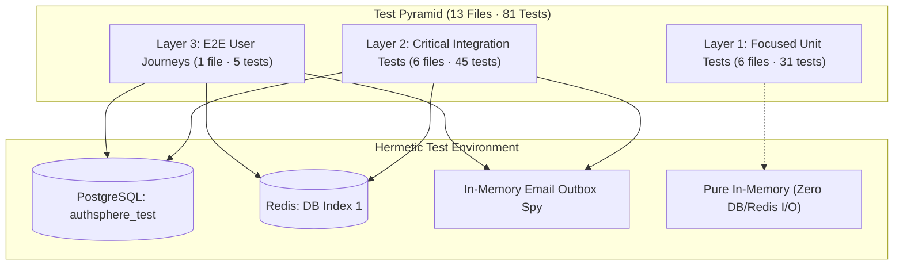

# AuthSphere Testing — Strategy, Isolation & Verification Matrix

> **Single Source of Truth (SSOT)** for AuthSphere's hermetic testing pyramid, mock/DB/Redis test isolation, flattened test suite layout & commands, and security invariant verification.
>
> **Companion Documentation Suite:**
>
> - System Design & Component Architecture: [`docs/ARCHITECTURE.md`](./ARCHITECTURE.md)
> - Frontend Architecture & Control Plane: [`docs/FRONTEND_ARCHITECTURE.md`](./FRONTEND_ARCHITECTURE.md)
> - Formal Decisions (109 Formal ADRs): [`docs/Engineering-Decisions.md`](./Engineering-Decisions.md)
> - OAuth 2.0 PKCE & Integration Guide: [`docs/OAUTH.md`](./OAUTH.md)
> - Cloud Deployment & DevOps Guide: [`docs/DEPLOYMENT.md`](./DEPLOYMENT.md)

---

## 1. Testing Philosophy & Core Invariants

AuthSphere's test suite prioritizes **high-signal security invariant verification** over vanity coverage targets `[ADR-070]`:

- **Zero External Network Egress:** Third-party email dispatches and OAuth provider calls (`getUserProfile`) are intercepted in-memory; external I/O in integration and E2E tests is strictly isolated to dedicated PostgreSQL (`authsphere_test`) and Redis (DB index `1`) test instances `[ADR-003, ADR-070]`.
- **Unit Zero-I/O Fast-Path:** `tests/unit/` skips Prisma and Redis connections in [`apps/api/tests/setup.ts`](../apps/api/tests/setup.ts) via `isUnitTestSuite()`, executing purely in memory.
- **Serial Deterministic Execution:** [`apps/api/vitest.config.ts`](../apps/api/vitest.config.ts) enforces `fileParallelism: false` (`testTimeout: 20_000`, `hookTimeout: 60_000`) and `beforeEach` cleanup via `cleanTestState()`, eliminating cross-test state leakage and database deadlocks.
- **Framework Baseline:** Vitest `4.x` (`environment: "node"`), Supertest `7.x`, V8 Coverage (`@vitest/coverage-v8`), Node.js `>=24` (ESM).

```text
Suite Layout: 13 flat test files · 81 tests (6 Unit [31] · 6 Integration [45] · 1 E2E [5])
```

---

## 2. Test Pyramid & Verification Scopes



### Layer 1: Focused Unit Tests (6 Files · 31 Tests — Zero DB/Redis I/O)

| File                                                                         | Tests | Scope & Verified Invariants                                                                                                                                                                                                                                                                                                            |
| :--------------------------------------------------------------------------- | :---- | :------------------------------------------------------------------------------------------------------------------------------------------------------------------------------------------------------------------------------------------------------------------------------------------------------------------------------------- |
| [`tests/unit/crypto.test.ts`](../apps/api/tests/unit/crypto.test.ts)         | 8     | Argon2id hashing & `DUMMY_PASSWORD_HASH`, HS256 JWT sign/verify & key separation, 32-byte tokens & timing-safe SHA-256 verification, AES-256-GCM MFA encryption (unique IVs + legacy fallback), recovery codes, and TOTP secret/URI/code validation `[ADR-013, ADR-014, ADR-031, ADR-040, ADR-047, ADR-087]`.                          |
| [`tests/unit/email.test.ts`](../apps/api/tests/unit/email.test.ts)           | 10    | Unmocks `email.queue.js` locally while mocking `lib/queue.js`, Nodemailer, and Resend to verify factory resolution (`gmail` vs `resend`), tri-driver routing (`bullmq`, `inline`, `sync`), failure error logging, HTML templates, and permanent vs. retryable classification `[ADR-072, ADR-073, ADR-075, ADR-078, ADR-084, ADR-103]`. |
| [`tests/unit/lambda.test.ts`](../apps/api/tests/unit/lambda.test.ts)         | 3     | Redis unhandled-error safety (`redis.on("error")`), Lambda degraded-mode `/health/live` routing & reconnect cooldown on Redis outage, and end-to-end Lambda Express 5 JSON body parsing with `400` / `413` boundary guardrails `[ADR-044, ADR-079]`.                                                                                   |
| [`tests/unit/logger.test.ts`](../apps/api/tests/unit/logger.test.ts)         | 1     | Pino `loggerRedactionConfig` verifying complete `[REDACTED]` masking of `authorization`, `cookie`, `set-cookie`, and `location` redirect URLs containing OAuth state/challenge secrets `[ADR-009, ADR-108]`.                                                                                                                           |
| [`tests/unit/openapi.test.ts`](../apps/api/tests/unit/openapi.test.ts)       | 3     | OpenAPI 3.1 document generation, cookie security schemes, `/api` production server config, and strict 1:1 bidirectional parity across all 34 Express operations `[ADR-071]`.                                                                                                                                                           |
| [`tests/unit/validation.test.ts`](../apps/api/tests/unit/validation.test.ts) | 6     | `signup` & `resetPassword` (TOTP/recovery code) schemas, pagination coercion/bounds, role allowlists & permission deduplication, `userProfile` `mfaEnabled` defaults, and `parseDurationToMs` `[ADR-017, ADR-026, ADR-088, ADR-099, ADR-101]`.                                                                                         |

### Layer 2: Critical Integration Tests (6 Files · 45 Tests)

Full Express HTTP pipeline tests via Supertest (and targeted service/concurrency probes) against `authsphere_test` and Redis DB `1`:

| Domain                  | File                                                                                       | Tests | Verified Invariants                                                                                                                                                                                                                                                                                                                                   |
| :---------------------- | :----------------------------------------------------------------------------------------- | :---- | :---------------------------------------------------------------------------------------------------------------------------------------------------------------------------------------------------------------------------------------------------------------------------------------------------------------------------------------------------- |
| **Authentication**      | [`tests/integration/auth.test.ts`](../apps/api/tests/integration/auth.test.ts)             | 12    | Signup verification dispatch, duplicate email `409`, idempotent email verification, login cookies, wrong-password `401` + `LOGIN_FAILED`, unverified `403`, `logout` / `logoutAll`, single-use magic links, password reset with session revocation, and isolated descending security events `[ADR-014, ADR-024, ADR-027, ADR-064, ADR-065, ADR-069]`. |
| **MFA**                 | [`tests/integration/mfa.test.ts`](../apps/api/tests/integration/mfa.test.ts)               | 6     | TOTP setup & invalid-code `400`, ephemeral `mfaToken` challenge fulfillment, single-use recovery code invalidation (`400` on reuse), recovery code regeneration, and MFA disablement revoking active sessions `[ADR-045, ADR-047, ADR-057]`.                                                                                                          |
| **OAuth 2.0**           | [`tests/integration/oauth.test.ts`](../apps/api/tests/integration/oauth.test.ts)           | 6     | Ephemeral Redis state with atomic `GETDEL` anti-replay, mocked `getUserProfile` provisioning, `409` anti-account-takeover conflict guard, authenticated account linking, and Zero-Orphan disconnect protection (`400`) `[ADR-059, ADR-060, ADR-061, ADR-080, ADR-082]`.                                                                               |
| **RBAC & Admin**        | [`tests/integration/rbac.test.ts`](../apps/api/tests/integration/rbac.test.ts)             | 9     | Real HTTP `401`/`403` enforcement (`requireRole(ADMIN)`, `requireSelfOrPermission`), admin `GET /users` listing (`mfaEnabled`), self-demotion block, and last-admin demotion block `[ADR-035, ADR-036, ADR-067, ADR-099, ADR-101]`.                                                                                                                   |
| **Resilience & Health** | [`tests/integration/resilience.test.ts`](../apps/api/tests/integration/resilience.test.ts) | 8     | Concurrent refresh token CAS rotation & 30s leeway collapse, bounded race retry, outside-leeway replay compromise revocation, concurrent admin-demotion row-lock guard, Redis fail-open rate limiting & DB permission fallback, zero-I/O `/health/live`, and `/health/ready` (`200`/`503`) `[ADR-011, ADR-035, ADR-050, ADR-067, ADR-076, ADR-092]`.  |
| **Active Sessions**     | [`tests/integration/sessions.test.ts`](../apps/api/tests/integration/sessions.test.ts)     | 4     | `GET /sessions` (`isCurrent` flag, `tokenHash` stripped), empty-state handling, cross-user revocation defense (`403`), and cookie clearing on self-revocation `[ADR-068]`.                                                                                                                                                                            |

### Layer 3: End-to-End User Journeys (1 File · 5 Tests)

[`tests/e2e/user-journeys.test.ts`](../apps/api/tests/e2e/user-journeys.test.ts) verifies 5 multi-step stateful journeys over HTTP + outbox spies:

1. **Full Registration & Auth Lifecycle:** Signup -> outbox verification token -> verify email -> login -> `/auth/me` -> refresh rotation -> logout -> cookie clear & refresh `401`.
2. **MFA-Enforced Lifecycle:** Enable MFA -> live TOTP setup verification -> 10 recovery codes -> logout -> login yielding `mfaRequired: true` -> TOTP challenge fulfillment -> profile access.
3. **Password Recovery & Prior Session Invalidation:** Forgot password -> outbox token -> password reset -> DB session revocation -> prior refresh rejected.
4. **Multi-Device Session Governance:** Dual login (Desktop + Mobile) -> `/sessions` introspection (`isCurrent`) -> remote revocation -> isolated failure (`401`) -> self-revocation clears cookies.
5. **Administrative Role Governance:** Promote to `ADMIN` -> access `/roles/ADMIN/permissions` & `/users` -> self-demotion blocked (`403`) -> demote back to `USER` -> admin routes return `403`.

For canonical backend route tables and OAuth protocol flows exercised by these suites, see [`docs/ARCHITECTURE.md`](./ARCHITECTURE.md#21-canonical-route-inventory--openapi-31-operation-registry-34-operations) and [`docs/OAUTH.md`](./OAUTH.md).

---

## 3. Hermetic Test Isolation & Helpers

### 3.1. Environment & Lifecycle (`tests/setup.ts`, `tests/helpers/`)

- **Isolated Configuration:** `vitest.config.ts` sets `NODE_ENV: "test"`, and [`apps/api/tests/setup.ts`](../apps/api/tests/setup.ts) loads `apps/api/.env.test` (`override: true`) so tests always target `authsphere_test` and Redis DB `1` (see [`apps/api/.env.test.example`](../apps/api/.env.test.example) and `.github/workflows/ci.yml`).
- **Auto-Seeding & Atomic Reset ([`tests/helpers/db.ts`](../apps/api/tests/helpers/db.ts)):**
  - `ensureBaselineSeed()` runs once per non-unit worker in `beforeAll`, idempotently ensuring `USER`/`ADMIN` roles and all `PERMISSIONS` exist without requiring a manual seed step.
  - `cleanTestState()` runs in `beforeEach` for integration and E2E suites: `cleanDatabase()` executes `TRUNCATE TABLE ... CASCADE` across mutable user tables (`security_events`, `mfa_challenges`, `mfa_recovery_codes`, `magic_link_tokens`, `password_reset_tokens`, `email_verification_tokens`, `oauth_accounts`, `sessions`, `users`) while **preserving** `roles`, `permissions`, and `role_permissions`; `flushRedis()` clears Redis DB `1`.
- **In-Memory Email Spy ([`tests/helpers/email.ts`](../apps/api/tests/helpers/email.ts)):** `tests/setup.ts` globally mocks `src/modules/email/email.queue.js` with `emailQueueMocks`, reset before every test (`resetEmailMocks()`). Tests inspect captured tokens via `getLastSentVerificationEmail()`, `getLastSentForgotPasswordEmail()`, `getLastSentMagicLinkEmail()`, and `getLastSentSecurityNotificationEmail()`.
- **Factories & Auth Helpers:**
  - [`tests/helpers/factories.ts`](../apps/api/tests/helpers/factories.ts): Caches the Argon2id hash for `DEFAULT_TEST_PASSWORD` (`"Password123!"`) and role IDs; exports `createUser`, `createVerifiedUser`, `createAdmin`, `createMfaUser`, `createOAuthUser`, `createSession`, and `createExpiredSession`.
  - [`tests/helpers/auth.ts`](../apps/api/tests/helpers/auth.ts): Exports `app`, `getTestApp`, `getAuthCookies`, `formatCookieHeader`, `login`, and `authenticate`.
  - [`tests/helpers/index.ts`](../apps/api/tests/helpers/index.ts): Unified barrel export for all helpers.

---

## 4. Security Invariant Verification Matrix

| Security Invariant                                           | ADR Reference                                            | Verified In                                                   | Proof Mechanism                                                                                                          |
| :----------------------------------------------------------- | :------------------------------------------------------- | :------------------------------------------------------------ | :----------------------------------------------------------------------------------------------------------------------- |
| **Stateless Access JWT vs. Stateful Session Revocation**     | `[ADR-013, ADR-021, ADR-068]`                            | `auth.test.ts`, `sessions.test.ts`, `user-journeys.test.ts`   | Deleting session row rejects refresh (`401`); logout and self-revocation clear auth cookies.                             |
| **SHA-256 Token Digest & Concurrent Refresh Leeway**         | `[ADR-076]`                                              | `resilience.test.ts`, `crypto.test.ts`                        | DB stores SHA-256 `tokenHash` only; concurrent refreshes collapse via Redis leeway cache and bounded retry.              |
| **Replay Compromise Detection Outside Leeway**               | `[ADR-014, ADR-076, ADR-092]`                            | `resilience.test.ts`                                          | Replaying a rotated token after flushing the 30s leeway window revokes sessions (`AUTH_REUSE_DELETION_MODE`).            |
| **Redis Outage Fail-Open Rate Limiting & DB Fallback**       | `[ADR-035, ADR-050]`                                     | `resilience.test.ts`                                          | Simulated Redis errors verify `rateLimiter` fails open and `authorizationService` falls back to PostgreSQL.              |
| **Idempotent Email Verification & Magic Links**              | `[ADR-024, ADR-064, ADR-065]`                            | `auth.test.ts`                                                | Atomic single-use token consumption, idempotent re-verify (`200`), and magic-link auto-verification.                     |
| **Ephemeral MFA Challenge & Single-Use Recovery Codes**      | `[ADR-045, ADR-047, ADR-057]`                            | `mfa.test.ts`, `user-journeys.test.ts`                        | Login returns `mfaToken`; TOTP fulfills challenge; recovery codes are single-use (`400` on reuse).                       |
| **Anti-Account Takeover & OAuth Zero-Orphan Guard**          | `[ADR-059, ADR-060, ADR-061, ADR-080, ADR-082]`          | `oauth.test.ts`                                               | Atomic Redis `GETDEL` state, `409` password-account conflict, authenticated linking, and `400` sole-method unlink block. |
| **Last-Admin Demotion Guard (Row-Level Lock)**               | `[ADR-067]`                                              | `rbac.test.ts`, `resilience.test.ts`, `user-journeys.test.ts` | Exclusive `ADMIN` row lock prevents concurrent write-skew and single-admin demotion below 1 admin (`403`).               |
| **Zero-I/O Liveness & Dependency Readiness Probes**          | `[ADR-011]`                                              | `resilience.test.ts`                                          | `/health/live` returns `200` with DB/Redis down; `/health/ready` returns `200` healthy or `503` degraded.                |
| **Immutable Security Audit Trail**                           | `[ADR-069]`                                              | `auth.test.ts`                                                | Records `LOGIN_SUCCESS`, `LOGIN_FAILED`, `LOGOUT`, `PASSWORD_RESET` with strict tenant isolation.                        |
| **Code-First OpenAPI 3.1 & Express Route Parity**            | `[ADR-071]`                                              | `openapi.test.ts`                                             | Asserts 1:1 bidirectional parity across all 34 operations and cookie security schemes.                                   |
| **RBAC Directory, Role Introspection & `mfaEnabled` Egress** | `[ADR-035, ADR-036, ADR-088, ADR-099, ADR-100, ADR-101]` | `rbac.test.ts`, `validation.test.ts`, `user-journeys.test.ts` | Enforces `403` for non-admins, validates role/pagination schemas, and sanitizes `mfaEnabled` without leaking secrets.    |
| **HTTP Log Redaction & Lambda JSON/Redis Resilience**        | `[ADR-044, ADR-079, ADR-108]`                            | `logger.test.ts`, `lambda.test.ts`                            | Redacts auth/cookie/location headers in Pino output; ensures Lambda handles Redis outages and `400`/`413` JSON limits.   |

---

## 5. Coverage Configuration & Developer CLI

### 5.1. V8 Coverage Scope (`apps/api/vitest.config.ts`)

Coverage runs via `@vitest/coverage-v8` (`provider: "v8"`), measuring `src/**` while excluding `src/generated/**`, `src/types/**`, `src/server.ts`, and `src/workers/**`.

### 5.2. Execution Commands

```bash
# Run full suite from repo root (builds @authsphere/shared first)
npm test

# Generate V8 coverage report
npm run test:coverage

# Interactive watch mode
npm run test:watch -w @authsphere/api

# Targeted layer or file execution
npm test -w @authsphere/api -- tests/unit/
npm test -w @authsphere/api -- tests/integration/
npm test -w @authsphere/api -- tests/e2e/
npm test -w @authsphere/api -- tests/integration/auth.test.ts
```

### 5.3. First-Time Test Database Migration

```bash
# Apply Prisma migrations to authsphere_test (after starting PostgreSQL + Redis)
DATABASE_URL="postgresql://postgres:<TEST_DB_PASSWORD>@localhost:5432/authsphere_test" \
  npm run db:migrate:deploy --workspace=@authsphere/api

# Optional manual seed (tests/setup.ts auto-seeds roles & permissions via ensureBaselineSeed())
DATABASE_URL="postgresql://postgres:<TEST_DB_PASSWORD>@localhost:5432/authsphere_test" \
  npx --workspace=@authsphere/api prisma db seed
```

---

## 6. Directory Layout

```text
apps/api/
├── .env.test                         # Local test environment (gitignored)
├── .env.test.example                 # Committed test env template
├── vitest.config.ts                  # Vitest runner, V8 coverage & serial config
└── tests/
    ├── setup.ts                      # .env.test override, email mock, auto-seed, unit fast-path
    ├── helpers/
    │   ├── index.ts                  # Barrel export
    │   ├── auth.ts                   # Express app singleton, cookie helpers & login
    │   ├── db.ts                     # cleanTestState(), cleanDatabase(), flushRedis(), ensureBaselineSeed()
    │   ├── email.ts                  # In-memory email outbox spy accessors
    │   └── factories.ts              # Cached Argon2id hashing & entity factories
    ├── unit/                         # 6 files · 31 tests (zero DB/Redis I/O)
    │   ├── crypto.test.ts
    │   ├── email.test.ts
    │   ├── lambda.test.ts
    │   ├── logger.test.ts
    │   ├── openapi.test.ts
    │   └── validation.test.ts
    ├── integration/                  # 6 files · 45 tests
    │   ├── auth.test.ts
    │   ├── mfa.test.ts
    │   ├── oauth.test.ts
    │   ├── rbac.test.ts
    │   ├── resilience.test.ts
    │   └── sessions.test.ts
    └── e2e/                          # 1 file · 5 tests
        └── user-journeys.test.ts
```

---

## 7. Troubleshooting Invariants

1. **OTPLib v13 Secret Length:** Secrets must be at least 16 bytes (32 Base32 characters); always generate via `totp.generateSecret()` and `generateSync({ secret })` rather than short literal strings `[ADR-045]`.
2. **Rate-Limit 429s Inside a Single Test:** `cleanTestState()` flushes Redis DB `1` before each integration/E2E test. When looping requests inside a single test, stay under the route's policy limit or call `flushRedis()` between phases (since `TRUST_PROXY=false` in `.env.test.example`, `X-Forwarded-For` headers are ignored unless `trust proxy` is enabled) `[ADR-050]`.
3. **Seeded RBAC Tables:** Never truncate `roles`, `permissions`, or `role_permissions` in `cleanDatabase()`; only truncate user/token/session/audit tables.
4. **Cross-Test State Contamination:** Always execute tests with `fileParallelism: false` (default in `vitest.config.ts`) and ensure Redis DB `1` is running so `cleanTestState()` resets both PostgreSQL and Redis between tests.
