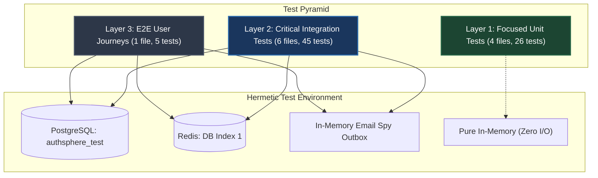
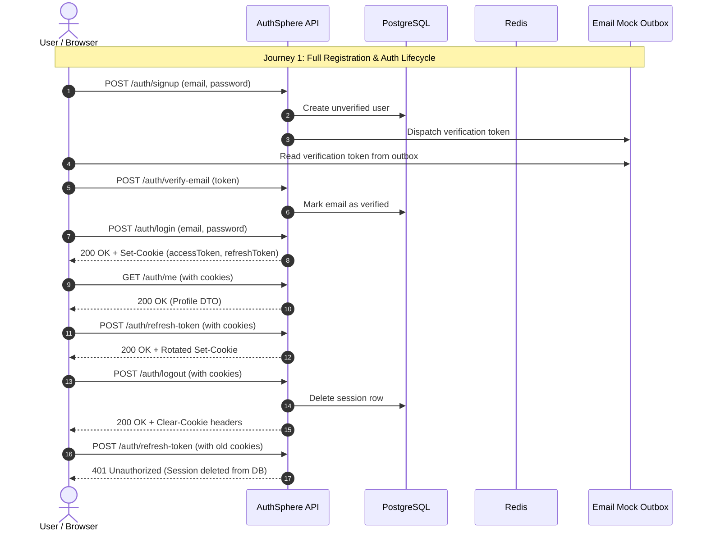

# AuthSphere Testing — Architecture, Strategy & Execution Reference

> **Single Source of Truth (SSOT)** for AuthSphere's automated testing architecture, hermetic test environment, test pyramid, security invariant verification, and developer test workflows.
>
> **Related Documentation:**
>
> - System Architecture & Ingress Pipeline: [`docs/ARCHITECTURE.md`](./ARCHITECTURE.md)
> - Frontend Architecture & Control Plane: [`docs/FRONTEND_ARCHITECTURE.md`](./FRONTEND_ARCHITECTURE.md)
> - Architectural Decision Records: [`docs/Engineering-Decisions.md`](./Engineering-Decisions.md)
> - OAuth 2.0 Protocol Specifications: [`docs/OAUTH.md`](./OAUTH.md)
> - Deployment & CI/CD Smoke Probes: [`docs/DEPLOYMENT.md`](./DEPLOYMENT.md)

---

## Table of Contents

1. [Testing Philosophy & Monorepo Strategy](#1-testing-philosophy--monorepo-strategy)
2. [Test Pyramid Architecture & Verification Scopes](#2-test-pyramid-architecture--verification-scopes)
3. [Hermetic Test Infrastructure & Isolation](#3-hermetic-test-infrastructure--isolation)
4. [Modular Helpers, Spies & Entity Factories](#4-modular-helpers-spies--entity-factories)
5. [Security Invariant & Resilience Verification Matrix](#5-security-invariant--resilience-verification-matrix)
6. [Test Coverage Metrics & Quality Gates](#6-test-coverage-metrics--quality-gates)
7. [Developer Workflow & CLI Reference](#7-developer-workflow--cli-reference)
8. [Directory & File Reference Map](#8-directory--file-reference-map)
9. [Troubleshooting & Testing Invariants](#9-troubleshooting--testing-invariants)

---

## 1. Testing Philosophy & Monorepo Strategy

AuthSphere's testing suite is engineered around **high-signal verification, modular architecture, and DRY design patterns** rather than vanity coverage metrics. It directly proves core security invariants, authentication lifecycles, and infrastructure resilience under production-identical routing `[ADR-070]`.

### Core Testing Invariants

- **Zero External Network Egress:** No Internet or third-party service dependencies. All third-party dispatches (e.g. transactional emails, OAuth token exchanges) are intercepted in-memory with inspectable token accessors, with I/O strictly isolated to dedicated local/containerized PostgreSQL and Redis test instances `[ADR-070]`.
- **Deterministic State Transitions:** Tests execute against dedicated PostgreSQL (`authsphere_test`) and Redis (DB Index 1) test instances with atomic cascade cleanups between test suites `[ADR-003, ADR-070]`.
- **Pure In-Memory Fast-Path:** Unit tests execute 100% in-memory without initiating database or Redis connections, completing in milliseconds `[ADR-070]`.
- **Strict Configuration Separation:** Test configuration (`.env.test`) is isolated from development (`.env`) and production environments `[ADR-003]`.
- **Serial Execution Reliability:** Test files execute serially (`fileParallelism: false`) to eliminate state leakage, cross-test race conditions, and database deadlocks `[ADR-070]`.

```text
Suite Status: 11 test files (100% passing)
Architecture: Consolidated, High-Signal, Flat (4 Unit, 6 Integration, 1 E2E)
Total Tests:  76 tests
Framework:    Vitest 4.x + Supertest 7.x + V8 Coverage
Runtime:      Node.js >=24 (ESM)
```

---

## 2. Test Pyramid Architecture & Verification Scopes

The suite is structured into three practical, consolidated layers, establishing deep confidence from pure cryptographic primitives up to stateful customer journeys:



### Layer 1: Focused Unit Tests (4 Files, 26 Tests — Pure In-Memory)

Fast, pure-function tests executing with zero external I/O, database, or Redis dependencies:

| Test File                       | Verification Scope                           | Invariants Verified                                                                                                                                                                                                                                                                                                                       |
| :------------------------------ | :------------------------------------------- | :---------------------------------------------------------------------------------------------------------------------------------------------------------------------------------------------------------------------------------------------------------------------------------------------------------------------------------------- |
| `tests/unit/crypto.test.ts`     | Cryptography, JWT, Passwords, MFA & Recovery | Argon2id hashing & dummy hash exposure, symmetric WebCrypto HS256 JWT sign/verify & key separation, 32-byte token entropy & timing-safe SHA-256 verification, AES-256-GCM secret encryption with legacy fallback, recovery code generation, and TOTP secret/URI/shape utilities `[ADR-013, ADR-014, ADR-031, ADR-040, ADR-047, ADR-087]`. |
| `tests/unit/email.test.ts`      | Unified Email Service & Provider Adapters    | Dynamic provider factory resolution (`gmail` vs `resend`), tri-driver queue operations (`inline`, `bullmq`, `sync`), worker job processing & HTML template rendering, Resend error classification, and Gmail SMTP/OAuth2 adapter formatting `[ADR-072, ADR-073, ADR-075, ADR-078, ADR-084, ADR-103]`.                                     |
| `tests/unit/validation.test.ts` | Zod Boundary Schemas & Duration Parsers      | Signup & `resetPassword` payload schemas, pagination defaults/coercion/bounds, role allowlists & permission array deduplication, `userProfile` `mfaEnabled` defaults, and duration parsing `[ADR-017, ADR-026, ADR-088, ADR-099, ADR-101]`.                                                                                               |
| `tests/unit/openapi.test.ts`    | OpenAPI 3.1 Spec & Express Route Parity      | Document generation, production `/api` proxy server config, cookie security schemes, and strict 1:1 bidirectional Express router parity across all 34 operations `[ADR-071]`.                                                                                                                                                             |

### Layer 2: Critical Integration Tests (6 Files, 45 Tests)

End-to-end HTTP pipeline tests traversing Express routing, middleware, controllers, services, repositories, PostgreSQL, and Redis:

| Domain                       | Test File                              | Primary Invariants Verified                                                                                                                                                                                                                                                                                                                                                                                                                                 |
| :--------------------------- | :------------------------------------- | :---------------------------------------------------------------------------------------------------------------------------------------------------------------------------------------------------------------------------------------------------------------------------------------------------------------------------------------------------------------------------------------------------------------------------------------------------------- |
| **Authentication**           | `tests/integration/auth.test.ts`       | Email verification token dispatch, unverified user blocking (403), idempotent email verification, login/logout lifecycles, wrong password rejection with `LOGIN_FAILED` audit events, `logoutAll` session invalidation, single-use magic links, password resets with session revocation, and immutable security audit logging `[ADR-014, ADR-024, ADR-027, ADR-064, ADR-065, ADR-069]`.                                                                     |
| **RBAC & Admin Guard**       | `tests/integration/rbac.test.ts`       | Real HTTP role authorization (`ADMIN` vs `USER`), `requireSelfOrPermission` boundary guards, admin-only `GET /users` listing with `mfaEnabled`, admin self-demotion prevention, and last-admin demotion blocking `[ADR-035, ADR-036, ADR-067, ADR-099, ADR-101]`.                                                                                                                                                                                           |
| **Resilience & Concurrency** | `tests/integration/resilience.test.ts` | Refresh token rotation (RTR) with atomic CAS & leeway grace window collapse, deterministic race condition resolution, replay compromise detection outside leeway window, Last-Admin write-skew prevention via row-locking, Redis outage fail-open rate limiting, Redis fallback for authorization, zero-I/O ALB liveness probe (`/health/live`), and dependency readiness probe (`/health/ready`) `[ADR-011, ADR-050, ADR-067, ADR-070, ADR-076, ADR-092]`. |
| **MFA**                      | `tests/integration/mfa.test.ts`        | TOTP setup & invalid code rejection (`400`), ephemeral challenge tokens (`mfaToken`), single-use recovery code invalidation, recovery code regeneration, and MFA disablement with session revocation `[ADR-045, ADR-047, ADR-057]`.                                                                                                                                                                                                                         |
| **OAuth 2.0**                | `tests/integration/oauth.test.ts`      | Ephemeral state tokens in Redis (10m TTL) with atomic `GETDEL`, callback user provisioning (mocked provider `getUserProfile`), anti-account-takeover conflict guards (`409 Conflict`), authenticated social account linking, and Zero-Orphan disconnect protection `[ADR-059, ADR-060, ADR-061, ADR-080, ADR-082]`.                                                                                                                                         |
| **Active Sessions**          | `tests/integration/sessions.test.ts`   | Metadata introspection (`GET /sessions`), sensitive token hash omission, `isCurrent` annotation, foreign session revocation defense (403 Forbidden), and cookie clearing on self-revocation `[ADR-068]`.                                                                                                                                                                                                                                                    |

### Layer 3: End-to-End User Journeys (1 File, 5 Tests)

Multi-step customer workflows verifying state preservation and invalidation across distributed subsystems:



- **`tests/e2e/user-journeys.test.ts`**:
  - **Journey 1: Full Registration & Auth Lifecycle**: Signup $\rightarrow$ Verification email outbox intercept $\rightarrow$ Email verification $\rightarrow$ Login $\rightarrow$ Protected profile inspection $\rightarrow$ Refresh token rotation $\rightarrow$ Logout $\rightarrow$ Assert cookie clearing and refresh rejection.
  - **Journey 2: MFA-Enforced Lifecycle**: Enable MFA $\rightarrow$ Live TOTP code validation $\rightarrow$ 10 recovery codes issued $\rightarrow$ Logout $\rightarrow$ Login returning `mfaRequired: true` $\rightarrow$ Fulfill TOTP challenge $\rightarrow$ Profile access.
  - **Journey 3: Password Recovery & Prior Session Invalidation**: Forgot password $\rightarrow$ Outbox token extraction $\rightarrow$ Password reset $\rightarrow$ Immediate revocation of prior sessions in PostgreSQL $\rightarrow$ Rejection of subsequent refresh requests.
  - **Journey 4: Multi-Device Session Governance**: Dual-device login (Desktop + Mobile) $\rightarrow$ Session introspection via `/sessions` (`isCurrent` flags) $\rightarrow$ Remote revocation of mobile session from desktop $\rightarrow$ Desktop remains authenticated while mobile refresh fails with 401 $\rightarrow$ Self-revocation clears cookies.
  - **Journey 5: Administrative Role Governance & Demotion Defense**: Standard user promotes to `ADMIN` $\rightarrow$ Accesses privileged administrative endpoints (`/roles/ADMIN/permissions`, `/users`) $\rightarrow$ Self-demotion rejected $\rightarrow$ Admin is demoted to `USER` $\rightarrow$ Next request rejected with `403 Forbidden`.

---

## 3. Hermetic Test Infrastructure & Isolation

### Dedicated Database & Redis Instances

Testing never touches development or production state `[ADR-003]`:

```text
PostgreSQL Test DB:  postgresql://postgres:<TEST_DB_PASSWORD>@localhost:5432/authsphere_test
Redis Test DB Index: redis://localhost:6379/1
```

`apps/api/src/config/env.ts` intercepts `NODE_ENV === "test"` and dynamically loads `.env.test`:

```typescript
if (process.env.NODE_ENV !== "production") {
  const envFile =
    process.env.NODE_ENV === "test" ? "../../.env.test" : "../../.env";
  dotenv.config({ path: new URL(envFile, import.meta.url), quiet: true });
}
```

### Deterministic Database Reset (`cleanTestState`)

To ensure clean test runs without re-running expensive Prisma migrations between files, `tests/helpers/db.ts` executes an atomic PostgreSQL `TRUNCATE ... CASCADE` across all mutable user entities while preserving seeded RBAC tables, and flushes Redis test database #1 `[ADR-070]`:

```typescript
export async function cleanTestState() {
  await cleanDatabase();
  await flushRedis();
}
```

### Automated Baseline Role Seeding (`ensureBaselineSeed`)

`tests/helpers/db.ts` provides a self-healing baseline seeding utility that verifies `USER` and `ADMIN` roles and system permissions exist before running test suites, eliminating manual `prisma:seed` dependencies during CI/CD runs.

### In-Memory Email Spy Outbox

AuthSphere decouples automated testing from third-party email delivery services (e.g. Resend, Nodemailer, AWS SES). In `tests/setup.ts`, the asynchronous email queue (`email.queue.js`) is globally mocked using Vitest spies `[ADR-070, ADR-072, ADR-078]`:

```typescript
vi.mock("../src/modules/email/email.queue.js", async () => {
  const { emailQueueMocks } = await import("./helpers/email.js");
  return emailQueueMocks;
});
```

Test files consume strongly typed helper accessors to inspect token payloads directly from memory:

```typescript
const verificationEmail = getLastSentVerificationEmail();
expect(verificationEmail?.token).toBeDefined();

const magicLink = getLastSentMagicLinkEmail();
const resetToken = getLastSentForgotPasswordEmail();
```

---

## 4. Modular Helpers, Spies & Entity Factories

All reusable testing utilities reside under `apps/api/tests/helpers/` and are re-exported via a unified barrel export (`tests/helpers/index.ts`):

| Helper               | File                   | Purpose                                                                                                                                                                                                                      |
| :------------------- | :--------------------- | :--------------------------------------------------------------------------------------------------------------------------------------------------------------------------------------------------------------------------- |
| **Barrel Export**    | `helpers/index.ts`     | Unified, modular export point for all test helpers, factories, singletons, and lifecycle resets.                                                                                                                             |
| **Database & Cache** | `helpers/db.ts`        | Exports `prisma` client, `redis` client, `cleanDatabase()`, `flushRedis()`, `cleanTestState()`, and `ensureBaselineSeed()` auto-seeding guard.                                                                               |
| **Email Outbox**     | `helpers/email.ts`     | Captures sent emails into an in-memory outbox (`emailQueueMocks`, `getLastSentVerificationEmail`, `getLastSentForgotPasswordEmail`, `getLastSentMagicLinkEmail`, `getLastSentSecurityNotificationEmail`, `resetEmailMocks`). |
| **Entity Factories** | `helpers/factories.ts` | Generates persisted test entities with sensible defaults and cached Argon2id hashing (`createUser`, `createVerifiedUser`, `createAdmin`, `createMfaUser`, `createOAuthUser`, `createSession`, `createExpiredSession`).       |
| **Auth & App**       | `helpers/auth.ts`      | Express test app singleton (`app`, `getTestApp`), cookie parsing (`getAuthCookies`), header formatting (`formatCookieHeader`), and test login/authentication (`authenticate`, `login`).                                      |

### Entity Factory Usage Example

```typescript
// Create a verified user with known password (cached Argon2id hash)
const { user, password } = await createVerifiedUser();

// Create an administrator
const { user: admin, password: adminPassword } = await createAdmin();

// Create a user with enabled MFA and known base32 secret
const { user: mfaUser, rawSecret, recoveryCodes } = await createMfaUser();
```

---

## 5. Security Invariant & Resilience Verification Matrix

The test suite explicitly verifies the architectural, cryptographic, and resilience properties specified in `docs/ARCHITECTURE.md` and `docs/Engineering-Decisions.md`:

| Security Invariant                                                     | ADR Reference                                   | Verified In                                                   | Proof Mechanism                                                                                                                                                                                                                                    |
| :--------------------------------------------------------------------- | :---------------------------------------------- | :------------------------------------------------------------ | :------------------------------------------------------------------------------------------------------------------------------------------------------------------------------------------------------------------------------------------------- |
| **Stateless Access Token vs Stateful Session Invalidation**            | `[ADR-013, ADR-021, ADR-068]`                   | `auth.test.ts`, `sessions.test.ts`, `user-journeys.test.ts`   | Deleting session row invalidates subsequent token rotation; unauthenticated calls return `401`; logout and self-revocation clear auth cookies (`Max-Age=0` / expired headers).                                                                     |
| **Plaintext Token Caching vs SHA-256 Digest Boundary**                 | `[ADR-076]`                                     | `resilience.test.ts`, `crypto.test.ts`                        | Verifies that PostgreSQL persists only SHA-256 hashes (`tokenHash`), while concurrent refresh requests during the leeway window collapse into identical rotated tokens via Redis cache and bounded retry.                                          |
| **Replay Compromise Detection & Session Revocation**                   | `[ADR-014, ADR-076, ADR-092]`                   | `resilience.test.ts`                                          | Token replay after flushing the 30s Redis leeway window triggers `401 Compromised session detected` and revokes sessions under the configured `AUTH_REUSE_DELETION_MODE`.                                                                          |
| **Redis Outage Fail-Open Rate Limiting & DB Fallback**                 | `[ADR-035, ADR-050]`                            | `resilience.test.ts`                                          | Simulating Redis `eval` and `get` errors verifies `rateLimiter` fails-open cleanly and `authorizationService` falls back to PostgreSQL permission queries.                                                                                         |
| **Idempotent Email Verification & Single-Use Consumption**             | `[ADR-024]`                                     | `auth.test.ts`                                                | Email verification deletes the token atomically, returns `200 OK` idempotently if already verified, and rejects invalid tokens with `400`.                                                                                                         |
| **Ephemeral MFA Challenge & Single-Use Recovery Codes**                | `[ADR-045, ADR-047, ADR-057]`                   | `mfa.test.ts`, `user-journeys.test.ts`                        | Primary login yields ephemeral `mfaToken`; valid TOTP issues cookies and deletes the challenge; recovery codes are strictly single-use (`usedAt`) and rejected on reuse with `400`.                                                                |
| **Anti-Account Takeover & OAuth Identity Resolution**                  | `[ADR-059, ADR-060, ADR-061, ADR-080, ADR-082]` | `oauth.test.ts`                                               | Single-use state tokens verified atomically via Redis `GETDEL`; existing password accounts conflict (`409 Conflict`) instead of silently auto-linking; authenticated linking and Zero-Orphan unlink (`400`) enforced with mocked `getUserProfile`. |
| **Single-Use Magic Link Invalidation & Auto-Verification**             | `[ADR-064, ADR-065]`                            | `auth.test.ts`                                                | Consuming magic link token deletes the record atomically, auto-marks unverified users as verified (`isEmailVerified: true`), and issues session cookies.                                                                                           |
| **Last-Admin Demotion Guard with Row-Level Locking**                   | `[ADR-067]`                                     | `rbac.test.ts`, `resilience.test.ts`, `user-journeys.test.ts` | Mutexes on `ADMIN` role record via Prisma interactive transaction; concurrent demotions and single-admin demotion cannot reduce active administrator count below 1 (`403 Forbidden`).                                                              |
| **ALB Liveness & Dependency Readiness Probes**                         | `[ADR-011]`                                     | `resilience.test.ts`                                          | `/health/live` returns `200 UP` with zero Prisma/Redis I/O even when dependencies fail; `/health/ready` returns `200 UP` when healthy and `503 DOWN` when PostgreSQL or Redis fails.                                                               |
| **Immutable Security Audit Logging**                                   | `[ADR-069]`                                     | `auth.test.ts`                                                | Records `LOGIN_SUCCESS`, `LOGIN_FAILED`, `LOGOUT`, `PASSWORD_RESET`; strictly isolates user event trails with descending chronological pagination.                                                                                                 |
| **Code-First OpenAPI 3.1 & 1:1 Express Route Parity**                  | `[ADR-071]`                                     | `openapi.test.ts`                                             | Validates OpenAPI 3.1 document compilation from runtime Zod schemas, cookie security schemes, and strict 1:1 bidirectional Express route parity across all 34 operations.                                                                          |
| **Administrative User Listing & Scoping (`GET /users`)**               | `[ADR-035, ADR-036, ADR-099]`                   | `rbac.test.ts`, `validation.test.ts`                          | Enforces admin-only access (`403` for non-admin) and returns paginated user listings with verified `mfaEnabled` status and pagination metadata.                                                                                                    |
| **Role Permission Introspection (`GET /roles/:roleName/permissions`)** | `[ADR-035, ADR-036, ADR-100]`                   | `user-journeys.test.ts`, `validation.test.ts`                 | Enforces admin-only HTTP access (`403` for `USER`, `200` for `ADMIN`) in E2E Journey 5 and validates allowed role parameters and permission array deduplication in `validation.test.ts`.                                                           |
| **MFA Status Schema Boundary Consistency (`mfaEnabled`)**              | `[ADR-088, ADR-101]`                            | `validation.test.ts`, `rbac.test.ts`                          | Enforces boolean typing and default fallback (`mfaEnabled: false`) in profile and listing DTOs without leaking sensitive MFA secrets or recovery hashes.                                                                                           |

---

## 6. Test Coverage Metrics & Quality Gates

Run code coverage profiling via Vitest V8 engine:

```bash
npm run test:coverage
```

### Module Coverage Breakdown

| Module / Layer                  | Statements | Branches   | Functions  | Lines      |
| :------------------------------ | :--------- | :--------- | :--------- | :--------- |
| **`src/modules/health`**        | **100%**   | **100%**   | **100%**   | **100%**   |
| **`src/lib/totp`**              | **100%**   | **85.71%** | **100%**   | **100%**   |
| **`src/modules/sessions`**      | **98.00%** | **75.00%** | **90.00%** | **98.00%** |
| **`src/lib/crypto`**            | **95.74%** | **100%**   | **100%**   | **95.65%** |
| **`src/modules/email`**         | **92.56%** | **82.35%** | **80.00%** | **93.27%** |
| **`src/modules/users`**         | **92.53%** | **62.50%** | **100%**   | **92.53%** |
| **`src/lib/jwt`**               | **91.66%** | **100%**   | **100%**   | **91.66%** |
| **`src/common/openapi`**        | **86.95%** | **66.66%** | **81.81%** | **85.71%** |
| **`src/common/utils`**          | **80.00%** | **61.11%** | **54.54%** | **81.63%** |
| **`src/modules/authorization`** | **78.12%** | **70.00%** | **90.90%** | **77.41%** |
| **`src/modules/auth`**          | **76.98%** | **53.81%** | **85.55%** | **77.71%** |
| **`src/common/errors`**         | **73.33%** | **50.00%** | **63.63%** | **75.00%** |
| **`src/middlewares`**           | **64.34%** | **44.28%** | **69.23%** | **64.84%** |
| **`src/config`**                | **60.52%** | **43.24%** | **60.00%** | **62.85%** |
| **`src/modules/roles`**         | **55.55%** | **0.00%**  | **30.00%** | **55.55%** |
| **`src/modules/auth/oauth`**    | **33.10%** | **23.21%** | **33.33%** | **33.33%** |
| **Overall Suite**               | **71.04%** | **47.76%** | **75.19%** | **71.55%** |

---

## 7. Developer Workflow & CLI Reference

### Root Workspace Commands

Run directly from the repository root:

```bash
# Run the complete test suite across all layers (builds @authsphere/shared first)
npm test

# Run tests with V8 code coverage report
npm run test:coverage

# Run API tests in interactive watch mode for TDD
npm run test:watch -w @authsphere/api
```

### Targeted Layer Execution

Target specific layers or test files via Vitest from `apps/api/` (or via `-w @authsphere/api`):

```bash
# Run only Layer 1 focused unit tests (instant execution, zero I/O)
npm test -w @authsphere/api -- tests/unit/

# Run only Layer 2 critical integration tests
npm test -w @authsphere/api -- tests/integration/

# Run only Layer 3 E2E user journeys
npm test -w @authsphere/api -- tests/e2e/

# Run a single specific test file
npm test -w @authsphere/api -- tests/integration/auth.test.ts
npm test -w @authsphere/api -- tests/e2e/user-journeys.test.ts
```

### Test Database Setup & Migration

If running tests for the first time or after altering the Prisma schema:

```bash
# Apply pending database migrations to the test database
DATABASE_URL="postgresql://postgres:<TEST_DB_PASSWORD>@localhost:5432/authsphere_test" npm run db:migrate:deploy --workspace=@authsphere/api

# Optional: Seed system roles and permissions manually via Prisma CLI
# Note: The test suite automatically self-seeds baseline roles & permissions via ensureBaselineSeed() in tests/setup.ts
DATABASE_URL="postgresql://postgres:<TEST_DB_PASSWORD>@localhost:5432/authsphere_test" npx --workspace=@authsphere/api prisma db seed
```

---

## 8. Directory & File Reference Map

```text
apps/api/
├── .env.test                         # Active test environment variables
├── .env.test.example                 # Committed template for testing config
├── vitest.config.ts                  # Vitest runner, V8 coverage & serial configuration
└── tests/
    ├── setup.ts                      # Global hooks, email mocks, baseline auto-seeding, and unit fast-path
    ├── helpers/
    │   ├── index.ts                  # Unified barrel export for all test helpers
    │   ├── auth.ts                   # Express app singleton (app, getTestApp), cookie helpers & authentication
    │   ├── db.ts                     # cleanTestState(), cleanDatabase(), flushRedis(), ensureBaselineSeed()
    │   ├── email.ts                  # In-memory email outbox spy accessors
    │   └── factories.ts              # Precomputed Argon2id caching & entity factories (User, Session, MFA, OAuth)
    ├── unit/
    │   ├── crypto.test.ts            # Argon2id, JWT HS256, AES-256 MFA, TOTP utilities, SHA-256 digests, recovery codes
    │   ├── email.test.ts             # Provider factory (Gmail/Resend), tri-driver queue, worker rendering, adapter error mapping
    │   ├── openapi.test.ts           # OpenAPI 3.1 spec generation, tags, cookie security schemes, and 1:1 Express route parity (34 ops)
    │   └── validation.test.ts        # Zod schemas (signup, resetPassword, pagination, roles, userProfile) & duration parsing
    ├── integration/
    │   ├── auth.test.ts              # Auth suite (Signup, Login, Logout, Magic Link, Passwords, Security Events)
    │   ├── mfa.test.ts               # MFA lifecycle suite (Setup, Verify, Disable, Regenerate recovery codes)
    │   ├── oauth.test.ts             # OAuth 2.0 flow, state verification, conflict defense & Zero-Orphan account linking
    │   ├── rbac.test.ts              # RBAC role authorization, Admin guards, self/last-admin demotion defense, GET /users
    │   ├── resilience.test.ts        # CAS token rotation & leeway collapse, replay compromise, Redis fail-open, ALB liveness & readiness
    │   └── sessions.test.ts          # Active session inspection, listing & cross-user revocation defense
    └── e2e/
        └── user-journeys.test.ts     # 5 canonical multi-step customer workflows (Auth, MFA, Reset, Multi-device, Admin)
```

---

## 9. Troubleshooting & Testing Invariants

### 1. OTPLib v13 Secret Length Requirement

- In OTPLib v13, secrets must be at least 16 bytes (32 Base32 characters).
- **Rule:** Never use short arbitrary strings (e.g. `"testsecret"`) when generating test MFA fixtures. Always use `totp.generateSecret()` or 32-character strings `[ADR-045]`.
- Code generation must use `generateSync({ secret })` instead of deprecated `authenticator.generate(secret)`.

### 2. Rate Limiting False Positives (429 in Tests)

- Integration tests simulating consecutive requests from `127.0.0.1` will exhaust IP rate limits if Redis is not cleared between tests `[ADR-050]`.
- **Remedy:** `tests/setup.ts` automatically runs `cleanTestState()` (which flushes Redis) before each integration/E2E test. If making rapid loops within a single test, supply unique simulated IP headers (`X-Forwarded-For: 10.x.x.x`).

### 3. Preserving Seeded Roles During DB Cleanup

- System roles (`USER`, `ADMIN`) and permissions must exist for user factories and RBAC guards to function `[ADR-035, ADR-067]`.
- **Rule:** Never truncate the `roles` or `permissions` tables inside `cleanDatabase()`. Only truncate dynamic user entities (`users`, `sessions`, `security_events`, etc.). `tests/setup.ts` automatically verifies and re-seeds baseline roles if missing via `ensureBaselineSeed()`.

### 4. Cross-Test State Contamination

- If a test passes individually (`npx vitest run <file>`) but fails during full suite execution (`npm test`), the cause is almost always leftover state in PostgreSQL or Redis.
- Automated lifecycle hooks in `tests/setup.ts` invoke `cleanTestState()` before every non-unit test to ensure complete isolation across suites.
